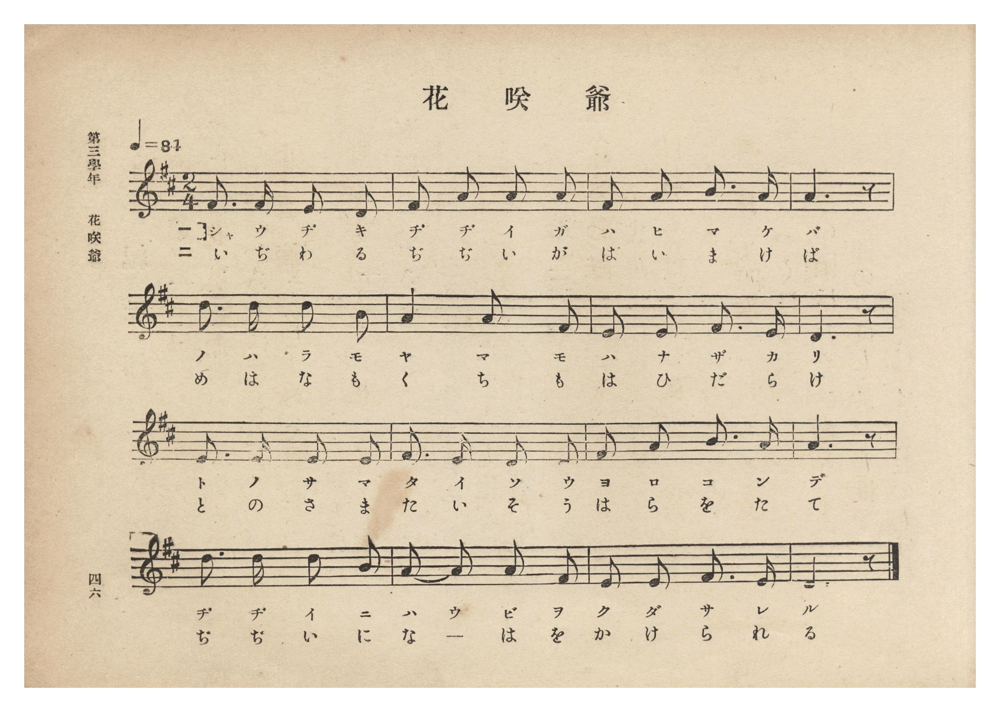
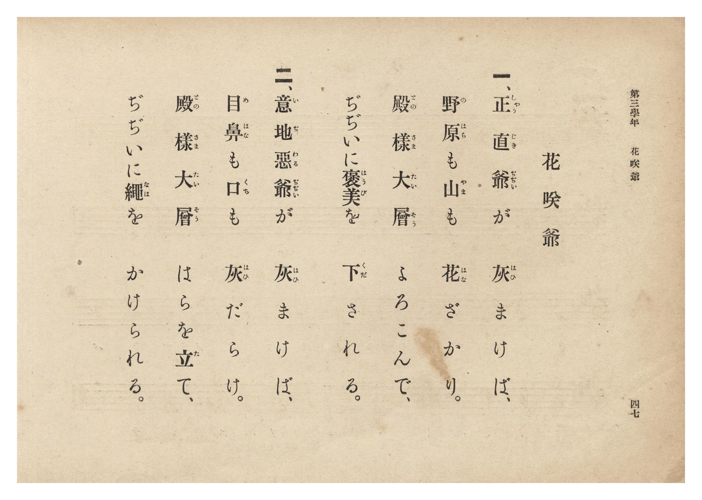

# 花咲爺

> Re:Shōka 使用 AI 協助辨識與重建樂譜，可能會有錯誤。歡迎回報。

- **鋼琴伴奏版**：<br><audio controls src="hanasaka_jijii.mp3"></audio>
- **NEUTRINO 歌聲合成版**：<br><audio controls src="hanasaka_jijii_neutrino.mp3"></audio>

- 文部省《尋常小學唱歌》
- 臺灣總督府《公學校唱歌集》（大正四年三月，索書號 0725 26）

## 說明

原書資訊與歌詞全文（對應 P052.jpg–P053.jpg，原書 p. 46–47，第三學年第 7 首）：
出處原曲：文部省編纂《尋常小學唱歌》第一學年〈花咲爺〉（明治 44 年／1911 年）
調性與拍號：ニ長調 2/4 拍子，♩= 84


## 歌詞

```text
一、正直爺（しやうぢきぢぢい）が　灰（はひ）まけば、
野原（のはら）も山（やま）も　花（はな）ざかり。
殿樣（とのさま）大層（たいそう）　よろこんで、
ぢぢいに褒美（はうび）を　下（くだ）される。

二、意地惡爺（いぢわるぢぢい）が　灰（はひ）まけば、
目鼻（めはな）も口（くち）も　灰（はひ）だらけ。
殿樣（とのさま）大層（たいそう）　はらを立（た）て、
ぢぢいに繩（なは）を　かけられる。
```

## ABC

```abc
X:1
T:花咲爺
M:2/4
L:1/16
Q:1/4=84
K:D
V:V1 name="Piano" snm="Pia"
[V:V1]
F3 F E2 D2 | F2 A2 A2 A2 | F2 A2 B3 A | A6 z2 |
w: 1.~しゃ う ぢ き | ぢ ぢ い が | は ひ ま け | ば
w: 2.~い ぢ わ る | ぢ ぢ い が | は ひ ま け | ば
d3 d d2 B2 | A4 A2 F2 | E2 E2 F3 E | D6 z2 |
w: 1.~の は ら も | や ま も | は な ざ か | り
w: 2.~め は な も | く ち も | は ひ だ ら | け
E3 E E2 E2 | F3 E D2 E2 | F2 A2 B3 A | A6 z2 |
w: 1.~と の さ ま | た い そ う | よ ろ こ ん | で
w: 2.~と の さ ま | た い そ う | は ら を た | て
d3 d d2 B2 | A2 A2 A2 F2 | E2 E2 F3 E | D6 z2 |
w: 1.~ぢ ぢ い に | は う び を | く だ さ れ | る
w: 2.~ぢ ぢ い に | な _ は を | か け ら れ | る
```

## TMD 檔案連結

- [主旋律 TMD 檔案](hanasaka_jijii.tmd) [[在 TMD Studio 編輯](https://tmdlang.github.io/Tmd-TS/#tmd=s7IKdvYPcrWy4qpTUCpJTLdSSM7PyUlNLsnMz7PKzk9PzM7Ojy_OyM9OLM4ojTe0NDRVgqssy88pzU21Si9KTEmNN0aIF-eXFiWnWhUnZ-Tn58SXpFaUJOXnZ6PLxxckpqdaBRiYGiFkCoryy1LzEvOAuguKMvNKUlPA2hEKUssyU1JB0sXJiXnxZalFmWmZqSlITkotKga5HGpFSVFiXnFyUWYByDsIVflFJRn5QGcXZFRaZWQWl-QXZSYn5sRnJ-YlIhSVZKQCPZeWn5Odk1-Uiqw5Mz0zzyo3Py-pFBgwSlxaWgovujY-nbTpeccuBS0tLkVbBQsTLntbBRcuGyN9EzuQzmfT2l82r3g-p_FxQ9fTDd1Pd-x4uqH_6dodT6dsfLa253FDN9j8F-27njcufr5j7_O5i5_umgNS27oGqOrZgoUQhS9ntwHVvt_T8XTJ8mdrFz-dPfvpzi1PdnQ-m9Pxfk_P8y2Lns3e8WLmfAUDcyNTBSOz93s6lbi49LUUbKkFuBQUFJ72zQdZs7n9xYquFx3tQGe9WDnvaesKoB9BLtvQ-6y9UwEUr3pZBemPGiYDmcYgJtCFEK0KBXoKJmZAGRNzkKvXrAH6ABQWO7cA2QrmCi-XTQO6_P2eWWDb2ne9mDkVrHETUAgekM-3r3i-qwlXcIINbYAY-rihAx4_jxuA5nY8m9H3bNNuBRMTBaD0-z39wGRtCGF2gqx8sWr_s4blIK919wJDE2jr4-bul1O3A8UVgBGqABR-unYC0OmPZq4ExzVIE9C6xw2NwEh5PnsL0CKgLY8bpz9uannc2Pa4cdHjxl4wCUQtQFseNwId2fC8cQNY2frHjUCvAQX3PW6c-LhxA9AckIkv2_uA3garWAdS1AR0eufjpqanGzeCBEFG74OIAM0C-hBm1iqwWdMeN3Y_bup63NAEMuvZuv3PViwGq1gBNm4qRDMwHT3duAQsPh_otMeNc4HuBelvaHjcBLQD6OrJj5smP25cDnUU3BePG1e_WDLp-b4-mLVAb24GO2cSUPOTHaBU-rix_3HjArBzpj5u6nnc1A1yDji0dgEDoPFZS__TORueNS-EBRjQ1EWPm_pBCkkNreez173csxscMI2IYACGVj_E20CXLISHFoZZC4ChCzKO_NACRxDQ889XQ3wOjDigicuwBNvznSvBKlYB9cADDBRbQPtBRsDCCaiN8gwLBQpa-lxcHsDyrTgxO9ErMysz0yogMzEv36HGoKYaZJOCjaGZlh2Yha28UIBkqBcLexQ0gLlmQ__z9Q068EyuiUUD0EKQYTUKxgq6QGisYAQkDYEYImKKhBEiZmC1pkAREA8GDUBqwKb5GNYAgxKYrZrBEsDQB4UsmNULNgjGg5AtYLIHKrMezNsEJvdB9U8Ey2xAsiweYZkRSA5kBsREYMIEsZq6qWoT_iDf1UNOkBvGgS0AUmAWKFQRIQqiQeFdA44REIbEkBFII55QXwf1yHpgEHSCA6IJ4t0mSBDBPAsXhwbDKjA5DaqiG6yjC3eANzUi7IHohZsHCn6I3EIs9kCCewFEBdCFIJmJJAb3jk5yghsUhqDwg4UnLM0bgcMTIUJ8Cl8B9ec6IJ4KD1mQzHyoTAsQzwWz2qCx0AH2NygbAMtsaChMButZjju0ybEJEt7QNDAJqmo-WGYZaeENbL9QNXnDMDnJG5SPofkcmptXI3sX7HlgDQf3NCxBQpIcJPBAcj3gyACVEbiCHLdNoOQOS_zI9oBMgyRmSLDjs6eWi0vXTgGlqFcACihzAQA)]
- [鋼琴伴奏 TMD 檔案](hanasaka_jijii_piano.tmd) [[在 TMD Studio 編輯](https://tmdlang.github.io/Tmd-TS/#tmd=s7IKdvYPcrWy4tLSUnjRtfHppE3PO3a939PxsnvP8wlbnuzZ8nRp__POjvd7OhW0tLgUbRUsTLjsbRVcuGyM9E3suOoUlJ5Na3_ZvOL5nMbHDV1PN3Q_3bHj6Yb-p2t3PJ2y8dnanscN3UogVS_adz1vXPx8x97ncxc_3TUHpLZ1DVDVswULIQpfzm4DqgXa_HTJ8mdrFz-dPfvpzi1PdnQ-mwO0vOf5lkXPZu94MXO-goG5kamCkRnQQUpcXB6JeYnFidmJXplZmZlWAZmJeflBHg41BjXVXApAYGNopmUHZulrKdiiA4Xna9Y82dHwYmGPgoaJAtDRz9c36CgEGJga6WUVpGti0aClDzasRsFYQRcIjRWMgKQhEENETJEwQsQMrNYUKALiwaABSA3YNB_DGoXHjdMfNzWDJR43tgHxIjCrF2wQjAchW8BkD1RmPZi3CUzug-qfCJbZgGRZPMIyI5AcyAyIiY-b-kGspm6q2oQ_yHf1kBPkhnFgC4AUmAUKVUSIgmhQeNeAYwSEITFkBNKIJ9TXQT2yHhgEneCAaIJ4twkSRDDPwsWhwbAKTE6DqugG6-jCHeBNjQh7IHrh5oGCHyK3EIs9kOBeAFEBdCFIZiKJwb2jk5zgBoUhKPxg4QlL80bg8ESIEJ_CV0D9uQ6Ip8JDFiQzHyrTAsRzwaw2aCx0gP0NygaPGydDQ2EyWM9y3KFNjk2Q8IamgUlQVfPBMstIC29gwUXV5A3D5CRvUD6G5nNobl6N7F2w5x83boZ7GpYgIUkOEngguR5wZIDKCFxBjtsmUHKHJX5ke0CmQRIzJNjx2VOLtaT3QS7pTaAFPTBA4hWiDWPRGSYghml8PDCMIO6uUTCBCcMVguSjTeOhYgiVqOIUGwr0jq6dAoqPon2AajEFjcCCylwA)]

## 分析

```text
================================================================================
📊 TMD Song Profile: [ 花咲爺 ]
================================================================================
⏱  Duration:       0:22 (22.9s), 16 measures total
🎼 Key & Tempo:    首調基準 D, != 84.0 BPM, <2/4>
   - 分析範圍：      由實際發聲的音符與和弦推測調性；播放脈絡另行呈現
🎤 人聲音域:    D4 (MIDI 62) – D5 (MIDI 74) [跨度: 12 個半音 / 1.0 個八度, 難度: easy]
   - 最低音:  D4 in [HanasakaJijii #1 @ m.1, 0:01]
   - 最高音: D5 in [HanasakaJijii #1 @ m.5, 0:05]
   - 適合: soprano, mezzo-soprano, contralto, tenor, baritone, bass
🏛  結構:      HanasakaJijii (22.9s)
⚡ 編曲密度:        Peak 1 軌道同時演奏
🗝  調性診斷：       D 調性不明確（純淨自然大調，未偵測到可信轉調）
   - 風格氣質:    純淨自然大調（陽光明朗、易唱易記，無明顯調外色彩）
   - 轉調歷程:    全曲維持單一推測調性（未偵測到可信轉調）
   - 核心骨幹音:  A, D, E, F#, B
   - 調性數值:    D 調性不明確 [相關度: 0.83, 穩定度: Ambiguous, 自然音純度: 100.0%]
   - 候選調性 (K-S): D 大調 (0.83), A 大調 (0.83), F# 小調 (0.65)
   - 五度圈歷程:   +2
   - 各段落調性細節:
     • [HanasakaJijii #1]: D 調性不明確 (r: 0.83, 自然音純度: 100.0%)

  [ 五度圈游移軌跡 ]
               C  
         F            G  
      Bb              [D ]*
      Eb               A  
         Ab           E  
            Db       B  
               F# 
     (* = active key center)

  [ 十二半音累積音高分佈 ]
     C  :                            0.0%
     C# :                            0.0%
     D  : ███████████████████       23.3%
     D# :                            0.0%
     E  : ███████████████           19.2%
     F  :                            0.0%
     F# : ███████████████           19.2%
     G  :                            0.0%
     G# :                            0.0%
     A  : ████████████████████████  30.0%
     A# :                            0.0%
     B  : ███████                    8.3%
--------------------------------------------------------------------------------
Assignment 軌道音域：
  - Piano         : D4 – D5 (12 個半音 / 1.0 個八度, 51 個音符)
================================================================================
```


## 原書掃描頁






