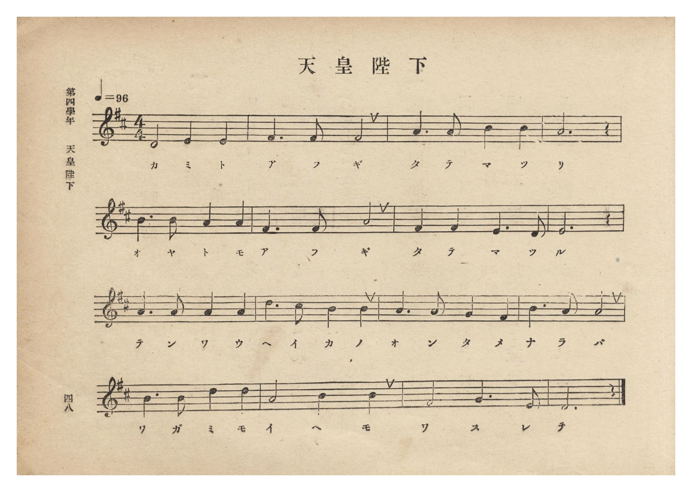
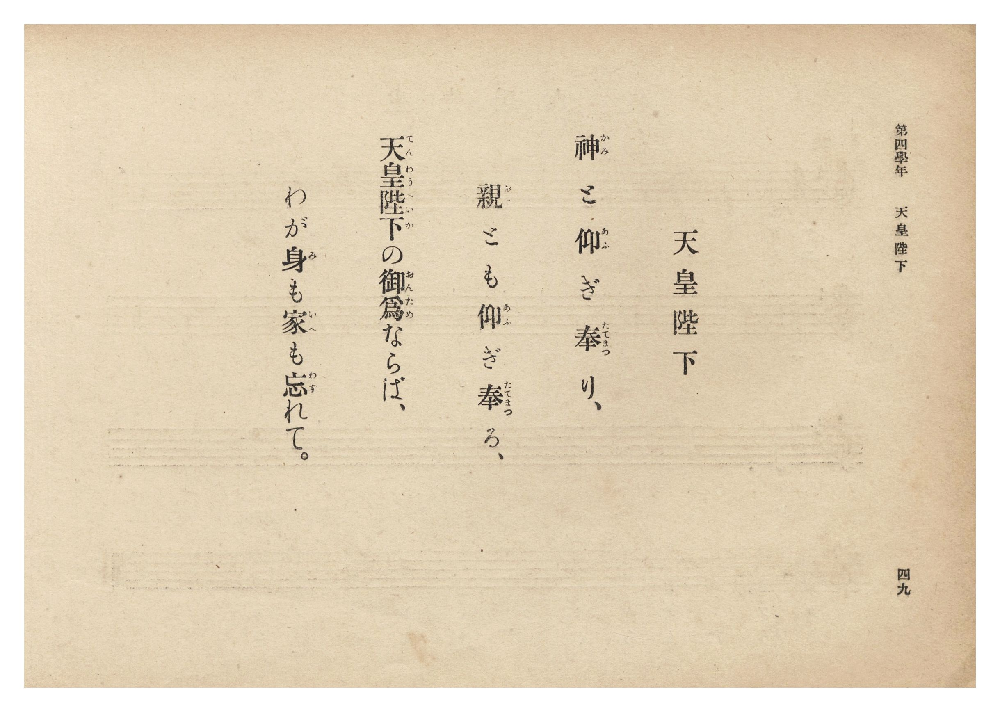

# 天皇陛下

> Re:Shōka 使用 AI 協助辨識與重建樂譜，可能會有錯誤。歡迎回報。

- **鋼琴伴奏版**：<br><audio controls src="tenno_heika.mp3"></audio>
- **NEUTRINO 歌聲合成版**：<br><audio controls src="tenno_heika_neutrino.mp3"></audio>

- 文部省《尋常小學唱歌》
- 臺灣總督府《公學校唱歌集》（大正四年三月，索書號 0725 26）

## 說明

原書資訊與歌詞全文（對應 P054.jpg–P055.jpg，原書 p. 48–49，第四學年第 1 首）：
出處原曲：文部省編纂《尋常小學唱歌》第二學年〈天皇陛下〉（明治 44 年／1911 年）
調性與拍號：ニ長調 4/4 拍子，♩= 96

## 歌詞

```text
神（かみ）と仰（あふ）ぎ奉（たてまつ）り、
親（おや）とも仰（あふ）ぎ奉（たてまつ）る、
天皇陛下（てんわうへいか）の御爲（おんため）ならば、
わが身（み）も家（いへ）も忘（わす）れて。
```

## ABC

```abc
X:1
T:天皇陛下
M:4/4
L:1/16
Q:1/4=96
K:D
V:V1 name="Piano" snm="Pia"
[V:V1]
D8 E4 E4 | F6 F2 F8 | A6 A2 B4 B4 | A12 z4 |
w: か み と | あ ふ ぎ | た て ま つ | り
B6 B2 A4 A4 | F6 F2 A8 | F4 F4 E6 D2 | E12 z4 |
w: お や と も | あ ふ ぎ | た て ま つ | る
A6 A2 A4 A4 | d6 c2 B4 B4 | A6 A2 G4 F4 | B6 A2 A8 |
w: て ん わ う | へ い か の | お ん た め | な ら ば
B6 B2 d4 d4 | A8 B4 B4 | F8 G6 E2 | D12 z4 |
w: わ が み も | い へ も | わ す れ | て
```

## TMD 檔案連結

- [主旋律 TMD 檔案](tenno_heika.tmd) [[在 TMD Studio 編輯](https://tmdlang.github.io/Tmd-TS/#tmd=s7IKdvYPcrWy4qpTUCpJTLdSSM7PyUlNLsnMz7PKzk9PzM7Ojy_OyM9OLM4ojTe0NDRVgqssy88pzU21Si9KTEmNN0GIF-eXFiWnWhUnZ-Tn58SXpFaUJOXnZ6PLxxckpqdaBRiYIuksKMovS81LzAPqLijKzCtJTQFrRyhILctMSQVJFycn5sWXpRZlpmWmpiA5KbWoGORyqBUlRYl5xclFmQUg7yBU5ReVZOQDnV2QUWmVkVlckl-UmZyYE5-dmJeIUFSSkQr0XGZuAdCSxBwlLi0thadLVj6f1f5y5uwnO7oVtLS4FG0VLM247G0VXLhsTPRN7EB6n01rf9m84vmcxscNXU83dD_dsePphv6na3c8nbLx2dqexw3dYBtetO963rj4-Y69z-cufrprDkht6xqgqmcLFkIUvpzdBlT7fk_H0yXLn61d_HT27Kc7tzzZ0flsTsf7PT3Ptyx6NnvHi5nzFQzMjUwVjMze7-lU4uLS11KwpRbgUlBQeNo3H2TN5vYXK7pedLQDnfVi5bynrSuAfgS5bEPvs_ZOBVAM6mUVpD9qmAxkmoKYQBdCtCoU6CmYWABlTCxBrl6zBuQPYFjs3AJkKxgqvFw2Dejy93tmgW1r3_Vi5lSwxk1AIXhAPt--4vmuJlzBCTToya4eiKGPG4DBhYiixw1Aozuezeh7tmm3gomJAlDF-z39wDRsCGF2gmx9sWr_s4blIN919wIDFGjx4-bul1O3A8UVgHGqABR-unYC0PWPZq4ERzdI0_Ol84AmP27sfty4H2jO48YVT3ZvAIs0PW7cChbpe7oUZPvjxvmPG5c9btz3uHEJSLyp63FDI9jeZavA0l2Pm1ogRjxuaiLaFKDfwKYgexesbtnjpsmPm_ofN7Y9btzxuLEF6EawQeue7lv4vAMYrhArJ4NMbGoES6163AQkN0BNBGvuebFrNVgp2HdNTU_XbQNzgcbtgIrsnwESASmeCRbpAdnd0AQygvLEBwUKWvpcXCGpeXn5HqmZ2YlWAZmJefkONQY11SBrFGwstOzADGzpXgGUMHY0vFjYo6ABjPoN_c_XN-jAE6smFg1Ay0CG1QDTpS4YGkFxjYIxmG8MpUEipmDaVMEMSIIwTAQCDUAiYNN8ahSAUQAVBoYnmFwB1gCMZqjoViDugxsNjBqo-DIg3gdmLYHINHUhWRIPtgR_AOzqIScAQB4CeQvkJRBGBADMkxAREAYFkC4wyGqgLKwBAHE2MKVDPQ9MQEQEASgAQCQoCCCBAAoCWGASGwQ7OskJAlj8IoLAMA4sZI4R5aYKJtCwgIUcRBvYK4gwAPkF5PPJoCwG9k8b1K87oP4DhQ7Id8DcCpWBhRtQDyREmhqhMqugMp1A9ga4ZXhDAlj2UpIYwP4HE4i0jggKWM4ABQUoUSByEWZyAHsf5M0eWI6AJ4cWqAZIoMDFoTpA4jOhHu8Bq4cEKnJiqOXi0rVTQBQaCkCeMhcA)]
- [鋼琴伴奏 TMD 檔案](tenno_heika_piano.tmd) [[在 TMD Studio 編輯](https://tmdlang.github.io/Tmd-TS/#tmd=s7IKdvYPcrWy4tLSUni6ZOXzWe0vZ85-sqP7_Z6Ol917nk_Y8mTPlqdL-593drzf06mgpcWlaKtgacZlb6vgwmVjom9ix1WnoPRsWvvL5hXP5zQ-buh6uqH76Y4dTzf0P1274-mUjc_W9jxu6FYCqXrRvut54-LnO_Y-n7v46a45ILWta4Cqni1YCFH4cnYbUC3Q5qdLlj9bu_jp7NlPd255sqPz2Ryg5T3Ptyx6NnvHi5nzFQzMjUwVjMyADlLi4gpJzcvL90jNzE60CshMzMsP8nCoMaip5lIAAhsLLTswQ19LwRYdKDxfs-bJjoYXC3sUNEwUgA5-vr5BRyHAwNREL6sgXROLBi19sGE1CoYKumBoBMU1CsZgvjGUBomYgmlTBTMgCcIwEQg0AImATfOpUXjc2A0Vfty4H0yuAGt43NgEFd0KxH1wox83zoeKLwPifWDWEohMUxeSJfFgS_AHwK4ecgIA5CGQt0BeAmFEAMA8CREBYVAA6QKDrAbKwhoAEGc_bmqBev5xE8jrhIIAFAAgEhQEkEAABQEsMIkNgh2d5AQBLH4RQWAYBxYyx4hyUwUTaFjAQg6iDewVRBiA_ALy-WQg7gf7pw3q1x1Q_4FCB-S7x43roDKwcAPqgYRIUyNUZhVUphPI3gC3DG9IADMcJYkB7H8wgUjriKCA5QxQUIASBSIXYSYHsPdB3uyB5Qh4cmiBaoAEClwcqgMkPhPq8R6wekigIieGWswywwe5zDCBlhlAB8YrRBvGKpjGA2nT-FiECJSC802AlAmqvAHUOzUwSXQ96HyQLabxoKCDWQdiIIzBog2oHN1msGawPJq1-B2D1Rh0L4PcAgw8XTsFRPhF-8QqAAWUuQA)]

## 分析

```text
================================================================================
📊 TMD Song Profile: [ 天皇陛下 ]
================================================================================
⏱  Duration:       0:40 (40.0s), 16 measures total
🎼 Key & Tempo:    首調基準 D, != 96.0 BPM, <4/4>
   - 分析範圍：      由實際發聲的音符與和弦推測調性；播放脈絡另行呈現
🎤 人聲音域:    D4 (MIDI 62) – D5 (MIDI 74) [跨度: 12 個半音 / 1.0 個八度, 難度: easy]
   - 最低音:  D4 in [TennoHeika #1 @ m.1, 0:00]
   - 最高音: D5 in [TennoHeika #1 @ m.10, 0:22]
   - 適合: soprano, mezzo-soprano, contralto, tenor, baritone, bass
🏛  結構:      TennoHeika (40.0s)
⚡ 編曲密度:        Peak 1 軌道同時演奏
🗝  調性診斷：       A 調性不明確（純淨自然大調，未偵測到可信轉調）
   - 風格氣質:    純淨自然大調（陽光明朗、易唱易記，無明顯調外色彩）
   - 轉調歷程:    全曲維持單一推測調性（未偵測到可信轉調）
   - 核心骨幹音:  A, B, F#, D, E
   - 調性數值:    A 調性不明確 [相關度: 0.78, 穩定度: Ambiguous, 自然音純度: 95.9%]
   - 候選調性 (K-S): A 大調 (0.78), D 大調 (0.77), F# 小調 (0.67)
   - 五度圈歷程:   +3
   - 各段落調性細節:
     • [TennoHeika #1]: A 調性不明確 (r: 0.78, 自然音純度: 95.9%, 調外音: G)

  [ 五度圈游移軌跡 ]
               C  
         F            G  
      Bb               D  
      Eb              [A ]*
         Ab           E  
            Db       B  
               F# 
     (* = active key center)

  [ 十二半音累積音高分佈 ]
     C  :                            0.0%
     C# : █                          0.8%
     D  : ███████████               14.8%
     D# :                            0.0%
     E  : █████████                 11.5%
     F  :                            0.0%
     F# : ██████████████            18.0%
     G  : ███                        4.1%
     G# :                            0.0%
     A  : ████████████████████████  32.0%
     A# :                            0.0%
     B  : ██████████████            18.9%
--------------------------------------------------------------------------------
Assignment 軌道音域：
  - Piano         : D4 – D5 (12 個半音 / 1.0 個八度, 49 個音符)
================================================================================
```


## 原書掃描頁






