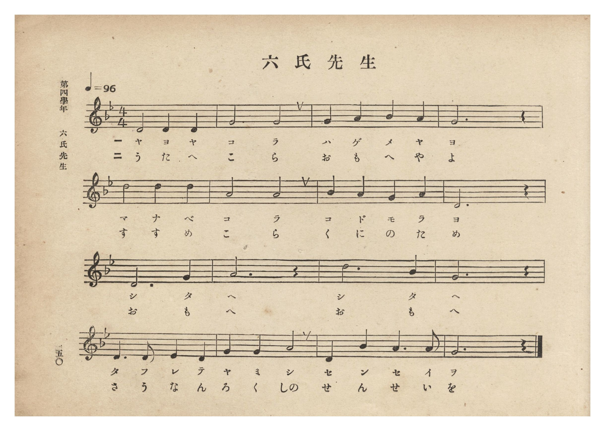
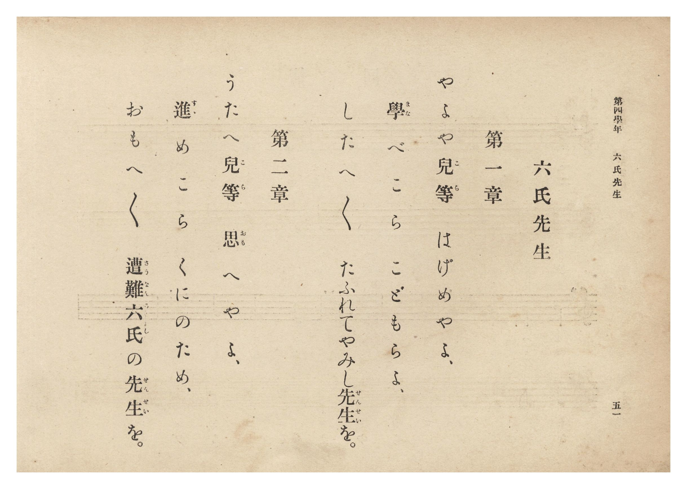

# 六氏先生

> Re:Shōka 使用 AI 協助辨識與重建樂譜，可能會有錯誤。歡迎回報。

- **NEUTRINO 歌聲合成版**：<br><audio controls src="rokushi_sensei_neutrino.mp3"></audio>
- **鋼琴伴奏版**：<br><audio controls src="rokushi_sensei.mp3"></audio>


- 曲：宮島慎三郎
- 臺灣總督府《公學校唱歌集》（大正四年三月，索書號 0725 26）

## 說明

原書資訊與歌詞全文（對應 P056.jpg–P057.jpg，原書 p. 50–51，第四學年第 2 首）：
作曲：臺灣總督府國語學校助教授 宮島慎三郎（據卷首〈緒言〉）
調性與拍號：ト短調（G 小調，2 個降記號）4/4 拍子，♩= 96


## 跨冊／重複收錄參照

> 同曲（《公學校唱歌》、《公學校唱歌集》、《新定兒童唱歌》共同收錄教材）

- **[同曲]** 《公學校唱歌》第五學年用（昭和13年／1938）：[**〈六氏先生〉**](../../kogakko_shoka/grade_5/18_rokushi_sensei/index.md)（`B,` / `4/4` — [原始 TMD](../../kogakko_shoka/grade_5/18_rokushi_sensei/rokushi_sensei.tmd)）
- **[同曲]** 《新定兒童唱歌》尋常科第五學年用（2020.006.0847.0005）：[**〈六氏先生〉**](../../shintei_jido_shoka/grade_5_2020.006.0847.0005/3_03_rokushi_sensei/index.md)（`B,` / `4/4` — [原始 TMD](../../shintei_jido_shoka/grade_5_2020.006.0847.0005/3_03_rokushi_sensei/rokushi_sensei.tmd)）
- 總表：[跨冊重複與同名歌曲總索引](../../duplicate_songs.md)

## 歌詞

```text
第一章
やよや兒等（こら）　はげめやよ、
學（まな）べこら　こどもらよ、
したへ／＼
たふれてやみし先生（せんせい）を。

第二章
うたへ兒等（こら）　思（おも）へやよ、
進（すゝ）めこら　くにのため、
おもへ／＼
遭難六氏（さうなんろくし）の先生（せんせい）を。
```

## ABC

```abc
X:1
T:六氏先生
C:曲：宮島慎三郎
M:4/4
L:1/16
Q:1/4=96
K:Gm
V:V1 name="Piano" snm="Pia"
[V:V1]
d8 d4 d4 | g8 g8 | g4 a4 b4 a4 | g12 z4 |
w: 1.~や よ や | こ ら | は げ め や | よ
w: 2.~う た へ | こ ら | お も へ や | よ
d'8 d'4 d'4 | a8 a8 | b4 a4 g4 a4 | d12 z4 |
w: 1.~ま な べ | こ ら | こ ど も ら | よ
w: 2.~す す め | こ ら | く に の た | め
d12 g4 | a12 z4 | d'12 b4 | g12 z4 |
w: 1.~し た | へ | し た | へ
w: 2.~お も | へ | お も | へ
d6 d2 e4 d4 | g4 g4 a8 | d4 b4 a6 a2 | g12 z4 |
w: 1.~た ふ れ て | や み し | せ ん せ い | を
w: 2.~さ う な ん | ろ く しの | せ ん せ い | を
```

## TMD 檔案連結

- [主旋律 TMD 檔案](rokushi_sensei.tmd) [[在 TMD Studio 編輯](https://tmdlang.github.io/Tmd-TS/#tmd=s7IKdvYPcrWy4qpTUCpJTLdSSM7PyUlNLsnMz7PKzk9PzM7Ojy_OyM9OLM4ojTe0NDRVgqssy88pzU21Si9KTEmNN0GIF-eXFiWnWhUnZ-Tn58SXpFaUJOXnZ6PLxxckpqdaBRiYmiFkCoryy1LzEvOAuguKMvNKUlPA2hEKUssyU1JB0sXJiXnxZalFmWmZqSlITkotKga5HGpFSVFiXnFyUWYByDsIVflFJRn5QGcXZFRaZWQWl-QXZSYn5sRnJ-YlIhSVZKQCPQeRrkQXhvotJzMtVYlLS0vhaevaZxv6n7Z2PJ8yX0FLi0vRVsHSjMveVsFJhys7tdJWwT2Xy8ZE38QOZM6z2Zve75n1dN26p5u3PWvte7Kj82VzH9iGF-27njcufr5j7_O5i5_umvO4oetp65qna3c8W7Dw6ZSNz9b2vJzd9rih-_2ejqdLlj9bu_jp7NlPd24BGvBsTsf7PT3Ptyx6NnvHi5nzFQzMjUwVjMze7-lU4uLS11KwpRbgUlBQeNo3H2TN5vYXK7pedLQDnfVi5bynrSueTWsHuWxD77P2TgVQxOplFaQ_apgMZJqDmEAXQrQqFOgpmBoAZUwNQa5eswbkj7U7gF4BshWMFF4umwZ0OTCMQLY92TsHEmBogfN0TveLVfOggdO18tnUmc_6OhTQQhXonmeTZz3t3Q408nFDx_Ptk16saHjcADS7E2T2i1X7nzUsB_mhuxcYbEBLHjd3PJ-_FigO1Omu8HRDP5jZY6TwtKH75czeFytmgNV1AuNSAajp6doJQNlHM1eC4xtkJNAHT3Y0PF-9AMR53NTyuKkDSD5tnfR8LdDWjseNkx83gax_3NDwuHH948ZJj5saocoaGsGhu3YHWN2-x42rQOoad0L0gDVMfty48nFTE4gL1_C4cfrjxvmPG4Ha-t_v2QMRAvK3Pm7qedy4DGR4436gIkjqBJs9-3ET0KTZjxtbQDY0TXrc0AR3_K4emOMb2yDmYnX8s4a5YJEuoHPAztyB4ouXDcAoA0rPfNwEVAe0oxHJF_2PG1c_blwHMh0oDvMFyCQUX7xsXPty9mJI1gIbNhXspFUgxzf1go2ZDrZ6HQGvAc2iPOVDgYKWPhdXUH52aXFGZnBqXnFqplVAZmJevkONQU01yCYFGwstOzADW76Dpo8XC3sUNExA6ev5-gYdeGbRxKIBaB_IsBoFYwVdMATRIFyjYAYVgdEQEXMgNoyDMhCKQNAAJAI2zsewBpQ6oeLAeAOTID5QvHEyXLwTbjQwtYJEGieBxRuR1YN1w2A8wg4jkK42mFmN88HkDrx2dIFFmuAq8dmBP5B39ZAVyKCAA4cyiAEmasABCYIwugYRvrAAR0QPlnBu3AcPg1VgcifeMACJAvM5IiTAsoTCeSbcDhALEkO47egHq1wNJteBSVDsgOwA6SMlnHd0UpKYYckXEcjw8EPEBQiCQxxvam6cjiQH9w84FaH4h3iVSKELSpdwHeBYwWU2kSrxhyqwQiQ_VI0VTMAkLLxgaRQS9yBxePIFkfgDFRQ4oEDaCvRMD5i1DOIlcMYE1ixgEhagIB2zwR6HJGIQG0S3gHWAig5cATwVqrINlknAJoB09YLFIQkWWNOBUis5VtVycenaKaCU3ApAAWUuAA)]
- [鋼琴伴奏 TMD 檔案](rokushi_sensei_piano.tmd) [[在 TMD Studio 編輯](https://tmdlang.github.io/Tmd-TS/#tmd=s7IKdvYPcrWy4tLSUnjauvbZhv6nrR3Pp8x_v6fjZfee5xO2PNmz5enS_uedHe_3dCpoaXEp2ipYmnHZ2yo46XBlp1baKrjnctmY6JvYcdUpKD2bven9nllP1617unnbs9a-Jzs6Xzb3KYFkXrTvet64-PmOvc_nLn66a87jhq6nrWuert3xbMHCp1M2Plvb83J22-OGbqC1T5csf7Z28dPZs5_u3AI04NkcoM09z7csejZ7x4uZ8xUMzI1MFYzMgK5R4uIKys8uLc7IDE7NK07NtArITMzLD_JwqDGoqeZSAAIbCy07MENfS8EWHSg8X7PmyY6GFwt7FDRMFJ5u6H--vkFHIcDA1EwvqyBdE4sGLX2wYTUKxgq6YAiiQbhGwQwqAqMhIuZAbBgHZSAUgaABSARsnI9hjcLjphao-OOmDjAJ4gPFGyfDxTvhRj9uXA8SaZwEFm9EVg_WDYPxCDuMQLraYGY1zgeTO_Da0QUWaYKrxGcH_kDe1UNWIIMCDhzKIAaYqAEHJAjC6BpE-MICHBE9WMK5cR88DFaByZ14wwAk-rhxJSIkwLKEwnkm3A4QCxJDuO3oB6tcDSbXgUlQ7IDsAOkjJZx3dFKSmGHJFxHI8PBDxAUIgkMcb2punI4kB_cPOBWh-Id4lUihC0qXcB3gWMFlNpEq8YcqsCAiP1SNFUzAJCy8YGkUEvcgcXjyBZH4AxUUOKBA2gr0TA-YtQziJXDGfNy4H0zCAhSkYzbY45BEDGKD6BawDlDRgSuAp0JVtsEyCdgEkK5esDgkwU6HpFZyrKrFWnD7IBfcJoiC-0VT6_OVbS_2733WMPfJzm5gLLxYtR8YK8-6e5-unfB0-7Jnnd2QSgpcTzQ83b_1Rdfcpxs3Pt0-DblGQ4qbeIVo49xYOA0M9ngg0yweyEawIKJANYZgEl2RATTMcGkGGw61A8SHmAI1ElkaYRDMPdiNAapDkgEaF22I6XRMw4wwXA93EogBNAPOxzQKGFO6dgookRXtA9SCKWgEFlTmAgA)]

## 分析

```text
================================================================================
📊 TMD Song Profile: [ 六氏先生 ]
================================================================================
⏱  Duration:       0:40 (40.0s), 16 measures total
🎼 Key & Tempo:    首調基準 B,, != 96.0 BPM, <4/4>
   - 分析範圍：      由實際發聲的音符與和弦推測調性；播放脈絡另行呈現
🎤 人聲音域:    D5 (MIDI 74) – D6 (MIDI 86) [跨度: 12 個半音 / 1.0 個八度, 難度: easy]
   - 最低音:  D5 in [RokushiSensei #1 @ m.1, 0:00]
   - 最高音: D6 in [RokushiSensei #1 @ m.5, 0:10]
   - 適合: soprano, tenor
🏛  結構:      RokushiSensei (40.0s)
⚡ 編曲密度:        Peak 1 軌道同時演奏
🗝  調性診斷：       D 大調（流行色彩大調，未偵測到可信轉調）
   - 風格氣質:    流行大調（略帶和弦色彩音與裝飾副屬和弦）
   - 轉調歷程:    全曲維持單一推測調性（未偵測到可信轉調）
   - 核心骨幹音:  D, G, A, A#, D#
   - 調性數值:    D 大調 [相關度: 0.78, 穩定度: Moderate, 自然音純度: 91.5%]
   - 候選調性 (K-S): D 大調 (0.78), G 大調 (0.70), G 小調 (0.68)
   - 五度圈歷程:   +2
   - 各段落調性細節:
     • [RokushiSensei #1]: D 大調 (r: 0.78, 自然音純度: 91.5%, 調外音: D#, A#)

  [ 五度圈游移軌跡 ]
               C  
         F            G  
      Bb              [D ]*
      Eb               A  
         Ab           E  
            Db       B  
               F# 
     (* = active key center)

  [ 十二半音累積音高分佈 ]
     C  :                            0.0%
     C# :                            0.0%
     D  : ████████████████████████  35.6%
     D# : █                          1.7%
     E  :                            0.0%
     F  :                            0.0%
     F# :                            0.0%
     G  : █████████████████████     30.5%
     G# :                            0.0%
     A  : █████████████████         25.4%
     A# : █████                      6.8%
     B  :                            0.0%
--------------------------------------------------------------------------------
Assignment 軌道音域：
  - Piano         : D5 – D6 (12 個半音 / 1.0 個八度, 38 個音符)
================================================================================
```


## 原書掃描頁






