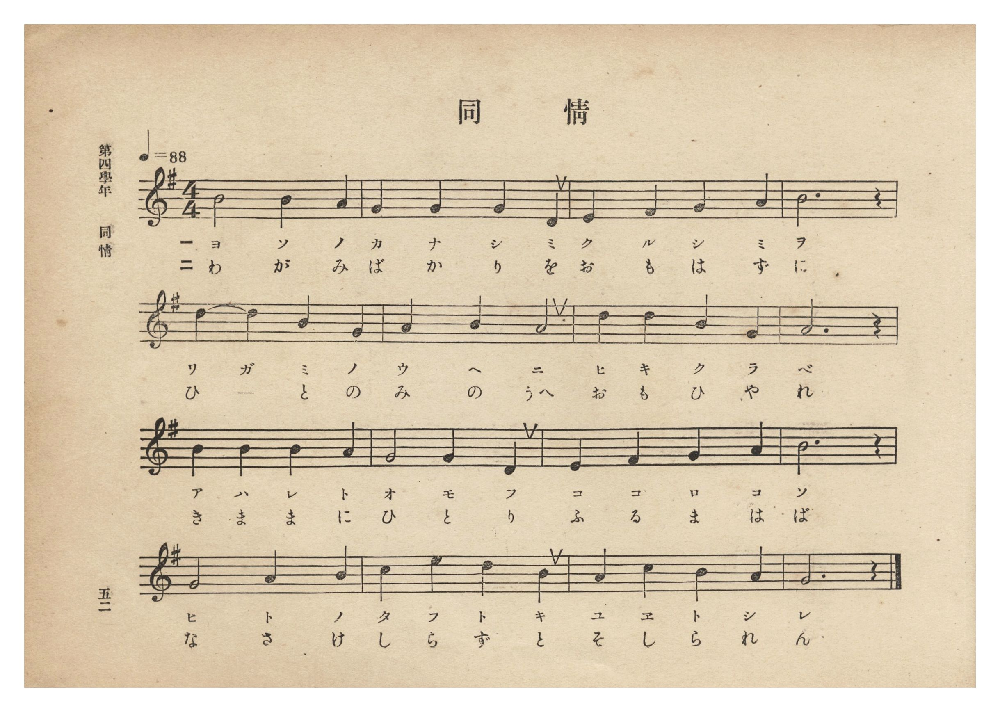
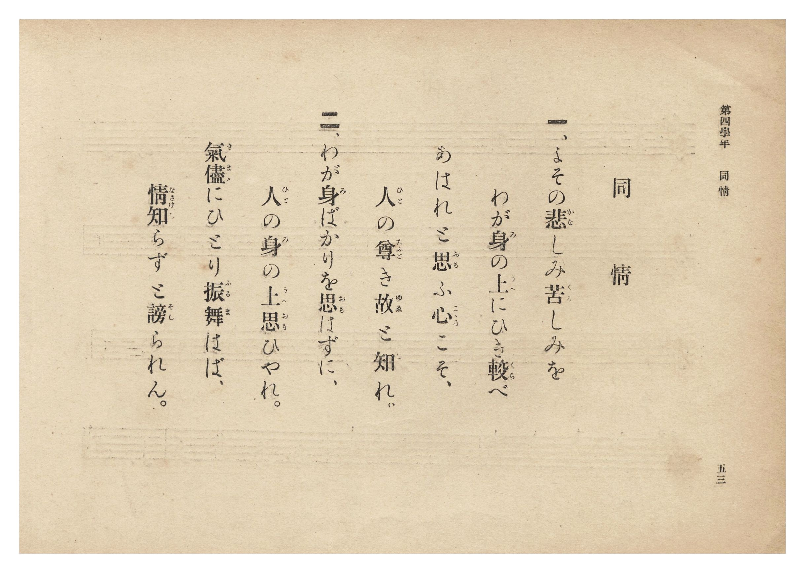

# 同情

> Re:Shōka 使用 AI 協助辨識與重建樂譜，可能會有錯誤。歡迎回報。

- **鋼琴伴奏版**：<br><audio controls src="dojo.mp3"></audio>
- **NEUTRINO 歌聲合成版**：<br><audio controls src="dojo_neutrino.mp3"></audio>

- 文部省《尋常小學唱歌》
- 臺灣總督府《公學校唱歌集》（大正四年三月，索書號 0725 26）

## 說明

原書資訊與歌詞全文（對應 P058.jpg–P059.jpg，原書 p. 52–53，第四學年第 3 首）：
出處原曲：文部省編纂《尋常小學唱歌》第二學年〈同情〉（明治 44 年／1911 年）
調性與拍號：ト長調 4/4 拍子，♩= 88


## 歌詞

```text
一、よその悲（かな）しみ苦（くる）しみを
わが身（み）の上（うへ）にひき較（くら）べ
あはれと思（おも）ふ心（こゝろ）こそ、
人（ひと）の尊（たふと）き故（ゆゑ）と知（し）れ。

二、わが身（み）ばかりを思（おも）はずに、
人（ひと）の身（み）の上（うへ）思（おも）ひやれ。
氣儘（きまゝ）にひとり振舞（ふるま）はば、
情知（なさけし）らずと謗（そし）られん。
```

## ABC

<div class="abc-score" data-abc-src="dojo.abc" aria-label="五線譜載入中"></div>

[下載 ABC 原始檔](dojo.abc)

## TMD 檔案連結

- [主旋律 TMD 檔案](dojo.tmd) [[在 TMD Studio 編輯](https://tmdlang.github.io/Tmd-TS/#tmd=s7IKdvYPcrWy4qpTUCpJTLdSSM7PyUlNLsnMz7PKzk9PzM7Ojy_OyM9OLM4ojTe0NDRVgqssy88pzU21Si9KTEmNN0GIF-eXFiWnWhUnZ-Tn58SXpFaUJOXnZ6PLxxckpqdaBRiYWiBkCoryy1LzEvOAuguKMvNKUlPA2hEKUssyU1JB0sXJiXnxZalFmWmZqSlITkotKga5HGpFSVFiXnFyUWYByDsIVflFJRn5QGcXZFRaZWQWl-QXZSYn5sRnJ-YlIhSVZKQCPZdWlJmal1KckVmArD0zPTPPKjc_L6kUGDRKXFpaCk8n9DxrblXQ0uJStFWwsOCyt1Vw57Ix0TexA2l7Nq39ZfOK53MaHzd0Pd3Q_XTHjqcb-p-u3fF0ysZna3seN3SDDX_Rvut54-LnO_Y-n7v46a45ILWta4Cqni1YCFH4cnYbUO37PR1Plyx_tnbx09mzn-7c8mRH57M5He_39DzfsujZ7B0vZs5XMDA3MlUwMnu_p1OJi0tfS8GWWoBLQUHhad98kDWb21-s6HrR0Q501ouV8562rgD6EeSyDb3P2jsVQNGql1WQ_qhhMpBpCWICXQjRqlCgp2BqBJQxNQa5es0akD-AYbFzC5CtYKzwctk0oMvf75kFtq1914uZU8EaNwGF4AH5fPuK57uacAUn0KAnu3oghj5u6IBEzuMGoKEdz2b0Pdu0W8HERAEo935PPzBJG0KYnSD7Xqza_6xhOchf3b3AoARa-bi54-XU7UBxBWBsKgCFn66dAHT3o5krwREN0vRkR8PjhsbHTR2PG-c-blz3rAnoVCC7-3HjKqCxjxunP27c_6J7GViw_3ETMAahgo-bJoH0P27qf9zY82LXarCK_WDpdU92dIG5bY8bd4BFVj9u3PS4sffFnmaYQUD_AMV3go1obHrcuP5xU8_jxhXPGuaCVXQ9bmoCq9j6dD9Ez-THTXMfN_WCBSeDHNvQCHb_rl1gaaDxKyCWP90AsXw-UDNMsPfZ1FaQYFPb46aJYJEVz-cvBSubDuIC7W5ogoTHLiATGB6YvtoACpUmoMMmYThy_ePGWSBP4nIS_uDBMG7T46YWqJOAxj3bsPhpywywit7HjfuAwYAUpCuALnrWs_5Fxzywgq3AGAKqgTlqA9RFwBQE8-6qx41THzdOhPkbqA7o8hUv1gC5kCQAEwfa3zQZ6gTKcx8UKGjpc3G55GflWwVkJublO9QY1FSDLFCwMdGyAzOwZXkFUJ7Y0fBiYY-CBjDtb-h_vr5BB55PNbFoAFoDMqwGmCV1gdgIyDIEQ9N4INMsXsE8HsgBCYMU6CoYKNSANfgY1gBTdAdQBBgWQLwOqAIY7UC8CoinA_F-sEg_UBVIFC7SNAlsDtB0iDlGILF-sDk9cF0bIGY1dYHVg0RArCYgvR6IZ4FFVsPNwR8cu3rICQ5TIDQG-rwG6HdQsOiiiWGGBdCnUB_AQqMNiHdAXQribwLiXmiYdIJFdmKGBVAVKCxWwE2BmAfJA1CDYIEBNLCpBRyoPUQGxo5O8tIGCELShi6RaaMRGltAp4F8A3E20Gdgh28F8ydDcBMoTCaDReZiCQ-Q7D4oXg0NR2gIAdMHiL8VmsZAKtZD0w9RwQGsk8gJDlAggFJFjYKJghk4TYBShAlSEKGHBXqczoe4GizSC45AYFppmggVmY4WpYiwWAU2ZyoQTwSbA8xVwJQEyhGwMAblRago0ASQOZPh5tRycenaKYAKFQUgrcwFAA)]
- [鋼琴伴奏 TMD 檔案](dojo_piano.tmd) [[在 TMD Studio 編輯](https://tmdlang.github.io/Tmd-TS/#tmd=s7IKdvYPcrWy4tLSUng6oedZc-v7PR0vu_c8n7DlyZ4tT5f2P-_seL-nU0FLi0vRVsHCgsveVsGdy8ZE38SOq05B6dm09pfNK57PaXzc0PV0Q_fTHTuebuh_unbH0ykbn63tedzQrQRS9aJ91_PGxc937H0-d_HTXXNAalvXAFU9W7AQovDl7DagWqDNT5csf7Z28dPZs5_u3PJkR-ezOUDLe55vWfRs9o4XM-crGJgbmSoYmQEdpMTF5ZlXUpRvFZCZmJcf5OFQY1BTzaUABDYmWnZgRo2CoYKugpGCMZBlomCmYApmGQHZxkASIqurYKBQw1WLYpgPDsPiFaINYxVMIRTQSCDDJBYmXAOWMIXIAym4ehCG2uGSn4XPvfpaCrboQOH5mjVPdjS8WNijoGGiAAzb5-sbdBQCDEwt9LIK0jWxaNDSh7rXGOg5mEdBEOiwGgWzeAXzeCAHJAxSAPE_SIOPYY3C46YOoMjjxrlAvA6o4nFjNxCvAuLpQLwfLNIPVAUShYs0TQKbAzQdYo4RSKwfbE4PXNcGiFlNXWD1IBEQqwlIrwfiWWCR1XBz8AfHrh5ygsMUHP-G4BQAChZdNDHMsAD6FOoDWGi0AfEOqEtB_E1A3AsNk06wyE7MsACqAoXFCrgpEPOApoEMgxgECwyggU0t4EDtITIwdnSSlzZAEJYJiEsbjdDYAjoN5BuIs4E-Azt8K5g_GYKbQGEyGSwyF0t4gGT3QfFqaDhCQwiYPkD8rdA0BlKxHpp-iAoOYMFBTnAQW04gwgI9TudDXA0W6QVHIDCtNE2EikxHi1JEWKwCmzMViCeCzQHmKmBKAuUIWBiD8iJUFGgCyJzJcHNQyhT8xRaQgkVytFluLKj0AgrBSzFcpRa6GZCiDmYIzFCoBEwYXhaCMG5TgIoQZSppLqGgENa1UwCX9QpABijwon2AcnC2EZitzAUA)]

## 分析

```text
================================================================================
📊 TMD Song Profile: [ 同情 ]
================================================================================
⏱  Duration:       0:43 (43.6s), 16 measures total
🎼 Key & Tempo:    首調基準 G, != 88.0 BPM, <4/4>
   - 分析範圍：      由實際發聲的音符與和弦推測調性；播放脈絡另行呈現
🎤 人聲音域:    D4 (MIDI 62) – E5 (MIDI 76) [跨度: 14 個半音 / 1.2 個八度, 難度: moderate]
   - 最低音:  D4 in [Dojo #1 @ m.2, 0:04]
   - 最高音: E5 in [Dojo #1 @ m.14, 0:36]
   - 適合: soprano, mezzo-soprano, contralto, tenor, baritone, bass
🏛  結構:      Dojo (43.6s)
⚡ 編曲密度:        Peak 1 軌道同時演奏
🗝  調性診斷：       G 大調（純淨自然大調，未偵測到可信轉調）
   - 風格氣質:    純淨自然大調（陽光明朗、易唱易記，無明顯調外色彩）
   - 轉調歷程:    全曲維持單一推測調性（未偵測到可信轉調）
   - 核心骨幹音:  B, G, A, D, E
   - 調性數值:    G 大調 [相關度: 0.74, 穩定度: Moderate, 自然音純度: 100.0%]
   - 候選調性 (K-S): G 大調 (0.74), B 小調 (0.65), D 大調 (0.56)
   - 五度圈歷程:   +1
   - 各段落調性細節:
     • [Dojo #1]: G 大調 (r: 0.74, 自然音純度: 100.0%)

  [ 五度圈游移軌跡 ]
               C  
         F           [G ]*
      Bb               D  
      Eb               A  
         Ab           E  
            Db       B  
               F# 
     (* = active key center)

  [ 十二半音累積音高分佈 ]
     C  : ███                        3.3%
     C# :                            0.0%
     D  : █████████                 11.7%
     D# :                            0.0%
     E  : ████                       5.0%
     F  :                            0.0%
     F# : ███                        3.3%
     G  : ████████████████████      25.0%
     G# :                            0.0%
     A  : █████████████████         21.7%
     A# :                            0.0%
     B  : ████████████████████████  30.0%
--------------------------------------------------------------------------------
Assignment 軌道音域：
  - Piano         : D4 – E5 (14 個半音 / 1.2 個八度, 48 個音符)
================================================================================
```


## 原書掃描頁






