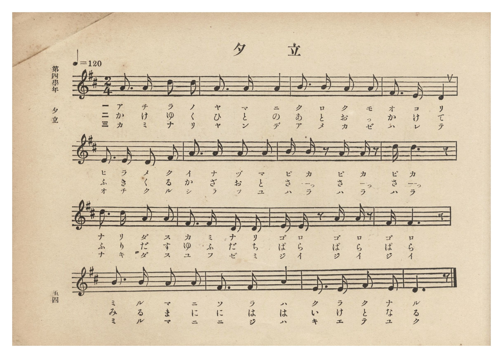
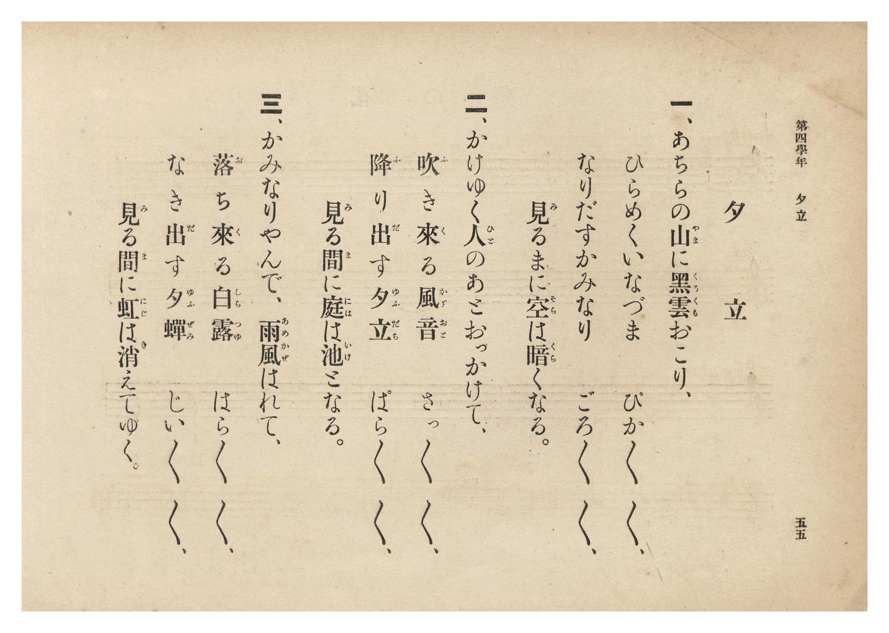

# 夕立

> Re:Shōka 使用 AI 協助辨識與重建樂譜，可能會有錯誤。歡迎回報。

- **NEUTRINO 歌聲合成版**：<br><audio controls src="yudachi_neutrino.mp3"></audio>
- **鋼琴伴奏版**：<br><audio controls src="yudachi.mp3"></audio>


- 詞：公學校用國民讀本
- 曲：宮島慎三郎
- 臺灣總督府《公學校唱歌集》（大正四年三月，索書號 0725 26）

## 說明

原書資訊與歌詞全文（對應 P060.jpg–P061.jpg，原書 p. 54–55，第四學年第 4 首）：
作曲：臺灣總督府國語學校助教授 宮島慎三郎（據卷首〈緒言〉）
調性與拍號：ニ長調 2/4 拍子，♩= 120


## 歌詞

```text
一、あちらの山（やま）に黑雲（くろくも）おこり、
ひらめくいなづま　ぴか／＼／＼、
なりだすかみなり　ごろ／＼／＼、
見（み）るまに空（そら）は暗（くら）くなる。

二、かけゆく人（ひと）のあとおっかけて、
吹（ふ）き來（く）る風音（かざおと）　さっ／＼／＼、
降（ふ）り出（だ）す夕立（ゆふだち）　ぱら／＼／＼、
見（み）る間（ま）に庭（には）は池（いけ）となる。

三、かみなりやんで、雨風（あめかぜ）はれて、
落（お）ち來（く）る白露（しらつゆ）　はら／＼／＼、
なき出（だ）す夕蟬（ゆふぜみ）　じい／＼／＼、
見（み）る間（ま）に虹（にじ）は消（き）えてゆく。
```

## ABC

```abc
X:1
T:夕立
C:曲：宮島慎三郎
M:2/4
L:1/16
Q:1/4=120
K:D
V:V1 name="Piano" snm="Pia"
[V:V1]
A3 A d2 d2 | A3 A A4 | B3 B A2 A2 | F3 E D4 |
w: 1.~あ ち ら の | や ま に | く ろ く も | お こ り
w: 2.~か け ゆ く | ひ と の | あ と お っ | か け て
w: 3.~か み な り | や ん で | あ め か ぜ | は れ て
E3 E D2 F2 | A3 A A2 A2 | B B z2 A A z2 | d d6 z |
w: 1.~ひ ら め く | い な づ ま | ぴ か ぴ か | ぴ か
w: 2.~ふ き く る | か ざ お と | さ っ さ っ | さ っ
w: 3.~お ち く る | し ら つ ゆ | は ら は ら | は ら
d3 d A2 A2 | F3 F D2 D2 | E E z2 A A z2 | F F6 z |
w: 1.~な り だ す | か み な り | ご ろ ご ろ | ご ろ
w: 2.~ふ り だ す | ゆ ふ だ ち | ぱ ら ぱ ら | ぱ ら
w: 3.~な き だ す | ゆ ふ ぜ み | じ い じ い | じ い
B3 B A2 A2 | F3 F A4 | E3 E F2 E2 | D6 z2 |
w: 1.~み る ま に | そ ら は | く ら く な | る
w: 2.~み る ま に | に は は | い け と な | る
w: 3.~み る ま に | に じ は | き え て ゆ | く
```

## TMD 檔案連結

- [主旋律 TMD 檔案](yudachi.tmd) [[在 TMD Studio 編輯](https://tmdlang.github.io/Tmd-TS/#tmd=s7IKdvYPcrWy4qpTUCpJTLdSSM7PyUlNLsnMz7PKzk9PzM7Ojy_OyM9OLM4ojTe0NDRVgqssy88pzU21Si9KTEmNN0GIF-eXFiWnWhUnZ-Tn58SXpFaUJOXnZ6PLxxckpqdaBRiYGSBkCoryy1LzEvOAuguKMvNKUlPA2hEKUssyU1JB0sXJiXnxZalFmWmZqSlITkotKga5HGpFSVFiXnFyUWYByDsIVflFJRn5QGcXZFRaZWQWl-QXZSYn5sRnJ-YlIhSVZKQCPVeemghkFClxaWkpPF0y9fnqbgUtLS5FWwVDIwMue1sFFy4bI30TO5CuFyvnvd8z62nrmqdrdzxbsPD5lBVP53Q_2zDxxbqGZ3PWgA1-NnsTSMm6dU83b3vW2vdkR-fL5j6wzIv2Xc8bFz_fsff53MVPd8153NAFN-jplI3P1va8nN32uKH7_Z6Op0uWP1u7-Ons2U93bgEa8GxOx_s9Pc-3LHo2e8eLmfMVDMyNTBWMzN7v6VTi4tLXUrClFuBSUFB42jcfZM3m9hcrul50tAOdBfT009YVz6a1g1y2ofdZe6cCKEr1sgrSHzVMBjINQUygCyFaFQr0FExNgDKmpiBXr1kD8sfaHUCvANkKJgovl00DuhwYRiDbnuydAwkwtMABBuuLVfOggdO18tnUmc_6OhTQQhXonmeTZz3t3Q408nFDx_Ptk16saHjcADS7E2T2i1X7nzUsB_mhuxcYbEBLHjd3v5y6HSiuAIxQBaDw07UTgG58NHMlJLLBLtoBNKLxcWPT48aFj5s6Hzeue7pxI9Cmx00tjxv3AY1-3Lj65e6JL0Gu7njc2P-4qRdMNoGluh43Tn7c1AU0AWTW48ZNICOagMb1P24E6l_1uHEp0JTHDQ2PG7c8bgTGdf_7PXsgJFzPKpABjQseN84EqnjcuB8qAtIzBWgbFj0vloFSDVApyA1NQD37gI58vnIXWHAu0Algt61_Nms6zM0QEaCjgEZ3P25ognh9Vw_Y60ADJj5uagPKP9kFMWPT48YVYB3rwAGzAuzRxVCVjcugzng6YSdY9Vaw0t4n-9og1kFc9XLRipfzN4NFgNqmgY0AGwry2FSgcVg89nIm0LswE5u6nrZDnLMAbMFMSGYFxw3QsVvBYbYQZuJGsCcJBdXLaZPBXGjEPt21FsxdDQwtaJhtBFoGFAFG3kSwCNDvKGG2A2gdJMxgEQVMKE2THzcuB4q_nL0C6G2wAU3gZABUNgdi8OOmHkTIvZiwF6yoCyy3EC3kns_c-3IOJLlNByfJJUAPw_wJNAibP8FprRczwF7MX4MUYHOgAQEyaAbQkyQH2IuZkCgHBtgMaIBtAxZWQBFgxAG5QMYySFICBRjQOMoLKShQ0NLn4oosTUlMzsi0CshMzMt3qDGoqQbZoWBjaKZlB2ZhKx0VgOUQMJe_WNijoGGi8HRD__P1DTrwIk0TiwagVSDDahRMFXSB0FTBMA5IgQmEGIQGiZiBaTOwCAjXKBiDRYwUDGFqwOb5GNYA46kJLAKMdQVgTIJZ68B6gOkIKrMPiFfDTQeGJUS8qRfKBhY-UJkuqI7JQDEIG26XEUi-Gyo_ESjfBmaB9INkNkFlVkDth9kFcx1IHGQiMJ9CZZDMalyGapcxsvx-UFoEuxKkH8lfTUBXNi7HtKupEaobmD6hMuuhMj0oduGP4V095MSwEVJMgWINNX4hsWkGhAZQMRBdA0oK4NQAgwYoMQwNW2DsgvyGHOqwGF4FxEvBrH1QmS3gMIgHiyHYCBmEXfEoMbwVaiIibYDUIsfHNHhMroDKTAXHKsQuBBshg8UucAzDUhsw5aLZNR3h48YlYBYotUFiEiQKsQvBRsig2kUgD3eSE8PQiAJS6PnTGBzrIAxKB0ZocWwMVYUthkHpG5LCgWUt2G8z0UIdIxc0TgHnYEhIINgIGQIxjGkXOIxB_K1wmYVQEzcihTqCjZDBFcNQf4FTE267QLkU5EOIiTPA6RpiF4KNkCEhhoEtR3JiGFf5a4xURsPyOUgGxAamC5TYRS2jQX6DpG9IDoWUxyCZuVAZUEqHlFKoZTRIHJw3wGEJCjnUvItaPuO2B1L-g3MJij2wEgRUCoPyM0F7wPFK2B5QXCHbA0mPwAodiEElMCJHQ3yKbE8tF5eunQK0blYAMpW5AA)]
- [鋼琴伴奏 TMD 檔案](yudachi_piano.tmd) [[在 TMD Studio 編輯](https://tmdlang.github.io/Tmd-TS/#tmd=s7IKdvYPcrWy4tLSUni6ZOrz1d3v93S87N7zfMKWJ3u2PF3a_7yz4_2eTgUtLS5FWwVDIwMue1sFFy4bI30TO646BaUXK-e93zPraeuap2t3PFuw8PmUFU_ndD_bMPHFuoZnc9YogZQ8m70JpGTduqebtz1r7Xuyo_Nlcx9Y5kX7rueNi5_v2Pt87uKnu-Y8buiCG_R0ysZna3tezm573ABy0dMly5-tXfx09uynO7cADXg2B-ionudbFj2bvePFzPkKBuZGpgpGZkCHKnFxRZamJCZnZFoFZCbm5Qd5ONQY1FRzKQCBjaGZlh2Ypa-lYIsOFJ6vWfNkR8OLhT0KGiYKTzf0P1_foKMQYGBmoJdVkK6JRYOWPtiwGgVTBV0gNFUwjANSYAIhBqFBImZg2gwsAsI1CsZgESMFQ5gasHk-hjUKjxubwCKPGxcqPG7qBLPWgfU8bmqByuwD4tVw0x839kPEm3qh7MdNIDNAMl1QHZOBYhA23C4jkHw3VH4iUL4NzALpB8lsgsqsgNoPswvmOpA4yMTHjYuhMkhmNS5DtcsYWX4_EK8CuxKkH8lfTUBXNi7HtKupEar7ceMcqMx6qEwPil34Y3hXDzkxbIQUU6BYQ41fSGyaAaEBVAxE14CSAjg1wKABSgxDwxYYuyC_IYc6LIZXAfFSMGsfVGYLOAziwWIINkIGYVc8SgxvhZqISBsgtcjxMQ0ekyugMlPBsQqxC8FGyGCxCxzDsNQGTLlodk1H-LhxCZgFSm2QmASJQuxCsBEyqHYRyMOd5MQwNKKAFHr-NAbHOgiD0oERWhwbQ1Vhi2FQ-oak8MeNC8B-m4kW6hi5oHEKOAdDQgLBRsgQiGFMu8BhDOJvhcsshJq4ESnUEWyEDK4YhvoLnJpw2wXKpSAfQkycAU7XELsQbIQMCTEMrAbIiWFc5a8xUhkNy-cgGRAbmC5QYhe1jAb5DZK-ITkUUh6DZOZCZUApHVJKoZbRIHFw3gCHJSjkUPMuavmM2x5I-Q_OJSj2wEoQUCkMys8E7QHHK2F7QHGFbA8kPT5u7ABiUAmMyNEQnyLbU4tWNfsgV80m0JoZGODxCtGGscgMExjDNB7KgtW7MD6KWiAbTMPyIjYjQTpBGCyEUAi3CUVhtGk8VAykEugNXTsFqE-ifYCqkLlGqFxjMFeZCwA)]

## 分析

```text
================================================================================
📊 TMD Song Profile: [ 夕立 ]
================================================================================
⏱  Duration:       0:16 (16.0s), 16 measures total
🎼 Key & Tempo:    首調基準 D, != 120.0 BPM, <2/4>
   - 分析範圍：      由實際發聲的音符與和弦推測調性；播放脈絡另行呈現
🎤 人聲音域:    D4 (MIDI 62) – D5 (MIDI 74) [跨度: 12 個半音 / 1.0 個八度, 難度: easy]
   - 最低音:  D4 in [Yudachi #1 @ m.4, 0:03]
   - 最高音: D5 in [Yudachi #1 @ m.1, 0:00]
   - 適合: soprano, mezzo-soprano, contralto, tenor, baritone, bass
🏛  結構:      Yudachi (16.0s)
⚡ 編曲密度:        Peak 1 軌道同時演奏
🗝  調性診斷：       D 大調（純淨自然大調，未偵測到可信轉調）
   - 風格氣質:    純淨自然大調（陽光明朗、易唱易記，無明顯調外色彩）
   - 轉調歷程:    全曲維持單一推測調性（未偵測到可信轉調）
   - 核心骨幹音:  A, D, F#, E, B
   - 調性數值:    D 大調 [相關度: 0.87, 穩定度: Moderate, 自然音純度: 100.0%]
   - 候選調性 (K-S): D 大調 (0.87), A 大調 (0.78), F# 小調 (0.67)
   - 五度圈歷程:   +2
   - 各段落調性細節:
     • [Yudachi #1]: D 大調 (r: 0.87, 自然音純度: 100.0%)

  [ 五度圈游移軌跡 ]
               C  
         F            G  
      Bb              [D ]*
      Eb               A  
         Ab           E  
            Db       B  
               F# 
     (* = active key center)

  [ 十二半音累積音高分佈 ]
     C  :                            0.0%
     C# :                            0.0%
     D  : ███████████████████       26.7%
     D# :                            0.0%
     E  : ████████                  11.2%
     F  :                            0.0%
     F# : █████████████             19.0%
     G  :                            0.0%
     G# :                            0.0%
     A  : ████████████████████████  34.5%
     A# :                            0.0%
     B  : ██████                     8.6%
--------------------------------------------------------------------------------
Assignment 軌道音域：
  - Piano         : D4 – D5 (12 個半音 / 1.0 個八度, 54 個音符)
================================================================================
```


## 原書掃描頁






