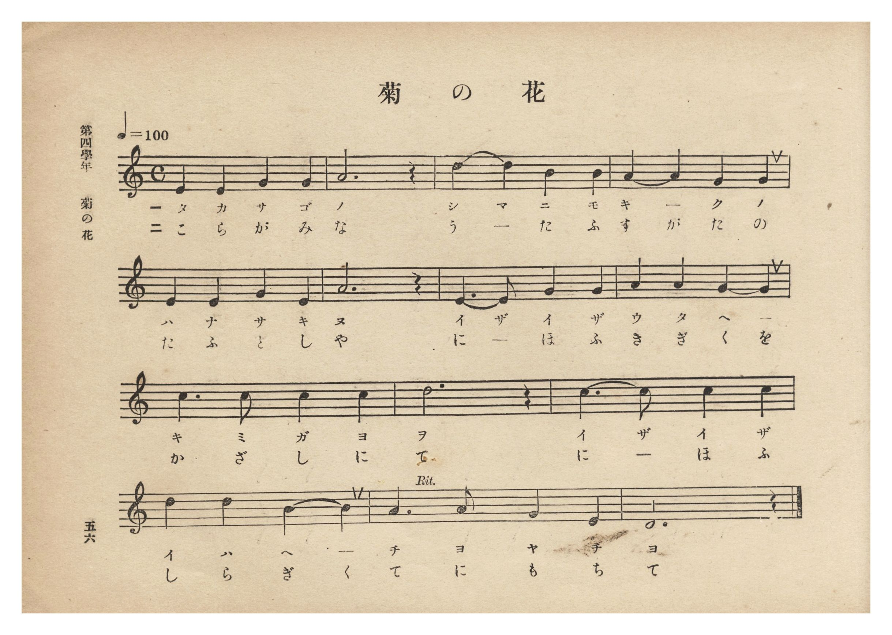
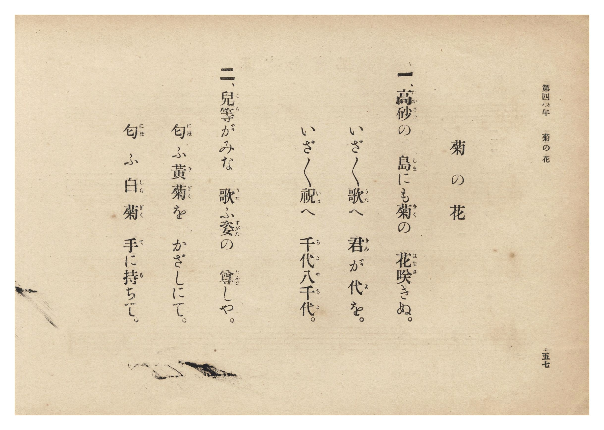

# 菊の花

> Re:Shōka 使用 AI 協助辨識與重建樂譜，可能會有錯誤。歡迎回報。

- **鋼琴伴奏版**：<br><audio controls src="kiku_no_hana.mp3"></audio>
- **NEUTRINO 歌聲合成版**：<br><audio controls src="kiku_no_hana_neutrino.mp3"></audio>

- 曲：宮島慎三郎
- 臺灣總督府《公學校唱歌集》（大正四年三月，索書號 0725 26）

## 說明

原書資訊與歌詞全文（對應 P062.jpg–P063.jpg，原書 p. 56–57，第四學年第 5 首）：
作詞：臺灣總督府（據卷首〈緒言〉，專為臺灣公學校新編）
作曲：臺灣總督府國語學校助教授 宮島慎三郎（據卷首〈緒言〉）
調性與拍號：ハ調（律旋法 D 主音）4/4 拍子，♩= 100

## 歌詞

```text
一、高砂（たかさご）の　島（しま）にも菊（きく）の　花咲（はなさ）きぬ。
いざ／＼歌（うた）へ　君（きみ）が代（よ）を。
いざ／＼祝（いは）へ　千代八千代（ちよやちよ）。

二、兒等（こら）がみな　歌（うた）ふ姿（すがた）の　尊（たふと）しや。
匂（にほ）ふ黃菊（きぎく）を　かざしにて。
匂（にほ）ふ白菊（しらぎく）　手（て）に持（も）ちて。
```

## ABC

```abc
X:1
T:菊の花
C:曲：宮島慎三郎
M:4/4
L:1/16
Q:1/4=100
K:C
V:V1 name="Piano" snm="Pia"
[V:V1]
E4 E4 G4 G4 | A12 z4 | d4 d4 B4 B4 | A4 A4 G4 G4 |
w: 1.~た か さ ご | の | し ま に も | き _ く の
w: 2.~こ ら が み | な | う _ た ふ | す が た の
E4 E4 G4 E4 | A12 z4 | E6 E2 G4 G4 | A4 A4 G4 G4 |
w: 1.~は な さ き | ぬ | い ざ い ざ | う た へ _
w: 2.~た ふ と し | や | に _ ほ ふ | き ぎ く を
c6 c2 c4 c4 | d12 z4 | c6 c2 c4 c4 | d4 d4 B4 B4 |
w: 1.~き み が よ | を | い ざ い ざ | い は へ _
w: 2.~か ざ し に | て | に _ ほ ふ | し ら ぎ く
A6 A2 G4 E4 | D12 z4 |
w: 1.~ち よ や ち | よ
w: 2.~て に も ち | て
```

## TMD 檔案連結

- [主旋律 TMD 檔案](kiku_no_hana.tmd) [[在 TMD Studio 編輯](https://tmdlang.github.io/Tmd-TS/#tmd=s7IKdvYPcrWy4qpTUCpJTLdSSM7PyUlNLsnMz7PKzk9PzM7Ojy_OyM9OLM4ojTe0NDRVgqssy88pzU21Si9KTEmNN0GIF-eXFiWnWhUnZ-Tn58SXpFaUJOXnZ6PLxxckpqdaBRiYGSFkCoryy1LzEvOAuguKMvNKUlPA2hEKUssyU1JB0sXJiXnxZalFmWmZqSlITkotKga5HGpFSVFiXnFyUWYByDsIVflFJRn5QGcXZFRaZWQWl-QXZSYn5sRnJ-YlIhSVZKQCPZeXWFJaBHRrTmJeSTG6ZGZuAdAFiTlKXFpaCi_6ux43rnvRtVFBS4tL0VbB0MCAy95WwZnLxkTfxA6k89nsTe_3zHq6bt3TzduetfY92dH5srkPbOaL9l3PGxc_37H3-dzFT3fNedzQ9bR1zdO1O54tWPh0ysZna3tezm573ND9fk_H0yXLn61d_HT27Kc7twANeDan4_2enudbFj2bvePFzPkKBuZGpgpGZu_3dCpxcelrKdhSC3ApKCg87ZsPsmZz-4sVXS862oHOerFy3tPWFc-mtYNctqH3WXunAihC9bIK0h81TAYyjUFMoAshWhUK9BRMzYAypuYgV69ZA_LH2h1ArwDZCqYKL5dNA7ocGEYg257snQM0HshBCxygVc8mz3raux2o-nFDx_Ptk16saHjcANTW83RDx_OmXRD18AB8Nm3D8-0rgOZCDYXEApqhT-d0v1g1DxriXSufTZ35rK9DAS2qcNsMNvvFqv3PGpaDAqa7FxgXQEseN_cDBUFhs6_72fTuZ5unKrgoPNmx--X8zUA9wGShAFT6dO0EoNMfzVwJSTJgV-4AGtv4cvWM5wuagLofN85_3Nj9uHHq48YpQH3AVPa4oQHoMLDU9MeN-8CCqx83NQHTIFiw93FjP1wlMEk-nQT0M1B8_ePGVUBzwFJANWseNzSB7Hvc2PK4ERj0QD17gLEKVtoGtBWsbgfIsgmzYeYCvQMU7HmyezFIpAmY_DofN03CYtDzpXPBeoAi6xEG9TYDdT5tXQ1hgBUsBJryuAmoDMQAqQSaBQ6FXT3AUHjaOun5WmAQAxVOftwECmug7UBngHzS0IDh2q1Pl4MC_HHjTLAyiCA4vDZAggYYlFsfN4LSAyjsgNZCXP60BxLSqx837oYY9HJ3M1Jw9kFDFOTVBnBsTAOHPVD9MpxGPJ-5F2YE0CqgCMwUoMM7QbkZqBkSd896GsHBCTQByF2IMJTynAsFClr6XFzemdmlfvkewHLOKiAzMS_focagphpkjYKNhZYdmIGt0FAAZk9gmnyxsEdBw0Th6Yb-5-sbdOA5XROLBqBlIMNqFIwVdMHYFIprFMyAJAwagEWM4oAUmDCHYogqEIbrA5vnY1gDTGPzgXxgFIDJqWByClgPMKKRzI6Hik0Hq9gHJleDyKYmqEwvVCUwUsAkSDfUHiOQ_GSw6k6wXA-Y3A_VuQqLPW1w0yDu2woVn4mkHyIDsQd_aO_qoTS0QTS20AaJg2RRYwRXWK8HuxjkX1hYg0INJLMGSxi0QENgGpQNYiFCB-b_HVBdyGGNCDNg5gSToHgDyjRBzES1BxSPEJt2o4Q1yG3AXAYmwXHaNImIsN7RCQ5rY9LC2hCUYHVBFJgFJqBpGTXAsSpECmJIMgQlLmgyaeqAeh3keCKDGCkoQRkDpgKS-EHBBZJZRmxQ4g8wYK1NToDhyuagxIdIsEbo4YcUUhD_QpIkPBEB2QshPgCGGyS5QERAIQgKSRQfI4UTOGyg2RuRZBDhBAobSGEBNw8zBLlqubh07RQQBasCkKfMBQA)]
- [鋼琴伴奏 TMD 檔案](kiku_no_hana_piano.tmd) [[在 TMD Studio 編輯](https://tmdlang.github.io/Tmd-TS/#tmd=s7IKdvYPcrWy4tLSUnjR3_W4cd2Lro3v93S87N7zfMKWJ3u2PF3a_7yz4_2eTgUtLS5FWwVDAwMue1sFZy4bE30TO646BaVnsze93zPr6bp1Tzdve9ba92RH58vmPiWQzIv2Xc8bFz_fsff53MVPd8153ND1tHXN07U7ni1Y-HTKxmdre17Obnvc0A207umS5c_WLn46e_bTnVuABjybA7Sx5_mWRc9m73gxc76CgbmRqYKRGdAVSlxc3pnZpX75Hol5iVYBmYl5-UEeDjUGNdVcCkBgY6FlB2boaynYogOF52vWPNnR8GJhj4KGicLTDf3P1zfoKAQYmBnpZRWka2LRoKUPNqxGwVhBF4xNobhGwQxIwqABWMQoDkiBCXMohqgCYbg-sHk-hjUKjxvnA_mPG7vB5FQwOQWsBxgHSGbHQ8Wmg1XsA5OrQWRTE1SmF6rycWM_mATphtpjBJKfDFbdCZbrAZP7oTpXYbGnDW4axH1boeIzkfRDZCD24A_tXT2UhjaIxhbaIHGQLGqM4Arr9WAXg_wLC2tQqIFk1mAJgxZoCEyDskEsROjA_L8Dqgs5rBFh9rhxBZgExRtQpgliJqo9oHiE2LQbJaxBbnvc2AcmwXHaNImIsN7RCQ5rY9LC2hCUYHVBFJgFJqBpGTXAsSpECmJIMgQlLmgyaeqAeh3keCKDGCkoQRkDpgKS-EHBBZJZRmxQ4g8wYGlDToDhyuagxIdIsEbo4YcUUhD_QpIkPBEB2QshPgCGGyS5QERAIQgKSRQfI4UTOGyg2RuRZBDhBAobSGEBNw8zBLlqMctVH-Ry1QRRrr6c3Qosq5-vXv-ir-vJzu6n-7pfzt_8clbfk11Tnu5a9n5PP6gY37Xs6aSeF42bIDUIUnKLV4g2jFUwjQfSpvGxoLADMc3ic2PBLAOgCFzSGEgbAyWQFSF0opoIpbCZh89ODONQtUNYwOgEMo2ALCANMhGrIqgBeF0PdyXQILN4bSOogaDg17VTQMRAtA9QFZqIEVhEmQsA)]

## 分析

```text
================================================================================
📊 TMD Song Profile: [ 菊の花 ]
================================================================================
⏱  Duration:       0:33 (33.6s), 14 measures total
🎼 Key & Tempo:    首調基準 C, != 100.0 BPM, <4/4>
   - 分析範圍：      由實際發聲的音符與和弦推測調性；播放脈絡另行呈現
🎤 人聲音域:    D4 (MIDI 62) – D5 (MIDI 74) [跨度: 12 個半音 / 1.0 個八度, 難度: easy]
   - 最低音:  D4 in [KikuNoHana #1 @ m.14, 0:31]
   - 最高音: D5 in [KikuNoHana #1 @ m.3, 0:04]
   - 適合: soprano, mezzo-soprano, contralto, tenor, baritone, bass
🏛  結構:      KikuNoHana (33.6s)
⚡ 編曲密度:        Peak 1 軌道同時演奏
🗝  調性診斷：       G 大調（純淨自然大調，未偵測到可信轉調）
   - 風格氣質:    純淨自然大調（陽光明朗、易唱易記，無明顯調外色彩）
   - 轉調歷程:    全曲維持單一推測調性（未偵測到可信轉調）
   - 核心骨幹音:  A, D, G, C, E
   - 調性數值:    G 大調 [相關度: 0.78, 穩定度: Moderate, 自然音純度: 100.0%]
   - 候選調性 (K-S): G 大調 (0.78), A 小調 (0.72), C 大調 (0.66)
   - 五度圈歷程:   +1
   - 各段落調性細節:
     • [KikuNoHana #1]: G 大調 (r: 0.78, 自然音純度: 100.0%)

  [ 五度圈游移軌跡 ]
               C  
         F           [G ]*
      Bb               D  
      Eb               A  
         Ab           E  
            Db       B  
               F# 
     (* = active key center)

  [ 十二半音累積音高分佈 ]
     C  : ████████████████          15.4%
     C# :                            0.0%
     D  : ████████████████████      19.2%
     D# :                            0.0%
     E  : ████████████████          15.4%
     F  :                            0.0%
     F# :                            0.0%
     G  : ████████████████████      19.2%
     G# :                            0.0%
     A  : ████████████████████████  23.1%
     A# :                            0.0%
     B  : ████████                   7.7%
--------------------------------------------------------------------------------
Assignment 軌道音域：
  - Piano         : D4 – D5 (12 個半音 / 1.0 個八度, 44 個音符)
================================================================================
```


## 原書掃描頁






