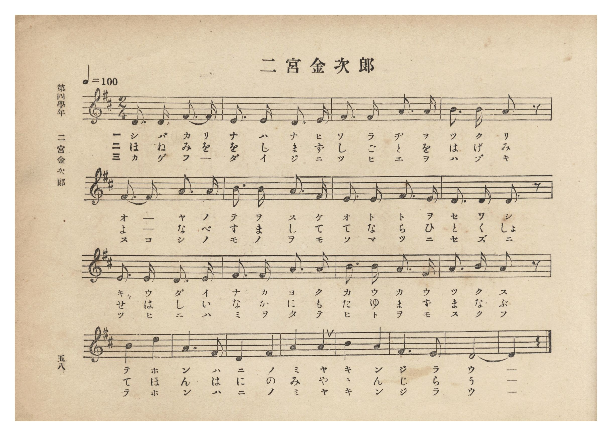
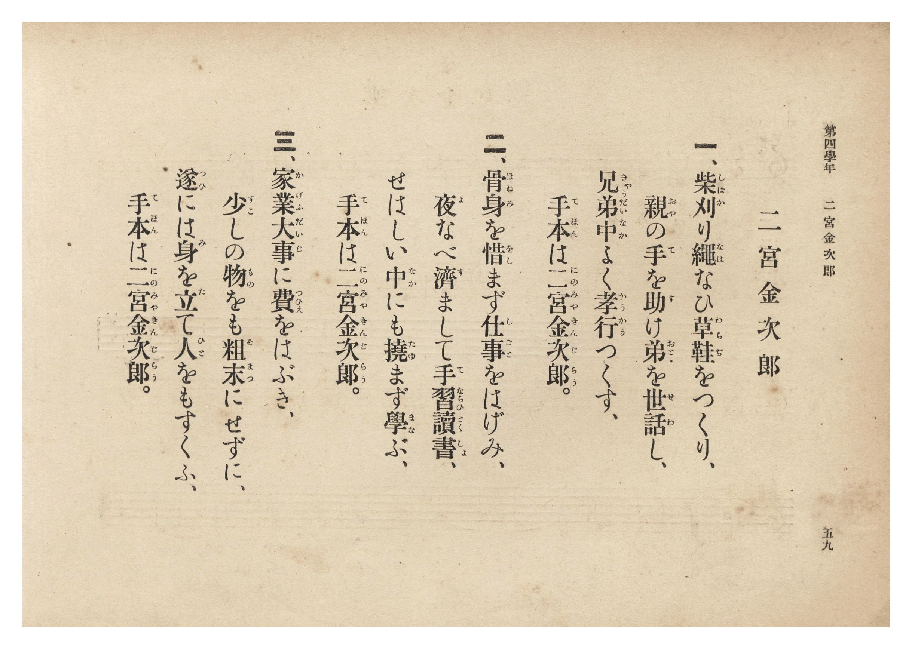

# 二宮金次郎

> Re:Shōka 使用 AI 協助辨識與重建樂譜，可能會有錯誤。歡迎回報。

- **鋼琴伴奏版**：<br><audio controls src="ninomiya_kinjiro.mp3"></audio>
- **NEUTRINO 歌聲合成版**：<br><audio controls src="ninomiya_kinjiro_neutrino.mp3"></audio>

- 文部省《尋常小學唱歌》
- 臺灣總督府《公學校唱歌集》（大正四年三月，索書號 0725 26）

## 說明

原書資訊與歌詞全文（對應 P064.jpg–P065.jpg，原書 p. 58–59，第四學年第 6 首）：
出處原曲：文部省編纂《尋常小學唱歌》第二學年〈二宮金次郎〉（明治 44 年／1911 年）
調性與拍號：ニ長調 2/4 拍子，♩= 100


## 歌詞

```text
一、柴刈（しばか）り繩（なは）なひ草鞋（わらぢ）をつくり、
親（おや）の手（て）を助（たす）け弟（おとゝ）を世話（せわ）し、
兄弟中（きやうだいなか）よく孝行（かうかう）つくす、
手本（てほん）は二宮金次郎（にのみやきんじらう）。

二、骨身（ほねみ）を惜（をし）まず仕事（しごと）をはげみ、
夜（よ）なべ濟（す）まして手習讀書（てならひどくしよ）、
せはしい中（なか）にも撓（たゆ）まず學（まな）ぶ、
手本（てほん）は二宮金次郎（にのみやきんじらう）。

三、家業大事（かげふだいじ）に費（つひえ）をはぶき、
少（すこ）しの物（もの）をも粗末（そまつ）にせずに、
遂（つひ）には身（み）を立（た）て人（ひと）をもすくふ、
手本（てほん）は二宮金次郎（にのみやきんじらう）。
```

## ABC

<div class="abc-score" data-abc-src="ninomiya_kinjiro.abc" aria-label="五線譜載入中"></div>

[下載 ABC 原始檔](ninomiya_kinjiro.abc)

## TMD 檔案連結

- [主旋律 TMD 檔案](ninomiya_kinjiro.tmd) [[在 TMD Studio 編輯](https://tmdlang.github.io/Tmd-TS/#tmd=s7IKdvYPcrWy4qpTUCpJTLdSSM7PyUlNLsnMz7PKzk9PzM7Ojy_OyM9OLM4ojTe0NDRVgqssy88pzU21Si9KTEmNN0GIF-eXFiWnWhUnZ-Tn58SXpFaUJOXnZ6PLxxckpqdaBRiYIeksKMovS81LzAPqLijKzCtJTQFrRyhILctMSQVJFycn5sWXpRZlpmWmpiA5KbWoGORyqBUlRYl5xclFmQUg7yBU5ReVZOQDnV2QUWmVkVlckl-UmZyYE5-dmJeIUFSSkQr0HES6EllvZnpmnlVufl5SKTBclLi0tBSe7Op5um7dy_aJz9YsfNncp6ClxaVoq2BoYMBlb6vgwmVjpG9iBzLg2bT2l80rns9pfNzQ9XRD99MdO55u6H-6dsfTKRufre153NANtuZF-67njYuf79j7fO7ip7vmgNS2rgGqerZgIUThy9ltQLXv93Q8XbL82drFT2fPfrpzy5Mdnc_mdLzf0_N8y6Jns3e8mDlfwcDcyFTByOz9nk4lLi59LQVbagEuBQWFp33zQdZsbn-xoutFRzvQWS9WznvaugLoR5DLNvQ-a-9UAMWuXlZB-qOGyUCmKYgJdCFEq0KBnoKpBVDG1BLk6jVrQP4AhsXOLUC2gpnCy2XTgC5_v2cW2Lb2XS9mTgVr3AQUggfk8-0rnu9qwhWcQINAUQM29HFDB1o0PW4Amt7xbEbfs027FUxMFICK3u_pByZxQwizE2Txi1X7nzUsB3mwuxcYpkC7Hzd3v5y6HSiuAIxWBaDw07UTgB54NHMlJMpBup7saHjc0Phs_panHcAo6XjcOP1x44bHjcA463zc1PV850qw4KrHjetBIiDGphe9nS_ngSL1cVP_4yag4CKw4kmPG5c8bgSKdAENBDto2Sqw5q7HTS1gzeuedYK1NS6DaHjaBTF9_uPGmWAFE5_uAbobrKVxxeOmuRBlT3ZMe7FyI1h8NtBKsMrpUDuetrYA9TzZsRYs3Qu06XFj2-PGBY8bgQygYyH-AEoBQ3vui4U9YGXdYDUgEmwW2NWNM6EmAt34bM4aiDMfN-5-3DQZrGg9WpSAFawG-ulx436wrUC7Jz9unAEOELC5DU2QAN4FjN_Gl6tWvNi1Gqxp9-PGtUBNEL89a54DDkhg4E0H27PvceOsJ7unPtkFCSlgbEwBhgUsgNc_bgSS-2GeXwLRDIw4SNTsfLYfEn6Q4ASaBdS_DOij5_snvVjXAEzKMH-tArtz0-PGlWDPT4caAjEXFM4gq4CaW2BBCwtLoJ-bmp5NAgYKOOKaIEEIcjUw8YIFgWxgvAMFt9EqRHeAHPp03bZnS9cCyxVYUAHjExg2W2GRPwPi2hebdoNlgZEM9C3Yk9CA3AayARqQGyZCgu1xI8RtQJ-ve94JTp1NTUA2VFtT0_NN05_NgcTjXLBXl0ADBRRks0AMiIkvG5vg1sJUrIelAGjcP18NcTgwyoAKlj3ZtQvMBToTFt8gu4FuAkbQVhqEJdA4ygtYKFDQ0ufi8svMy8_NrEz0zszLyizKtwrITMzLd6gxqKkG2aVgY2imZQdmYSvhFUBF4I4GYB5V0ACWcBv6n69v0IEXy5pYNACtBBlWo2CooAuEhgrGYNoYKGIEZhlBZYyAIjA5UzBtChQxA7PMwCIGQFwDNs3HsAaY_qeD5YAlIRB3Q9hNXUA9wKQNlVmPxN4Ekmnqh6rrBIosgrIngfUsgarrB5uiqxCPsM0IJL8bKr8WiPcj6wSSEJnpQLwPyp4FNhPmwilAvALFtvVQmUlQ05BsMwbJQ_0Dlt8KZgPlgewFUPEWIJ4BZa9Gcf8mIO7Aatc2IO6F24U_jnf1kBPH-OMPNdYhakGxDksZIBo9jkExAfFLC9QX68B-Wgb3ITBrQmWAmXAiWBKiCRTk6ME-G8oDRjI4ctAiuQkScCC9sGSzE6xvJpS3DylSlyE7BKgelKiQklrjSigPbNfjpnZU68CxDDN2MpKxYP81NcF58PQFFAPpmYvkFFicQ1IA1HPAtAcSIS6ed3SSE8-k5lxIzENY2PMysOhrhjq_DSWZI2fnbngMgUIVOZuA9CDYaNkZHMzo2RkWWKAiAhb0GLaBgxER9NCE1gSyDTWjw3jAVADMZpgRjZw5oWYCbQbJIIoSREKGpKxNUB4wFaMlAViyAfkNVDgQEdHAxjA4oi1Ii2hIJAIzZxyUAYtFCATFOiz_QnioamA0ckxDMgzI-ZASFVyuNU1GMhVSYoHUQoIKkg_gaqFBhigTUCOWhuaDo5I25qOFNzzg4IEKgqBshwhuGKyBs0CZCsm5kIwFtwzmRJAopOqAyYDKLZBoG06TQSkMyWRwQNPEZHAQU9vkWi4uXTsFtIaPAlBImQsA)]
- [鋼琴伴奏 TMD 檔案](ninomiya_kinjiro_piano.tmd) [[在 TMD Studio 編輯](https://tmdlang.github.io/Tmd-TS/#tmd=s7IKdvYPcrWy4tLSUniyq-fpunUv2yc-W7PwZXPf-z0dL7v3PJ-w5cmeLU-X9j_v7Hi_p1NBS4tL0VbB0MCAy95WwYXLxkjfxI6rTkHp2bT2l80rns9pfNzQ9XRD99MdO55u6H-6dsfTKRufre153NCtBFL1on3X88bFz3fsfT538dNdc0BqW9cAVT1bsBCi8OXsNqBaoNVPlyx_tnbx09mzn-7c8mRH57M5QNt7nm9Z9Gz2jhcz5ysYmBuZKhiZAV2kxMXll5mXn5tZmeidmZeVWZRvFZCZmJcf5OFQY1BTzaUABDaGZlp2YJa-loItOlB4vmbNkx0NLxb2KGiYKACd_Xx9g45CgIGZiV5WQbomFg1a-mDDahQMFXSB0FDBGEwbA0WMwCwjqIwRUAQmZwqmTYEiZmCWGVjEAIhrwKb5GNYoPG6cDpZ73LgBiLsh7KYuoJ7HjaugMuuR2JtAMk39UHWdQJFFUPYksJ4lUHX9YFN0FeIRthmB5HdD5dcC8X5knUASIjMdiPdB2bPAZsJcOAWIV6DYth4qMwlqGpJtxiB5qH_A8lvBbKA8kL0AKt4CxDOg7NUo7t8ExB1Y7doGxL1wu_DH8a4ecuIYf_yhxjpELSjWYSkDRKPHMSgmIH5pgfpiHdhPy-A-fNw4Hyoz83HjRLAkRBMoyNGDfTaUB4xkcOSgRXITJOBAemHJZidY30wobx9SpC5DdghQPShRISW1xpVQHtiux03tqNaBYxlm7GQkY8H-a2qC8-DpCygG0jMXySmwOIekAKjngGkPJEJcPO_oJCeeSc25kJiHsLDn5d7HTc1Q57ehJHPk7NwNjyFQqCJnE5AeBBstO4ODGT07wwILVETAgh7DNnAwIoIemtCaQLahZnQYD5gKgNkMM6KRMyfUTKDNIBlEUYJIyJCUtQnKA6ZitCQASzYgv4EKByIiGlg7gCPagrSIhkQiMHPGQRmwWIRAUKzD8i-Eh6oGRiPHNCTDgJwPKVHB5VrTZCRTISUWSC0kqCD5AK4WGmSIMgE1YmloPjgqaWM-WnjDAw4eqCAIynaI4IbBGjgLlKmQnAvJWHDLYE4EiUKqDpgMqNwCibbhNBmUwpBMBgc0TUwGBzG1Ta7F0e7xQW73mECbPcAAjleINowFJeN4GAsuZBIPYkMciyqMpMU0HqrHAK4Su1EIPQiVIGETFIWo7gEbjqQWrgRuK1wIZCjQ77p2Cmjej_YBKsEmbIRd2BgsrMwFAA)]

## 分析

```text
================================================================================
📊 TMD Song Profile: [ 二宮金次郎 ]
================================================================================
⏱  Duration:       0:24 (24.0s), 20 measures total
🎼 Key & Tempo:    首調基準 D, != 100.0 BPM, <2/4>
   - 分析範圍：      由實際發聲的音符與和弦推測調性；播放脈絡另行呈現
🎤 人聲音域:    D4 (MIDI 62) – D5 (MIDI 74) [跨度: 12 個半音 / 1.0 個八度, 難度: easy]
   - 最低音:  D4 in [NinomiyaKinjiro #1 @ m.1, 0:00]
   - 最高音: D5 in [NinomiyaKinjiro #1 @ m.13, 0:15]
   - 適合: soprano, mezzo-soprano, contralto, tenor, baritone, bass
🏛  結構:      NinomiyaKinjiro (24.0s)
⚡ 編曲密度:        Peak 1 軌道同時演奏
🗝  調性診斷：       D 大調（純淨自然大調，未偵測到可信轉調）
   - 風格氣質:    純淨自然大調（陽光明朗、易唱易記，無明顯調外色彩）
   - 轉調歷程:    全曲維持單一推測調性（未偵測到可信轉調）
   - 核心骨幹音:  A, D, F#, B, E
   - 調性數值:    D 大調 [相關度: 0.86, 穩定度: High, 自然音純度: 100.0%]
   - 候選調性 (K-S): D 大調 (0.86), A 大調 (0.74), F# 小調 (0.71)
   - 五度圈歷程:   +2
   - 各段落調性細節:
     • [NinomiyaKinjiro #1]: D 大調 (r: 0.86, 自然音純度: 100.0%)

  [ 五度圈游移軌跡 ]
               C  
         F            G  
      Bb              [D ]*
      Eb               A  
         Ab           E  
            Db       B  
               F# 
     (* = active key center)

  [ 十二半音累積音高分佈 ]
     C  :                            0.0%
     C# :                            0.0%
     D  : ████████████████████      24.0%
     D# :                            0.0%
     E  : █████████                 11.3%
     F  :                            0.0%
     F# : ██████████████████        22.0%
     G  :                            0.0%
     G# :                            0.0%
     A  : ████████████████████████  28.7%
     A# :                            0.0%
     B  : ████████████              14.0%
--------------------------------------------------------------------------------
Assignment 軌道音域：
  - Piano         : D4 – D5 (12 個半音 / 1.0 個八度, 58 個音符)
================================================================================
```


## 原書掃描頁






