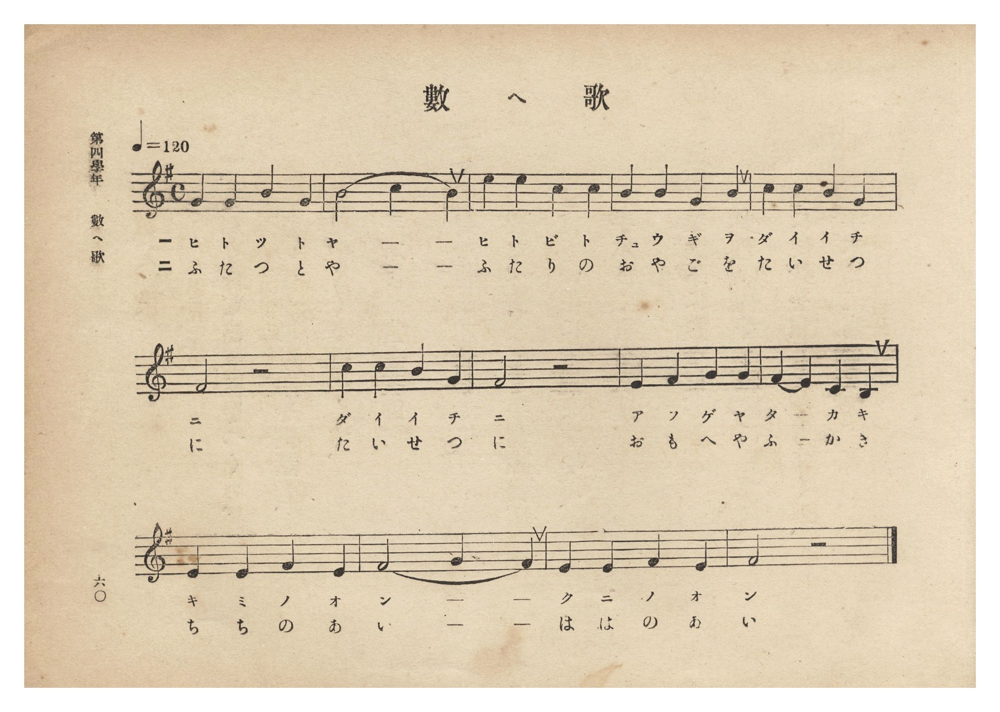
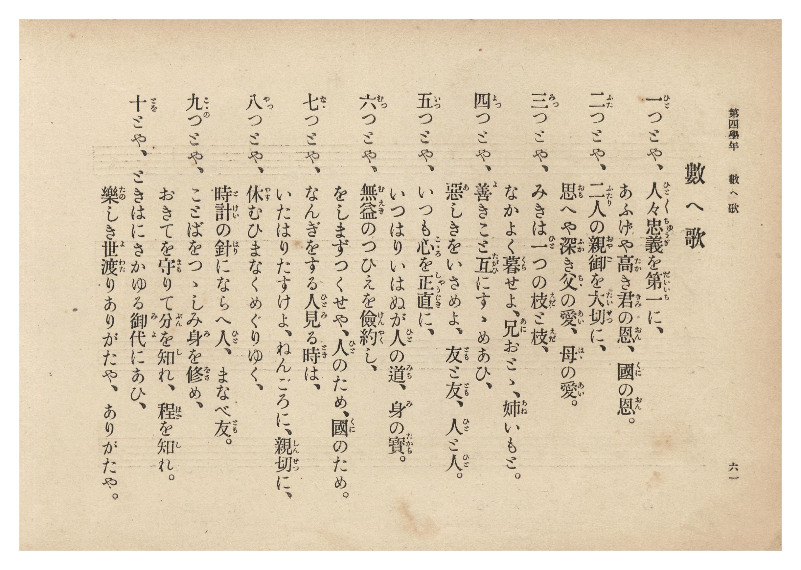

# 數へ歌

> Re:Shōka 使用 AI 協助辨識與重建樂譜，可能會有錯誤。歡迎回報。

- **鋼琴伴奏版**：<br><audio controls src="kazoeuta.mp3"></audio>
- **NEUTRINO 歌聲合成版**：<br><audio controls src="kazoeuta_neutrino.mp3"></audio>

- 文部省《尋常小學唱歌》
- 臺灣總督府《公學校唱歌集》（大正四年三月，索書號 0725 26）

## 說明

原書資訊與歌詞全文（對應 P066.jpg–P067.jpg，原書 p. 60–61，第四學年第 7 首）：
出處原曲：文部省編纂《尋常小學唱歌》第二學年〈數へ歌〉（明治 44 年／1911 年）
調性與拍號：ト調（律／陽旋法 E 主音）4/4 拍子，♩= 120


## 歌詞

```text
一（ひと）つとや、人々忠義（ひと／＼ちゆうぎ）を第一（だいいち）に、
あふげや高（たか）き君（きみ）の恩（おん）、國（くに）の恩（おん）。

二（ふた）つとや、二人（ふたり）の親御（おやご）を大切（たいせつ）に、
思（おも）へや深（ふか）き父（ちゝ）の愛（あい）、母（はゝ）の愛（あい）。

三（み）つとや、みきは一（ひと）つの枝（えだ）と枝（えだ）、
なかよく暮（くら）せよ、兄（あに）おとゝ、姉（あね）いもと。

四（よ）つとや、善（よ）きこと互（たがひ）にすゝめあひ、
惡（あ）しきをいさめよ、友（とも）と友（とも）、人（ひと）と人（ひと）。

五（いつ）つとや、いつも心（こゝろ）を正直（しやうじき）に、
いつはりいはぬが人（ひと）の道（みち）、身（み）の寶（たから）。

六（む）つとや、無益（むえき）のつひえを儉約（けんやく）し、
をしまずつくせや、人（ひと）のため、國（くに）のため。

七（なゝ）つとや、なんぎをする人見（ひとみ）る時（とき）は、
いたはりたすけよ、ねんごろに、親切（しんせつ）に。

八（や）つとや、休（やす）むひまなくめぐりゆく、
時計（とけい）の針（はり）にならへ人（ひと）、まなべ友（とも）。

九（こゝの）つとや、ことばをつゝしみ身（み）を修（をさ）め、
おきてを守（まも）りて分（ぶん）を知（し）れ、程（ほど）を知（し）れ。

十（とを）とや、ときはにさかゆる御代（みよ）にあひ、
樂（たの）しき世渡（よわた）りありがたや、ありがたや。
```

## ABC

```abc
X:1
T:數へ歌
M:4/4
L:1/16
Q:1/4=120
K:G
V:V1 name="Piano" snm="Pia"
[V:V1]
E4 E4 A4 E4 | A8 B4 A4 | d4 d4 B4 B4 | A4 A4 E4 A4 |
w: 1.~ひ と つ と | や _ _ | ひ と び と | ちゅ う ぎ を
w: 2.~ふ た つ と | や _ _ | ふ た り の | お や ご を
w: 3.~み っ つ と | や _ _ | み き は ひ | と つ の _
w: 4.~よ っ つ と | や _ _ | よ き こ と | た が ひ に
w: 5.~い つ つ と | や _ _ | い つ も こ | こ ろ を _
w: 6.~む っ つ と | や _ _ | む え き の | つ ひ え を
w: 7.~な な つ と | や _ _ | な ん ぎ を | す る ひ と
w: 8.~や っ つ と | や _ _ | や す む ひ | ま な く _
w: 9.~こ こ のつ と | や _ _ | こ と ば を | つ つ し み
w: 10.~と _ を と | や _ _ | と き は に | さ か ゆ る
B4 B4 A4 F4 | E8 z8 | B4 B4 A4 F4 | E8 z8 |
w: 1.~だ い い ち | に | だ い い ち | に
w: 2.~た い せ つ | に | た い せ つ | に
w: 3.~え だ と え | だ | え だ と え | だ
w: 4.~す す め あ | ひ | す す め あ | ひ
w: 5.~しゃ う じ き | に | しゃ う じ き | に
w: 6.~け ん や く | し | け ん や く | し
w: 7.~み る と き | は | み る と き | は
w: 8.~め ぐ り ゆ | く | め ぐ り ゆ | く
w: 9.~み を を さ | め | み を を さ | め
w: 10.~み よ に あ | ひ | み よ に あ | ひ
D4 E4 F4 F4 | E4 D4 B,4 A,4 | D4 D4 E4 D4 | E8 F4 E4 |
w: 1.~あ ふ げ や | た _ か き | き み の お | ん _ _
w: 2.~お も へ や | ふ _ か き | ち ち の あ | い _ _
w: 3.~な か よ く | く ら せ よ | あ に お と | と _ _
w: 4.~あ し き を | い さ め よ | と も と と | も _ _
w: 5.~い つ は り | い は ぬ が | ひ と の み | ち _ _
w: 6.~を し ま ず | つ く せ や | ひ と の た | め _ _
w: 7.~い た は り | た す け よ | ね ん ご ろ | に _ _
w: 8.~と け い の | は り に _ | な ら へ ひ | と _ _
w: 9.~お き て を | ま も り て | ぶ ん を し | れ _ _
w: 10.~た の し き | よ わ た り | あ り が た | や _ _
D4 D4 E4 D4 | E8 z8 |
w: 1.~く に の お | ん
w: 2.~は は の あ | い
w: 3.~あ ね い も | と
w: 4.~ひ と と ひ | と
w: 5.~み の た か | ら
w: 6.~く に の た | め
w: 7.~し ん せ つ | に
w: 8.~ま な べ と | も
w: 9.~ほ ど を し | れ
w: 10.~あ り が た | や
```

## TMD 檔案連結

- [主旋律 TMD 檔案](kazoeuta.tmd) [[在 TMD Studio 編輯](https://tmdlang.github.io/Tmd-TS/#tmd=s7IKdvYPcrWy4qpTUCpJTLdSSM7PyUlNLsnMz7PKzk9PzM7Ojy_OyM9OLM4ojTe0NDRVgqssy88pzU21Si9KTEmNN0GIF-eXFiWnWhUnZ-Tn58SXpFaUJOXnZ6PLxxckpqdaBRiYmSFkCoryy1LzEvOAuguKMvNKUlPA2hEKUssyU1JB0sXJiXnxZalFmWmZqSlITkotKga5HGpFSVFiXnFyUWYByDsIVflFJRn5QGcXZFRaZWQWl-QXZSYn5sRnJ-YlIhSVZKQCPZebX5SYk1lSiaw5Mz0zDyiRl1QKDBglLi0thWdTdzxu3PFsbY-ClhaXoq2CoZEBl72tgjuXjYm-iR1I67Np7S-bVzyf0_i4oevphu6nO3Y83dD_dO2Op1M2ArU9bugGW_CifdfzxsXPd-x9Pnfx011zQGpb1wBVPVuwEKLw5ew2oNr3ezqeLln-bO3ip7NnP9255cmOzmdzOt7v6Xm-ZdGz2TtezJyvYGBuZKpgZPZ-T6cSF5e-loIttQCXgoLC0775IGs2t79Y0fWiox3orBcr5z1tXQH0I8hlG3qftXcqgCJWL6sg_VHDZCDTHMQEuhCiVaFAT8HMAChjZghy9Zo1IH8Aw2LnFiBbwVzh5bJpQJe_3zMLbFv7rhczp4I1bgIKwQPy-fYVz3c14QpOoEFPdvVADH3c0AGPoMcNQHM7ns3oe7Zpt4KJiQJQ-v2efmC6NoQwO0FWvli1_1nDcpDXunuBoQm09XFzB1AQ5Lt9wNDvfzlz77Pp3c82T1VwVXiyY_fL-ZuBOoFRrQDU8HTtBKCnHs1cCUkGIPOe7GgAan3cuOlx4wqgwseNS4CMx00tjxsan-za9bih9en-Bc_3rURS0_9-z57HjQsfN7U9bgSiPpCupkkgT0GNWvC4sQWMFoINXA00CmTT48amx41bHzdOApr-cvUMsNL5jxuBbgYq6n06YTZYpPdxI9AvQJF1zxohtnY9bpoMEmlofDoHlLweN_YDDcWhpgniqV09YGGgbcAQQvNUD9BfcNnHTV0Qk14sW_V0H9DBEMOAjp8C8RcwMT_tAKUdsGOB4rOBpqH461nDXJi2JrDEDqD-Z9s3wuyAevB5xzawCDDggOrBjm-BeBkYLC0QDz5b3wsWWY9bDdSDO0BJBRZUCN8BRcBBuB5btK57Ng_iUlAcgQVXoIvAYmoV0NmPm0BB_WzWOmiYNwGtBOqZDRIHxkUr0D0Qh0HiogvsiLkgqeUQxwGl1oKlWoAhA5KFOh6Yo0DyTcBiAcXxT6eBjYSKA30xGSj1ZNckWOD3AL0DDfnGmSCrmoD-BRq8CRYRzZD4g8TCdJARTZPAcTYVpBTi7H5IEgJaCVG2Al0EnO5Rww7oCFQReDIDJhKgMNAGSJJAjgiQINDIp_ubwWomgx0MjF5QogIWj89nA3M0UHw6OLEB89EMoHvR8gvYCFBiAIYtkL3-ceMaYChgOG_dy0Zg4gelBmiWa2h8sQsYKfD0se7pekjaA2U3aDzC4qIVGEXAMAemFhT3P29Z-Hw2MGuApMDJA-K2dWA1QJuB4pOetnQ-3wJJBROB-Q_sEWDhAA57qBdA4Q-MiH2PG2eBdQJzLjD9QAsXNF-AcyOwDsKSzWFSsMQPCdJVsFyCHOxAQWCy6QPbDEwk3UB7XiyDmAeyChokTd3PZgJjGxztUK-tRw52YEBBgh3ImAn2HijxANMz2PQpwIiExBOo1ICWDsCIBEohlw6wEAZHRRM4-yIXRHsmQsSBNoCdBAxnoAuBQQXMfMDcBrRtAsgJoGK2H5bCZza9WAHMHhB3T4SWCcAE0A7JxiA3w3IIMCBAZRFG0gWaC7FjJ0bKhwbvTohh4BTbCMz9aCEMypWPGzeAQxiYwoFqgDG8HyXFNU16sh9cbIDUTAWLgCIWErzAUAWG3jJQAloH8cs-qANAAb7saUcbWHAbtEgHVi3zl0JCGMwFVpONz1dAXL77Maj8x6oGGvi9jTAvAosRUFaG-QIU7-AsBQyqqeBs0QZMFcAq4MnuxdDMBC2IgAqQC5kVkHQDTBiQoAGVM092THu2A1z4ANNJEzDdgmsdkHeawCSw5AImYIjFaCJNIEMpb_tAgYKWPheXd2JVfmppSaJVQGZiXr5DjUFNNcgSBRsLLTswA1ujSwFSgb9Y2KOgYaoAbLE8X9-gA28paWLRALQKZFiNglm8gi6EMIIxasBMEDSGCtcomAJJEAaJgDBEDVwLRBFMEsQzB5sEtsTHsAaYcjYB-cCYA5NL4GygTFML1DYYRFe9GVk1qApuBQu0gck-ENk0CSq5ACwGMhBGLkQ4wwikYitYdD6RzkBS3dQFZq-DyoB5YD3AIgXFDRCzITKz4fZA3WAMUrEfLLqYSDdAVPeCyfVgEhQ4IBnkwAS5C6ajAywCCQuIGpAI1AUmIHsgKoh0AVQ1xAWTkVVD_doDdxUww0FlZoJ5YLKpEcxuQrjBFKQCEkIQ2wmHApLqJpBJEJeAZMAuagK7DhwHMB3AMr0ZrBCSUGbAPQF1hBnIqgaSAgKiGjk4YMkBohcSBGB5eHKYCOZBHAnxRD_CDeYgFavAohCScECA1UHMQ0v8kMDuRnIJLJrASQgqA0kQSOFgAbOJ-HCAqIbYBwkTWJLch-QXkD9hOiBJYAJYByTrgGIF6gJLeDRCSVBLhWBAIFIisEJDCQjkNDUdTIICABEQIHVQsnEqwhmGBrBMBYIwBficgAhLWNaEJX-QscCKCe5TSOgjnABJQyDVsIyBv3Df1UN24Q6CBnBHY5bR2FSZwmsFsBpkhWApY3Chj17Eg7wDgjDz8JTIOFRDcjak1IXEEkgPrKQBRwskUJETMLhcx2YajpIYh2pIsoS4YAeK3SD34LAbXJ6D_IhuGo4yGIdqSIaBJBeITnAhAaWBjUGEH8DySGU5OOuhm4ej9MWhGuJnSE4BJ2Z4ToKEHTgxQ8xBth1cimMLSdwlLw4NyFUBOB-BywiEDCRvrQGToMoGqQQHOxvdPBxlLnbV0HwO8T6k_JoFVQ1xETgKoIEPThJIZTfIZei24yhtcaiGuA-SVFH9DhGDRCXER0iBDyq14SUssm9wlLTYVUPdBzYd6hJYjYZwCyLOkMprsD3YfY5RvOJQDTEbnOAal8H1wGsRSFaEugAkj1JMY0vHOIpWHKohwQvyLnLaBzkWUoFDoh3R9iNURO_oBBfRwKE_UopocHGKKG7BLKQiGVzyQlvlBJTCS2-kEhkSuJAWJMSn0MQFzhzIEF7WQEMOu2p4-CGVvKDyHEZCdMFCHVuVCcnKEBK7ajQ7wCUspISCuAySIGBNG1h1jWwHRPVaMAlO1OCkhKwazQ5wOQrOCtDyH5ItYFU_SAzdDuQOCoREbpVjsQNcWiLrgvge1jIBhR-6HcjxBkmt0EYEuD7AYge4QMS0A6QXORPij3N01Wh2gIs9cNhCG6GQ3g8opSEX78h2gHMXVDWBehipcIM0dCE1H7g-xghhZDuQG5474SGAHHtodoAbndsQLkOqBkC6QNUMuh27wSpW4lGNZgekqEIuxyBdJVgQY8sghFUjLKnl4tK1U4ANGSgA2cpcAA)]
- [鋼琴伴奏 TMD 檔案](kazoeuta_piano.tmd) [[在 TMD Studio 編輯](https://tmdlang.github.io/Tmd-TS/#tmd=s7IKdvYPcrWy4tLSUng2dcfjxh3P1va839PxsnvP8wlbnuzZ8nRp__POjvd7OhW0tLgUbRUMjQy47G0V3LlsTPRN7LjqFJSeTWt_2bzi-ZzGxw1dTzd0P92x4-mG_qdrdzydshFo1uOGbiWQqhftu543Ln6-Y-_zuYuf7poDUtu6Bqjq2YKFEIUvZ7cB1QKtfrpk-bO1i5_Onv1055YnOzqfzQHa3vN8y6Jns3e8mDlfwcDcyFTByAzoIiUuLu_EqvzU0pJEq4DMxLz8IA-HGoOaai4FILCx0LIDM_S1FGzRgcLzNWue7Gh4sbBHQcNUAejc5-sbdBQCDMzM9LIK0jWxaNDSBxtWo2AWr6ALIYxgjBowEwSNocI1CqZAEoRBIiAMUQPXAlEEkwTxzMEmgS3xMaxReNy4Cch_3LgCTC6Bs4EyTS1Q22AQXfVmZNWNCx83tYIF2sBkH4hsmgSVXAAWAxkIIxcinGEEUrEVLDqfSGcgqW7qArPXQWXAPLCex41TUNwAMRsiMxtuD9QNxiAV-8Gii4l0A0R1L5hcDyZBgQOSQQ5MkLtgOjrAIpCwgKgBiUBdYAKyB6KCSBdAVUNcMBlZNdSvPXBXPW5cDZWZCeaByaZGMLsJ4QZTkApICEFsJxwKSKqbQCZBXAKSAbuoCew6cBzAdEx_3NQMVghJKDPgnoA6wgxkVQNJAQFRjRwcsOQA0QsJArA8PDlMBPMgjoR4oh_hBnOQilVgUQhJOCDA6iDmoSV-SGB3I7kEFk3gJASVgSQIpHCwgNlEfDhAVEPsg4QJLEnuQ_ILyJ8wHZAkMAGsA5J1QLECdYElPBqh5DpiAgKREh83bkAJCOQ0NR1MggIAERAgdVCycSrCGYYGsEwFgjAF-JyACEtY1oQlf5CxjxvBIQ72KST0EU6ApCGQaljGwF-47-ohu3AHQQO4ozHLaGyqTOG1AlgNskKwlDG40Ecv4kHeAUGYeXhKZByqITkbUupCYgmkB1bSgKMFEqjICRhcrmMzDUdJjEM1JFlCXLADxW6Qe3DYDS7PQX5ENw1HGYxDNSTDQJILRCe4kIDSj5s6EX4AyyOV5eCsh24ejtIXh2qInyE5BZyY4TkJEnbgxAwxB9l2cCmOLSRxl7w4NCBXBeB8BC4jEDKQvLUGTIIqG6QSHOxsdPNwlLnYVUPzOcT7kPJrFlQ1xEXgKIAGPjhJIJXdIJeh246jtMWhGuI-SFJF9TtEDBKVEB8hBT6o1IaXsMi-wVHSYlcNdR_YdKhLYDUawi2IOEMqr8H2YPc5RvGKQzXEbHCCa1wG1wOvRSBZEeoCkDxKMY0tHeMoWnGohgQvyLvIaR_kWEgFDol2RNuPUBG9oxNcRJuQVkSDi1NEcQtmIRXJ4JIX2ionoBReeiOVyJDAhbQgIT6FJi5w5kCG8LIGGnLYVcPDD6nkBZXnMBKiCxbq2KpMSFaGkNhVo9kBLmEhJRTEZZAEAWvawKprZDsgqteCSXCiBiclZNVodoDLUXBWgJb_kGwBq_pBYuh2IHdQICRyqxyLHeDSElkXxPewlgko_NDtQI43SGqFNiLA9QEWO8AFIqYdIL3ImRB_nKOrRrMDXOyBwxbaCIX0fkApDbl4R7YDnLugqgnUw0iFG6ShC6n5wPUxRggj24Hc8NwJDwHk2EOzA9zo3IZwGVI1ANIFqmbQ7dgNVrESj2o0OyBFFXI5BukqwYIYWwYhrBphSS36iIEP8oiBCWLE4Gn_kpezW5_smvKicdPTfd3Ppnc_X7kLyH26a9mLjvYX7auet2wDFlsvVu2HDJEgNyHjQa09YFsPxAJ2-yEMiBCoTAIzgFwUaRAGy0MlIEogoQI3E1RgoatAlUOYbg42HSQJEjMGiyMMhKqDScNNAemCuAuHCm1g6Qm2ChSUunYKsNCM9jGMVUDhG6HxjdH4Jmh8UzS-GRrfHI1vgca3ROMbGoAFlLkA)]

## 分析

```text
================================================================================
📊 TMD Song Profile: [ 數へ歌 ]
================================================================================
⏱  Duration:       0:28 (28.0s), 14 measures total
🎼 Key & Tempo:    首調基準 G, != 120.0 BPM, <4/4>
   - 分析範圍：      由實際發聲的音符與和弦推測調性；播放脈絡另行呈現
🎤 人聲音域:    A3 (MIDI 57) – D5 (MIDI 74) [跨度: 17 個半音 / 1.4 個八度, 難度: challenging]
   - 最低音:  A3 in [Kazoeuta #1 @ m.10, 0:19]
   - 最高音: D5 in [Kazoeuta #1 @ m.3, 0:04]
   - 適合: soprano, mezzo-soprano, contralto, tenor, baritone, bass
🏛  結構:      Kazoeuta (28.0s)
⚡ 編曲密度:        Peak 1 軌道同時演奏
🗝  調性診斷：       A 大調（純淨自然大調，未偵測到可信轉調）
   - 風格氣質:    純淨自然大調（陽光明朗、易唱易記，無明顯調外色彩）
   - 轉調歷程:    全曲維持單一推測調性（未偵測到可信轉調）
   - 核心骨幹音:  E, D, A, B, F#
   - 調性數值:    A 大調 [相關度: 0.77, 穩定度: Moderate, 自然音純度: 100.0%]
   - 候選調性 (K-S): A 大調 (0.77), E 大調 (0.67), D 大調 (0.61)
   - 五度圈歷程:   +3
   - 各段落調性細節:
     • [Kazoeuta #1]: A 大調 (r: 0.77, 自然音純度: 100.0%)

  [ 五度圈游移軌跡 ]
               C  
         F            G  
      Bb               D  
      Eb              [A ]*
         Ab           E  
            Db       B  
               F# 
     (* = active key center)

  [ 十二半音累積音高分佈 ]
     C  :                            0.0%
     C# :                            0.0%
     D  : ██████████████            20.0%
     D# :                            0.0%
     E  : ████████████████████████  34.0%
     F  :                            0.0%
     F# : ███████                   10.0%
     G  :                            0.0%
     G# :                            0.0%
     A  : ██████████████            20.0%
     A# :                            0.0%
     B  : ███████████               16.0%
--------------------------------------------------------------------------------
Assignment 軌道音域：
  - Piano         : A3 – D5 (17 個半音 / 1.4 個八度, 45 個音符)
================================================================================
```


## 原書掃描頁






