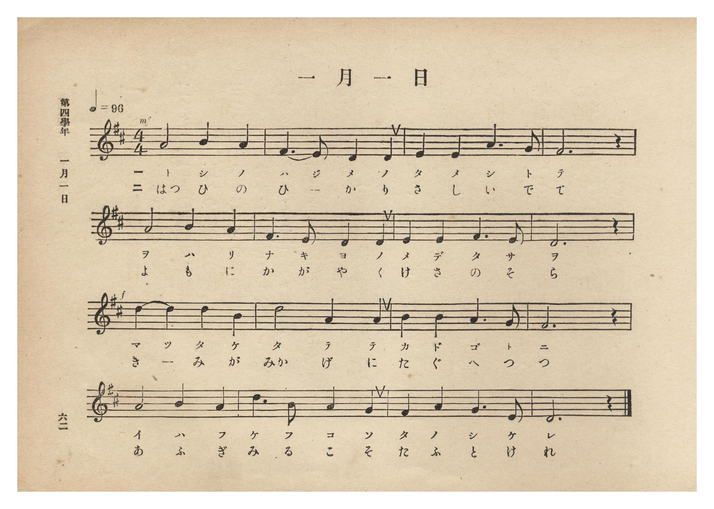
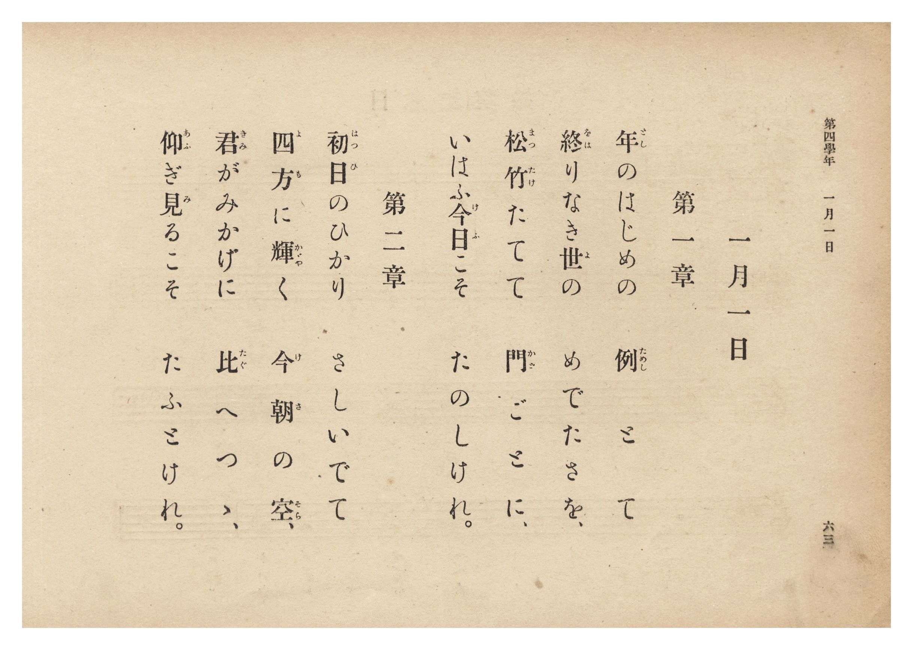

# 一月一日

> Re:Shōka 使用 AI 協助辨識與重建樂譜，可能會有錯誤。歡迎回報。

- **NEUTRINO 歌聲合成版**：<br><audio controls src="ichigatsu_ichijitsu_neutrino.mp3"></audio>
- **鋼琴伴奏版**：<br><audio controls src="ichigatsu_ichijitsu.mp3"></audio>


- 詞：千家尊福
- 曲：上真行
- 臺灣總督府《公學校唱歌集》（大正四年三月，索書號 0725 26）

## 說明

原書資訊與歌詞全文（對應 P068.jpg–P069.jpg，原書 p. 62–63，第四學年第 8 首）：
調性與拍號：ニ長調 4/4 拍子，♩= 96


## 跨冊／重複收錄參照

> 同曲（儀式歌〈一月一日〉；收錄於《公學校唱歌集》、《新定兒童唱歌》卷首與《唱歌帖》P123）

- **[同曲]** 《新定兒童唱歌》尋常科第一學年用（2020.006.0847.0001）：[**〈一月一日〉**](../../shintei_jido_shoka/grade_1_2020.006.0847.0001/0_05_ichigatsu_ichijitsu/index.md)（`D` / `4/4` — [原始 TMD](../../shintei_jido_shoka/grade_1_2020.006.0847.0001/0_05_ichigatsu_ichijitsu/ichigatsu_ichijitsu.tmd)）
- **[同曲]** 《新編小公學校唱歌教材集》第一、二學年（大正12年／1923，國臺圖 0725-41）：[**〈一月一日〉**](../../shoka_kyozai_shu_1923/grade_1_2/60_ichigatsu_ichijitsu/index.md)（`D` / `4/4` — [原始 TMD](../../shoka_kyozai_shu_1923/grade_1_2/60_ichigatsu_ichijitsu/ichigatsu_ichijitsu.tmd)）
- **[同曲]** 楊金土手抄《唱歌帖》第 1 冊（2020.006.0843）：[**〈一月一日〉**](../../shokacho/vol_01/p123_ichigatsu_ichijitsu/index.md)（`D` / `4/4` — [原始 TMD](../../shokacho/vol_01/p123_ichigatsu_ichijitsu/ichigatsu_ichijitsu.tmd)）
- 總表：[跨冊重複與同名歌曲總索引](../../duplicate_songs.md)

## 歌詞

```text
第一章
年（とし）のはじめの　例（ためし）とて
終（をは）りなき世（よ）の　めでたさを、
松竹（まつたけ）たてて　門（かど）ごとに、
いはふ今日（けふ）こそ　たのしけれ。

第二章
初日（はつひ）のひかり　さしいでて
四方（よも）に輝（かゞや）く　今朝（けさ）の空（そら）、
君（きみ）がみかげに　比（たぐ）へつゝ、
仰（あふ）ぎ見（み）るこそ　たふとけれ。
```

## ABC

```abc
X:1
T:一月一日
C:曲：上真行
M:4/4
L:1/16
Q:1/4=96
K:D
V:V1 name="Piano" snm="Pia"
[V:V1]
A8 B4 A4 | F6 E2 D4 D4 | E4 E4 A6 G2 | F12 z4 |
w: 1.~と し の | は じ め の | た め し と | て
w: 2.~はつ ひ の | ひ _ か り | さ し い で | て
A8 B4 A4 | F6 E2 D4 D4 | E4 E4 F6 E2 | D12 z4 |
w: 1.~を は り | な き よ の | め で た さ | を
w: 2.~よ も に | か が や く | け さ の そ | ら
d4 d4 d4 B4 | d8 A4 A4 | B4 B4 A6 G2 | F12 z4 |
w: 1.~ま つ た け | た て て | か ど ご と | に
w: 2.~き _ み が | みか げ に | た ぐ へ つ | つ
A8 B4 A4 | d6 B2 A4 G4 | F4 A4 G6 E2 | D12 z4 |
w: 1.~い は ふ | け ふ こ そ | た の し け | れ
w: 2.~あ ふ ぎ | み る こ そ | た ふ と け | れ
```

## TMD 檔案連結

- [主旋律 TMD 檔案](ichigatsu_ichijitsu.tmd) [[在 TMD Studio 編輯](https://tmdlang.github.io/Tmd-TS/#tmd=s7IKdvYPcrWy4qpTUCpJTLdSSM7PyUlNLsnMz7PKzk9PzM7Ojy_OyM9OLM4ojTe0NDRVgqssy88pzU21Si9KTEmNN0GIF-eXFiWnWhUnZ-Tn58SXpFaUJOXnZ6PLxxckpqdaBRiYWSBkCoryy1LzEvOAuguKMvNKUlPA2hEKUssyU1JB0sXJiXnxZalFmWmZqSlITkotKga5HGpFSVFiXnFyUWYByDsIVflFJRn5QGcXZFRaZWQWl-QXZSYn5sRnJ-YlIhSVZKQCPVecmlicn1eMLpycWpSam5-XmZijxKWlpfBkR8OzOR0gcvpSBS0tLkVbBUszLntbBRcuGxN9EzuQ7hcr573fM-tpb_PTdduebuh6vqwfbOiz2ZuAwk92dD2fM__Fwh6w2Iv2Xc8bFz_fsff53MVPd8153ND1tHXN07U7ni1Y-HTKxmdre17Obnvc0P1-T8fTJcufrV38dPbspzu3PNnRCXTE-z09z7csejZ7x4uZ8xUMzI1MFYzM3u_pVOLi0tdSsKUW4FJQUHjaNx9kzeb2Fyu6XnS0A50F9OLT1hXPprWDXLah91l7pwIofvWyCtIfNUwGMi1BTKALIVoVCvQUzIyAMmbGIFevWQPyx9odQK8A2QoWCi-XTQO6HBg6INterNr_rGE5yJ7uXqDXgKKPm7tfTt0OFFcABrECUPjp2glAcx7NXAkOfZAmoDnASHm-egHYvTu3AN31uHHF48bpQHMfN6573Lj-ceOMx02NIHZDw5N9oCB93DgfLAJRA1S8DGzS1iaQXNMkoB6QRFPX48ZVjxt7n-wAuhEoDgx3sIkNDWDNy0GmNE4FqW9oBOl_Nnff89U7wcbve9y4BCw9EawHyFgGQg0NL6c1gBV0P25cCZaaArZ_NdSIx40tYAdvfbK7C5jOwEonArlgpZMfN84FWQ4yDuiv6SCppp7HDU3wcNjVAwuHjrkw7UDTgE4BJkBIaGwC2Q30GcicqWBDgDYCvQIOAWDkPJsG9kETEAFDA6hn9Ys9c6FObpr3uKkFLNgPCkqgE-dApIBOnAqx4PnKXWCRuY-bgLHaCfXW0wmzwaK9jxv3g9X1ABngQACGNdDvDc_WT4FGSyMwfoEKdoBc3QT0Llj_k90bwNJNsKDoe7EMEo9g45qABiEHzlZwmMICB6if8swABQpa-lxcnskZmemJJcWlIEZWJpBhFZCZmJfvUGNQUw2yTsHGQssOzMCWH6EpFlgQKGiYKDzd0P98fYMOPBNpYtEAtBRkWI2CqYIuGJoBMYhdo2AM5hspGAJJEK4BskF8iLyugglcDQQagNSATfMxrAEmtxVQcWBKAJPrwGYAUw1UdIYCMK2jyMwH8aBiID0gegVYZhmSPfEIe4zA5gHjE27VJhQDQTyIeDfY6C6o-FQkZ7VAVSzHYRH-wN7VQ-vAhsnUgMVxBHbTJLhPQcGL8OkqqGgvUKwDOWygwbwcTIICHkRPBcvAzMIS2GAzwGqbmsA6VkPtAYUviN8DlAGFKDAfQ2UmQk2G2Q2i54Lt6SQxrHd0khPWhnGgIIUToCCHCoIgKPQhMQCSgMUH4cS9D-wPULqDJluwP2GJGOJLUFqCkLAQApbMYHIKVAUkcYPCEFfi7oWbth8avhDTQEUcXAoUYYiogDhnApjcAVWxBCwDyyZEBjiwyKZO4oaGthmYawIWAoUtjEcwdUPzKDx1N26FehUU5hA-sJQGs-aiBAIovSGKkongVAcKQVyhDUrTMBNBZB8stCGiTd047IGohhR4uO2p5eLStVPALOIVgKLKXAA)]
- [鋼琴伴奏 TMD 檔案](ichigatsu_ichijitsu_piano.tmd) [[在 TMD Studio 編輯](https://tmdlang.github.io/Tmd-TS/#tmd=s7IKdvYPcrWy4tLSUniyo-HZnA4QOX3p-z0dL7v3PJ-w5cmeLU-X9j_v7Hi_p1NBS4tL0VbB0ozL3lbBhcvGRN_EjqtOQenFynnv98x62tv8dN22pxu6ni_rVwIJP5u9CSj8ZEfX8znzXyzsAYu9aN_1vHHx8x17n89d_HTXnMcNXU9b1zxdu-PZgoVPp2x8trbn5ey2xw3dQOufLln-bO3ip7NnP9255cmOTqDL3u_peb5l0bPZO17MnK9gYG5kqmBkBnSVEheXZ3JGZnpiSXEpiJGVCWRYBWQm5uUHeTjUGNRUcykAgY2Flh2Yoa-lYIsOFJ6vWQP0ONCVChomCk839D9f36CjEGBgZqGXVZCuiUWDlj7YsBoFUwVdMDQDYhC7RsEYzDdSMASSIFwDZIP4EHldBRO4Ggg0AKkBm-ZjWKPwuHEFVPxx43QwuQ5sxuPG9VDRGQqPmxpRZOaDeFAxkB4QvQIsswzJnniEPUZg8x43LoFbtQnFQBAPIt4NNroLKj4VyVktUBXLcViEP7B39dA6sGEyNWBxHIHdNAnuU1DwIny6CiraCxTrQA4baDAvB5OggAfRU8EyMLOwBDbYDLDapiawjtVQe0DhC-L3AGVAIfq4sR8qMxFqMsxuED0XbE8niWG9o5OcsDaMAwUpnAAFOVQQBEGhD4kBkAQsPggn7n1gf4DSHTTZgv0JS8QQX4LSEoSEhdDjxpVgcgpUBSRxg8IQV-LuhZu2Hxq-ENP2w4IcJAiKMERUQJwzAUzugKpYApaBZRMiAxxYaFEncUND2wzMNQELgcIWxiOYuqF5FJ66G7dCvQoKcwj_ceNkMGsuSiCA0huiKJkITnWgEMQV2qA0DTMRRPbBQhsi2tSNwx6IakiBh9ueWtwlvA9yCW-CKOGfTpvzrHXbsxl9T3atA0bHs-7ep2snQOoypBQerxBtGAujMPmm8UCWaXwsgoGsxgAaAnAxEyBlgqQGzifWHKgGuP04-MS5hrAunOYAw1vXTgEzyKN9gGpwyBiBZZS5AA)]

## 分析

```text
================================================================================
📊 TMD Song Profile: [ 一月一日 ]
================================================================================
⏱  Duration:       0:40 (40.0s), 16 measures total
🎼 Key & Tempo:    首調基準 D, != 96.0 BPM, <4/4>
   - 分析範圍：      由實際發聲的音符與和弦推測調性；播放脈絡另行呈現
🎤 人聲音域:    D4 (MIDI 62) – D5 (MIDI 74) [跨度: 12 個半音 / 1.0 個八度, 難度: easy]
   - 最低音:  D4 in [IchigatsuIchijitsu #1 @ m.2, 0:03]
   - 最高音: D5 in [IchigatsuIchijitsu #1 @ m.9, 0:20]
   - 適合: soprano, mezzo-soprano, contralto, tenor, baritone, bass
🏛  結構:      IchigatsuIchijitsu (40.0s)
⚡ 編曲密度:        Peak 1 軌道同時演奏
🗝  調性診斷：       D 大調（純淨自然大調，未偵測到可信轉調）
   - 風格氣質:    純淨自然大調（陽光明朗、易唱易記，無明顯調外色彩）
   - 轉調歷程:    全曲維持單一推測調性（未偵測到可信轉調）
   - 核心骨幹音:  D, A, F#, B, E
   - 調性數值:    D 大調 [相關度: 0.95, 穩定度: High, 自然音純度: 100.0%]
   - 候選調性 (K-S): D 大調 (0.95), A 大調 (0.69), F# 小調 (0.64)
   - 五度圈歷程:   +2
   - 各段落調性細節:
     • [IchigatsuIchijitsu #1]: D 大調 (r: 0.95, 自然音純度: 100.0%)

  [ 五度圈游移軌跡 ]
               C  
         F            G  
      Bb              [D ]*
      Eb               A  
         Ab           E  
            Db       B  
               F# 
     (* = active key center)

  [ 十二半音累積音高分佈 ]
     C  :                            0.0%
     C# :                            0.0%
     D  : ████████████████████████  27.5%
     D# :                            0.0%
     E  : █████████                 10.0%
     F  :                            0.0%
     F# : █████████████████         19.2%
     G  : █████                      5.8%
     G# :                            0.0%
     A  : ███████████████████████   26.7%
     A# :                            0.0%
     B  : █████████                 10.8%
--------------------------------------------------------------------------------
Assignment 軌道音域：
  - Piano         : D4 – D5 (12 個半音 / 1.0 個八度, 48 個音符)
================================================================================
```


## 原書掃描頁






