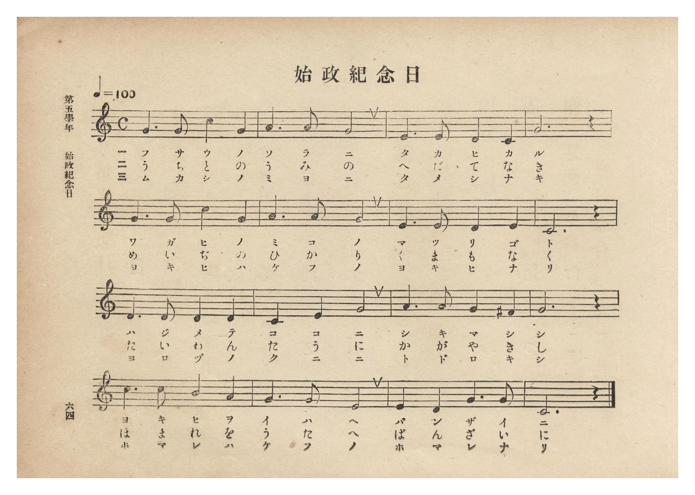
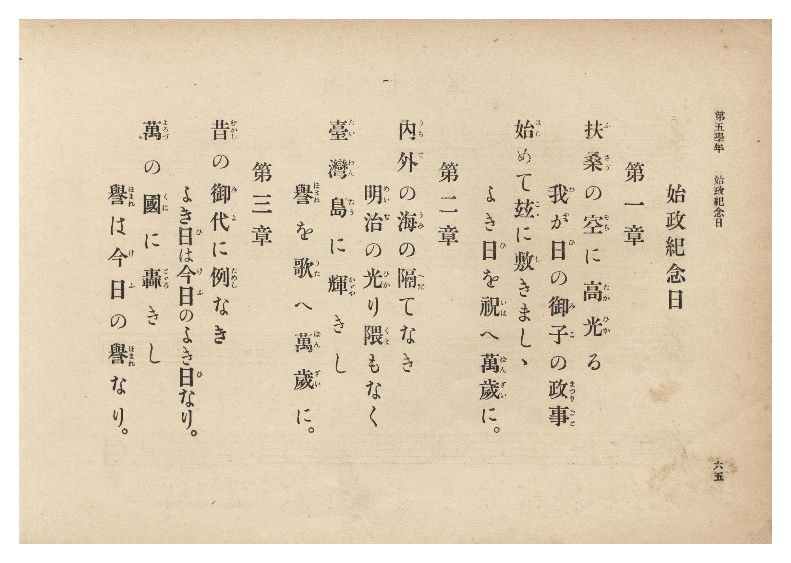

# 始政紀念日

> Re:Shōka 使用 AI 協助辨識與重建樂譜，可能會有錯誤。歡迎回報。

- **鋼琴伴奏版**：<br><audio controls src="shisei_kinenbi.mp3"></audio>
- **NEUTRINO 歌聲合成版**：<br><audio controls src="shisei_kinenbi_neutrino.mp3"></audio>

- 曲：宮島慎三郎
- 臺灣總督府《公學校唱歌集》（大正四年三月，索書號 0725 26）

## 說明

原書資訊與歌詞全文（對應 P070.jpg–P071.jpg，第五學年 pp. 64–65）：
調性與拍號：ハ長調（C 大調）4/4 拍，速度 ♩=100
曲譜出處：卷首〈緒言〉明載第五學年「始政紀念日」為國語學校助教授宮島慎三郎作曲。


## 歌詞

```text
第一章
扶桑（ふさう）の空（そら）に高光（たかひか）る
我が日（ひ）の御子（みこ）の政事（まつりごと）
始（はじ）めて茲（こゝ）に敷（し）きましゝ
よき日（ひ）を祝（いは）へ萬歳（ばんざい）に。

第二章
内外（うちと）の海（うみ）の隔（へだ）てなき
明治（めいぢ）の光（ひか）り隈（くま）もなく
臺灣島（たいわんたう）に輝（かゞや）きし
譽（ほまれ）を歌（うた）へ萬歳（ばんざい）に。

第三章
昔（むかし）の御代（みよ）に例（ためし）なき
よき日（ひ）は今日（けふ）のよき日（ひ）なり。
萬（よろづ）の國（くに）に轟（とゞろ）きし
譽（ほまれ）は今日（けふ）の譽（ほまれ）なり。
```

## ABC

<div class="abc-score" data-abc-src="shisei_kinenbi.abc" aria-label="五線譜載入中"></div>

[下載 ABC 原始檔](shisei_kinenbi.abc)

## TMD 檔案連結

- [主旋律 TMD 檔案](shisei_kinenbi.tmd) [[在 TMD Studio 編輯](https://tmdlang.github.io/Tmd-TS/#tmd=s7IKdvYPcrWy4qpTUCpJTLdSSM7PyUlNLsnMz7PKzk9PzM7Ojy_OyM9OLM4ojTe0NDRVgqssy88pzU21Si9KTEmNRxIvzi8tSk61Kk7OyM_PiS9JrShJys_PRpePL0hMT7UKMDA3QMgUFOWXpeYl5gF1FxRl5pWkpoC1IxSklmWmpIKki5MT8-LLUosy0zJTU5CclFpUDHI51IqSosS84uSizAKQdxCq8otKMvKBzi7IqLTKyCwuyS_KTE7Mic9OzEtEKCrJSAV6LjO3AGhJYg66eHJqUWpufh6KDNCY9Mw8q5LEzHKg4_LT0jKTwfJaWgpPl3c_m7L_-ZaGp_u3Ppu-VEFLi0vRVsHQwIDL3lbBmcvGRN_EDmTOs9mb3u-Z9XTduqebtz1r7Xuyo_Nlcx_Yhhftu543Ln6-Y-_zuYuf7przuKHraeuap2t3PFuw8OmUjc_W9ryc3fa4ofv9no6nS5Y_W7v46ezZT3duARrwbE7H-z09z7csejZ7x4uZ8xUMzI1MFYzM3u_pVOLi0tdSsKUW4FJQUHjaNx9kzeb2Fyu6XnS0A531YuW8p60rnk1rB7lsQ--z9k4FUJzrZRWkP2qYDGQagpggF65Z82TXFKCPgM5WKCjQUzAzASowMwU6FBgkIMNfrNr_rGE5yNjuXqBPgKKPm_tfTt0OFAca7qwA9DiY2QkMTQWgGqChLxvmP921TOHRzJW2oMAGGgIM4Rdr5zxt3_Vi5lRQUPduf7ls2uOGjufbJ71Y0fC4ofPZjL4XezqRXfO4oQct_h439D5v2vV0TveLVfOgcdC18tnUmc_6OtDi7sneOUAbHzc0cYEsB5m6o-H56gVgl3Rue7ZwItDljxu3Pm6c-rixDej0x43rnq_cBRac-7gJ6HOgyOqXq2c8bQWygYLzHzd2P27cBCRBUk3dYIM6Jj5u7AE6C6wCmIBApjzdt_Dp2glgkf2PGydDBIF-eLILlEYeN-573LjkcVPX48YpjxtXAGXBsbccIrf-ceMMsPGNjxuXvegBmggUnPy4aS7EOc-mbgeLTAdze8FmTQfKgox43ASU6EVxS9Ok50uBOoHcFqDRYD07XkxY82ztZrDghsdNkx83TgPKQkxHDqtdPdCwetrW-nTJNLD6tseNCyFOBnloK8QpQEFQxANFXs6aAhbZ8bhxAVhk2ePGVUAngQNqRt-zTbtB0iCfAV2zCBpW0MCFB2vXy1nATAMU6Qd6DizSBDalH5wMwTkRGMmwCGl53NQP9gSQDYnD1S_2QHzc_bhp3uMmiM-AATUdrH_tXrDcblDANfVAggiYU2AeASZsEoJoRycsOc0Ae7ypAZxCIHEDSgVPdi-GpoImoJ9A2p_sg0TzfHAwQFTCgghL_DWuf7K7CyYCTGlbIUZjU7kKlKKAjgP5csIasHOACOhxoCKwc-ZAbAYG62poQO0FehcosgIcUMAsiz-gcLgFm0okt1BetkGBgpY-F1cwsMpIzfTOzEvNS8q0CshMzMt3qDGoqQbZpGBjoWUHZmArWaH5_8XCHgUNE4WnG_qfr2_QgReHmlg0AO0DGVajYKqgC8aGcVBGjYIZkNQFkiAeCNYoGINpYwUjkEKwCEwOBA1AImDjfAxrFIBhB-QDyx0w2QYm14H1AEsesHpg8QNkr4abDkwwEPHGbiDeBGWBZZpANAzGI-wxAumCmL0QTK5AsQckA-Lvh4rB7NkBFV8AxMvArFVQmV7s9hiD3NAAdxEw_aDYsx_qnw7s_mlqhOvAbQ_-SN3VQ8dIBZE4IrWpH-yNHjAJiSK0QGicjBbY-6DiS4C6u8CsKVAZUGThiFRgkIFUtoDJRSj2gGyFJhKweTB7QC4Die8DijehBDZEBnukdoBVgqID5p_1UF0ToeZtRfUPWAdED0wH1B64a4iN1B2d5EQqKJ6QMSS-QLGIiFNQLIMwSMREHSyEL6eCvAyskkEkNOBBuQIkMxnMg5DIKRuSmiHBBopgiAhMBldOBeUHaKRCElITyGSEDCQnI9sDyW3g5NYESQwgO_HYg4jUJojrloJJWOKBJF-QDaj2QMqNlUj6cNuDN1KBzWJyIhWcQ8GEORCDog4WY6bQDArLqqAoh8ngz6oYSbtpEtRPoJCEJHVYWQgR3wCPE2BrAKqmBSwDCytssbobrA6cCpogMQWzB1b-zqfUHlCsYtpDKKti6IBkVuxZtZaLS9dOAaXuVQAKKHMBAA)]
- [鋼琴伴奏 TMD 檔案](shisei_kinenbi_piano.tmd) [[在 TMD Studio 編輯](https://tmdlang.github.io/Tmd-TS/#tmd=s7IKdvYPcrWy4tLSUni6vPvZlP3PtzQ83b_12fSl7_d0vOze83zClid7tjxd2v-8s-P9nk4FLS0uRVsFQwMDLntbBWcuGxN9EzuuOgWlZ7M3vd8z6-m6dU83b3vW2vdkR-fL5j4lkMyL9l3PGxc_37H3-dzFT3fNedzQ9bR1zdO1O54tWPh0ysZna3tezm573NANtO7pkuXP1i5-Onv2051bgAY8mwO0sef5lkXPZu94MXO-goG5kamCkRnQFUpcXMEZmcWpmd6Zeal5SZlWAZmJeflBHg41BjXVXApAYGOhZQdm6Gsp2KIDhedr1jzZ0fBiYY-ChonC0w39z9c36CgEGJgb6GUVpGti0aClDzasRsFUQReMDeOgjBoFMyCpCyRBPBCsUTAG08YKRiCFYBGYHAgagETAxvkY1ig8btwK5D9unAom28DkOrCex41zweofN3UC2avhpj9unA8Rb-wG4k1QFlimCUTDYDzCHiOQLojZC8HkChR7QDIg_n6oGMyeHVDxBUC8DMxaBZXpxW6PMcgNDXAXPW6cjmLPfqh_OrD7p6kRrgO3PfgjdVcPHSMVROKI1KZ-sDd6wCQkitACoXEyWmDvg4ovAeruArOmQGVAkYUjUoFBBlLZAiYXodgDshWaSMDmwewBuQwkvg8o3oQS2BAZ7JHaAVYJig6Yf9ZDdU2EmrcV1T9gHRA9MB1Qe-CuITZSd3SSE6mgeELGkPgCxSIiTkGxDMIgERN1sBC-nAry8uPGGSASGvCgXAGSmQzmQUjklA1JzZBgA0UwRAQmgyungvIDNFIhCakJZDJCBpKTke2B5DZwcmuCJAaQnXjsQURqE8R1S8EkLPFAki_IBlR7IOXGSiR9uO3BG6nAQp6cSAXnUDBhDsSgqIPFmCk0g8KyKijKYTL4sypG0m6aBPUTKCQhSR1WFkLEN8Dj5HHjNKiaFrAMLKywxepusDpwKmiCxBTMHlj5O59Se0CximkPoayKoQOSWbFn1VqsVa8PctVrgqh6X_R1vWzvBUb2s-7ep2snPJ3U86JxE6Q9gRSp8QrRhrEwqkbBBMgwQeJDGabxWAQMoF4n3xQghTAELGsaD1UGYuA02AhIGYH4KHow3ANVjWkMsnvQLQKZAgxoXTsFlLCO9jGMBZuOKWGES8IYLqHMBQA)]

## 分析

```text
================================================================================
📊 TMD Song Profile: [ 始政紀念日 ]
================================================================================
⏱  Duration:       0:38 (38.4s), 16 measures total
🎼 Key & Tempo:    首調基準 C, != 100.0 BPM, <4/4>
   - 分析範圍：      由實際發聲的音符與和弦推測調性；播放脈絡另行呈現
🎤 人聲音域:    C4 (MIDI 60) – C5 (MIDI 72) [跨度: 12 個半音 / 1.0 個八度, 難度: easy]
   - 最低音:  C4 in [ShiseiKinenbi #1 @ m.3, 0:06]
   - 最高音: C5 in [ShiseiKinenbi #1 @ m.1, 0:01]
   - 適合: soprano, mezzo-soprano, contralto, tenor, baritone, bass
🏛  結構:      ShiseiKinenbi (38.4s)
⚡ 編曲密度:        Peak 1 軌道同時演奏
🗝  調性診斷：       G 大調（純淨自然大調，未偵測到可信轉調）
   - 風格氣質:    純淨自然大調（陽光明朗、易唱易記，無明顯調外色彩）
   - 轉調歷程:    全曲維持單一推測調性（未偵測到可信轉調）
   - 核心骨幹音:  G, C, E, D, A
   - 調性數值:    G 大調 [相關度: 0.84, 穩定度: Moderate, 自然音純度: 100.0%]
   - 候選調性 (K-S): G 大調 (0.84), C 大調 (0.80), E 小調 (0.63)
   - 五度圈歷程:   +1
   - 各段落調性細節:
     • [ShiseiKinenbi #1]: G 大調 (r: 0.84, 自然音純度: 100.0%)

  [ 五度圈游移軌跡 ]
               C  
         F           [G ]*
      Bb               D  
      Eb               A  
         Ab           E  
            Db       B  
               F# 
     (* = active key center)

  [ 十二半音累積音高分佈 ]
     C  : ██████████████            21.7%
     C# :                            0.0%
     D  : ███████                   11.7%
     D# :                            0.0%
     E  : ████████                  13.3%
     F  :                            0.0%
     F# : █                          1.7%
     G  : ████████████████████████  38.3%
     G# :                            0.0%
     A  : ███████                   11.7%
     A# :                            0.0%
     B  : █                          1.7%
--------------------------------------------------------------------------------
Assignment 軌道音域：
  - Piano         : C4 – C5 (12 個半音 / 1.0 個八度, 48 個音符)
================================================================================
```


## 原書掃描頁






