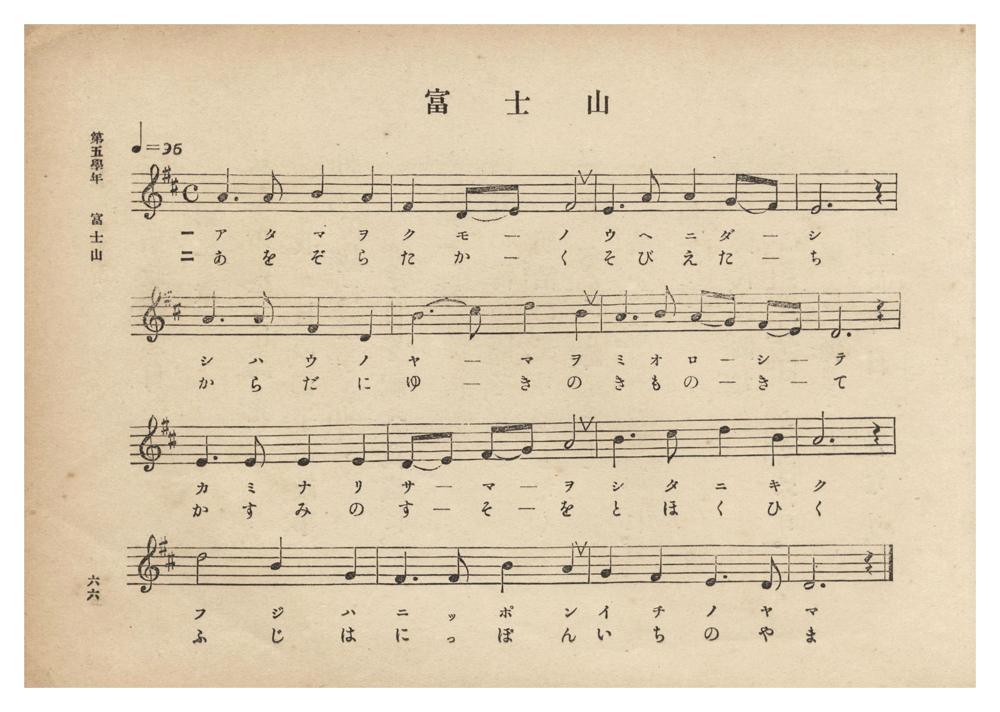
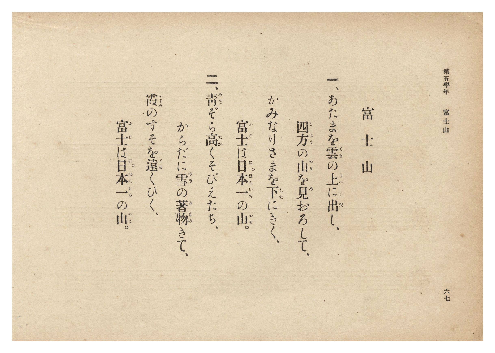

# 富士山

> Re:Shōka 使用 AI 協助辨識與重建樂譜，可能會有錯誤。歡迎回報。

- **NEUTRINO 歌聲合成版**：<br><audio controls src="fujisan_neutrino.mp3"></audio>
- **鋼琴伴奏版**：<br><audio controls src="fujisan.mp3"></audio>


- 文部省《尋常小學唱歌》
- 臺灣總督府《公學校唱歌集》（大正四年三月，索書號 0725 26）

## 說明

原書資訊與歌詞全文（對應 P072.jpg–P073.jpg，第五學年 pp. 66–67）：
調性與拍號：ニ長調（D 大調）4/4 拍，速度 ♩=96


## 跨冊／重複收錄參照

> 同曲＋同名異曲（《公學校唱歌》第三學年、《公學校唱歌集》與《新定兒童唱歌》第二學年為文部省『尋常小學唱歌』「あたまを雲の上に出し…」同曲；《公學校唱歌》第二學年〈フヂサン〉為低學年別曲）

- **[同曲]** 《公學校唱歌》第二學年用（昭和11年／1936）：[**〈フジサン（富士山）〉**](../../kogakko_shoka/grade_2/8_fujisan/index.md)（`D` / `4/4` — [原始 TMD](../../kogakko_shoka/grade_2/8_fujisan/fujisan.tmd)）
- **[同名異曲]** 《共益商社唱歌教科書》卷四・教師用（明治33年／1900）：[**〈富士山〉**](../../kyoeki_shoka/kan_4_854865/6_fujisan/index.md)（`E,` / `4/4` — [原始 TMD](../../kyoeki_shoka/kan_4_854865/6_fujisan/fujisan.tmd)）
- **[同曲]** 《新定兒童唱歌》尋常科第二學年用（2020.006.0847.0002）：[**〈ふじ山〉**](../../shintei_jido_shoka/grade_2_2020.006.0847.0002/4_14_fujisan/index.md)（`D` / `4/4` — [原始 TMD](../../shintei_jido_shoka/grade_2_2020.006.0847.0002/4_14_fujisan/fujisan.tmd)）
- **[同曲]** 《新編小公學校唱歌教材集》第三、四學年（大正12年／1923，國臺圖 0725-41）：[**〈富士山〉**](../../shoka_kyozai_shu_1923/grade_3_4/07_fujisan/index.md)（`D` / `4/4` — [原始 TMD](../../shoka_kyozai_shu_1923/grade_3_4/07_fujisan/fujisan.tmd)）
- 總表：[跨冊重複與同名歌曲總索引](../../duplicate_songs.md)

## 歌詞

```text
一、あたまを雲（くも）の上（うへ）に出（だ）し、
四方（しはう）の山（やま）を見（み）おろして、
かみなりさまを下（した）にきく、
富士（ふじ）は日本一（にっぽんいち）の山（やま）。

二、青（あを）ぞら高（たか）くそびえたち、
からだに雪（ゆき）の著物（きもの）きて、
霞（かすみ）のすそを遠（とほ）くひく、
富士（ふじ）は日本一（にっぽんいち）の山（やま）。
```

## ABC

```abc
X:1
T:富士山
M:4/4
L:1/16
Q:1/4=96
K:D
V:V1 name="Piano" snm="Pia"
[V:V1]
A6 A2 B4 A4 | F4 D2 E2 F8 | E6 A2 A4 G2 F2 | E12 z4 |
w: 1.~あ た ま を | く も _ の | う へ に だ _ | し
w: 2.~あ を ぞ ら | た か _ く | そ び え た _ | ち
A6 A2 F4 D4 | B4 c2 d2 B8 | A6 B2 A2 G2 F2 E2 | D12 z4 |
w: 1.~し は う の | や _ ま を | み お ろ _ し _ | て
w: 2.~か ら だ に | ゆ _ き の | き も の _ き _ | て
E6 E2 E4 E4 | D2 E2 F2 G2 A8 | B3 c d4 B8 | A12 z4 |
w: 1.~か み な り | さ _ ま _ を | し た に き | く
w: 2.~か す み の | す _ そ _ を | と ほ く ひ | く
d8 B4 G4 | F6 F2 B4 A4 | G4 F4 E6 D2 | D12 z4 |
w: 1.~ふ じ は | に つ ぽ ん | い ち の や | ま
w: 2.~ふ じ は | に つ ぽ ん | い ち の や | ま
```

## TMD 檔案連結

- [主旋律 TMD 檔案](fujisan.tmd) [[在 TMD Studio 編輯](https://tmdlang.github.io/Tmd-TS/#tmd=s7IKdvYPcrWy4qpTUCpJTLdSSM7PyUlNLsnMz7PKzk9PzM7Ojy_OyM9OLM4ojTe0NDRVgqssy88pzU21Si9KTEmNRxIvzi8tSk61Kk7OyM_PiS9JrShJys_PRpePL0hMT7UKMDA3QsgUFOWXpeYl5gF1FxRl5pWkpoC1IxSklmWmpIKki5MT8-LLUosy0zJTU5CclFpUDHI51IqSosS84uSizAKQdxCq8otKMvKBzi7IqLTKyCwuyS_KTE7Mic9OzEtEKCrJSAV6Li-xpLQoFV20ICcxGSiopaXwdH3P08Wrn27cqKClxaVoq2BpxmVvq-DCZWOib2IH0vVsWvvL5hXP5zQ-buh6uqH76Y4dTzf0P1274-mUjc_W9jxu6Aab_aJ91_PGxc937H0-d_HTXXNAalvXAFU9W7AQovDl7Dag2vd7Op4uWf5s7eKns2c_3bnlyY7OZ3M63u_peb5l0bPZO17MnK8ADE5TBSOz93s6lbi49LUUbKkFuBQUFJ72zQdZs7n9xYquFx3tQGe9WDnvaesKoB9BLtvQ-6y9UwEUo3pZBemPGiYDmcYgJsiFa9Y82TUF5O-dWxQKCvQUzMyACszMgQ59v2cWyPAXq_Y_a1gOMra7F-gToOjj5u6XU7cDxYGGuygAPQ5mdgJDVgGoBmjoy4b5T3ctU3g0c6UtMNxBhjzZ0fC4ofFxY9PjxvmPG_c9bpr0cvYmoPbHjf2Pm5qAmh83rnuyowss0va4cQdYZPXT9l1gkQVg7nSgCWDfzp79bNpOsMT0x43rgRog-oGRDRJsagFaABJpmvRiGShmHjeCXPe4setxUy9YyzKoQY8bu4FyjxtXPW7qetw4FeKuJzsgeoDqgH4FueJxI1BbP8xycLoCq9j6uHEGWMX6Z9OXPpuzBuhHsDhQw-LHjXsfN01-3Ah0y0LsrmtoggTMLmBaa3w5dxJYaxPQAWDl8x43db5cDTQeKAgMMKCTgIL9jxvnPm7c_LgRIrgQyRtNQOkFQKtfzl4FtgUYhsCIANn7YuL0550rwQb1AoMaKAIWB3oJFgwv58wDSwMDYyYsrNaB2XNB8QQKfaDsiseNu2Gu2ESb8AAaR3l-gAIFLX0uLrfSrMzixDyrgMzEvHyHGoOaapAdCjYWWnZgBrZ8qADKETsaXizsUdAwUQCWCc_XN-jAM48mFg1Am0CG1SiYKugCoamCGZjUBYoYA0lDBSMwDYI1QDZEDUjeBCgOE4FAA5AasGk-hjXAiG0CiwJjG4j3gVhNk8CmAMMfzAPJA8MSbjowL0B17ADi1WDWAqjMdCR74hH2GCHZAzQdmPTArE6orvlgM7rBJMhOmD1zofZsBuIOqBshMgsx7MEf1rt6KAlrSAiDbAaFurmCYRyYAXEmRJEZkAYFtRFQBKQUV2BDAgiYfKHBCAlYoExTC1RmHzQCYIGwHyreBRTvBbNAZoBkluEJbFBgQoIYEjmQiALZA4u8XrRIBZkNiW6IOEQEuz0EEnYnOYENSaJGYBqEQeEIStQm0BAGiWhAgt1cU1VDV1cTFA-gkEeNCezhDg0PYGgCi2KwP7ugvpsKDXVYwofahIiq-ZrwZA4JI0TmIBD6jTOh8QePZaAIiAdK2Gi2rYBq2Q2yDZzxGjfhtQ1vHACrL3LiABygkOQMKjlgpYsukESUNyBxkCgkwgwJJPitUHFguQ0m10M9BApQEH8JEO8FB8dkqAwoI0ByOCyBgjIHSAYUSbiCnLb21HJx6dopQIt6BSBTmQsA)]
- [鋼琴伴奏 TMD 檔案](fujisan_piano.tmd) [[在 TMD Studio 編輯](https://tmdlang.github.io/Tmd-TS/#tmd=s7IKdvYPcrWy4tLSUni6vufp4tVPN258v6fjZfee5xO2PNmz5enS_uedHe_3dCpoaXEp2ipYmnHZ2yq4cNmY6JvYcdUpKD2b1v6yecXzOY2PG7qebuh-umPH0w39T9fueDpl47O1PY8bupVAql6073reuPj5jr3P5y5-umsOSG3rGqCqZwsWQhS-nN0GVAu0-emS5c_WLn46e_bTnVue7Oh8Ngdoec_zLYuezd7xYuZ8BQNzI1MFIzOgg5S4uNxKszKLE_OsAjIT8_KDPBxqDGqquRSAwMZCyw7MqFEwVdAFQlMFMzCpCxQxBpKGCkZgGgRrgGyIGpC8CVAcJgKBBiA1YNN8DGsUHjc2gUUfN84H4n0gVtMksCmPG_vBPJD848Z1cNMfN7ZBdewA4tVg1gKozHQke-IR9hgh2QM0_XHjPDCrE6prPtiMbjAJshNmz1yoPZuBuAPqRojMQgx70IIHEiggxaCAMlcwjAMzICZDFJkBaVDoGAFFQEpxhQ_ET48b10N9DgkLoExTC1RmHzTMYO7eDxXvAor3glkgM0Ayy_CED8j_kFCBhCckbEH2wMK7Fy0eQGZDYggiDhHBbg80fCAJwQhMgzDI66CkYwINFJCIBiSkzDVVNXR1NUFBBwos1MDDHlRQLwAD4HHjKrDTuqAOmgoNKFjygtqECN35mvDEBPEWIgkSCLDGmdAgh0cMUATEAyUfNNtWQLXsBtkGTt6Nm_DaBg02cBhAEg0oS8GynS6QRGREkDhIFBLGhgSS1Vao-OPGGWByPdQNoDAA8ZcA8V6wDyZDZUDJDZL0YckAlARBMqBwxRVKtLWnFq3U8sFeahmCVEcbxoJCD8w0ATFRxJGYwEQWD-aZxoO4KBw0OSiFCFzcZoItBsURigvw2YSkHUIiW0NYI4SH6QaI1bhdgcVPuPQhGW4GMcIM6gQjhAzUcKgTcHgKGJG6dgrQuIz2AckgcY3AXGUuAA)]

## 分析

```text
================================================================================
📊 TMD Song Profile: [ 富士山 ]
================================================================================
⏱  Duration:       0:40 (40.0s), 16 measures total
🎼 Key & Tempo:    首調基準 D, != 96.0 BPM, <4/4>
   - 分析範圍：      由實際發聲的音符與和弦推測調性；播放脈絡另行呈現
🎤 人聲音域:    D4 (MIDI 62) – D5 (MIDI 74) [跨度: 12 個半音 / 1.0 個八度, 難度: easy]
   - 最低音:  D4 in [Fujisan #1 @ m.2, 0:03]
   - 最高音: D5 in [Fujisan #1 @ m.6, 0:13]
   - 適合: soprano, mezzo-soprano, contralto, tenor, baritone, bass
🏛  結構:      Fujisan (40.0s)
⚡ 編曲密度:        Peak 1 軌道同時演奏
🗝  調性診斷：       D 大調（純淨自然大調，未偵測到可信轉調）
   - 風格氣質:    純淨自然大調（陽光明朗、易唱易記，無明顯調外色彩）
   - 轉調歷程:    全曲維持單一推測調性（未偵測到可信轉調）
   - 核心骨幹音:  A, D, E, B, F#
   - 調性數值:    D 大調 [相關度: 0.85, 穩定度: Moderate, 自然音純度: 100.0%]
   - 候選調性 (K-S): D 大調 (0.85), A 大調 (0.80), B 小調 (0.62)
   - 五度圈歷程:   +2
   - 各段落調性細節:
     • [Fujisan #1]: D 大調 (r: 0.85, 自然音純度: 100.0%)

  [ 五度圈游移軌跡 ]
               C  
         F            G  
      Bb              [D ]*
      Eb               A  
         Ab           E  
            Db       B  
               F# 
     (* = active key center)

  [ 十二半音累積音高分佈 ]
     C  :                            0.0%
     C# : █                          1.2%
     D  : ████████████████████      20.0%
     D# :                            0.0%
     E  : ███████████████████       19.2%
     F  :                            0.0%
     F# : ██████████████            14.2%
     G  : ██████                     5.8%
     G# :                            0.0%
     A  : ████████████████████████  24.2%
     A# :                            0.0%
     B  : ███████████████           15.4%
--------------------------------------------------------------------------------
Assignment 軌道音域：
  - Piano         : D4 – D5 (12 個半音 / 1.0 個八度, 55 個音符)
================================================================================
```


## 原書掃描頁






