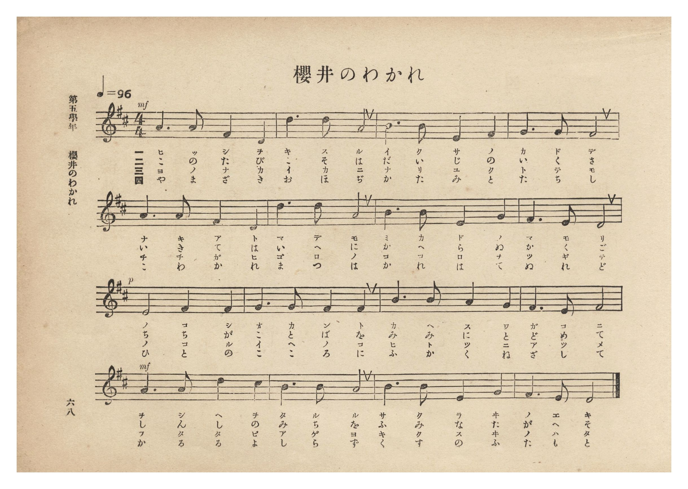
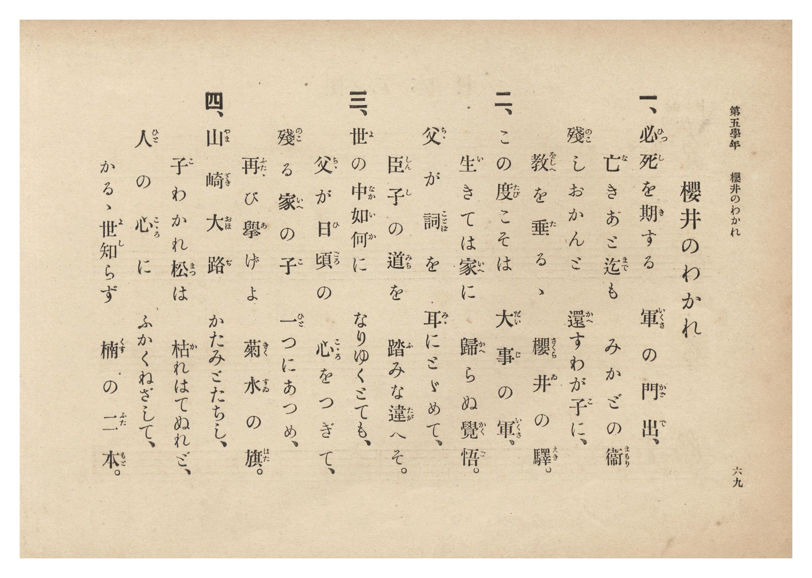

# 櫻井のわかれ

> Re:Shōka 使用 AI 協助辨識與重建樂譜，可能會有錯誤。歡迎回報。

- **NEUTRINO 歌聲合成版**：<br><audio controls src="sakurai_no_wakare_neutrino.mp3"></audio>
- **鋼琴伴奏版**：<br><audio controls src="sakurai_no_wakare.mp3"></audio>


- 文部省《尋常小學唱歌》
- 臺灣總督府《公學校唱歌集》（大正四年三月，索書號 0725 26）

## 說明

原書資訊與歌詞全文（對應 P074.jpg–P075.jpg，第五學年 pp. 68–69）：
調性與拍號：ニ長調（D 大調）4/4 拍，速度 ♩=96
版本考證：本曲採自文部省《尋常小學唱歌》第五學年〈櫻井のわかれ〉（全四章，「必死を期する…」），
與《新定兒童唱歌》第六學年〈小楠公〉（落合直文詞・奥山朝恭曲〈櫻井のわかれ〉末段「言の葉を…」）詞曲不同。


## 歌詞

```text
一、必死（ひっし）を期（き）する　軍（いくさ）の門出（かどで）、
亡（な）きあと迄（まで）も　みかどの衞（まもり）
殘（のこ）しおかんと　還（かへ）すわが子（こ）に、
教（をしへ）を垂（た）るゝ　櫻井（さくらゐ）の驛（えき）。

二、この度（たび）こそは　大事（だいじ）の軍（いくさ）。
生（い）きては家（いへ）に　歸（かへ）らぬ覺悟（かくご）。
父（ちゝ）が詞（ことば）を　耳（みゝ）にとゞめて、
臣子（しんし）の道（みち）を　踏（ふ）みな違（たが）へそ。

三、世（よ）の中（なか）如何（いか）に　なりゆくとても、
父（ちゝ）が日頃（ひごろ）の　心（こゝろ）をつぎて、
殘（のこ）る家（いへ）の子（こ）　一（ひと）つにあつめ、
再（ふたゝ）び擧（あ）げよ　菊水（きくすゐ）の旗（はた）。

四、山崎大路（やまざきおほぢ）　かたみとたちし、
子（こ）わかれ松（まつ）は　枯（か）れはてぬれど、
人（ひと）の心（こゝろ）に　ふかくねざして、
かるゝ世知（よし）らず　楠（くす）の二本（ふたもと）。
```

## ABC

```abc
X:1
T:櫻井のわかれ
M:4/4
L:1/16
Q:1/4=96
K:D
V:V1 name="Piano" snm="Pia"
[V:V1]
!mf! A6 A2 F4 D4 | d6 d2 A8 | B6 B2 E4 F4 | G6 G2 F8 |
w: 1.~ひ っ し を | き す る | い く さ の | か ど で
w: 2.~こ の た び | こ そ は | だ い じ の | い く さ
w: 3.~よ の な か | い か に | な り ゆ く | と て も
w: 4.~や ま ざ き | お ほ ぢ | か た み と | た ち し
A6 A2 F4 D4 | d6 d2 A8 | B6 B2 E4 G4 | F6 E2 D8 |
w: 1.~な き あ と | ま で も | み か ど の | ま も り
w: 2.~い き て は | い へ に | か へ ら ぬ | か く ご
w: 3.~ち ち が ひ | ご ろ の | こ こ ろ を | つ ぎ て
w: 4.~こ わ か れ | ま つ は | か れ は て | ぬ れ ど
!p! E8 F4 F4 | G6 G2 F4 F4 | B6 B2 A4 G4 | F6 E2 F8 |
w: 1.~の こ し | お か ん と | か へ す わ | が こ に
w: 2.~ち ち が | こ と ば を | み み に と | ど め て
w: 3.~の こ る | い へ の こ | ひ と つ に | あ つ め
w: 4.~ひ と の | こ こ ろ に | ふ か く ね | ざ し て
!mf! A6 A2 d4 c4 | B6 B2 A8 | B6 B2 E4 G4 | F6 E2 D8 |
w: 1.~を し へ を | た る る | さ く ら ゐ | の え き
w: 2.~し ん し の | み ち を | ふ み な た | が へ そ
w: 3.~ふ た た び | あ げ よ | き く す ゐ | の は た
w: 4.~か る る よ | し ら ず | く す の ふ | た も と
```

## TMD 檔案連結

- [主旋律 TMD 檔案](sakurai_no_wakare.tmd) [[在 TMD Studio 編輯](https://tmdlang.github.io/Tmd-TS/#tmd=s7IKdvYPcrWy4qpTUCpJTLdSSM7PyUlNLsnMz7PKzk9PzM7Ojy_OyM9OLM4ojTe0NDRVgqssy88pzU21Si9KTEmNRxIvzi8tSk61Kk7OyM_PiS9JrShJys_PRpePL0hMT7UKMDA3QcgUFOWXpeYl5gF1FxRl5pWkpoC1IxSklmWmpIKki5MT8-LLUosy0zJTU5CclFpUDHI51IqSosS84uSizAKQdxCq8otKMvKBzi7IqLTKyCwuyS_KTE7Mic9OzEtEKCrJSAV6DiJdiS6cm5mTWZKILA40Iz0zzyo3Py-pFBhemBKpmVmZSIGhpaXwbPXuJ7umPm5c97ip_3Fj9-OmHgUtLS5FWwVLMy57WwUXLhsTfRM7kEHPprW_bF7xfE7j44aupxu6n-7Y8XRD_9O1O55O2fhsbc_jhm6wdS_adz1vXPx8x97ncxc_3TUHpLZ1DVDVswULIQpfzm4Dqn2_p-PpkuXP1i5-Onv2051bnuzofDan4_2enudbFj2bvePFzPkKBuZGpgpGZu_3dCpxcelrKdhSC3ApKCg87ZsPsmZz-4sVXS862oHOerFy3tPWFUA_gly2ofdZe6cCKFnoZRWkP2qYDGSagpggF65Z82TXFJC_d25RKCjQUzCzACowswQ69P2eWSDDX6za_6xhOcjY7l6gT4Cij5u7X07dDhQHGu6iAPQ4mNkJDFkFoBqgoS8b5j_dtUzh0cyVtsBwB5rxvLPj2Zw1LxqaX6wFGQtkP5u96VnfwhftqwjGA7ILHzd0YMbw4wagmR1A7wID__nqBUD7Hzf0PN3f-mzt7sdNk57Nmf-4cebjpu5HDcseNwBdB1TcA_ZXRzvQymfTNjxdN-tp66Tnq5ciW_m0dS3cSqCDni1dAIx4iE0vJux9OqHj-ewtQKcDw_lx8-6nS5c-3bjx2Zy5zxrXAj2Gy5XP5qx-tm4r0HEvVjQApV5M7AS6D-4soFFAvU929D6dAFTcxAVy45MdDY8bGiF-Adr8uHHT48bFjxunA5VDvAYWBOmG-PFxQ8OL3UAuULDlcSPQ5qlgqXUvpzU8bd8FFu9-3LjyceNykHhDI9iOXQvBEqvASnsfNzY9blzxYn8LWHAfVGlTE9Dox437YfrXvVg4D6oAKNXUBVQDMuvZuhlg0XWPGyeDjZv-uLEL7P_JQEOBRrxsgpgLNGUHzNVAZ_Y8XTsBLA7RtRrqtGdTZ4JEmyaBDQJraJr0dF4TWCnQ70Au0Oi5QHMh4Q0WB4Z6_-MmoBTQRLDfV84Gi8MCCha0u4Ch3Ai0EagEmFghRj5u3AzWBBSc-7hxPdBgYOp-sguUvx83LgAHKtCDIFOxBDPQYFBSnwKJFKA_IcG5DGjQ03XbYKoh3gb6sOHZWiAbKSyAbm5c82LZrmdNEBOA4kCjpyAZ3QExZSHQz2BTQNkcEmyg0G3cAAkgUCJoAPoDKL4fpnI1SEHTvMdNQB8D0xs4dF-0L4YF-3RwBIGTFTDAQLEA1twITBkwE3f0gwW3gtUApVa9BPkaEmg9YMEdoECDJ1xQ8nqyYxo4_oBFIcjgJzvWQlIa0G9AkafLmp7shZgBDBeQCCRcQAqauh43tYH9D_TXMnDyA7sZMwieTV_6ckEzLHNMedwEyQ3rQHG3HyI-GZRGIOKgpLTkcWMfIhTQk2xTN0ZkrUNJnQ0NwFwJs28FWAHQRGAAA_PNElAAQ8x92gZJIFtBIQR17OZnk4G5CSgITMFA7iRgyICCtr_r2YYtkJwM9jIwT0DT7rPpwDgBiq-HJndo6AILOlCxsHHj0y19oOJ3-3pwMAMdDMyv08DGAHPd7seNiyAOBqclYDwBow0YnEDGQlCUQ92J7DdYYfVs7j5Y9l8CdgkoKzybB7YGElPAAg3kKmDiXgNmr4SXJpBiBh4267DEAjSagUEDSeNrwa4GZnFYpIBdAcrawBT0fP5SSCKClXtA_bNAzlkKLOqBgqAAg6avXT3AmgUp1EElGSL7UF7XQoGClj4XV3BidmlRYqZffnhidmIRsNWVmZiX71BjUFMNskvBxkLLDszAVtcrgOq0HQ0vFvYoaJgoAKuX5-sbdOAVtCYWDUAbQYbVKFTnptUqmCroAqGpgjGQNATiGgXDOLAQkILIgcTMwLSZghGQBKmsUTABi5iAeWA1YEN9DGuAAb4JLAKsXoB4OojVNAmsB5iaoDIzgWLdcNOB-QMq3g_EU8GsdVAZiCpgogDi5ah2GYHkJ0Pl1wHxfDBrM1QnTGYuEK9HsmsBVLwFiGeg2IXuCiS7jIHyTR1Idq0Cs0CuQ9bZDcSrkewCqQL5vwuI26BmQ2RWQHUsA8o0odplArILZuI-IJ4GZoHCDqSzCyqzG4gXIdkFC6n5QLwfzALZAZIBhQuIvxAaHxC78CepXT3kJCnSUxMoHdVAU5ERWA96aoKGIdD_wMIOxV_7oDLLkcMQ6ntYbKyExhiKDqBqUJxgpiZYqIPsWgZmgVIOsswOtBiGhTpQvKkTzFqDJgNKTVNQ7QKlJmBsIGKlB8wC5RuQDEQ1sICDuhxmFyxFTwbLIeerJVCZPqi70VITTGcTyC0gd4E6M6hhuATqVzR_AdVBxCHmgmRA_oPJgEKXmNS0o5OsAqqgFpxGQBCUQjBLHogILD2BUhhqesJWOsFCFBIqkByBnK-AqaYJIgNLZ0hxDCy5IOEIkQGFIjRGEKkCKT1B4hgSyyASFuqwmFwBxBvAJsJiEpZ290NNRLgCEtbAVgFmHIPTE5q_wOUresoFqYHII5fTIFeAUhDERpAMJDeBUwXQPsz0BNEJcx0if2GkULiJWxGhCy4DgTU1VAZUukHiAdlfeNMTsNFCcYUHLpjMwW5ATj-Q9E9SCQWOO5gPdoDDHhab0JIXGBeo9R2kdgGXDZBSo2kCVAYSi8AuBhCDQhA9RUHKb1AKhdat8LCHpRxgeQJ1EWrIg1IUpNYCuQo59YJSxlxUu8ApCqYTVKOg1q2w9DEJXitCxCEuhpR5kJyC7q_18FBBTVGw8gYWUhBzkX3cCWTPQrILlIpAJgLbEtB0DXIvcqgDS3loPQuyq5aLS9dOAa2tpQAUUuYCAA)]
- [鋼琴伴奏 TMD 檔案](sakurai_no_wakare_piano.tmd) [[在 TMD Studio 編輯](https://tmdlang.github.io/Tmd-TS/#tmd=s7IKdvYPcrWy4tLSUni2eveTXVMfN6573NT_uLH7cVPP-z0dL7v3PJ-w5cmeLU-X9j_v7Hi_p1NBS4tL0VbB0ozL3lbBhcvGRN_EjqtOQenZtPaXzSuez2l83ND1dEP30x07nm7of7p2x9MpG5-t7Xnc0K0EUvWifdfzxsXPd-x9Pnfx011zQGpb1wBVPVuwEKLw5ew2oFqgzU-XLH-2dvHT2bOf7tzyZEfnszlAy3ueb1n0bPaOFzPnKxiYG5kqGJkBHaTExRWcmF1alJjplx-emJ1YlGoVkJmYlx_k4VBjUFPNpQAENhZadmCGvpaCLTpQeL5mzZMdDS8W9ihomCgAXf18fYOOQoCBuYleVkG6JhYNWvpgw2oUqnPTahVMFXSB0FTBGEgaAnGNgmEcWAhIQeRAYmZg2kzBCEiCVNYomIBFTMA8sBqwoT6GNQqPGzeBRR43Lgbi6SBW0ySwnseNvVCZmUCxbrjpjxtboOL9QDwVzFoHlYGoety4EoiXo9plBJKfDJVfB8TzwazNUJ0wmblAvB7JrgVQ8RYgnoFiF7orkOwyBso3dSDZtQrMArkOWWc3EK9GsgukCuT_LiBug5oNkVkB1bEMKNOEapcJyC6YifuAeBqYBQo7kM4uqMxuIF6EZBcspOYD8X4wC2QHSAYULiD-Qmh8QOzCn6R29ZCTpEhPTaB0VANNRUZgPeipCRqGQP8_bgSFFMJf-6Ayy5HDEOp7WGyshMYYig6galCcYKYmWKiD7FoGZoFSDrLMDrQYhoU6ULypE8xagyYDSk1TUO0CpSZgbCBipQfMAuUbkAxE9eMmkCtALofZBUvRk8FyyPlqCVSmD-putNQE09kEcgvIXcDyES0Ml0D9iuYvoDqIOMRckAzIfzAZUOgSk5p2dJJVQBXUgtMICIJSCGbJAxGBpSdQCkNNT9hKJ1iIQkIFkiOQ8xUw1TRBZGDpDCmOgSUXJBwhMqBQhMYIIlUgpSdIHENiGUTCQh0WkyuAeAPYRFhMwtLufqiJCFdAwvpxUyNmHIPTE5q_wOUresoFqYHII5fTIFeAUhDERpAMJDeBUwXQPsz0BNEJcx0if2GkULiJWxGhCy4DHzeuhcqASjdIPCD7C296AlasFFd44ILJHOwG5PQDSf8klVDguIP5YAc47GGxCS15gXGBWt9Bahdw2QApNZomQGUgsfi4sQOIQSGInqIg5TcohULrVnjYw1IOsDyBugg15EEpClJrgVyFnHpBKWMuql3gFAXTCapRUOtWWPqYBK8VIeIQF0PKPEhOQffXeniooKYoWHkDCymIucg-7gSyZyHZBUpFIBOBbQlouga5FznUgaU8tJ4F2VWLo6nlg9zUMoE2taCJxTBeIdowFkYByx4gwwSTbxoPpE3jQSJwJlANzIfAWpBkc0BSGMaACkRkCyCaMUWQjAdSuAxD8iBUAxkOA4aqrp0CWsBG-xjGgm3BJmWEW8oYt5QJXEqZCwA)]

## 分析

```text
================================================================================
📊 TMD Song Profile: [ 櫻井のわかれ ]
================================================================================
⏱  Duration:       0:40 (40.0s), 16 measures total
🎼 Key & Tempo:    首調基準 D, != 96.0 BPM, <4/4>
   - 分析範圍：      由實際發聲的音符與和弦推測調性；播放脈絡另行呈現
🎤 人聲音域:    D4 (MIDI 62) – D5 (MIDI 74) [跨度: 12 個半音 / 1.0 個八度, 難度: easy]
   - 最低音:  D4 in [SakuraiNoWakare #1 @ m.1, 0:01]
   - 最高音: D5 in [SakuraiNoWakare #1 @ m.2, 0:02]
   - 適合: soprano, mezzo-soprano, contralto, tenor, baritone, bass
🏛  結構:      SakuraiNoWakare (40.0s)
⚡ 編曲密度:        Peak 1 軌道同時演奏
🗝  調性診斷：       D 大調（純淨自然大調，未偵測到可信轉調）
   - 風格氣質:    純淨自然大調（陽光明朗、易唱易記，無明顯調外色彩）
   - 轉調歷程:    全曲維持單一推測調性（未偵測到可信轉調）
   - 核心骨幹音:  F#, A, D, B, G
   - 調性數值:    D 大調 [相關度: 0.86, 穩定度: High, 自然音純度: 100.0%]
   - 候選調性 (K-S): D 大調 (0.86), B 小調 (0.72), F# 小調 (0.70)
   - 五度圈歷程:   +2
   - 各段落調性細節:
     • [SakuraiNoWakare #1]: D 大調 (r: 0.86, 自然音純度: 100.0%)

  [ 五度圈游移軌跡 ]
               C  
         F            G  
      Bb              [D ]*
      Eb               A  
         Ab           E  
            Db       B  
               F# 
     (* = active key center)

  [ 十二半音累積音高分佈 ]
     C  :                            0.0%
     C# : ██                         1.6%
     D  : █████████████████         17.2%
     D# :                            0.0%
     E  : ██████████                10.2%
     F  :                            0.0%
     F# : ████████████████████████  24.2%
     G  : ███████████               10.9%
     G# :                            0.0%
     A  : ████████████████████      20.3%
     A# :                            0.0%
     B  : ███████████████           15.6%
--------------------------------------------------------------------------------
Assignment 軌道音域：
  - Piano         : D4 – D5 (12 個半音 / 1.0 個八度, 56 個音符)
================================================================================
```


## 原書掃描頁






