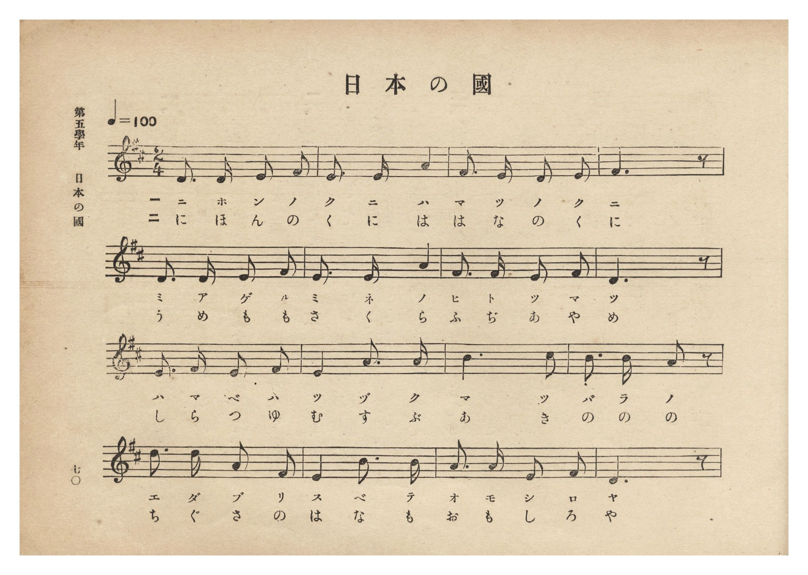
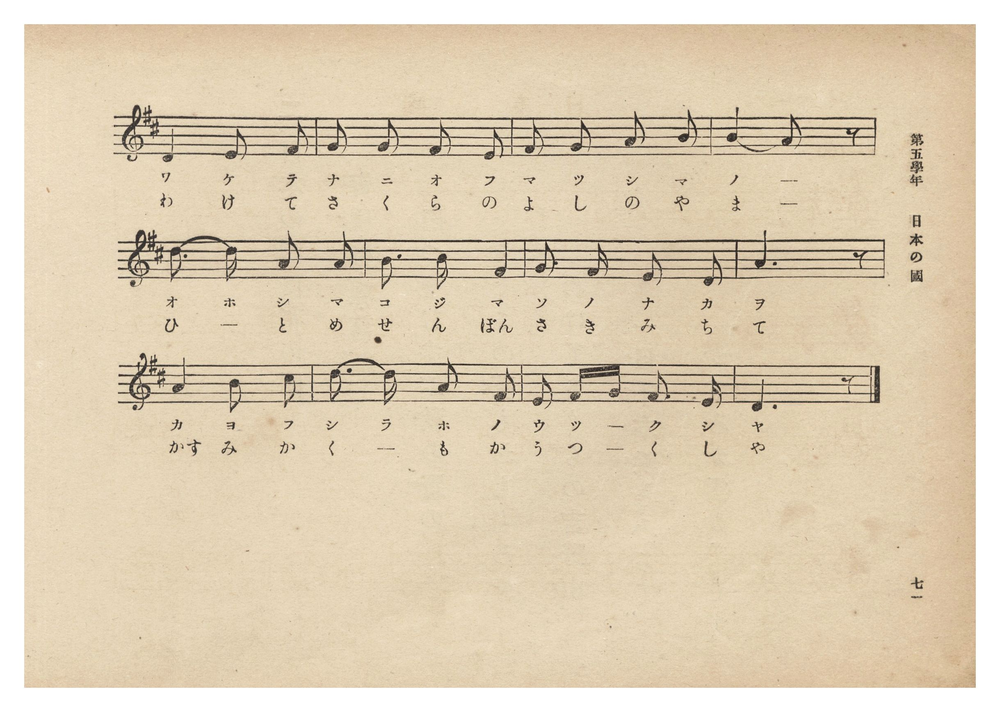
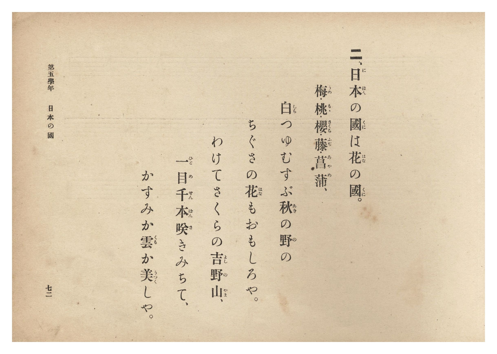
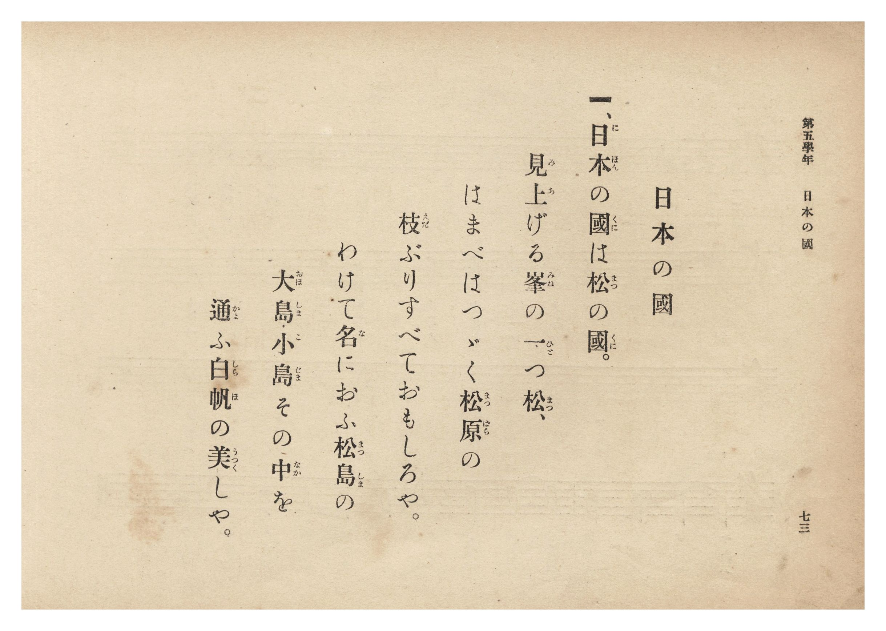

# 日本の國

> Re:Shōka 使用 AI 協助辨識與重建樂譜，可能會有錯誤。歡迎回報。

- **鋼琴伴奏版**：<br><audio controls src="nihon_no_kuni.mp3"></audio>
- **NEUTRINO 歌聲合成版**：<br><audio controls src="nihon_no_kuni_neutrino.mp3"></audio>

- 文部省
- 臺灣總督府《公學校唱歌集》（大正四年三月，索書號 0725 26）

## 說明

原書資訊與歌詞全文（對應 P076.jpg–P079.jpg，第五學年 pp. 70–73）：
調性與拍號：ニ長調（D 大調）2/4 拍，速度 ♩=100


## 歌詞

```text
一、日本（にほん）の國（くに）は松（まつ）の國（くに）。
見上（みあ）げる峯（みね）の一（ひと）つ松（まつ）、
はまべはつゞく松原（まつばら）の
枝（えだ）ぶりすべておもしろや。
わけて名（な）におふ松島（まつしま）の
大島（おほしま）・小島（こじま）その中（なか）を
通（かよ）ふ白帆（しらほ）の美（うつく）しや。

二、日本（にほん）の國（くに）は花（はな）の國（くに）。
梅（うめ）・桃（もも）・櫻（さくら）・藤（ふぢ）・菖蒲（あやめ）、
白（しら）つゆむすぶ秋（あき）の野（の）の
ちぐさの花（はな）もおもしろや。
わけてさくらの吉野山（よしのやま）、
一目（ひとめ）千本（せんぼん）咲（さ）きみちて、
かすみか雲（くも）か美（うつく）しや。
```

## ABC

```abc
X:1
T:日本の國
M:2/4
L:1/16
Q:1/4=100
K:D
V:V1 name="Piano" snm="Pia"
[V:V1]
D3 D E2 F2 | E3 E A4 | F3 E D2 E2 | F6 z2 |
w: 1.~に ほ ん の | く に は | ま つ の く | に
w: 2.~に ほ ん の | く に は | は な の く | に
D3 D E2 F2 | E3 E A4 | F3 F E2 F2 | D6 z2 |
w: 1.~み あ げ る | み ね の | ひ と つ ま | つ
w: 2.~う め も も | さ く ら | ふ ぢ あ や | め
E3 F E2 F2 | E4 A3 A | B6 c2 | B3 B A2 z2 |
w: 1.~は ま べ は | つ づ く | ま つ | ば ら の
w: 2.~し ら つ ゆ | む す ぶ | あ き | の の の
d3 d A2 F2 | E4 B3 B | A3 A E2 F2 | D6 z2 |
w: 1.~え だ ぶ り | す べ て | お も し ろ | や
w: 2.~ち ぐ さ の | は な も | お も し ろ | や
D4 E2 F2 | G2 G2 F2 E2 | F2 G2 A2 B2 | B4 A2 z2 |
w: 1.~わ け て | な に お ふ | ま つ し ま | の _
w: 2.~わ け て | さ く ら の | よ し の や | ま _
d3 d A2 A2 | B3 B F4 | G3 F E2 D2 | A6 z2 |
w: 1.~お ほ し ま | こ じ ま | そ の な か | を
w: 2.~ひ _ と め | せ ん ぼん | さ き み ち | て
A4 B2 c2 | d3 d A2 F2 | E2 F G F3 E | D6 z2 |
w: 1.~か よ ふ | し ら ほ の | う つ _ く し | や
w: 2.~かす み か | く _ も か | う つ _ く し | や
```

## TMD 檔案連結

- [主旋律 TMD 檔案](nihon_no_kuni.tmd) [[在 TMD Studio 編輯](https://tmdlang.github.io/Tmd-TS/#tmd=s7IKdvYPcrWy4qpTUCpJTLdSSM7PyUlNLsnMz7PKzk9PzM7Ojy_OyM9OLM4ojTe0NDRVgqssy88pzU21Si9KTEmNRxIvzi8tSk61Kk7OyM_PiS9JrShJys_PRpePL0hMT7UKMDA3Q8gUFOWXpeYl5gF1FxRl5pWkpoC1IxSklmWmpIKki5MT8-LLUosy0zJTU5CclFpUDHI51IqSosS84uSizAKQdxCq8otKMvKBzi7IqLTKyCwuyS_KTE7Mic9OzEtEKCrJSAV6Li-xpLQoFV20ICcxGUkQqD89M88qNz8vqRQYVkpcWloKz6YvfTZnzePGdU_ndCtoaXEp2ioYGhhw2dsquHDZGOmb2IF0P5vW_rJ5xfM5jWCzXrTvet64-PmOvc_nLn66a87jhq6nrWuert3xbMHCp1M2Plvb83J22-OG7vd7Op4uWf5s7eKns2c_3bnlyY7OZ3M63u_peb5l0bPZO17MnK9gYG5kqmBk9n5PpxIXl76Wgi21AJeCgsLTvvkgaza3v1jR9aKjHeisFyvnPW1dAfQLyGUbep-1dyqAolUvqyD9UcNkINMSxAS5cM2aJ7umAH0EdLZCQYGegrkBUIG5MdCh7_fMAhn-YtX-Zw3LQcZ29wJ9AhR93Nz9cup2oDjQcBcFoMfBzE5gCCoA1QANfdkw_-muZQqPZq60BQUwyJQnOxoeNzRCYgCo7XHj6seNux83TQbqg0QIWLAfKA4WWf9s7j6wyL7HjUuwq2loArtuWfeTHV1gif2PG5vASic9bup-unk9THAtRD_QBWCRTY8bV4BFlqDb0dAIMhFoOVhoJ5ix5HHTPKCdQKXAQIarfty44XETMIBA5oL0PJs3FywHRAvAotseN3U9bpwJNmXZ48aux01NjxunP27qfdzUAnX54yagTyYCpZ9OAIYZUOcqsE5guAB1bgVZuHkbkoXTgQyEhcBAh0kDVe9GSDfvfrqhHyY1-XHjDJi2ueAgAIYFyKbHjcCw7HzcNAlk1suGWWDR7sdNwDQLVLr1-cy9T3e0gQWBbgaK7IbY_HxfH1iwDeyifrAgUAHYR-BI3tVDUiS_6NoIFgGGM8TzOCL52aJWqL1NjRBPPlvYDBIBhmoTOM6BIquBjgSqmQrSDImb5t0vpgMjFii49XHjIqhI_7QXkzaBBYF6W6AGQmIe6G24nyEp5HET0MoGcERue74c4jRgRALjC-TYl-2Q4FiHiJfHjQsfN04Au2Iduu9ASQBvQoA7HhQQEzqBxj_dCDaiCeyoxnUgPZDohDgYmKSfzwbaDk3VEM887W2GBf9sYNg_btwDiYGnUG9PBbu2F5w1gI5dBk_23WB_AkW7X86GKAW6BZKjuvHFPFAz5cUYFCho6XNx-WVm5Of55XuX5mVaBWQm5uU71BjUVIPsUbAxNNOyA7OwlaEKoNJsR8OLhT0KGiYKwIzwfH2DDrzg08SiAWgdyLAaBUMFXSA0VDACksZAXANm6QJJUzANEgGJg0RAakGyMBEINACJgE3zMawBBudqsCgwAwAjeDKYtQ6sBxh8UJnVoLIGbjowZqHiS6BqISoRZkFgPMIeI_LsgbCBqZIIe_CH9a4e2oa1MZIaiC7sYb0f6qMmIJ4EYjV1Q30Ek1kL9SssDDZBxVeAwxvEAoU-SAbEwxXWbRBdTY1A3ARmgUiQzFSoef1AsU4ke7ZCxReBXQfS0QKRAZpBWljv6CQnrCEhixyOEBFdaFibAkXMkFxiDlYDETEDq0EPa1jq2QfEO8EskAhyyD1uXAoPDUS6hsmBVIFEN0DDshMaM-hhPR1JHhxDTaDQB4VcA9ysmVB6G9hEUPgi7OmF2gOJdRCNbA_esAa24shK13Fgq4AUKNxQQxsWojXwcCcuZXdAXb8A7EtQKHRB_QXxO0gOFAsgehlYHCQPSZmQMATWNdBwA6U8XCl7IdSMCdC0jChFYCUHqLyAmUyqPQRKkSmYoW1OZCkCKYkh4WgCJEEYxEOUzyARUJiDYgCR1rGk7CZIeQny6URoeEJCAORvSNkI8TUkV8NSNqz8AIcBvBSBlTVYwhqnPZBwB8lCyhB4HDSBUgHMBnCJDStFUPIWMSm7dS1ZYY2SskEYUUbA6kBI-MPKGlDswNI69pQNTT-gegst7EC1GIg_A8l_IPG5UHFQTobECbSUbwKV-bhSNqSkh5T1kLIbYtpsiCiwzoQ0kZAsghXmvUAMqkAg2QMkA4oqUpL2jmZyghsWbKAghhTIuIoWY2Cgw5ol-AsSUFBBPAxJTLAkjFzM7oYGL0QGVNzCEjesKTGdYEECakXCQxwSeLC6GJ7uIXUnXJwUi2q5uHTtFJBaiApArjIXAA)]
- [鋼琴伴奏 TMD 檔案](nihon_no_kuni_piano.tmd) [[在 TMD Studio 編輯](https://tmdlang.github.io/Tmd-TS/#tmd=s7IKdvYPcrWy4tLSUng2femzOWseN657Oqf7_Z6Ol917nk_Y8mTPlqdL-593drzf06mgpcWlaKtgaGDAZW-r4MJlY6RvYsdVp6D0bFr7y-YVz-c0KoF4L9p3PW9c_HzH3udzFz_dNedxQ9fT1jVP1-54tmDh0ykbn63teTm77XEDyIqnS5Y_W7v46ezZT3duebKj89kcoC09z7csejZ7x4uZ8xUMzI1MFYzMgDYrcXH5ZWbk5_nle5fmZVoFZCbm5Qd5ONQY1FRzKQCBjaGZlh2Ypa-lYIsOFJ6vWfNkR8OLhT0KGiYKTzf0P1_foKMQYGBuppdVkK6JRYOWPtiwGgVDBV0gNFQwApLGQFwDZukCSVMwDRIBiYNEQGpBsjARCDQAiYBN8zGsUXjcuBos-rhxt8Ljpslg1jqwnseN_VCZ1UC8Hm7648Z9UPElULUQlQizIDAeYY8RefZA2I8bVxFhD_6w3tVD27A2RlID0YU9rPdDfdQExJNArKZuqI9gMmuhfoWFwSao-ApweINYoNAHyYB4uMK6DaKrqRGIm8AsEAmSmQo1rx8o1olkz1ao-CKw60A6WiAyQDNIC-sdneSENSRkkcMRIqILDWtToIgZkkvMwWogImZgNehhDUs9-4B4J5gFEkEOuceNS-GhgUjXMDmQKpDoBmhYdkJjBj2spyPJg2OoCRT6oJBrgJs1E0pvA5sICl-EPb1QeyCxDqKR7cEb1sCCiqx0HQe2CkiBwg01tGEhWgMPd-JSdgfU9QvAvgSFQhfUXxC_g-RAsQCil4HFQfKQlAkJw8dN0JAApzxcKXsh1IwJ0LSMKEVgJQeovICZTKo9BEqRKZihbU5kKQIpiSHhaAIkQRjEQ5TPIBFQmINiAJHWsaTsJkh5CfLpRGh4QkIA5G9I2QjxNSRXw1I2rPwAhwG8FIGVNVjCGqc9kHAHyULKEHgcNIFSAcwGcIkNK0VQ8hYxKbt1LVlhjZKyQRhRRsDqQEj4w8oaUOzA0jr2lA1NP6B6Cy3sQLUYiD8DyX8g8blQcVBOhsQJtJRvApX5uFI2pKSHlPWQshti2myIKLDOfNy4B1J1wiyCFea9QAyqQCDZAyQDiipSkvaOZnKCGxZsoCCGFMi4ihZjYKDDmiX4CxJQUEE8DElMsCSMXMzuhgYvRAZU3MISN6wpMZ1gQdKNXDJBAg9WF8PTPaTuhIuTYlEtlgaiD3ID0QLaPgSGRrxCtGEsjAKGajyQZRqPJAJlwCXgIiBsAPUWFQ2CyyMpxDTMBMgwiQVTECVQAaACItwEVUy25xCWIemCuQ9sMDHOQTIFR5DBRcAEhkkI3-MNfaweA6YRXTsFpGQS7WMYCzYeXdgILqzMBQA)]

## 分析

```text
================================================================================
📊 TMD Song Profile: [ 日本の國 ]
================================================================================
⏱  Duration:       0:33 (33.6s), 28 measures total
🎼 Key & Tempo:    首調基準 D, != 100.0 BPM, <2/4>
   - 分析範圍：      由實際發聲的音符與和弦推測調性；播放脈絡另行呈現
🎤 人聲音域:    D4 (MIDI 62) – D5 (MIDI 74) [跨度: 12 個半音 / 1.0 個八度, 難度: easy]
   - 最低音:  D4 in [NihonNoKuni #1 @ m.1, 0:00]
   - 最高音: D5 in [NihonNoKuni #1 @ m.13, 0:14]
   - 適合: soprano, mezzo-soprano, contralto, tenor, baritone, bass
🏛  結構:      NihonNoKuni (33.6s)
⚡ 編曲密度:        Peak 1 軌道同時演奏
🗝  調性診斷：       D 大調（純淨自然大調，未偵測到可信轉調）
   - 風格氣質:    純淨自然大調（陽光明朗、易唱易記，無明顯調外色彩）
   - 轉調歷程:    全曲維持單一推測調性（未偵測到可信轉調）
   - 核心骨幹音:  D, F#, E, A, B
   - 調性數值:    D 大調 [相關度: 0.85, 穩定度: Moderate, 自然音純度: 100.0%]
   - 候選調性 (K-S): D 大調 (0.85), A 大調 (0.73), B 小調 (0.64)
   - 五度圈歷程:   +2
   - 各段落調性細節:
     • [NihonNoKuni #1]: D 大調 (r: 0.85, 自然音純度: 100.0%)

  [ 五度圈游移軌跡 ]
               C  
         F            G  
      Bb              [D ]*
      Eb               A  
         Ab           E  
            Db       B  
               F# 
     (* = active key center)

  [ 十二半音累積音高分佈 ]
     C  :                            0.0%
     C# : ██                         1.9%
     D  : ████████████████████████  21.9%
     D# :                            0.0%
     E  : █████████████████████     19.5%
     F  :                            0.0%
     F# : ██████████████████████    20.5%
     G  : █████                      4.8%
     G# :                            0.0%
     A  : █████████████████████     19.0%
     A# :                            0.0%
     B  : ██████████████            12.4%
--------------------------------------------------------------------------------
Assignment 軌道音域：
  - Piano         : D4 – D5 (12 個半音 / 1.0 個八度, 86 個音符)
================================================================================
```


## 原書掃描頁










