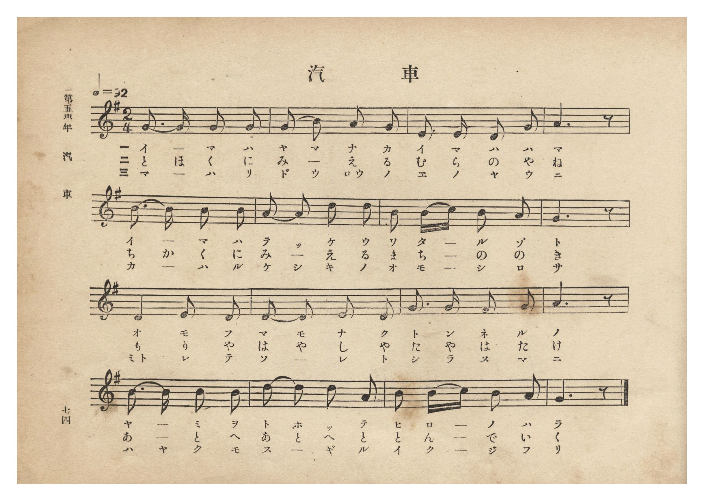
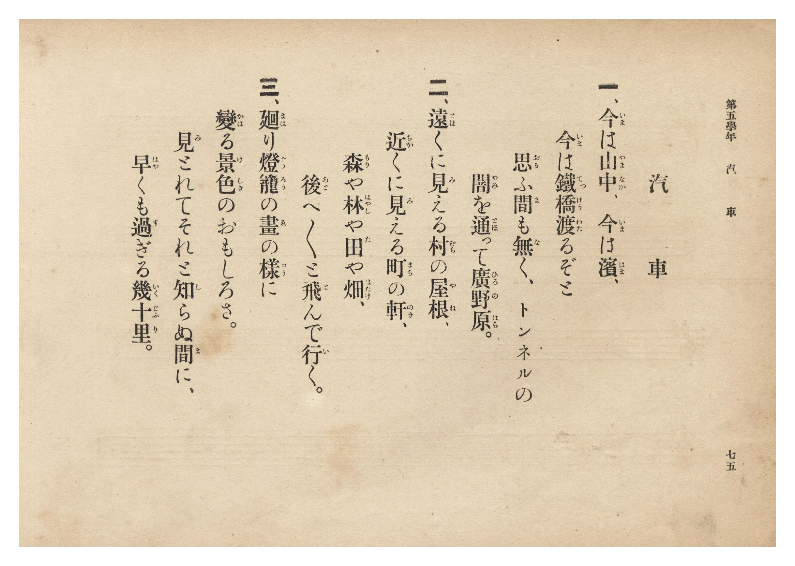

# 汽車

> Re:Shōka 使用 AI 協助辨識與重建樂譜，可能會有錯誤。歡迎回報。

- **NEUTRINO 歌聲合成版**：<br><audio controls src="kisha_neutrino.mp3"></audio>
- **鋼琴伴奏版**：<br><audio controls src="kisha.mp3"></audio>


- 文部省《尋常小學唱歌》
- 臺灣總督府《公學校唱歌集》（大正四年三月，索書號 0725 26）

## 說明

原書資訊與歌詞全文（對應 P080.jpg–P081.jpg，第五學年 pp. 74–75）：
調性與拍號：ト長調（G 大調）2/4 拍，速度 ♩=92


## 歌詞

```text
一、今（いま）は山中（やまなか）、今（いま）は濱（はま）、
今（いま）は鐵橋（てつけう）渡（わた）るぞと
思（おも）ふ間（ま）も無（な）く、トンネルの
闇（やみ）を通（とほ）って廣野原（ひろのはら）。

二、遠（とほ）くに見（み）える村（むら）の屋根（やね）、
近（ちか）くに見（み）える町（まち）の軒（のき）、
森（もり）や林（はやし）や田（た）や畑（はたけ）、
後（あと）へ〳〵と飛（と）んで行（い）く。

三、廻（まは）り燈籠（どうろう）の畫（ゑ）の樣（やう）に
變（かは）る景色（けしき）のおもしろさ。
見（み）とれてそれと知（し）らぬ間（ま）に、
早（はや）くも過（す）ぎる幾十里（いくじふり）。
```

## ABC

```abc
X:1
T:汽車
M:2/4
L:1/16
Q:1/4=92
K:G
V:V1 name="Piano" snm="Pia"
[V:V1]
G3 G G2 G2 | G2 B2 A2 G2 | E3 E E2 G2 | A6 z2 |
w: 1.~い _ ま は | や ま な か | い ま は は | ま
w: 2.~と ほ く に | み え _ る | む ら の や | ね
w: 3.~ま _ は り | ど う ろう の | ゑ の や う | に
B3 B B2 B2 | A2 A2 d2 d2 | B2 B c B2 A2 | G6 z2 |
w: 1.~い _ ま は | て っ け う | わ た _ る ぞ | と
w: 2.~ち か く に | み え _ る | ま ち _ の の | き
w: 3.~か _ は る | け し き の | お も _ し ろ | さ
D2 D2 E2 D2 | D2 D2 E2 D2 | G3 G F2 G2 | A6 z2 |
w: 1.~お _ も ふ | ま も な く | と ん ね る | の
w: 2.~も _ り や | は や し や | た や は た | け
w: 3.~み と れ て | そ _ れ と | し ら ぬ ま | に
B3 B B2 B2 | d2 d2 B2 A2 | B2 B c B2 A2 | G6 z2 |
w: 1.~や _ み を | と ほ っ て | ひ ろ _ の は | ら
w: 2.~あ _ と へ | あ と へ と | と ん _ で い | く
w: 3.~は や く も | す ぎ _ る | い く _ じ ふ | り
```

## TMD 檔案連結

- [主旋律 TMD 檔案](kisha.tmd) [[在 TMD Studio 編輯](https://tmdlang.github.io/Tmd-TS/#tmd=s7IKdvYPcrWy4qpTUCpJTLdSSM7PyUlNLsnMz7PKzk9PzM7Ojy_OyM9OLM4ojTe0NDRVgqssy88pzU21Si9KTEmNRxIvzi8tSk61Kk7OyM_PiS9JrShJys_PRpePL0hMT7UKMLAwQMgUFOWXpeYl5gF1FxRl5pWkpoC1IxSklmWmpIKki5MT8-LLUosy0zJTU5CclFpUDHI51IqSosS84uSizAKQdxCq8otKMvKBzi7IqLTKyCwuyS_KTE7Mic9OzEtEKCrJSAV6DmxCAVADsu7M9Mw8q9z8vKRSYMhgSqRmZmUieVtLS-HZxr0vdncpaGlxKdoqWBpx2dsquHPZGOmb2IE0P5vW_rJ5xfM5jY8bup5u6H66Y8fTDf1P1-54OmXjs7U9jxu6wVa8aN_1vHHx8x17n89d_HTXHJDa1jVAVc8WLIQofDm7Daj2_Z6Op0uWP1u7-Ons2U93bnmyo_PZnI73e3qeb1n0bPaOFzPnKxiYG5kqGJm939OpxMWlr6VgSy3ApaCg8LRvPsiaze0vVnS96GgHOuvFynlPW1cA_Qhy2YbeZ-2dCqBI18sqSH_UMBnINAQxQS5cs-bJrikgf-_colBQoKdgbgJUYG4KdOj7PbNAhr9Ytf9Zw3KQsd29QJ8ARR83d7ycuh0oDjTcXQHocTCzExiyCkA1QENfNsx_umuZwqOZK22B4Q4y5MmOhscNjU92dwG1PG5sedy4D6jhceP6pxs3PtmxFiTYBBJ83LjqcSMwNDuxKn62fyNYZD1UpKERbDSGupcTtj5bCYqTx43LHjcuedw48XFjG1Dq2Y6FYJv6HzcCvdH5uKn7ceO8x40rQKY8a5gL1tD1uKkJbMrWl9Mmg0XAhjY1PW8Ba25cBZbtB1oODIbHzZsfN_c-bl79uHEdyJSX00EBDvYLKEQeN0162TALrG3F48bdYJ2LgY56unvxy_Y-YKyBpTY9buoF6gf5qwkY6EB_NUHCbBcwGTa-bFyAagDQ9atfLIN4D2xJI9DC7mdzJ4JtboCa0bju6cbuZwt2wpwDDGNYgL3YD1bauBAa1DhMfD5lF8T_QJUQE1_sngQWAToVGMsw454tXge2pOlxEzAigH5ueTZvOjSeQDYD2SDB51M2gAUhId_yfCrEEcC4nA-MIIRxT_f1gCWagF4GW7vjccPmxw1bgdyXi2dDggJsxOTHjctfLIQoboFFCjTkdoBMe7obGGAQD6wH6-h63t7xfCMkOFcCkwQ43EEJA-il51NXg30BdknjumcrFsNCDqJgNTjk1kGSGjDdQEzsfjZz_YvOTWBBYCKbDg0YUAiBEhJIBGTHVJDDQPpRAnnF46YecAqdC2aseD5_KVgWEmBABWtQkmDjaliAT18JD16ov5uaXjb2gQVngkX6gE57unPf097Gl-3QEAJH8wxguoZGE8RFlJc_UKCgpc_F5Z1ZnJFoFZCZmJfvUGNQUw2yQcHGQssOzMBW6imAyp8dDcB4VNAwUQCWwM_XN-jAiypNLBqA9oAMq1HQMFTQBUJDTVUNXV1NBUMgrAFiYwUjMEvDLB4sbxYPVQDkg8SNwKIGCjVgY3wMgSqBoQMWBCoChjUQrweqAwYulLcKiLtBJsLUAYVBKtfDVAJVgYTjYWYagdWugKrdDVLbD8SrwWr3A3EHSKIJYmZTA0RdUydI3TqwvSB1a1HNNAabCbEI7E6g7U1dYJUrgbgNyAMlZrARYGMnQq1fB1QM9kobWPFquLH442RXD1lxYgw23hga5MZACApxIwVTIKwB8oAKTECSIDkjcHwRGRuNy4B4MRBPhHmlqR-kdj5YHTAsgUU5WB0k2NHiYiE0MLrxxQXINohaaEyAgxKYpbHFRDdqTED0g9w2HawDprcLFBVNEHVAmaZesOhUIiNhRyc5kWAaD0LA5A4k0XlomcYcV54AuRwULk1A1lZo2EB4oNzQD8kN0BTeNBnku7XwUFiHEQPgIACnV1jqBoUZKFGCwgQkAolJsKIWWN6aDw1T9NCHxNsKoNIecLoAicwFawXxV0BMm46cq9aA3U9C8gc246iW_EFJH5LYiUv-wPCAJy2gR5smQZM1sCSBZgGIlzeB1ALTJiyxQgqtTmzJHxT6UBNB5uwA6wdFJoQHCTQQCTRxMkTdciCGRFU_tuS_HjmygBkKGMEgtTOBuA8pQ7WA1AINAKmaAUtKwGQAM7GWi0vXTgFcbSgAGcpcAA)]
- [鋼琴伴奏 TMD 檔案](kisha_piano.tmd) [[在 TMD Studio 編輯](https://tmdlang.github.io/Tmd-TS/#tmd=s7IKdvYPcrWy4tLSUni2ce-L3V3v93S87N7zfMKWJ3u2PF3a_7yz4_2eTgUtLS5FWwVLIy57WwV3LhsjfRM7rjoFpWfT2l82r3g-p_FxQ9fTDd1Pd-x4uqH_6dodT6dsfLa253FDtxJI1Yv2Xc8bFz_fsff53MVPd80BqW1dA1T1bMFCiMKXs9uAaoE2P12y_NnaxU9nz366c8uTHZ3P5gAt73m-ZdGz2TtezJyvYGBuZKpgZAZ0kBIXl2deSVG-VUBmYl5-kIdDjUFNNZcCENhYaNmBGTUKGsYKukBorKmqoaurqWAMhDUKpkBorGAEZBmDFJiAJEFyIBFDsHoDhRquWhTzfbCbbxivEG0Yq2AKoYBGAxmmED6QQpFH5oMw1A7vzOKMRDx-0NdSsEUHCs_XrHmyo-HFwh4FDRMFYHg_X9-goxBgYGGgl1WQrolFg5Y-LEAgHjSEBoghEII8DfI8iKVhFg-WN4uHKgDyQeJG8GABGeNjCFT5uLEFLAhU9LhxHxCvB6p73NQC5a0C4m6QiTB1QGGQyvUwlUBVIOF4mJlGYLUroGp3g9T2A_FqsNr9QNwBkmiCmNnUAFHX1AlStw5sL0jdWlQzjcFmQiwCuxNoe1MXWOVKIG4D8nrBFNAIsLETodavAyoGe6UNrHg13Fj8cbKrh6w4wZZIjYAQlFDxJ1ICsdG4DIgXA_FEmFea-kFq54PVAcPyceM8sDpIsKPFxUJoYHTjiwuQbRC10JgAB-Xjxl5sMdGNGhMQ_SC3TQfrgOntAkVFE0QdUKapFyw6lchI2NFJTiQAsygQAZM7kETnoWUac1x5AuRyULg0AVlboWED4YFyQz8kN0BTeNNkkO_WwkNhHUYMgIMAnF5hqRsUZqBECQoTkAgkJsGKWmB5az40TNFDHxJvK4BKe8DpAiQyF6wVxF8BMW06cq5aA3Y_CckfWGhTLfkTV0Yjkj8wPOBJC-jRpknQZA0sSaBZAOLlTSC1wLQJS6yQQqsTW_IHhT7URJA5O8D6QZEJ4UECDUQCTZwMUbcciCFR1Y8t-a9HjixghgJGMEjtTCDuQ8pQLSC1QANAqmbAkhIwGcBMRK01iKyZ0PnAtB1tlhsLp5HrLljQkl2_ASmEGVBJI5gadD5uOyh2B1I9q2unAK7OwQYCOeAQjPYxjEUTMEIXMIYLKHMBAA)]

## 分析

```text
================================================================================
📊 TMD Song Profile: [ 汽車 ]
================================================================================
⏱  Duration:       0:20 (20.9s), 16 measures total
🎼 Key & Tempo:    首調基準 G, != 92.0 BPM, <2/4>
   - 分析範圍：      由實際發聲的音符與和弦推測調性；播放脈絡另行呈現
🎤 人聲音域:    D4 (MIDI 62) – D5 (MIDI 74) [跨度: 12 個半音 / 1.0 個八度, 難度: easy]
   - 最低音:  D4 in [Kisha #1 @ m.9, 0:10]
   - 最高音: D5 in [Kisha #1 @ m.6, 0:07]
   - 適合: soprano, mezzo-soprano, contralto, tenor, baritone, bass
🏛  結構:      Kisha (20.9s)
⚡ 編曲密度:        Peak 1 軌道同時演奏
🗝  調性診斷：       G 大調（純淨自然大調，未偵測到可信轉調）
   - 風格氣質:    純淨自然大調（陽光明朗、易唱易記，無明顯調外色彩）
   - 轉調歷程:    全曲維持單一推測調性（未偵測到可信轉調）
   - 核心骨幹音:  G, B, A, D, E
   - 調性數值:    G 大調 [相關度: 0.83, 穩定度: High, 自然音純度: 100.0%]
   - 候選調性 (K-S): G 大調 (0.83), D 大調 (0.66), B 小調 (0.65)
   - 五度圈歷程:   +1
   - 各段落調性細節:
     • [Kisha #1]: G 大調 (r: 0.83, 自然音純度: 100.0%)

  [ 五度圈游移軌跡 ]
               C  
         F           [G ]*
      Bb               D  
      Eb               A  
         Ab           E  
            Db       B  
               F# 
     (* = active key center)

  [ 十二半音累積音高分佈 ]
     C  : ██                         1.7%
     C# :                            0.0%
     D  : ███████████████           16.7%
     D# :                            0.0%
     E  : ████████                   8.3%
     F  :                            0.0%
     F# : ██                         1.7%
     G  : ████████████████████████  26.7%
     G# :                            0.0%
     A  : ██████████████████        20.0%
     A# :                            0.0%
     B  : ███████████████████████   25.0%
--------------------------------------------------------------------------------
Assignment 軌道音域：
  - Piano         : D4 – D5 (12 個半音 / 1.0 個八度, 54 個音符)
================================================================================
```


## 原書掃描頁






