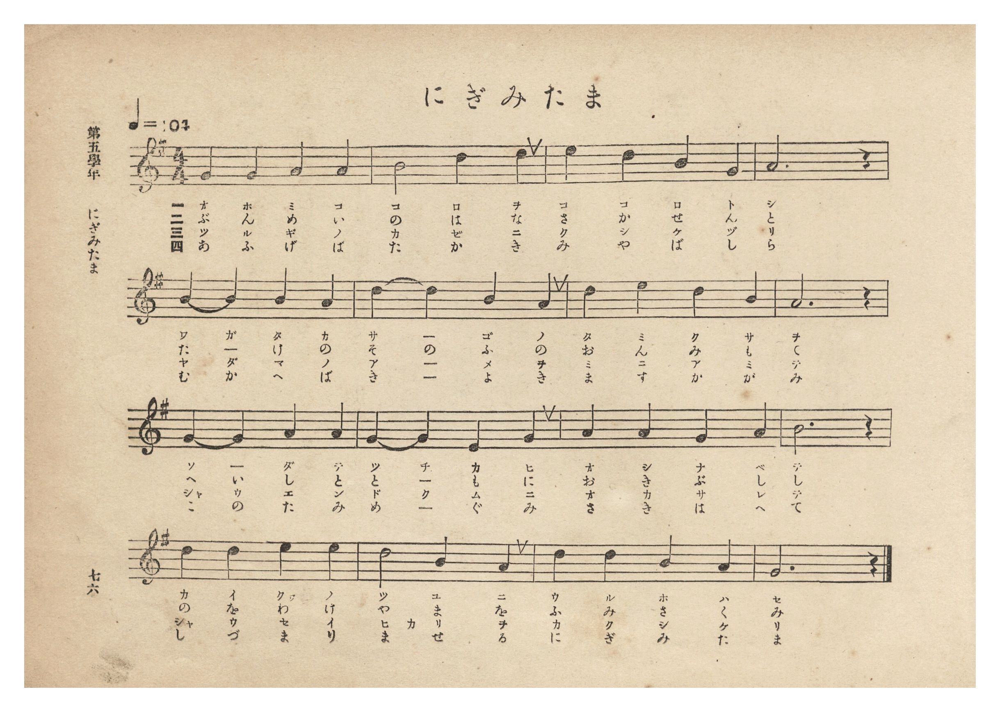
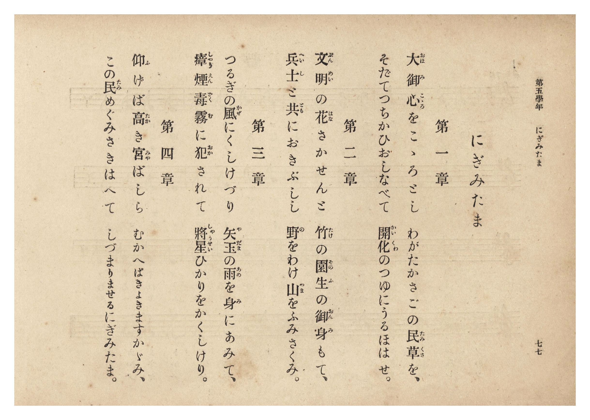

# にぎみたま

> Re:Shōka 使用 AI 協助辨識與重建樂譜，可能會有錯誤。歡迎回報。

- **NEUTRINO 歌聲合成版**：<br><audio controls src="nigimitama_neutrino.mp3"></audio>
- **鋼琴伴奏版**：<br><audio controls src="nigimitama.mp3"></audio>


- 曲：芝葛鎮
- 臺灣總督府《公學校唱歌集》（大正四年三月，索書號 0725 26）

## 說明

原書資訊與歌詞全文（對應 P082.jpg–P083.jpg，第五學年 pp. 76–77）：
調性與拍號：ト長調（G 大調）4/4 拍，速度 ♩=104
曲譜出處：卷首〈緒言〉明載第五學年「にぎみたま」為宮內省樂部樂長芝葛鎮作曲。


## 跨冊／重複收錄參照

> 同曲（芝葛鎮作曲〈にぎみたま〉；收錄於《公學校唱歌》六年級、《公學校唱歌集》與《新定兒童唱歌》六年級）

- **[同曲]** 《公學校唱歌》第六學年用（昭和15年／1940，國臺圖 523.37 4322-4）：[**〈にぎみたま〉**](../../kogakko_shoka/grade_6/11_nigimitama/index.md)（`G` / `4/4` — [原始 TMD](../../kogakko_shoka/grade_6/11_nigimitama/nigimitama.tmd)）
- **[同曲]** 《新定兒童唱歌》尋常科第六學年用（2020.006.0847.0006）：[**〈にぎみたま〉**](../../shintei_jido_shoka/grade_6_2020.006.0847.0006/2_07_nigimitama/index.md)（`G` / `4/4` — [原始 TMD](../../shintei_jido_shoka/grade_6_2020.006.0847.0006/2_07_nigimitama/nigimitama.tmd)）
- **[同曲]** 《新編小公學校唱歌教材集》高等一、二學年（大正12年／1923，國臺圖 0725-41）：[**〈にぎみたま〉**](../../shoka_kyozai_shu_1923/koto_1_2/16_nigimitama/index.md)（`G` / `4/4` — [原始 TMD](../../shoka_kyozai_shu_1923/koto_1_2/16_nigimitama/nigimitama.tmd)）
- 總表：[跨冊重複與同名歌曲總索引](../../duplicate_songs.md)

## 歌詞

```text
第一章
大御心（おほみこゝろ）をこゝろとし　わがたかさごの民草（たみくさ）を、
そだてつちかひおしなべて　開化（かいくわ）のつゆにうるほはせ、

第二章
文明（ぶんめい）の花（はな）さかせんと　竹（たけ）の園生（そのふ）の御身（おんみ）もて、
兵士（へいし）と共（とも）におきふしし　野（の）をわけ山（やま）をふみさくみ。

第三章
つるぎの風（かぜ）にくしけづり　矢玉（やだま）の雨（あめ）を身（み）にあみて、
瘴煙毒霧（しゃうえんどくむ）に犯（おか）されて　將星（しゃうせい）ひかりをかくしけり。

第四章
仰（あふ）げば高（たか）き宮（みや）ばしら　むかへばきよきますかゞみ、
この民（たみ）めぐみさきはへて　しづまりませるにぎみたま。
```

## ABC

```abc
X:1
T:にぎみたま
C:曲：芝葛鎮
M:4/4
L:1/16
Q:1/4=104
K:G
V:V1 name="Piano" snm="Pia"
[V:V1]
D4 G4 B4 d4 | c8 B4 A4 | G4 A4 B4 d4 | A12 z4 |
w: 1.~お ほ み こ | こ ろ を | こ こ ろ と | し
w: 2.~ぶ ん め い | の は な | さ か せ ん | と
w: 3.~つ る ぎ の | か ぜ に | く し け づ | り
w: 4.~あ ふ げ ば | た か き | み や ば し | ら
B4 B4 A4 G4 | A4 B4 d4 B4 | A4 d4 B4 A4 | G12 z4 |
w: 1.~わ が た か | さ _ ご の | た み く さ | を
w: 2.~た _ け の | そ の ふ の | お ん み も | て
w: 3.~や だ ま の | あ _ め を | み に あ み | て
w: 4.~む か へ ば | き _ よ き | ま す か が | み
F4 G4 A4 F4 | G4 A4 B4 c4 | d4 e4 d4 B4 | d12 z4 |
w: 1.~そ _ だ て | つ ち か ひ | お し な べ | て
w: 2.~へ い し と | と _ も に | お き ふ し | し
w: 3.~しゃ う え ん | ど く む に | お か さ れ | て
w: 4.~こ の た み | め _ ぐ み | さ き は へ | て
e4 d4 B4 G4 | c8 B4 A4 | G4 D4 E4 F4 | G12 z4 |
w: 1.~か い くわ の | つ ゆ に | う る ほ は | せ
w: 2.~の を わ け | や ま を | ふ み さ く | み
w: 3.~しゃう せ い ひ | か り を | か く し け | り
w: 4.~し づ ま り | ま せ る | に ぎ み た | ま
```

## TMD 檔案連結

- [主旋律 TMD 檔案](nigimitama.tmd) [[在 TMD Studio 編輯](https://tmdlang.github.io/Tmd-TS/#tmd=s7IKdvYPcrWy4qpTUCpJTLdSSM7PyUlNLsnMz7PKzk9PzM7Ojy_OyM9OLM4ojTe0NDRVgqssy88pzU21Si9KTEmNRxIvzi8tSk61Kk7OyM_PiS9JrShJys_PRpePL0hMT7UKMLAwQsgUFOWXpeYl5gF1FxRl5pWkpoC1IxSklmWmpIKki5MT8-LLUosy0zJTU5CclFpUDHI51IqSosS84uSizAKQdxCq8otKMvKBzi7IqLTKyCwuyS_KTE7Mic9OzEtEKCrJSAV6rig1JzMdrFlLS-Fx4-rHjX2PG_c_bpz_uHGfgpYWl6KtgqGBCZe9rYI7l42JvokdSP-z2Zve75n1omvui4mzX_atA5v5on3X88bFz3fsfT538dNdcx43dD1tXfN07Y5nCxY-nbLx2dqel7PbHjd0v9_T8XTJ8mdrFz-dPfvpzi1PdnQ-m9Pxfk_P8y2Lns3e8WLmfAUDcyNTBSOz93s6lbi49LUUbKkFuBQUFJ72zQdZs7n9xYquFx3tQGe9WDnvaeuKZ9PaQS7b0PusvVMBFGd6WQXpjxomA5nGICbIhWvWPNk1BegjoLMVCgr0FMzNgArMzYEOBQYGyPAXq_Y_a1gOMra7F-gToOjj5o6XU7cDxYGGuysAPQ5mdgLDUQGoBmjoy4b5T3ctU3g0c6UtKJiBhgDD9sXaOU_bd72YORVowtPe7S-XTXvc0PF8-6QXKxoeN3Q-m9H3Yk8nsmseN_Sgxdzjht7nTbuerlv3tHX58zmNz1Y0vWxeASKBjoHF2pO9c4B2PW5o4gJZCzJvR8Pz1QvAobRk-dN9C5_ubwY6-3Fj1-PG3WCTJz9umvu4CejszsdNk-Dcx40rHjdOf9zQ8Lip_3Ej0CVAB3Q_bpz6uHHK48Z1zzZMfNELDCCgOUBxoCFANUB_gU1oaARZ9rhx7uPGBY8blz1uXPK4cSFY8yawrdMfN6563LgTJNXQ8HJa99OeaWCDgApaQAY19YMMalwH0tjUBg6CtsdNQFmgc9c_bpwNsgDmt109UL8BYxoYgmBztj1uAvqhEWgaxJwXXRvB4kC9q8AiQD8ATZsNUgb0ZAMweHbCfDIRouXpnEnPpwBjGigI9AXQJVuh4vsWvti1Ghp8IO2gaH_c1AT2C9jbT1u3Pl0MUbED7J_pYJ0rnrZCHLECqBosAvQVMCyAwbwVHCKgkH7ZDvHAOmhAggJ-4tONYI1NQKP2waIIqAUY5EBvABXsR4nqTmhwgMMO6Elg2ln3ctEKWPjOgVkN1Ai0dOLjxqWPm7pAQTB_0fM-cHyCLAJGG9guoN7ZEL1NwACF2A7zP9jnIKOAngc6Bub_5zO2PG-d-Wz9pJdzloPVTX_c1AyKwEag0cAAWwmO4QaI5udd62FJEViCgGOmCZjSQOni6QZgfEJiAG7CbFiUAtNRN8jdoLAA-grmGZBP4GEBLIigYfFk9waoH6DRCNS14eXqGbA4h1jdC8xWEI8BgwAssgFsdSc4CzSALQLGKFCw93ETUBkw5vY9bpwJdsk8cDRAkz3Qk6DsAc8b4GADpsYJsEgD6gQmRaBZIH-Cnb4UZBbQ9SATgckSaBNatm8CGU15UQkFClr6XFx-wPohN7MkMTfRKiAzMS_focagphpkjYKNiZYdmIGtlIaWKC8W9ihomCg83dD_fH2DDrxo1cSiAWgZyLAaBdN4BUMFYwVTINNEQRfIMgKyDIEkRMwIKKarYKBQA1buY1gDDMsuIN4NxPtB4QpUAyJ1FYClExBPgvLBGCTSuAIsMh1sTjzMHCOQ2DagCpCqRiC7BaxqHcicxvVAvArMnwrE3UA8G6wSJLIC1RxjkNgSoCxIVR_YBJBIN9icOaA6FszvB7sAmBqBeClIpKkL1RwTkKomIN4KxJOAeANY33ywOSCze8F8oI-bWsCyIPNA5nTCzcEfObt6yIkcY3B8GILjARQfxmAWiIbEEkbcNIF82gN2OcjdkDAE-WEKPGxAMqCYA6mcCvbDJCxxA_E5KLwguuaCWZDwgYgAUwEo9sBh0gQWWYYZN-DQWgDE--D6msBpBRjn0LQCcstqaOjvx2YOKG6aGqDxsAMeN71gczrgcQOyYSZUVQ_UZOLiZkcnOXFjDso4RiAKll9MQNlJwQwaT6ZYcs5ccKiCwmMZ2IXAlNu4EOrmTbBQBafUVUC8E1togGMHFAqgkAWphOQvUL4AxQMsxYPMAeU-UHyBUyp6DgTnHFAhDqTagBgYkNAsthKSOMBBjjAM5ERgdmyCBC2WKAJnelASgSQwUKQ1gr07AR6xoOwMchQog-9AMwdvFAGrDXKiCBIVoOyDXLQBSzyzeFi8YcYRyKOgsAU1eeCJdgk4eEHhBAkRIAtc5ICKwfVgkdlYogkYGsBEDjFnIjhEWsAhAkyq0MQPih5QBgCFTD9aokWNJkgsAQtCsOMgiQVczAGLMphpIBchijpcxRxIdinUFV3QrANyFaiQhRQZoOwIKkxBLpsPVwExp5aLS9dOAVFPKQB5ylwA)]
- [鋼琴伴奏 TMD 檔案](nigimitama_piano.tmd) [[在 TMD Studio 編輯](https://tmdlang.github.io/Tmd-TS/#tmd=s7IKdvYPcrWy4tLSUnjcuPpxY9_jxv2PG-c_btz3fk_Hy-49zydsebJny9Ol_c87O97v6VTQ0uJStFUwNDDhsrdVcOeyMdE3seOqU1B6NnvT-z2zXnTNfTFx9su-dUogsRftu543Ln6-Y-_zuYuf7przuKHraeuap2t3PFuw8OmUjc_W9ryc3fa4oRto0dMly5-tXfx09uynO7c82dH5bA7Qrp7nWxY9m73jxcz5CgbmRqYKRmZA-5W4uPwy0zNzM0sScxOtAjIT8_KDPBxqDGqquRSAwMZEyw7M0NdSsEUHCs_XrHmyo-HFwh4FDROFpxv6n69v0FEIMLAw0ssqSNfEokFLH2xYjYJpvIKhgrGCKZBpoqALZBkBWYZAEiJmBBTTVTBQqAEr9zGsAYZlFxDvBuL9QDwZqAZE6io8buoF4klQPhiDRBpXgEWmg82Jh5ljBBLbBlQBUtUIZLeAVa0DmdO4HohXgflTgbgbiGeDVYJEVqCaYwwSWwKUBanqA5sAEukGmzMHFO9gfj_YBY8bJwLxUpBIUxeqOSYgVU1AvBWIJwHxBrC--WBzQGb3gvlAHze1gGVB5oHM6YSbgz9ydvWQEznG4PgwBMcDKD6MwSwQDYkljLhpAvm0B-xykLshYQjywxR42IBkQDEHUjkV7IdJWOIG4nNQeEF0zQWzIOEDEQGmAlDsgcOkCSyyDDNuwKG1AIj3wfU1gdMKMM6haQXkltXQ0N-PzRxQ3DQ1QONhBzxuesHmdMDjBmTDTKiqHqjJxMXNjk5y4sYclHGMQBQsv5iAspOCGTSeTLHknLngUAWFxzKwC4Ept3Eh1M2bYKEKTqmrgHgnttAAxw4oFEAhC1IJyV-gfAGKB1iKB5kDyn2g-AKnVPQcCM450x83NQOpNiAGBiQ0i62EJA5wkCMMAzkRmB2bIEGLJYrAmR6URCAJDBRpjWDvToBHLCg7gxwFyuA70MzBG0XA4pOcKIJEBSj7IBdtwBLPLB4Wb5hxBPIoKGz7IZkJkmiXgIMXFE6QEAGywEUOqBhcDxaZjSWagKEBTOQQcyaCQ6QFHCLApApN_KDoAWUAUMj0oyVa1GiCxBKwIAQ7DpJYwMUcsCiDmQZyEaKow1XMgWSXQl3RBc06IFeBCllIkQHKjqDCFOSy-XAVEHNqMaspH2zVFDBw4xWiDWNhFDAOgAyTWGDwA2nTeJAIugq4FIgBixW4MrAsqjrsOjFMRxgFMwO7I4CuI9pRUN_AlRkBGUbYDMbpImBI6topIAIz2scwFmw4mqgRVlFjrKImcFFlLgA)]

## 分析

```text
================================================================================
📊 TMD Song Profile: [ にぎみたま ]
================================================================================
⏱  Duration:       0:36 (36.9s), 16 measures total
🎼 Key & Tempo:    首調基準 G, != 104.0 BPM, <4/4>
   - 分析範圍：      由實際發聲的音符與和弦推測調性；播放脈絡另行呈現
🎤 人聲音域:    D4 (MIDI 62) – E5 (MIDI 76) [跨度: 14 個半音 / 1.2 個八度, 難度: moderate]
   - 最低音:  D4 in [Nigimitama #1 @ m.1, 0:00]
   - 最高音: E5 in [Nigimitama #1 @ m.11, 0:23]
   - 適合: soprano, mezzo-soprano, contralto, tenor, baritone, bass
🏛  結構:      Nigimitama (36.9s)
⚡ 編曲密度:        Peak 1 軌道同時演奏
🗝  調性診斷：       G 大調（純淨自然大調，未偵測到可信轉調）
   - 風格氣質:    純淨自然大調（陽光明朗、易唱易記，無明顯調外色彩）
   - 轉調歷程:    全曲維持單一推測調性（未偵測到可信轉調）
   - 核心骨幹音:  G, D, A, B, C
   - 調性數值:    G 大調 [相關度: 0.87, 穩定度: Moderate, 自然音純度: 100.0%]
   - 候選調性 (K-S): G 大調 (0.87), D 大調 (0.76), B 小調 (0.65)
   - 五度圈歷程:   +1
   - 各段落調性細節:
     • [Nigimitama #1]: G 大調 (r: 0.87, 自然音純度: 100.0%)

  [ 五度圈游移軌跡 ]
               C  
         F           [G ]*
      Bb               D  
      Eb               A  
         Ab           E  
            Db       B  
               F# 
     (* = active key center)

  [ 十二半音累積音高分佈 ]
     C  : █████████                  8.3%
     C# :                            0.0%
     D  : ██████████████████████    20.0%
     D# :                            0.0%
     E  : ██████                     5.0%
     F  :                            0.0%
     F# : ██████                     5.0%
     G  : ████████████████████████  21.7%
     G# :                            0.0%
     A  : ██████████████████████    20.0%
     A# :                            0.0%
     B  : ██████████████████████    20.0%
--------------------------------------------------------------------------------
Assignment 軌道音域：
  - Piano         : D4 – E5 (14 個半音 / 1.2 個八度, 50 個音符)
================================================================================
```


## 原書掃描頁






