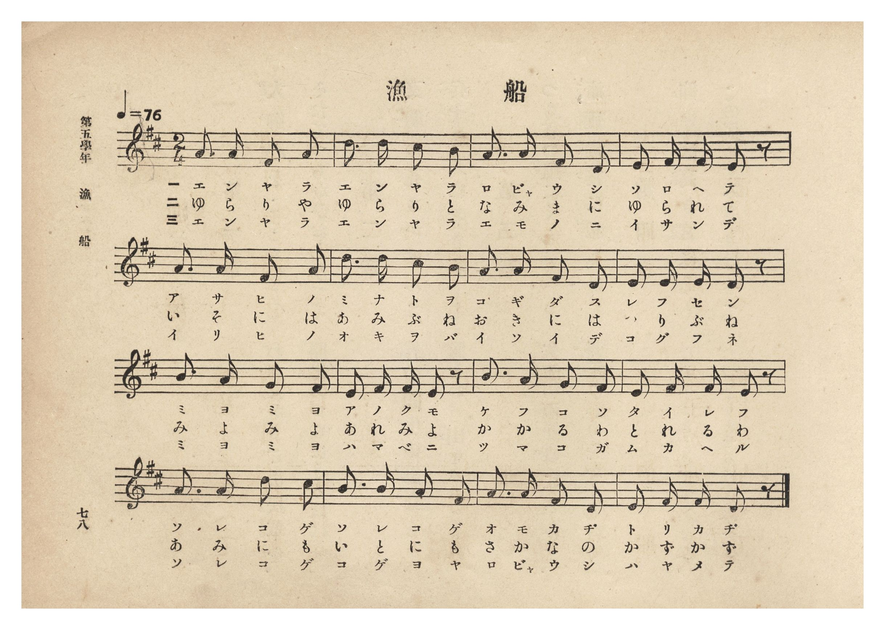
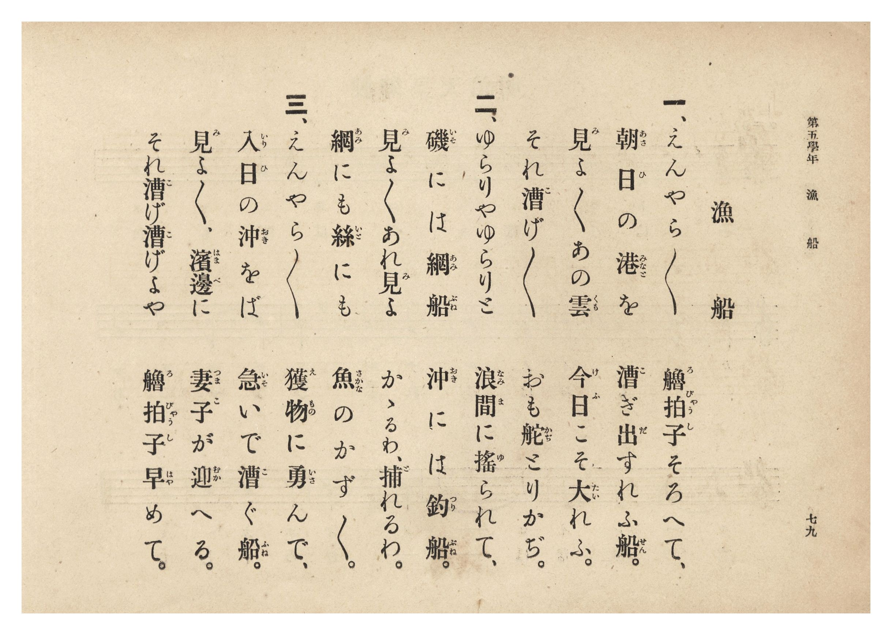

# 漁船

> Re:Shōka 使用 AI 協助辨識與重建樂譜，可能會有錯誤。歡迎回報。

- **鋼琴伴奏版**：<br><audio controls src="gyosen.mp3"></audio>
- **NEUTRINO 歌聲合成版**：<br><audio controls src="gyosen_neutrino.mp3"></audio>

- 文部省《尋常小學唱歌》
- 臺灣總督府《公學校唱歌集》（大正四年三月，索書號 0725 26）

## 說明

原書資訊與歌詞全文（對應 P084.jpg–P085.jpg，第五學年 pp. 78–79）：
調性與拍號：ニ長調（D 大調）2/4 拍，速度 ♩=76


## 歌詞

```text
一、えんやら〳〵　艪拍子（ろびゃうし）そろへて、
朝日（あさひ）の港（みなと）を　漕（こ）ぎ出（だ）すれふ船（せん）。
見（み）よ〳〵あの雲（くも）　今日（けふ）こそ大（たい）れふ。
それ漕（こ）げ〳〵　おも舵（かぢ）とりかぢ。

二、ゆらりやゆらりと　浪間（なみま）に搖（ゆ）られて、
磯（いそ）には網船（あみぶね）　沖（おき）には釣船（つりぶね）。
見（み）よ〳〵あれ見（み）よ　かゝるわ、捕（と）れるわ。
網（あみ）にも絲（いと）にも　魚（さかな）のかず〳〵。

三、えんやら〳〵　獲物（えもの）に勇（いさ）んで、
入日（いりひ）の沖（おき）をば　急（いそ）いで漕（こ）ぐ船（ふね）。
見（み）よ〳〵、濱邊（はまべ）に　妻子（つまこ）が迎（むか）へる。
それ漕（こ）げ漕（こ）げよや　艪拍子（ろびゃうし）早（はや）めて。
```

## ABC

<div class="abc-score" data-abc-src="gyosen.abc" aria-label="五線譜載入中"></div>

[下載 ABC 原始檔](gyosen.abc)

## TMD 檔案連結

- [主旋律 TMD 檔案](gyosen.tmd) [[在 TMD Studio 編輯](https://tmdlang.github.io/Tmd-TS/#tmd=s7IKdvYPcrWy4qpTUCpJTLdSSM7PyUlNLsnMz7PKzk9PzM7Ojy_OyM9OLM4ojTe0NDRVgqssy88pzU21Si9KTEmNRxIvzi8tSk61Kk7OyM_PiS9JrShJys_PRpePL0hMT7UKMLAwQcgUFOWXpeYl5gF1FxRl5pWkpoC1IxSklmWmpIKki5MT8-LLUosy0zJTU5CclFpUDHI51IqSosS84uSizAKQdxCq8otKMvKBzi7IqLTKyCwuyS_KTE7Mic9OzEtEKCrJSAV6DmxCAVADsu7M9Mw8q9z8vKRSYMgocWlpKTzb0_iiY6eClhaXoq2CuRmXva2CC5eNkb6JHUjbs2ntL5tXPJ_T-Lih6-mG7qc7djzd0P907Y6nUzY-W9vzuKEbbPiL9l3PGxc_37H3-dzFT3fNAaltXQNU9WzBQojCl7PbgGrf7-l4umT5s7WLn86e_XTnlic7Op_N6Xi_p-f5lkXPZu94MXO-goG5kamCkdn7PZ1KXFz6Wgq21AJcCgoKT_vmg6zZ3P5iRdeLjnags16snPe0dQXQjyCXbeh91t6pAIpVvayC9EcNk4FMUxAT5MI1a57smgLy984tCgUFegrmFkAF5pZAh77fMwtk-ItV-581LAcZ290L9AlQ9HFz98up24HiQMNdFIAeBzM7gSGrAFQDNPRlw_ynu5YpPJq50hYY7iBDnuxoeNzQ-Lix43HT5MdNLY-bOh83bH7csPVxQ8OLzlVAXU_XTgCa9rip93Hj5sdNzY8b2x43Tgca-rhxLlhwx-PGZUATQGY9mzP32fSlINWNTY8bpz5u3ARWt-7ZjvVgwf2PG1c9blwBEmyaBLTg2Z6pYPHJYGV9T9t3gbkLwNyZj5t6HjduBSYUsOBsoPtA4g1NYK8vA8Us0ESwWR1QJ4NsXfdyNtBWoFT_46YmsIaGJ7u7YM6aCDQRbPpkoPOB4QMWnP-4sQVsDsg-qAVg3_WgOhDoZGjIPG7sApr-ogNoFlC2-3HjIrCCFY-buiBckCng0N0FTLCNj5vaQOEKlAQFMIwNVA4Mgq2rXk4DGg80Bhg0wADaBzZp9bMJ08Ch3gZ2GMRtsGB-vhgSnC1AR0JUP25c_3zbJlhQAUMBaNC2x41rIf5_tglsFtDNjcA0AFX_sn0xTP0SsGvg6vEHcFMPhhQwOLofNwHDC0j2A934rBcSapCI7oGJg80FOhPuRqhbmpqeb4UIAj0E1gMWBJr7cu0ssDgwJQEDdRUkMYHZs2BRAQ3mHUB3Y0_Ez3s3Pe9cCTYGKAtKIBAbnnaDciDYTqBrge4Epojl0AB-2roUlmCAZgHDBpaO0QISmIgbN4ACuAGmGBohQMZy1LQzARbYwEAkGMzAINy_8WVTF1hqPTBNPG4EagaHS0PD02W7oVkSGHEgKYgFPS_294FTDCg2wCI7QAGPJzWjJ26g9cCgI5Ttn02HBOZ6oGKwo4HBDkyYYGsoLzOhQEFLn4vLvTK_ODXPKiAzMS_focagphpkhYKNoZmWHZiFraxWAJWaOxpeLOxR0DBRANYbz9c36MALWE0sGoA2gQyrUTBV0AVCUwVjMKkLFDGMAwsBKXMgZQYWQ1ZlCBYxApJGQD6INgCJgM3zMawBhnoHWDUwbQFxC5jVCdaDR6apFyIDC3UwezpYDKRvLlhtL5C1A4iXAXnxCDuNQPpBOiDmAZMumAUyH6tM4wqoqaugdu4H4n1g1mokPRAdPZj2GZPpR7hME5C9Dtm-RrC6xqkQXY3L4fbhj_FdPfSPcSMwDz3Gm6AhCfRB4yYwC-Q_kMx-qMwqaLgDSw-ozGSoTB8QLwCzZkJDvwfM2wrEs8EhghHb4PACqZkLDUNgxoSaCnMJKE63gVlroTKguAfxQakIVc8SsLu6wDog6tFjG2ofWA2q_5BMBfsMWDQixSnMjZD4BcUrzOfAshHqR4R9BPJ3JzmxDYpNUDyaAElQXAJjGz0eiVGDFNfQGG3qgLJBLETYg0IG2AoBp3Kov4D8idCwAPkX4ntQjgbJzAfzWqA5bSuWuCZgH1gfMLbBojD7uqH2dQPFQWxgTQyVgaRBoB6gOEQUPa5x2wdKL6CSAlgvQdMQzD5QCoLJQfwHSsOgtNwAcweo5AK7hYi4BrbaKcnZ4PwMysqwqDUDS0GiFnvGNgZCbJENiiZYIEM8Bsu-uGWgWQJczIEDv3ERSuCDMhEoQECi6JGNnH3BmRScjJCz0woMmamIyAYX6YjMCbF9FlRuFpbIxu0LWPE0CZoAEBUK_qoKnEiAaoFNBCAPUXXUcnHp2ilAancFIEuZCwA)]
- [鋼琴伴奏 TMD 檔案](gyosen_piano.tmd) [[在 TMD Studio 編輯](https://tmdlang.github.io/Tmd-TS/#tmd=s7IKdvYPcrWy4tLSUni2p_FFx873ezpedu95PmHLkz1bni7tf97Z8X5Pp4KWFpeirYK5GZe9rYILl42RvokdV52C0rNp7S-bVzyf0_i4oevphu6nO3Y83dD_dO2Op1M2Plvb87ihWwmk6kX7rueNi5_v2Pt87uKnu-aA1LauAap6tmAhROHL2W1AtUCbny5Z_mzt4qezZz_dueXJjs5nc4CW9zzfsujZ7B0vZs5XMDA3MlUwMgM6SImLy70yvzg1zyogMzEvP8jDocagpppLAQhsDM207MAsfS0FW3Sg8HzNmic7Gl4s7FHQMFEAuvb5-gYdhQADCxO9rIJ0TSwatPTBhtUomCroAqGpgjGY1AWKGMaBhYCUOZAyA4shqzIEixgBSSMgH0QbgETA5vkY1ig8buwAq37cNBmIW8CsTrAePDJNvRCZxs2Pm5ofN7aB2dPBYiB9c8Fqe4GsHUC8DMiLR9hpBNIP0gEx73FTF5gFMh-rTOMKqKmroHbuB-J9YNZqJD0QHT2Y9hmT6Ue4TBOQvQ7ZvkawusapEF2Ny-H24Y_xXT30j3EjMA89xpugIQn0QeMmMAvkP5DMfqjMKmi4P26aBJWZDJXpA-IFYNZMaOj3gHlbgXg2OEQwYhscXiA1c6Fh-LhxPdRUmEtAcboNzFoLlQHFPYgPSkWoepaA3dUF1gFRjx7bUPvAalD9h2Qq2GePGzcgxSnMjZD4BcUrzOePGydA_Yiwj0D-7iQntkGxCYpHEyAJiktgbKPHIzFqkOIaGqNNHVA2iIUIe1DIPG7sB6dyqL-A_InQsAD5F-J7UI4GycwH81qgOW0rlrgmYB9YHzC2waIw-7qh9nUDxUHsx039UBlIGgTqAYpDRNHjGrd9oPQCKikeN-6EpiGYfaAUBJOD-A-UhkFpuQHmDlDJBXYLEXENrCsoydng_AzKyrCoNQNLQaIWe8Y2BkJskQ2KJlggQzwGy764ZaBZAlzMgQO_cRFK4IMyEShAQKLokY2cfcGZFJyMkLPTCgyZqYjIBhfpiMwJsX0WVG4WlsjG7QtY8TQJmgAQFQr-qgqcSIBqHzc1AnmIqqMWtXL3Qa7cLaB1OzDjgRRHG8aCDYNwTOOReVAp03gQDyhkAPUORVpNMFVD5NFkcNlqCskHEMUoLsBmJzAkdO0UIIER7WMYCzYJScQIQ8QYLqLMBQA)]

## 分析

```text
================================================================================
📊 TMD Song Profile: [ 漁船 ]
================================================================================
⏱  Duration:       0:25 (25.3s), 16 measures total
🎼 Key & Tempo:    首調基準 D, != 76.0 BPM, <2/4>
   - 分析範圍：      由實際發聲的音符與和弦推測調性；播放脈絡另行呈現
🎤 人聲音域:    D4 (MIDI 62) – D5 (MIDI 74) [跨度: 12 個半音 / 1.0 個八度, 難度: easy]
   - 最低音:  D4 in [Gyosen #1 @ m.3, 0:04]
   - 最高音: D5 in [Gyosen #1 @ m.2, 0:01]
   - 適合: soprano, mezzo-soprano, contralto, tenor, baritone, bass
🏛  結構:      Gyosen (25.3s)
⚡ 編曲密度:        Peak 1 軌道同時演奏
🗝  調性診斷：       D 大調（純淨自然大調，未偵測到可信轉調）
   - 風格氣質:    純淨自然大調（陽光明朗、易唱易記，無明顯調外色彩）
   - 轉調歷程:    全曲維持單一推測調性（未偵測到可信轉調）
   - 核心骨幹音:  A, D, F#, E, B
   - 調性數值:    D 大調 [相關度: 0.91, 穩定度: Moderate, 自然音純度: 100.0%]
   - 候選調性 (K-S): D 大調 (0.91), A 大調 (0.82), F# 小調 (0.68)
   - 五度圈歷程:   +2
   - 各段落調性細節:
     • [Gyosen #1]: D 大調 (r: 0.91, 自然音純度: 100.0%)

  [ 五度圈游移軌跡 ]
               C  
         F            G  
      Bb              [D ]*
      Eb               A  
         Ab           E  
            Db       B  
               F# 
     (* = active key center)

  [ 十二半音累積音高分佈 ]
     C  :                            0.0%
     C# : █████                      5.1%
     D  : █████████████████████     23.7%
     D# :                            0.0%
     E  : ███████████               12.7%
     F  :                            0.0%
     F# : ██████████████            16.1%
     G  : ███                        3.4%
     G# :                            0.0%
     A  : ████████████████████████  27.1%
     A# :                            0.0%
     B  : ███████████               11.9%
--------------------------------------------------------------------------------
Assignment 軌道音域：
  - Piano         : D4 – D5 (12 個半音 / 1.0 個八度, 64 個音符)
================================================================================
```


## 原書掃描頁






