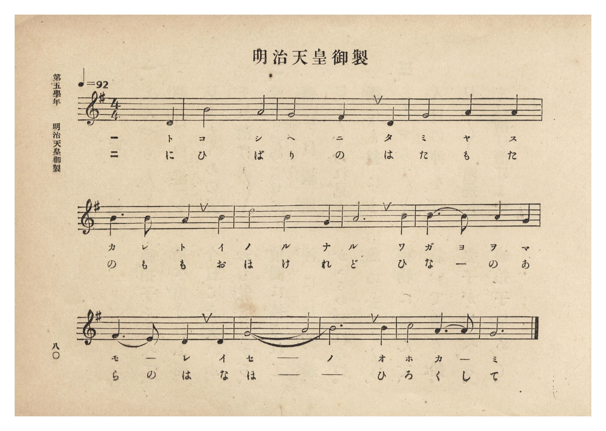
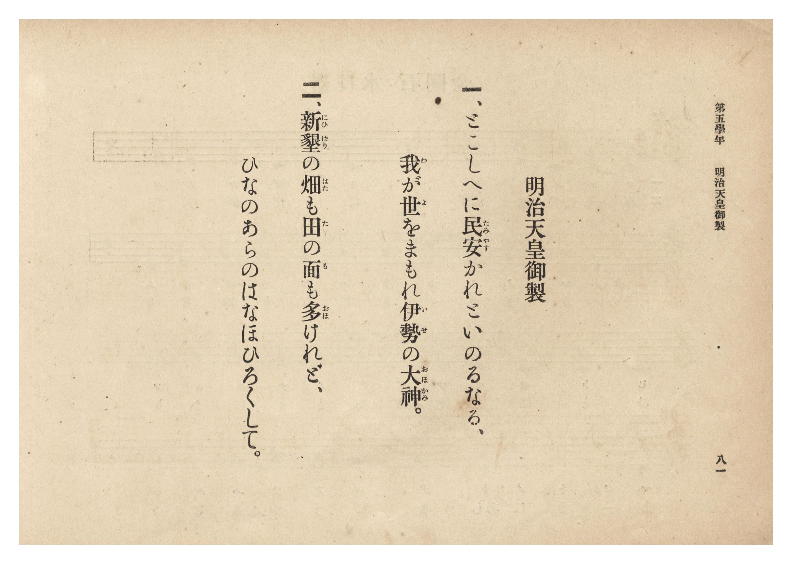

# 明治天皇御製

> Re:Shōka 使用 AI 協助辨識與重建樂譜，可能會有錯誤。歡迎回報。

<audio controls src="meiji_tenno_gyosei.mp3"></audio>

- 詞：明治天皇御製
- 臺灣總督府《公學校唱歌集》（大正四年三月，索書號 0725 26）

## 說明

原書資訊與歌詞全文（對應 P086.jpg–P087.jpg，第五學年 pp. 80–81）：
調性與拍號：ト長調（G 大調）4/4 拍（弱起 1 拍），速度 ♩=92
版本考證：本書所收〈明治天皇御製〉為「とこしへに民安かれと…／新墾の畑も田の面も…」二首御製，
與《新定兒童唱歌》第六學年所收〈明治天皇御製〉（「物學ぶ道に立つ子よ…」三首）詞曲不同。

## 歌詞

```text
一、とこしへに民安（たみやす）かれといのるなる、
我（わ）が世（よ）をまもれ伊勢（いせ）の大神（おほかみ）。

二、新墾（にひばり）の畑（はた）も田（た）の面（も）も多（おほ）けれど、
ひなのあらのはなほひろくして。
```

## ABC

```abc
X:1
T:明治天皇御製
M:4/4
L:1/16
Q:1/4=92
K:G
V:V1 name="Piano" snm="Pia"
[V:V1]
z4 z4 z4 D4 | B8 A8 | G8 F4 D4 | G8 A4 A4 |
w: 1.~と | こ し | へ に た | み や す
w: 2.~に | ひ ば | り の は | た も た
B6 B2 A4 B4 | c8 B4 G4 | A12 B4 | B6 A2 A4 G4 |
w: 1.~か れ と い | の る な | る わ | が よ を ま
w: 2.~の も も お | ほ け れ | ど ひ | な _ の あ
F6 E2 D4 D4 | G8 A8 | B12 B4 | c8 A6 A2 |
w: 1.~も _ れ い | せ _ | の お | ほ か _
w: 2.~ら の は な | ほ _ | _ ひ | ろ く し
G12 z4 |
w: 1.~み
w: 2.~て
```

## TMD 檔案連結

- [主旋律 TMD 檔案](meiji_tenno_gyosei.tmd) [[在 TMD Studio 編輯](https://tmdlang.github.io/Tmd-TS/#tmd=s7IKdvYPcrWy4qpTUCpJTLdSSM7PyUlNLsnMz7PKzk9PzM7Ojy_OyM9OLM4ojTe0NDRVgqssy88pzU21Si9KTEmNRxIvzi8tSk61Kk7OyM_PiS9JrShJys_PRpePL0hMT7UKMLAwQ8gUFOWXpeYl5gF1FxRl5pWkpoC1IxSklmWmpIKki5MT8-LLUosy0zJTU5CclFpUDHI51IqSosS84uSizAKQdxCq8otKMvKBzi7IqLTKyCwuyS_KTE7Mic9OzEtEKCrJSAV6DiJdiS6cmVsAtDsxR4lLS0vh2Yy-Z5t2P12y8vms9qf7Fr5YvFdBS4tL0VbB0ojL3lbBncvGRN_EDmTCi5Xz3u-ZhakebPyL9l3PGxc_37H3-dzFT3fNedzQ9bR1zdO1O54tWPh0ysZna3tezm573ND9fk_H0yXLn61d_HT27Kc7tzzZ0flsTsf7PT3Ptyx6NnvHi5nzFQzMjUwVjMze7-lU4uLS11KwpRbgUlBQeNo3H2TN5vYXK7pedLQDnQX01NPWFc-mtYNctqH3WXunAihW9bIK0h81TAYyzUFMkAvXrHmyawrQR0BnKxQU6ClYGAAVWBgCHQoMFZDhL1btf9awHGRsdy_QJ0DRx80dL6duB4oDDXdXAHoczOwEBqgCUA3Ixj0bX2zdrmAI4QIN6nnZMP_prmUKj2autAVGANDU550dz-asedHQ_GItyCIgG-iDZ50Nz6Zse9zQgRkbjxs6nzftetzQ87hxxePGyY8bpz9u3PG4cfWzDROfrut83Nj9uAkk9ahh2fs9_c-mbXi6aN_jxnXPp0583NT0fMoGIPvl3EVANlDB44beJ7t6Xi6bBjEZ6DqwNzvagbEL0rlu1tPWSc9XL4VEMDB2gWH0tHUtJIzwOxHod6ATn3euBCp-3LjtJcihq5-v7n7cuOTp2gmPmzqg1u_oBFoPDBlgND2bvenJjt6nE4AWNXGBHPJkR8Pjhkas3gQZ3zj_ceP-x00tjxtnAg2Ae_xxI1Bk3eMmoFWrQGRDI8isZx0TQXqa-sFKe57sAFoK5AKTZufjpkmPG_cBQwSo_8merqfdi8CmA02ZDVa8Dhivz5cCswZQsOtx426QTY2gaIa7cxfQyY2QoAarWv24cdPjxg2Pm7ogBgADHyy-HuhmsIWgiIB4AaIAGCNg5zRBZJ8umQW3DawAGHdAr62E-gVs-iqQJxuBbgbpBxsNFAG6bdPjpt7Hjf3g8AKGcBNIA-V5CwoUtPS5uHxTM7MyQ1Lz8vLdK_OLUzOtAjIT8_IdagxqqkGWKdhYaNmBGdgytwIom-1oeLGwR0EDOXMoaCsYKzzd0P98fYMOPINqYtEPdAHI7BoFAwVdODaNBxI1QBN0wdAIStcAzYawzEEKoKpgYiBVIFwDNtDHsEYBJA_DwJQEVg1Me1D1wCCFmwtMi3DR1WByPlR8P0y8qQUsPhNhgxG6DSCdID2b4GZtQNjQ1AUXXQcm10NVg2yC2NCEsBmcEHGH-K4ecIibkBbEkPA0BocSiF2jYAK1G8QDhWMNPKxhojBdRmAZsBp4-AJzDtTlPdDwBWYzqK9AfoTIgdQAUzM0FCA6YHL9UNU9UH4HEE8Cq9-HEs4w80BhBAsnUHiCZHbDw3Ui1C0Q8ZXINoHjBCQKcgdyLIDMIhTaOzrBoW1KWmiD06iuglk8JKFiSa2QlAFL5YgQh8UKRI0Rki4QBGUQpDgAhwYsFpBjYDaSHlgqh8UKJAQwQxAWO8gpHwTBbkfERlMnPAwh6Rgev3CzELYi8-Dx0NQLFwGlAUhuBOlfhmFrLReXrp0CeimlABRT5gIA)]
- [鋼琴伴奏 TMD 檔案](meiji_tenno_gyosei_piano.tmd) [[在 TMD Studio 編輯](https://tmdlang.github.io/Tmd-TS/#tmd=s7IKdvYPcrWy4tLSUng2o-_Zpt1Pl6x8Pqv96b6FLxbvfb-n42X3nucTtjzZs-Xp0v7nnR3v93QqaGlxKdoqWBpx2dsquHPZmOib2HHVKSi9WDnv_Z5ZmIYogSXbdz1vXPx8x97ncxc_3TXncUPX09Y1T9fueLZg4dMpG5-t7Xk5u-1xQzfQwqdLlj9bu_jp7NlPd255sqPz2RygnT3Ptyx6NnvHi5nzFQzMjUwVjMyA7lDi4vJNzczKDEnNy8t3r8wvTs20CshMzMsP8nCoMaip5lIAAhsLLTswQ19LwRYdKDxfs-bJjoYXC3sUNJ7u2fhi63YFQ4Vn3b0K2grGCk839D9f36CjEGBgYaaXVZCuiUW_lj7Y7BoFAwVdODaNBxI1QBN0wdAIStcAzYawzEEKoKpgYiBVIFwDNtDHsEYBJA_DjxtXgFU_bpwMVf-4cTrc3MeNO-Ciq8HkfKj4fph4UwtYfCbCBiN0G0A6QXo2wc3agLChqQsuug5MroeqBtkEsaEJYTMX_hDf1QMOcRPSghgSnsbgUAKxaxRMoHaDeKBwrIGHNUwUpssILANWAw_fx43dUJf3QMP3cSMolEAyID9C5EBqHjeugoYCRAdMrh-qugfK7wDiSWD1-1DCGWYeKIxg4QQKT5DMbni4ToS6BSK-EtkmcJyAREHuQI4FkFmEQntHJzi0TUkLbXAa1VUwi4ckVCypFZIyYKkcEeKwWIGoMULSBYKgDIIUB-DQgMUCcgzMRtIDS-WwWIGEAGYIwmIHOeWDINjtiNho6oSHISQdw-MXbhbCVmQePB6aeuEioDQAyY0g_cswbK3FVUj5IBdSJtBCClSQQCAw1OIVog1jgSEPpE3jY_GJmMAEoIYgKwTSwDgBMkxiYeI1CCMQSjCFoIahShBwCdwGqI1YVQB9BwoXXTsF9KCJ9jGMBVuLVc4ILqfMBQA)]

## 分析

```text
================================================================================
📊 TMD Song Profile: [ 明治天皇御製 ]
================================================================================
⏱  Duration:       0:33 (33.9s), 13 measures total
🎼 Key & Tempo:    首調基準 G, != 92.0 BPM, <4/4>
   - 分析範圍：      由實際發聲的音符與和弦推測調性；播放脈絡另行呈現
🎤 人聲音域:    D4 (MIDI 62) – C5 (MIDI 72) [跨度: 10 個半音 / 0.8 個八度, 難度: easy]
   - 最低音:  D4 in [MeijiTennoGyosei #1 @ m.1, 0:01]
   - 最高音: C5 in [MeijiTennoGyosei #1 @ m.6, 0:13]
   - 適合: soprano, mezzo-soprano, contralto, tenor, baritone, bass
🏛  結構:      MeijiTennoGyosei (33.9s)
⚡ 編曲密度:        Peak 1 軌道同時演奏
🗝  調性診斷：       G 大調（純淨自然大調，未偵測到可信轉調）
   - 風格氣質:    純淨自然大調（陽光明朗、易唱易記，無明顯調外色彩）
   - 轉調歷程:    全曲維持單一推測調性（未偵測到可信轉調）
   - 核心骨幹音:  A, B, G, C, D
   - 調性數值:    G 大調 [相關度: 0.66, 穩定度: Moderate, 自然音純度: 100.0%]
   - 候選調性 (K-S): G 大調 (0.66), D 大調 (0.53), B 小調 (0.51)
   - 五度圈歷程:   +1
   - 各段落調性細節:
     • [MeijiTennoGyosei #1]: G 大調 (r: 0.66, 自然音純度: 100.0%)

  [ 五度圈游移軌跡 ]
               C  
         F           [G ]*
      Bb               D  
      Eb               A  
         Ab           E  
            Db       B  
               F# 
     (* = active key center)

  [ 十二半音累積音高分佈 ]
     C  : ███████                    8.3%
     C# :                            0.0%
     D  : ███████                    8.3%
     D# :                            0.0%
     E  : █                          1.0%
     F  :                            0.0%
     F# : ████                       5.2%
     G  : ████████████████████      22.9%
     G# :                            0.0%
     A  : ████████████████████████  28.1%
     A# :                            0.0%
     B  : ██████████████████████    26.0%
--------------------------------------------------------------------------------
Assignment 軌道音域：
  - Piano         : D4 – C5 (10 個半音 / 0.8 個八度, 34 個音符)
================================================================================
```


## 原書掃描頁






