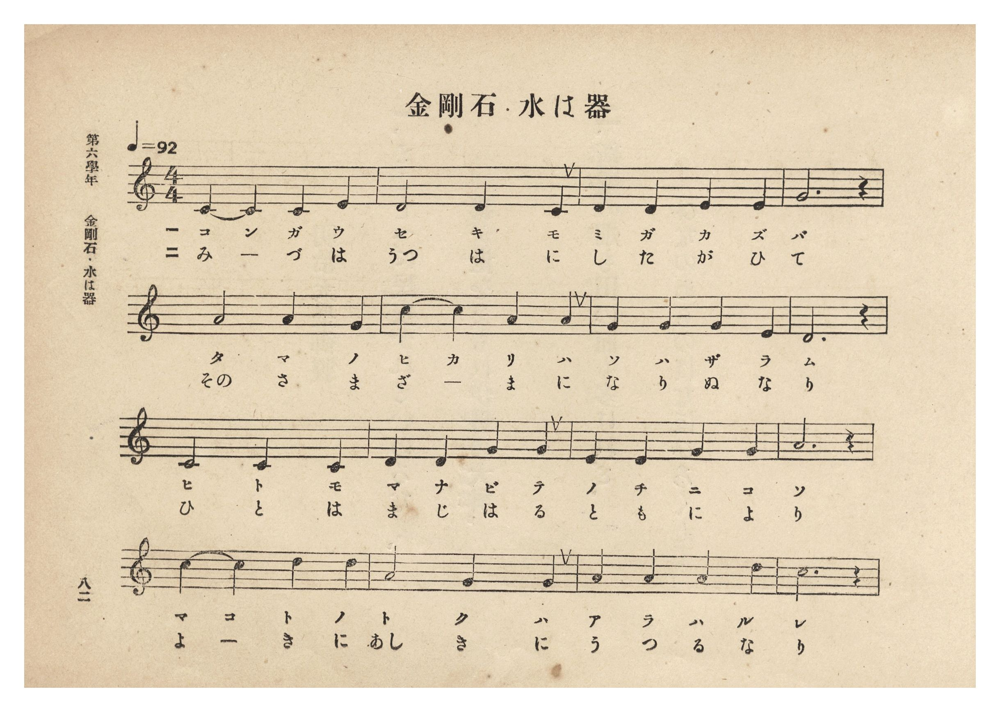
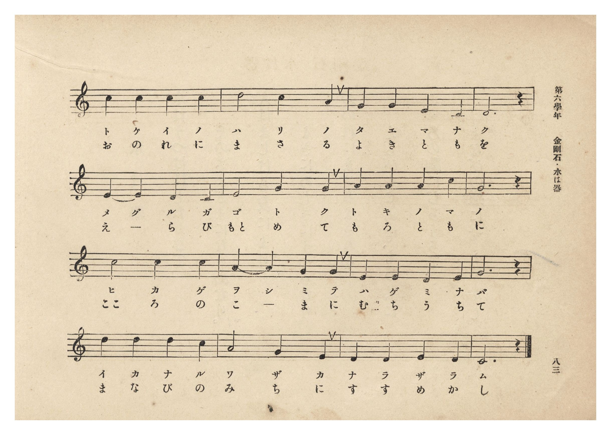
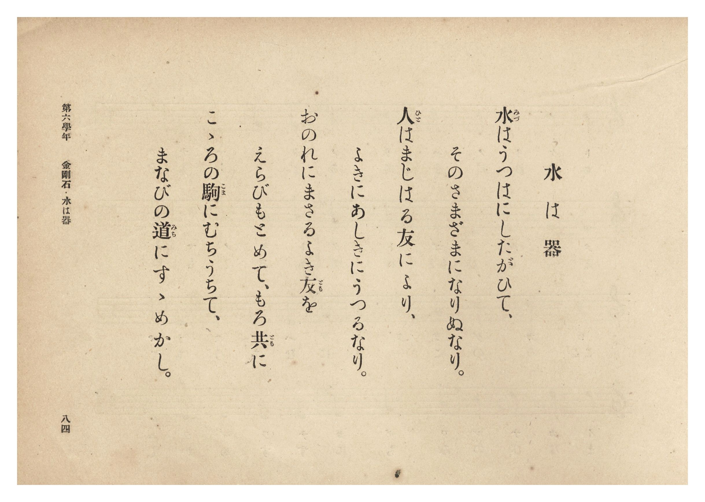
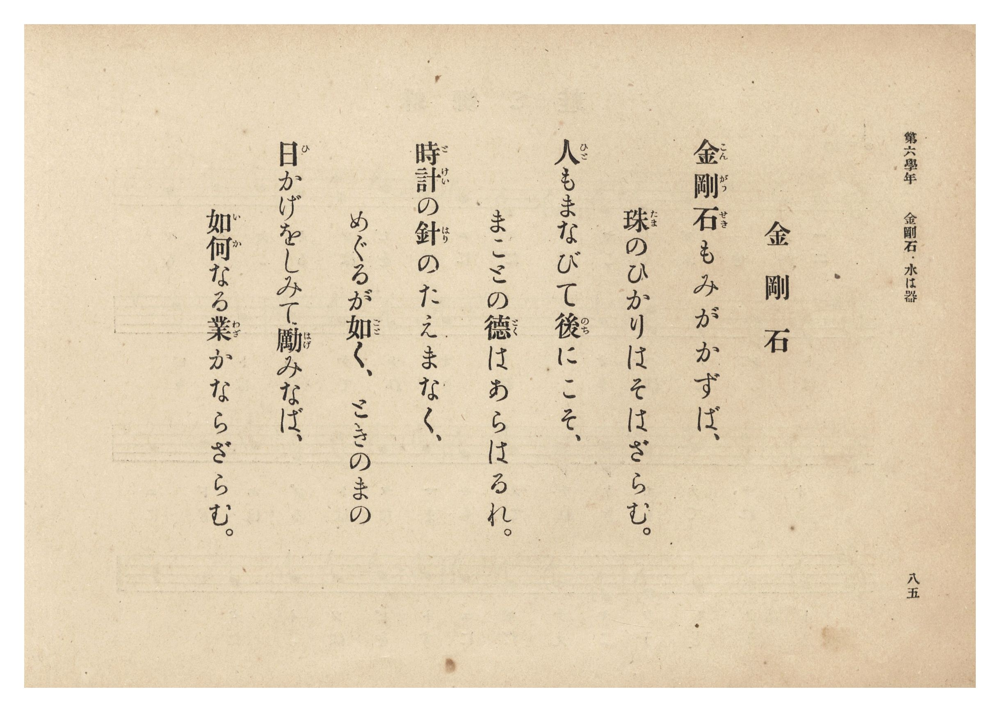

# 金剛石・水は器

> Re:Shōka 使用 AI 協助辨識與重建樂譜，可能會有錯誤。歡迎回報。

- **鋼琴伴奏版**：<br><audio controls src="kongoseki_mizu_wa_utsuwa.mp3"></audio>
- **NEUTRINO 歌聲合成版**：<br><audio controls src="kongoseki_mizu_wa_utsuwa_neutrino.mp3"></audio>

- 詞：昭憲皇太后御歌
- 曲：奥好義
- 臺灣總督府《公學校唱歌集》（大正四年三月，索書號 0725 26）

## 說明

原書資訊與歌詞全文（對應 P088.jpg–P091.jpg，第六學年 pp. 82–85）：
調性與拍號：ハ長調（C 大調）4/4 拍，速度 ♩=92


## 歌詞

```text
金剛石（P091.jpg，p. 85）
金剛石（こんがうせき）もみがかずば、
珠（たま）のひかりはそはざらむ。
人（ひと）もまなびて後（のち）にこそ、
まことの徳（とく）はあらはるれ。
時計（とけい）の針（はり）のたえまなく、
めぐるが如（ごと）く、ときのまの
日（ひ）かげをしみて勵（はげ）みなば、
如何（いか）なる業（わざ）かならざらむ。

水は器（P090.jpg，p. 84）
水（みづ）はうつはにしたがひて、
そのさまざまになりぬなり。
人（ひと）はまじはる友（とも）により、
よきにあしきにうつるなり。
おのれにまさるよき友（とも）を
えらびもとめて、もろ共（とも）に
こゝろの駒（こま）にむちうちて、
まなびの道（みち）にすゝめかし。
```

## ABC

<div class="abc-score" data-abc-src="kongoseki_mizu_wa_utsuwa.abc" aria-label="五線譜載入中"></div>

[下載 ABC 原始檔](kongoseki_mizu_wa_utsuwa.abc)

## TMD 檔案連結

- [主旋律 TMD 檔案](kongoseki_mizu_wa_utsuwa.tmd) [[在 TMD Studio 編輯](https://tmdlang.github.io/Tmd-TS/#tmd=s7IKdvYPcrWy4qpTUCpJTLdSSM7PyUlNLsnMz7PKzk9PzM7Ojy_OyM9OLM4ojTe0NDRVgqssy88pzU21Si9KTEmNN0OIF-eXFiWnWhUnZ-Tn58SXpFaUJOXnZ6PLxxckpqdaBRhYWCBkCoryy1LzEvOAuguKMvNKUlPA2hEKUssyU1JB0sXJiXnxZalFmWmZqSlITkotKga5HGpFSVFiXnFyUWYByDsIVflFJRn5QGcXZFRaZWQWl-QXZSYn5sRnJ-YlIhSVZKQCPZeZWwC0JDEHXbw8sSS1CNnEzPTMPKvc_LykUmBoYUqkZmZlIgWFlpbCy_aJTztnP5-_-XHz7mcbtjxuXP905goFLS0uRVsFSyMue1sFZy4bE30TO5BZL1bOe79n1rMZa5-1bXo-q_3pklVPJ_Q93bfw2doesF3PZm8Cyj9duvTp0r3P960Ei71o3_W8cfHzHXufz138dNecxw1dT1vXPF2749mChU-nbATqfDm77XFD9_s9HU-XLH-2dvHT2bOf7tzyZEfnszkd7_f0PN-y6NnsHS9mzlcwMDcyVTAye7-nU4mLS19LwZZagEtBQeFp33yQNZvbX6zoetHRDnQW0K9PW1c8m9YOctmG3mftnQqgVKKXVZD-qGFygIGlIYgJcuGaNU9b1wJ9BHS2QkGBnoKFEVCBhSnQocDAABn-YtX-Zw3LQcZ29wJ9AhR93Nz_cup2oDjQcGcFoMfBzE5gOCsA1QANfdkw_-muZQqPZq60BcYCyBB4RAG1INkOsg9kFbqSx42THzdNftzY87ix7XHj7MeNQFM7Hzc1PW7cDxbsftw463HjhscNjSCdz_sXgPXMf9y4D6Sucd3jxk0gRU1dwBTxuHEumJz2uAloRMPjhiaQnie7doH1ANWtgJm973HjqseNmx83Lnu6rwcsCzRoIdjE1SAXAQ2CWAhWCuSvAKp4ug_iYCC7H6wUaFUTyCogownohB6ohc9mNr1YAUwTEKUTHze2QJz6sn0uWBCougvmeKBHgCIQ5_TD7GxqfNw4AWRkY8_TZU1gPVOgjgcrApvbC9YP1LkObOf0pRBPghUBdU563DTpceN0cDAue9q9FWpz4ySwAqAg0EJYqAItebJ3KlhFC1AzWMUqoP3Plq4FCTb1A4MUZi5QHMhACmGw7bAMCYlzA6Q4N4HGOVAJ2AKgzUCXQgIPGOFLwAxgmANdCgwLYIQDo2kZPPCB8Qn05FSwP6eBSaBSoBOAsb0GysAeySBTgapnQOLmaT8o34KCrQkYnOBIbgL6C6gZGuBAOWB4As0Gpg2gSyBssPNAsYBkz-NGoNXrQHENUgG0YSo46kH60S1pmgTRALQIaONmcLoDygFjD-Q_ELep92nrRjSHQfQA88RcoDQo0SwHxhg4l0BTPNDpDcC0CnYekESEFTxNr3vZOBkW1vA0PRNsItByoH-mQz1DeZEEBQpa-lxc3vl56fnFqdmZvplVpeGJoSXFpeWJVgGZiXn5DjUGNdUgGxVsTLTswAxsBaMCsIh6sqPhxcIeBQ0Thacb-p-vb9CBl2aaWDQA7QUZVqNgCIbGQJaRgi4QG4JZRkARkJgpUExXwUChBqzax7AGFMTAaAfixh4gbgOqARY-QDXAeASKN4H5-6Gy3UA8CyyyAWxOPMwcI4gqkK6lQLwerAaUasBC64F4NVhoOhDPhxq2CSyyDG4Q_sDY1UNOYJgBzTYDehoSBOZACAoCEIQFEHpgzAe7eB8QrwO7bxPE201dcG_NhfpoGlC0EyTS1IAlMED5FWzUVLBxIKFpcKMhgbEKauwaMBtkUBeRgbGjk_yUoQsNDFAg1IBTBYQFCir0wAB5fgU4FYB0QdwOdHXjZnDEgUTWAfFCsI9A6QgSPJiBATUHGGwIc2ZAgrGpGywCsQVsTlMHKWEBbHyQFRZxIGQERhC_w0IBBMGCQHnMEAG5HJRXQL6BJJAV4FjthycPoC-AyQLJb009mCEC9CM0h0HTAqi0RRNqA-IlYENITR67pmAGiSWRQQJBwCQC8j2QZQbNMcbQggQzSEBBMRGIW-BBAopmSNKG8EE5vgOefEAi_VgSCUQ9KLhgIbAPloGgAQkyAxQ-kMQCEplEZCJpXUtOiIAyB6QANUZLIOAgwlKWNjUCnTcBGmk9YE9MAXsCFEj9sJQO9gQo50DKBVA5gR4Y4PQBTkebwR4F1ZhgIZAF4KwHyi5NKKEBDDUii49mMtMHOEWA_Q4KBEQJAqpdsNctm8C-B4XGJGiEQSoBUI0CKUFARSlIFCQCSRzY6hZgpT8Z7H9I0EGqLZTiFFgKQ4oiUL5ZSErd8rR1NTnhASk8gAgaIKAUAqlVQMFhBC5wMQMElEsgORqWqkF5AVybAMVh1QIo4vHXL8hFMSQ8INUvpDAG8WdCMDjFQEwGlTAQc2q5uHTtFLC2UxSAEspcAA)]
- [鋼琴伴奏 TMD 檔案](kongoseki_mizu_wa_utsuwa_piano.tmd) [[在 TMD Studio 編輯](https://tmdlang.github.io/Tmd-TS/#tmd=s7IKdvYPcrWy4tLSUnjZPvFp5-zn8zc_bt79bMOWx43rn85c8X5Px8vuPc8nbHmyZ8vTpf3POzve7-lU0NLiUrRVsDTisrdVcOayMdE3seOqU1B6sXLe-z2zns1Y-6xt0_NZ7U-XrHo6oe_pvoXP1vYogeSfzd4ElH-6dOnTpXuf71sJFnvRvut54-LnO_Y-n7v46a45jxu6nrauebp2x7MFC59O2QjU-XJ22-OGbqA7ni5Z_mzt4qezZz_dueXJjs5nc4BO6Xm-ZdGz2TtezJyvYGBuZKpgZAZ0nhIXl3d-Xnp-cWp2pm9mVWl4YmhJcWl5olVAZmJefpCHQ41BTTWXAhDYmGjZgRn6Wgq26EDh-Zo1T3Y0vFjYo6BhovB0Q__z9Q06CgEGFhZ6WQXpmlg0aOmDDatRMARDYyDLSEEXiA3BLCOgCEjMFCimq2CgUANW7WNYo_C4cbLC4yYgbuwB4jagmseNs4FqHjf2AsWbwPz9UNluIJ4FFtkANiceZo4RRBVI11IgXg9W0_a4cQlYaD0QrwYLTQfi-VDDNoFFlsENwh8Yu3rICQwzoNlmQE9DgsAcCEFBAIKwAEIPjPlgF-8D4nVg922CeLupC-6tuVAfTQOKdoJEmhqwBMZckAEgo6aCjQMJTYMbDQmMVVBj14DZIIO6iAyMHZ3kpwxdaGCAAqEGnCogLFBQoQcGyPMrwKkApAvidqCrGzeDIw4ksg6IF4J9BEpHkODBDAyoOcBgQ5gzAxKMTd1gEYgtYHOaOkgJC2CeJCss4kDICIwgfoeFAgiCBYHymCECcjkor4B8A0kgK8Cx2g9PHkBfAJMFkt-aejBDBOhHaA6DpoUmUN5AFWoD4iVgQ0hNHrumYAaJJZFBAkHAJALyPZBlBs0xxtCCBDNIQEExEYhb4EECimZI0obwQTm-A558QCL9WBIJRD0ouGAhsA-WgaABCTIDFD6QxAISmURkImldS06IgDIHpAA1Rksg4CDCUpY2NQKdNwEaaT1gT0wBewIUSP2wlA72BCjnQMoFUDmBHhjg9AFOR5vBHgWmD3BCA1sAznqg7NKEEhrAUCOy-GgmM32AUwTY76BAQJQgoNoFe92yCex7UGhMgkYYpBIA1SiQEgRUlIJEQSKQxIGtbpkMynYg_0OCDlJtoRSnwFIYUhSB8s1CUuqWp62ryQkPSOEBRNAAAaUQSK0CCg4jcIGLGSCgXALJ0bBUDcoL4NoEKA6rFkARj79-QS6KIeEBqX4hhTGIPxOCwSkGYjKohIGYU4u3meKDo5nybNfqp5N6nrbueDm7FVjuPuvufbp2AqRxhpRM4hWiDWNhFDBVxANZpvGxEAaqEHZFsACrUTABiprgNAvEIGAfwiicyuAi6CqglgMpDAchWW8GYprF52JqxOpG3A5CWAei4PII84n2GpEm4zcEPeiJDGbMYCUtDkEmAROnrp0C1vQZ7WMYC7YJtwIjuAJlLgA)]

## 分析

```text
================================================================================
📊 TMD Song Profile: [ 金剛石・水は器 ]
================================================================================
⏱  Duration:       1:23 (83.5s), 32 measures total
🎼 Key & Tempo:    首調基準 C, != 92.0 BPM, <4/4>
   - 分析範圍：      由實際發聲的音符與和弦推測調性；播放脈絡另行呈現
🎤 人聲音域:    C4 (MIDI 60) – D5 (MIDI 74) [跨度: 14 個半音 / 1.2 個八度, 難度: moderate]
   - 最低音:  C4 in [KongosekiMizuWaUtsuwa #1 @ m.1, 0:00]
   - 最高音: D5 in [KongosekiMizuWaUtsuwa #1 @ m.13, 0:32]
   - 適合: soprano, mezzo-soprano, contralto, tenor, baritone, bass
🏛  結構:      KongosekiMizuWaUtsuwa (83.5s)
⚡ 編曲密度:        Peak 1 軌道同時演奏
🗝  調性診斷：       G 調性不明確（純淨自然大調，未偵測到可信轉調）
   - 風格氣質:    純淨自然大調（陽光明朗、易唱易記，無明顯調外色彩）
   - 轉調歷程:    全曲維持單一推測調性（未偵測到可信轉調）
   - 核心骨幹音:  C, D, G, A, E
   - 調性數值:    G 調性不明確 [相關度: 0.80, 穩定度: Ambiguous, 自然音純度: 100.0%]
   - 候選調性 (K-S): G 大調 (0.80), C 大調 (0.79), A 小調 (0.60)
   - 五度圈歷程:   +1
   - 各段落調性細節:
     • [KongosekiMizuWaUtsuwa #1]: G 調性不明確 (r: 0.80, 自然音純度: 100.0%)

  [ 五度圈游移軌跡 ]
               C  
         F           [G ]*
      Bb               D  
      Eb               A  
         Ab           E  
            Db       B  
               F# 
     (* = active key center)

  [ 十二半音累積音高分佈 ]
     C  : ████████████████████████  24.2%
     C# :                            0.0%
     D  : ███████████████████████   23.3%
     D# :                            0.0%
     E  : █████████████             13.3%
     F  :                            0.0%
     F# :                            0.0%
     G  : ██████████████████████    21.7%
     G# :                            0.0%
     A  : ████████████████          15.8%
     A# :                            0.0%
     B  : ██                         1.7%
--------------------------------------------------------------------------------
Assignment 軌道音域：
  - Piano         : C4 – D5 (14 個半音 / 1.2 個八度, 96 個音符)
================================================================================
```


## 原書掃描頁










