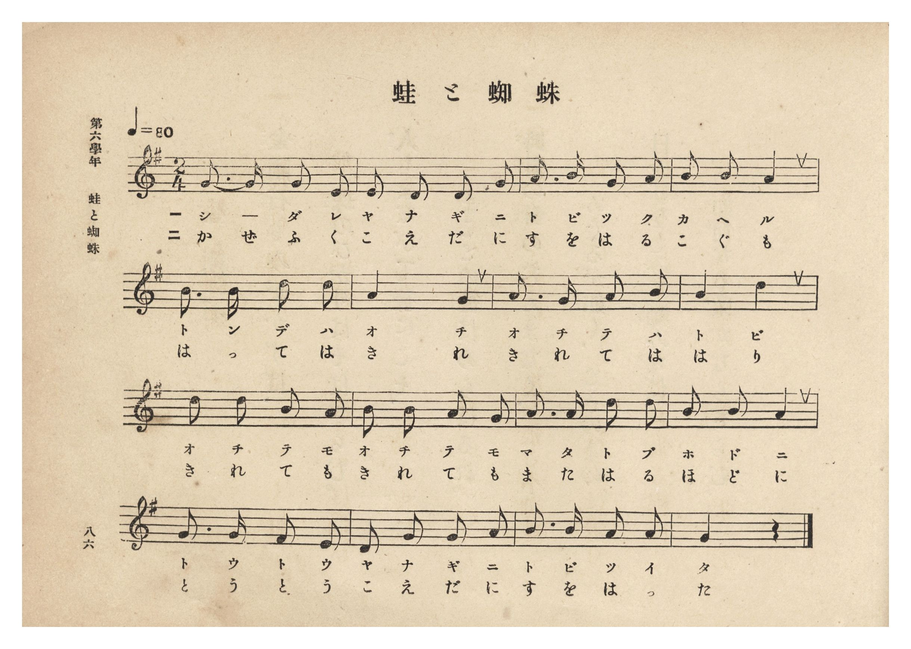
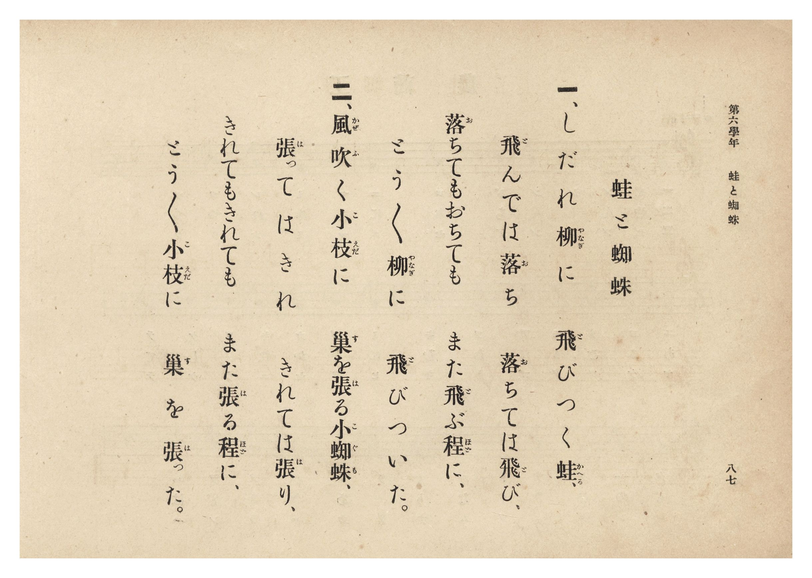

# 蛙と蜘蛛

> Re:Shōka 使用 AI 協助辨識與重建樂譜，可能會有錯誤。歡迎回報。

- **鋼琴伴奏版**：<br><audio controls src="kaeru_to_kumo.mp3"></audio>
- **NEUTRINO 歌聲合成版**：<br><audio controls src="kaeru_to_kumo_neutrino.mp3"></audio>

- 文部省《尋常小學唱歌》
- 臺灣總督府《公學校唱歌集》（大正四年三月，索書號 0725 26）

## 說明

原書資訊與歌詞全文（對應 P092.jpg–P093.jpg，第六學年 pp. 86–87）：
調性與拍號：ト長調（G 大調）2/4 拍，速度 ♩=80


## 歌詞

```text
一、しだれ柳（やなぎ）に飛（と）びつく蛙（かへる）、
飛（と）んでは落（お）ち落（お）ちては飛（と）び、
落（お）ちてもおちてもまた飛（と）ぶ程（ほど）に、
とう〳〵柳（やなぎ）に飛（と）びついた。

二、風吹（かぜふ）く小枝（こえだ）に巢（す）を張（は）る小蜘蛛（こぐも）、
張（は）ってはきれきれては張（は）り、
きれてもきれてもまた張（は）る程（ほど）に、
とう〳〵小枝（こえだ）に巢（す）を張（は）った。
```

## ABC

```abc
X:1
T:蛙と蜘蛛
M:2/4
L:1/16
Q:1/4=80
K:G
V:V1 name="Piano" snm="Pia"
[V:V1]
G3 G G2 E2 | E2 D2 D2 G2 | A2 B2 G2 A2 | B2 B2 A4 |
w: 1.~し _ だ れ | や な ぎ に | と び つ く | か へ る
w: 2.~か ぜ ふ く | こ え だ に | す を は る | こ ぐ も
B3 B d2 d2 | A4 G4 | A2 G2 A2 B2 | A4 d4 |
w: 1.~と ん で は | お ち | お ち て は | と び
w: 2.~は っ て は | き れ | き れ て は | は り
d2 d2 B2 A2 | B2 B2 A2 G2 | A2 A2 d2 d2 | B2 B2 A4 |
w: 1.~お ち て も | お ち て も | ま た と ぶ | ほ ど に
w: 2.~き れ て も | き れ て も | ま た は る | ほ ど に
G2 G2 F2 E2 | D2 G2 G2 A2 | B2 B2 A2 A2 | G4 z4 |
w: 1.~と う と う | や な ぎ に | と び つ い | た
w: 2.~と う と う | こ え だ に | す を は っ | た
```

## TMD 檔案連結

- [主旋律 TMD 檔案](kaeru_to_kumo.tmd) [[在 TMD Studio 編輯](https://tmdlang.github.io/Tmd-TS/#tmd=s7IKdvYPcrWy4qpTUCpJTLdSSM7PyUlNLsnMz7PKzk9PzM7Ojy_OyM9OLM4ojTe0NDRVgqssy88pzU21Si9KTEmNN0OIF-eXFiWnWhUnZ-Tn58SXpFaUJOXnZ6PLxxckpqdaBRhYGiFkCoryy1LzEvOAuguKMvNKUlPA2hEKUssyU1JB0sXJiXnxZalFmWmZqSlITkotKga5HGpFSVFiXnFyUWYByDsIVflFJRn5QGcXZFRaZWQWl-QXZSYn5sRnJ-YlIhSVZKQCPZeYl5mbmIMumpdYUlqUii5anpoIZBQh25OZnplnlZufl1QKDEMlLi0thRezZz5uXPFizowXs2craGlxKdoqWBhw2dsquHPZGOmb2IE0P5vW_rJ5xfM5jY8bup5u6H66Y8fTDf1P1-54OmXjs7U9jxu6wVa8aN_1vHHx8x17n89d_HTXHJDa1jVAVc8WLIQofDm7Daj2_Z6Op0uWP1u7-Ons2U93bnmyo_PZnI73e3qeb1n0bPaOFzPnKxiYG5kqGJm939OpxMWlr6VgSy3ApaCg8LRvPsiaze0vVnS96GgHOuvFynlPW1cA_Qhy2YbeZ-2dCqBUoJdVkP6oYTKQaQxigly4Zs3T1rUgf-_colBQoKdgYQZUYGEOdOj7PbNAhr9Ytf9Zw3KQsd29QJ8ARR83d7ycuh0oDjTcXQHocTCzExiyCkA1QENfNsx_umuZwqOZK22B4Q4y5MmOhscNjY8bpz9uXPC4qefZ_M1AvY-bWh43rnrc2AfU_Lhx9cvFs0GCjSvA3M2PG5c8buwHRiVYsPtx447HTcCA7gSaAzIRRXXT5MeNyx83rn8xYS9YsAtsxEI07uPGZUA16NZAjMOitKkJyEVi73vcOB9V87bnK0BR_7hx9-PGlRBPQI0DqnjcCEwZQOO3Eu1ZoIL5jxuaIAG2C5gGG18uWvF0wk5YAMx53LgVrLwfmFSfzZsLFgf6HEgugJj6dPsisCAwzICBMunpHqB6IHc9mNsN1AXJEzCNE4D-QoQoiurGxZDQetzYC4wvGAkSQTW0C-5hmApQUCGzQcGG5hCigo0cP4JcDQ5CoFmUZy0oUNDS5-LyTkwtKg3J9y7NzbcKyEzMy3eoMaipBtmjYGNopmUHZmHL1wrAHAZM_S8W9ihomCgAPfV8fYMOPDNqYtEAtA5kWI2CoYIuEBqCabN4IFEDoUzhBEimRsEISBpDeSB2DZgHwiAeCNaATfQxrAGG8HSoGDBAQWRTD1gHMHmCxVaByT4wuRoi07gCzNsMJpeAyX6oTDeYtwNsDoiNZJcRTB6kYg4Qb0XRORnM60C4A27bTLBpk8Bi6-EmI_RMAIs1wW3DH_K7esgJeVDYgULQFBTQ8DCGxAbUXrAILMRB6hFqQDrQQx0UhiB3Twayl8P9BpLpgsfHQrjZEFGICDAfoaiHmASLEfQQB6kCyS3G0NcL0weOcZg9IFGICLp6iEkgWZgLCYX1jk5ywhoWxrD0ipp6ESkchBHxgS-FY4QdOLXgl9kHFpsPJiHpfRtUZjeYtxJMgtIoeohjhCDcTNwyyLahpnHstuENd2Cbg9zSBYTNQQUJtHiBFyrYixKICCwLGGAJekjQtSEFI4hNavECUguSAQUQCIJchR7sOG0ipWgBZhNcNtVycenaKSAV-wpArjIXAA)]
- [鋼琴伴奏 TMD 檔案](kaeru_to_kumo_piano.tmd) [[在 TMD Studio 編輯](https://tmdlang.github.io/Tmd-TS/#tmd=s7IKdvYPcrWy4tLSUngxe-bjxhUv5sx4MXv2-z0dL7v3PJ-w5cmeLU-X9j_v7Hi_p1NBS4tL0VbBwoDL3lbBncvGSN_EjqtOQenZtPaXzSuez2l83ND1dEP30x07nm7of7p2x9MpG5-t7Xnc0K0EUvWifdfzxsXPd-x9Pnfx011zQGpb1wBVPVuwEKLw5ew2oFqgzU-XLH-2dvHT2bOf7tzyZEfnszlAy3ueb1n0bPaOFzPnKxiYG5kqGJkBHaTExeWdmFpUGpLvXZqbbxWQmZiXH-ThUGNQU82lAAQ2hmZadmCWvpaCLTpQeL5mzZMdDS8W9ihomCgAnfx8fYOOQoCBpZFeVkG6JhYNWvpgw2oUDBV0gdAQTJvFA4kaCGUKJ0AyNQpGQNIYygOxa8A8EAbxQLAGbKKPYY3C48bpULHHjQtAZFMPWMfjphaw2Cow2QcmV0NkGleAeZvB5BIw2Q-V6QbzdoDNAbGR7DKCyYNUzAHirSg6J4N5HQh3wG2bCTZtElhsPdxkhJ4JYLEmuG34Q35XDzkhDwo7UAiaggIaHsaQ2IDaCxaBhThIPUINSAd6qIPCEOTuyUD2crjfQDJd8PhYCDcbIgoRedy4DEU9xCRYjKCHOEgVSG4xhr5emD5wjMPsAYlCRNDVQ0wCycJcSCisd3SSE9awMIalV9TUi0jhIIyID3wpHCPswKkFv8w-sNh8MAlJ79ugMrvBvJVgEpRG0UMcIwThZuKWQbYNNY1jtw1vuAOLMHJLFxA2BxUk0OIFXqhgL0ogIrAsYIAl6CFB14YUjCA2qcULSC1IBhRAIAhyFXqw47SJlKIFmE1w2VSLpdT3QS71TRCF_vOVK582Ln02dcaTXd0vF614un3Zs85uSJ2GFN7xCtGGscgM03hkIdN4IAtdLUIJmAVWA2YaYKpF1QRRis1ghAwW1SBzgV7XtVNA8n20j2Es2AB0YSO4sDIXAA)]

## 分析

```text
================================================================================
📊 TMD Song Profile: [ 蛙と蜘蛛 ]
================================================================================
⏱  Duration:       0:24 (24.0s), 16 measures total
🎼 Key & Tempo:    首調基準 G, != 80.0 BPM, <2/4>
   - 分析範圍：      由實際發聲的音符與和弦推測調性；播放脈絡另行呈現
🎤 人聲音域:    D4 (MIDI 62) – D5 (MIDI 74) [跨度: 12 個半音 / 1.0 個八度, 難度: easy]
   - 最低音:  D4 in [KaeruToKumo #1 @ m.2, 0:01]
   - 最高音: D5 in [KaeruToKumo #1 @ m.5, 0:06]
   - 適合: soprano, mezzo-soprano, contralto, tenor, baritone, bass
🏛  結構:      KaeruToKumo (24.0s)
⚡ 編曲密度:        Peak 1 軌道同時演奏
🗝  調性診斷：       D 調性不明確（純淨自然大調，未偵測到可信轉調）
   - 風格氣質:    純淨自然大調（陽光明朗、易唱易記，無明顯調外色彩）
   - 轉調歷程:    全曲維持單一推測調性（未偵測到可信轉調）
   - 核心骨幹音:  A, G, B, D, E
   - 調性數值:    D 調性不明確 [相關度: 0.73, 穩定度: Ambiguous, 自然音純度: 100.0%]
   - 候選調性 (K-S): D 大調 (0.73), G 大調 (0.70), B 小調 (0.53)
   - 五度圈歷程:   +2
   - 各段落調性細節:
     • [KaeruToKumo #1]: D 調性不明確 (r: 0.73, 自然音純度: 100.0%)

  [ 五度圈游移軌跡 ]
               C  
         F            G  
      Bb              [D ]*
      Eb               A  
         Ab           E  
            Db       B  
               F# 
     (* = active key center)

  [ 十二半音累積音高分佈 ]
     C  :                            0.0%
     C# :                            0.0%
     D  : ██████████████            17.7%
     D# :                            0.0%
     E  : ████                       4.8%
     F  :                            0.0%
     F# : █                          1.6%
     G  : ███████████████████       24.2%
     G# :                            0.0%
     A  : ████████████████████████  30.6%
     A# :                            0.0%
     B  : ████████████████          21.0%
--------------------------------------------------------------------------------
Assignment 軌道音域：
  - Piano         : D4 – D5 (12 個半音 / 1.0 個八度, 55 個音符)
================================================================================
```


## 原書掃描頁






