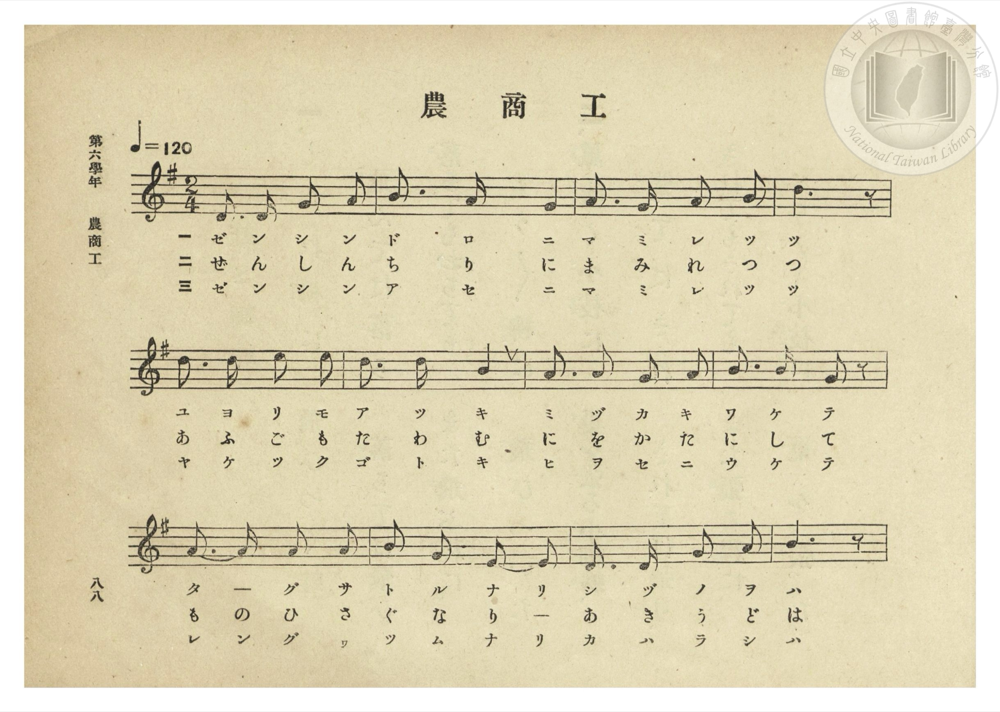
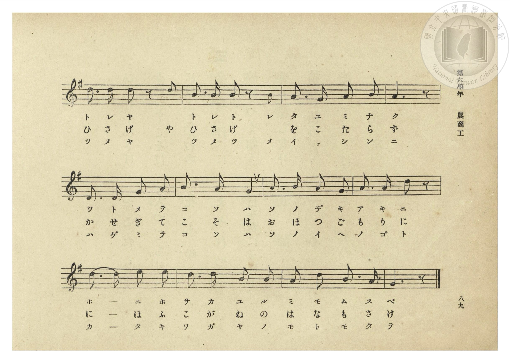
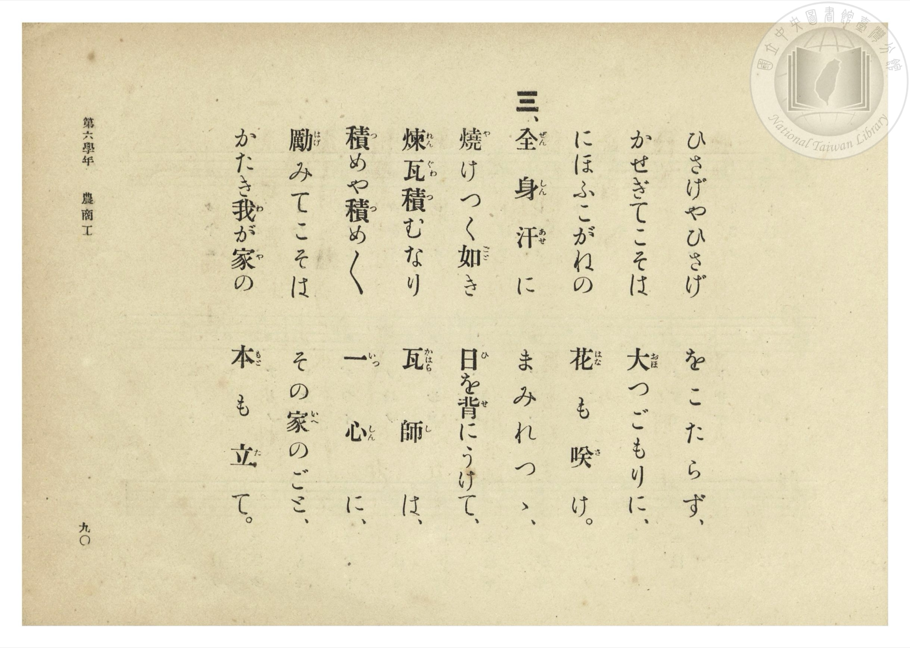
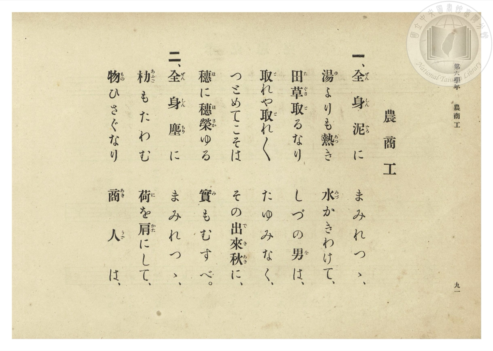

# 農商工

> Re:Shōka 使用 AI 協助辨識與重建樂譜，可能會有錯誤。歡迎回報。

- **NEUTRINO 歌聲合成版**：<br><audio controls src="no_sho_ko_neutrino.mp3"></audio>
- **鋼琴伴奏版**：<br><audio controls src="no_sho_ko.mp3"></audio>


- 曲：宮島慎三郎（臺灣總督府國語學校助教授）
- 臺灣總督府《公學校唱歌集》（大正四年三月，索書號 0725 26）

## 說明

原書資訊與歌詞全文（對應 P094.jpg–P097.jpg，第六學年 pp. 88–91）：
調性與拍號：ト長調（G 大調）2/4 拍，速度 ♩=120


## 歌詞

```text
一、全（ぜん）身（しん）泥（どろ）に　まみれつゝ、
湯（ゆ）よりも熱（あつ）き　水（みづ）かきわけて、
田（た）草（ぐさ）取（と）るなり　しづの男（を）は、
取（と）れや取（と）れ〳〵　たゆみなく、
つとめてこそは　その出（で）來（き）秋（あき）に、
穗（ほ）に穗（ほ）榮（さか）ゆる　實（み）もむすべ。

二、全（ぜん）身（しん）塵（ちり）に　まみれつゝ、
朸（あふご）もたわむ　荷（に）を肩（かた）にして、
物（もの）ひさぐなり　商（あき）人（うど）は、
ひさげやひさげ　をこたらず、
かせぎてこそは　大（おほ）つごもりに、
にほふこがねの　花（はな）も咲（さ）け。

三、全（ぜん）身（しん）汗（あせ）に　まみれつゝ、
燒（や）けつく如（ごと）き　日（ひ）を背（せ）にうけて、
煉（れん）瓦（ぐわ）積（つ）むなり　瓦（かはら）師（し）は、
積（つ）めや積（つ）め〳〵　一（いっ）心（しん）に、
勵（はげ）みてこそは　その家（いへ）のごと、
かたき我（わ）が家（や）の　本（もと）も立（た）て。
```

## ABC

```abc
X:1
T:農商工
C:曲：宮島慎三郎（臺灣總督府國語學校助教授）
M:2/4
L:1/16
Q:1/4=120
K:G
V:V1 name="Piano" snm="Pia"
[V:V1]
D3 D E2 F2 | G3 F E4 | F3 E F2 G2 | B6 z2 |
w: 1.~ぜ ん し ん | ど ろ に | ま み れ つ | つ
w: 2.~ぜ ん し ん | ち り に | ま み れ つ | つ
w: 3.~ぜ ん し ん | あ せ に | ま み れ つ | つ
d3 d e2 e2 | d3 d B4 | A3 A G2 A2 | B3 B G2 z2 |
w: 1.~ゆ よ り も | あ つ き | み づ か き | わ け て
w: 2.~あ ふ ご も | た わ む | に を か た | に し て
w: 3.~や け つ く | ご と き | ひ を せ に | う け て
A4 A2 A2 | B2 G2 E2 E2 | D3 D G2 A2 | B6 z2 |
w: 1.~た ぐ さ | と る な り | し づ の を | は
w: 2.~も ひ さ | ぐ な り _ | あ き う ど | は
w: 3.~れ ぐ わ | つ む な り | か は ら し | は
d3 d d2 z2 | B3 B B2 B2 | A3 G A2 B2 | A6 z2 |
w: 1.~と れ や | と れ と れ | た ゆ み な | く
w: 2.~ひ さ げ | ひ さ げ _ | を こ た ら | ず
w: 3.~つ め や | つ め つ め | い っ し ん | に
D3 D E2 F2 | G3 F E4 | F3 G F2 E2 | F3 F d2 z2 |
w: 1.~つ と め て | こ そ は | そ の で き | あ き に
w: 2.~か せ ぎ て | こ そ は | お ほ つ ご | も り に
w: 3.~は げ み て | こ そ は | そ の い へ | の ご と
d4 e2 e2 | d3 d B2 B2 | A2 d2 B3 A | G6 z2 |
w: 1.~ほ に ほ | さ か ゆ る | み も む す | べ
w: 2.~に ほ ふ | こ が ね の | は な も さ | け
w: 3.~か た き | わ が や の | も と も た | て
```

## TMD 檔案連結

- [主旋律 TMD 檔案](no_sho_ko.tmd) [[在 TMD Studio 編輯](https://tmdlang.github.io/Tmd-TS/#tmd=s7IKdvYPcrWy4qpTUCpJTLdSSM7PyUlNLsnMz7PKzk9PzM7Ojy_OyM9OLM4ojTe0NDRVgqssy88pzU21Si9KTEmNN0OIF-eXFiWnWhUnZ-Tn58SXpFaUJOXnZ6PLxxckpqdaBRhYmiBkCoryy1LzEvOAuguKMvNKUlPA2hEKUssyU1JB0sXJiXnxZalFmWmZqSlITkotKga5HGpFSVFiXnFyUWYByDsIVflFJRn5QGcXZFRaZWQWl-QXZSYn5sRnJ-YlIhSVZKQCPVeeXwR0uZaWwot9m55ObXu6famClhaXoq2CoZEBl72tgjuXjZG-iR1I17PZm97vmfV03bqnm7c9a-17sqPzZXPf-z0dL9p3PW9c_HzH3udzFz_dNefpnO4Xq-Y9Xbvj2YKFT7tWPps681lfx_s9nWCb0dQ-buh62roGqnbKxmdre17Obnvc0A009emS5c_WLn46e_bTnVuAVj2bAzSj5_mWRc9m73gxc76CgbmRqYKRGdhcLn0tBVtqAS4FBYWnffNB1mxuf7Gi60VHO9BZL1bOe9q64tm0dpDLNvQ-a-9UAMWsXlZB-qOGyUCmOYgJcuGaNU9b1wJ9BHS2QkGBnoKFBVCBpSHQocDAAxn-YtX-Zw3LQcZ29wJ9AhR93Nzxcup2oDjQcHcFoMfBzE5guCsA1QANfdkw_-muZQqPZq60BUULyJQnOxoeNzQC3QTU87hxzuOmyUAdL3atBnOnQ7jPNi8Fc1c-bgKa0vm4cfXjhobHjfseN-5_3NTzuHHJ46a5QENAxj3buR6ktKkNpK4JyOh63NT0vG0jWH8TUClYfy9Q_7MNW8CC-x83Ak0HCnaDxJv6HzdOfNy4DGrc8ykbwIqAvut80Qv0OZA94XHjVCD3af80MBfocKBNQM2rQJaB3DUdaOLjxnXPp2wHO2US2PT1UBNRtfU8bmpBF2nY_LhhK9ig-UB_gB246nFjP1Q_yLeNKx43NYIc2Tj5ceNcsNlA1UDGuqftu8BmLQea9WQfMBCAbFCQPV8OSorgEICHIMSDK6eDJXZDRJG5z5atA7OnAoMG7LQ2kDcbGp6uXwYJOLBg0-MmoN0zHzfufNzQBInRXUA_EIjRpwu3grkLgWFGKEbn7IA5fevjxilQS0Fh0w-yuqHhRS84nBuBFgClJr1oWgnmAmMEFGsgo0ExAo_RTrA0yAig94DSm8A-BEYqNP6AhQdyUD3ZBQlRYEQANSJFJEznJGAUIthAXzRNAscL0IFA1bPgqoHumf24sQ8t2oCZBGx8FywKgLE7BRyqQBFYJIH9sBvsf6BOYPCsBToe5PMuSLpeD3Q8JFyeTgIWbaA4A5s1ER4lOzoJZ7KNkKgH-ns2gSh53g5M08AwbIHaAnJ0_9NlTWD9U6ApGZLJpkNyLtBV4Lhp7gFzYRaAQhU5t7WCcxgoV4Bc9HwyJKFNAEY1iLsSGB9ALjgLgxIdNMJgyoABvB4Y5qDUtQPqM5QIQ9XfCHQ-uggs5wHLJLA4MF4Xg4zb34wcUIh4edoNScXA8IdkcmBWxZYp122DGQdMykBl6yChhJw05gPD61nHRLD3QZ4FRjNUGzSUQfH9bM4aWNqFFBZNz1dD8jUkpQPDsQlkIuWVBxQoaOlzcfnlB2fke-dbBWQm5uU71BjUVIPsULAxNNOyA7Ow1VoKwPoDGIwvFvYoaJgoPN3Q_3x9gw68qtHEogFoFciwGgXTeAVdIARSZiCWOYioUTAECwI5YEEQrIFI6YJEwCyQkhoFY6g0CBqARMDG-hjWAAN6DlgUGI1A9nQoC6QHmLehMr2gzAa3AJj8IeKN-4FyPWDWEqgMiIZBsBMh9hjht2chVKaLUnuM8dvTBDVvNgX24I_cXT1kRS7YfFMFMyAJwggRWLzVKBiBaSNwfILYsDg1BougxWlTGzQMOsChCmKB_I4cBkuAuBcpDPZDxZeCsh6YBZIFmdUPlZkIxMtQwxscrzATtwLxFBS75kNd0Q_EDUh2QcIeWPTB7QKpRJIBxhuGXaC4bWpBcgsoboBFLFQnyGYQfwWavzYh2TUbrAJkB0gGGkZo_iKQeTvJiV9I3EHiDRF3oHgD51swgZzF0eMYe76FhC7IBxPA5FSov1aA_QsJ11VgNigFgGRAuQEWx-ugoQKRWY9kD1r8gmMTpGsdNDQRNkHsRdgBC3OYDlC5AQplSEmCxx5w3IJyHizfgk0GpzxYLoSkIHQfgXwJEl0PFOsEs0B-xG4T3pgFdkUwY9aU6JwLosHxA8-VIBqEYbFvCKaRRbDHKij2QD7sgaZ2SNpAEYfGMCi8kHNZGzQXQ8IIJAPJuVhjFZYvgHEJrKfB-kG2YZOBxio4rYDEQfEDshMS4iAds7DbAy6NISUosCGB5h8kcWj8NkJlYHl8MTQ2EeU3rMwmMk6f7JpCVpySWtUaQhjQbAwVBFLwRIEUvVBvg4opsIchRQ9IBuRJEH8uUuIFic-FioOy33Iwqxcqg5zNQEGDHsWwzAGq7vqIsguSiYHNalikgItVpEIAXkWjRzPEFFCCgSVCUvwFinJgOxAqAyqaIHZDkjox2bd1LfnZF1LpYla8iMwKEoVkbCN4UsCefXdDxSGhBOGDxEFFJojfDa2cIQU0rOKFhC-skgT2HMEyO5HsQY9bWFaA2ACqfFFDG1RMrIWGL6JAhBWfsJQzFSwzEbs94HiFpCGQWnCWx2gUwIopuD0Qn0CLKJg988H2gFIEqj21XFy6dgrQtrQCkKnMBQA)]
- [鋼琴伴奏 TMD 檔案](no_sho_ko_piano.tmd) [[在 TMD Studio 編輯](https://tmdlang.github.io/Tmd-TS/#tmd=s7IKdvYPcrWy4tLSUnixb9PTqW1Pty99v6fjZfee5xO2PNmz5enS_uedHe_3dCpoaXEp2ioYGhlw2dsquHPZGOmb2HHVKSg9m73p_Z5ZT9ete7p527PWvic7Ol829wGNeNG-63nj4uc79j6fu_jprjlP53S_WDXv6dodzxYsfNq18tnUmc_6QOYqgcxAU_u4oetp6xqo2ikbn63teTm77XFDN9DUp0uWP1u7-Ons2U93bgFa9WwO0Iye51sWPZu948XM-QoG5kamCkZmYHO5_PKDM_K9860CMhPz8oM8HGoMaqq5FIDAxtBMyw7M0tdSsEUHCs_XrHmyo-HFwh4FDROFpxv6n69v0FEIMLA00csqSNfEokFLH2xYjYJpvIIuEAIpMxDLHETUKBiCBYEcsCAI1kCkdEEiYBZISY2CMVQaBA1AImBjfQxrFB43zgGLPm6aDGRPh7JAeh43roTK9ALZq-EWPG7cBxFv3A-U6wGzlkBlQDQMgp0IsccIvz0LoTJdlNpjjN-eJqh5symwB3_k7uohK3LB5psqmAFJEEaIwOKtRsEITBuB4xPEhsWpMVgELU6b2qBh0AEOVRAL5HfkMFgCxL1IYbAfKr4UiLvBLJAsyKx-qMxEIF6GGt7geIWZuBWIp6DYNR_qin4gbkCyCxL2j5smwe0CqUSSAcYbhl2guG1qQXILKG4eN4JcB9IJshnEX4Hmr01Ids0GqwDZAZKBhhGavwhk3k5y4hcSd5B4Q8QdKN7A-RZMIGdx9DjGnm8hoQvywQQwORXqrxVg_0LCdRWYDUoBIBlQboDF8TpoqEBk1iPZgxa_4NgE6VoHDU2ETRB7EXbAwhymA1RugEIZUpLgsQcct6CcB8u3YJPBKQ-WCyEpCN1HIF-CRNcDxTrBLJAfsduEN2aB5T5mzJoSnXNBNDh-4LkSRIMwLPYNwTSyCPZYBcUeyIc90NQOSRso4tAYBoUXci5rg-ZiSBiBZCA5F2uswvIFMC4fN4JSAcQ2bDLQWAWnFZA4KH5AdkJCHKRjFnZ7wKUxpAR93NSI5h8kcWj8NkJlYHl8MTQ2EeU3rMwmMk6f7JpCVpySWtUaQhjQbAwVBFLwRIEUvVBvg4opsIchRQ9IBuRJEH8uUuIFic-FioOy33Iwqxcqg5zNQEGDHsWwzAGq7vqIsguSiR837oZFCrhYRSoE4FU0ejRDTAElGFgiJMVfoCh_3LgDKgMqmiB2Q5I6Mdm3dS352RdS6WJWvIjMChKFZGwjeFLAnn13Q8UhoQThg8RBRSaI3w2tnCEFNKzihYQvrJJ83DgTLLMTyR70uIVlBYgNoMoXNbRBxcRaaPgiCkRY8QlLOVPBMhOx2wOOV0gaAqkFZ3mMRgGsmILbA_EJtIiC2TMfbA8oRaDaU4vWlPZBbkqbIFrST7uXPO3ufDaj7-n-1U92dgObWc-6e5-unfB0-7Jnnd2QzgRyBo5XiDaNjwUyzUBMs_hcEBskDMLACIwHxhvEl2BOtCFIHs7AoRDJWJBSckyFagcxsZqL3bmoykEGmuAyGeoGYLjq2ilAgzbaxzAWrBdZyAhTyBgupMwFAA)]

## 分析

```text
================================================================================
📊 TMD Song Profile: [ 農商工 ]
================================================================================
⏱  Duration:       0:24 (24.0s), 24 measures total
🎼 Key & Tempo:    首調基準 G, != 120.0 BPM, <2/4>
   - 分析範圍：      由實際發聲的音符與和弦推測調性；播放脈絡另行呈現
🎤 人聲音域:    D4 (MIDI 62) – E5 (MIDI 76) [跨度: 14 個半音 / 1.2 個八度, 難度: moderate]
   - 最低音:  D4 in [NoShoKo #1 @ m.1, 0:00]
   - 最高音: E5 in [NoShoKo #1 @ m.5, 0:04]
   - 適合: soprano, mezzo-soprano, contralto, tenor, baritone, bass
🏛  結構:      NoShoKo (24.0s)
⚡ 編曲密度:        Peak 1 軌道同時演奏
🗝  調性診斷：       D 調性不明確（純淨自然大調，未偵測到可信轉調）
   - 風格氣質:    純淨自然大調（陽光明朗、易唱易記，無明顯調外色彩）
   - 轉調歷程:    全曲維持單一推測調性（未偵測到可信轉調）
   - 核心骨幹音:  B, D, A, E, G
   - 調性數值:    D 調性不明確 [相關度: 0.84, 穩定度: Ambiguous, 自然音純度: 100.0%]
   - 候選調性 (K-S): D 大調 (0.84), B 小調 (0.82), G 大調 (0.68)
   - 五度圈歷程:   +2
   - 各段落調性細節:
     • [NoShoKo #1]: D 調性不明確 (r: 0.84, 自然音純度: 100.0%)

  [ 五度圈游移軌跡 ]
               C  
         F            G  
      Bb              [D ]*
      Eb               A  
         Ab           E  
            Db       B  
               F# 
     (* = active key center)

  [ 十二半音累積音高分佈 ]
     C  :                            0.0%
     C# :                            0.0%
     D  : ███████████████████████   21.3%
     D# :                            0.0%
     E  : █████████████████         15.2%
     F  :                            0.0%
     F# : ████████████              11.2%
     G  : ███████████████           13.5%
     G# :                            0.0%
     A  : ██████████████████        16.9%
     A# :                            0.0%
     B  : ████████████████████████  21.9%
--------------------------------------------------------------------------------
Assignment 軌道音域：
  - Piano         : D4 – E5 (14 個半音 / 1.2 個八度, 76 個音符)
================================================================================
```


## 原書掃描頁










