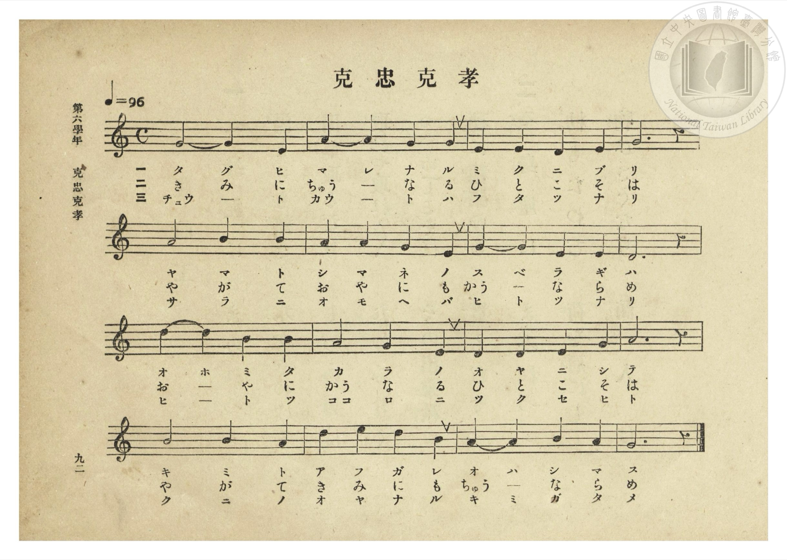
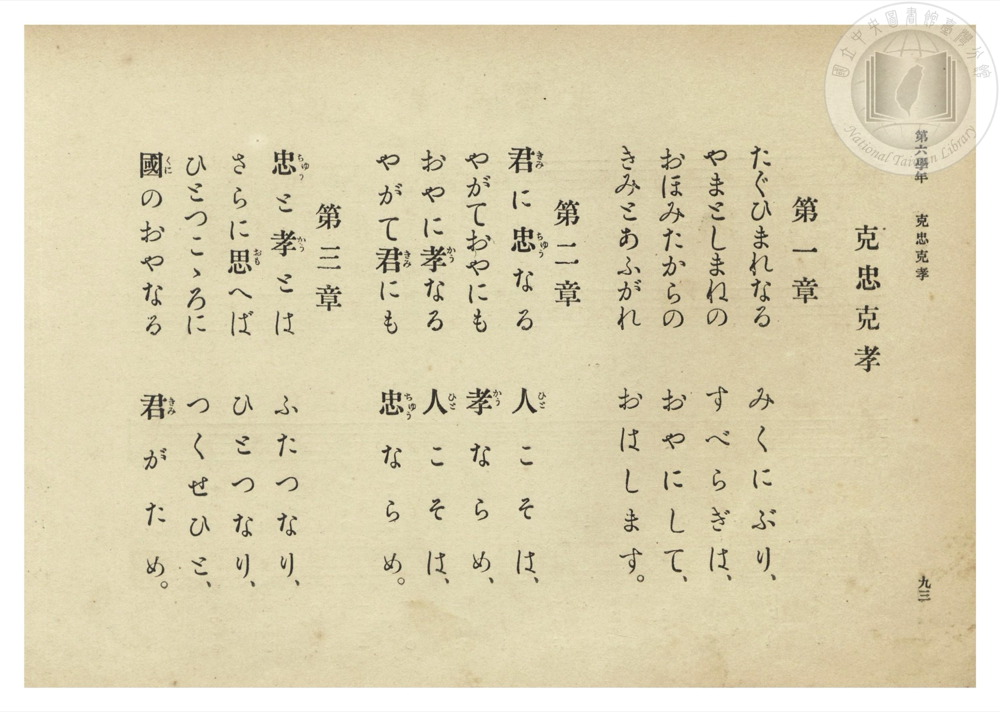

# 克忠克孝

> Re:Shōka 使用 AI 協助辨識與重建樂譜，可能會有錯誤。歡迎回報。

<audio controls src="koku_chu_koku_ko.mp3"></audio>

- 曲：芝葛鎮（宮內省式部職樂部樂長）
- 臺灣總督府《公學校唱歌集》（大正四年三月，索書號 0725 26）

## 說明

原書資訊與歌詞全文（對應 P098.jpg–P099.jpg，第六學年 pp. 92–93）：
調性與拍號：ハ調（C 大調／律旋）4/4 拍，速度 ♩=96

## 歌詞

```text
第一章
たぐひまれなる　みくにぶり、
やまとしまねの　すべらぎは、
おほみたからの　おやにして、
きみとあふがれ　おはします。

第二章
君（きみ）に忠（ちゅう）なる　人（ひと）こそは、
やがておやにも　孝（かう）ならめ、
おやに孝（かう）なる　人（ひと）こそは、
やがて君（きみ）にも　忠（ちゅう）ならめ。

第三章
忠（ちゅう）と孝（かう）とは　ふたつなり、
さらに思（おも）へば　ひとつなり、
ひとつこゝろに　つくせひと、
國（くに）のおやなる　君（きみ）がため。
```

## ABC

```abc
X:1
T:克忠克孝
C:曲：芝葛鎮（宮內省式部職樂部樂長）
M:4/4
L:1/16
Q:1/4=96
K:C
V:V1 name="Piano" snm="Pia"
[V:V1]
G8 G4 E4 | A4 A4 G4 G4 | E4 E4 D4 E4 | G12 z4 |
w: 1.~た ぐ ひ | ま れ な る | み く に ぶ | り
w: 2.~き み に | ちゅう _ な る | ひ と こ そ | は
w: 3.~ちゅう _ と | かう _ と は | ふ た つ な | り
A8 B4 B4 | A4 A4 G4 E4 | G4 G4 E4 E4 | D12 z4 |
w: 1.~や ま と | し ま ね の | す べ ら ぎ | は
w: 2.~や が て | お や に も | かう _ な ら | め
w: 3.~さ ら に | お も へ ば | ひ と つ な | り
d4 d4 B4 B4 | A8 G4 E4 | D4 D4 E4 G4 | A12 z4 |
w: 1.~お ほ み た | か ら の | お や に し | て
w: 2.~お _ や に | かう な る | ひ と こ そ | は
w: 3.~ひ _ と つ | こ ろ に | つ く せ ひ | と
B8 B4 A4 | d4 e4 d4 B4 | A4 A4 B4 A4 | G12 z4 |
w: 1.~き み と | あ ふ が れ | お は し ま | す
w: 2.~や が て | き み に も | ちゅう _ な ら | め
w: 3.~く に の | お や な る | き み が た | め
```

## TMD 檔案連結

- [主旋律 TMD 檔案](koku_chu_koku_ko.tmd) [[在 TMD Studio 編輯](https://tmdlang.github.io/Tmd-TS/#tmd=s7IKdvYPcrWy4qpTUCpJTLdSSM7PyUlNLsnMz7PKzk9PzM7Ojy_OyM9OLM4ojTe0NDRVgqssy88pzU21Si9KTEmNN0OIF-eXFiWnWhUnZ-Tn58SXpFaUJOXnZ6PLxxckpqdaBRhYWiBkCoryy1LzEvOAuguKMvNKUlPA2hEKUssyU1JB0sXJiXnxZalFmWmZqSlITkotKga5HGpFSVFiXnFyUWYByDsIVflFJRn5QGcXZFRaZWQWl-QXZSYn5sRnJ-YlIhSVZKQCPZebX5SYgy5YkFhSlJlfkpmsxKWlpfC0tfvp_gUgcu1cBS0tLkVbBUszLntbBWcuGxN9EzuQ5mezN73fM-tF19wXE2e_7Fv3fk_H03XrnrYufz6n8eme_pfNK140bn-2ognIAJFTt7_f0wm29EX7rueNi5_v2Pt87uKnu-Y8buh62rrm6dodzxYsfDpl47O1PS9ntz1u6AaZt2T5s7WLn86e_XTnlic7Op_N6Xi_p-f5lkXPZu94MXO-goG5kamCkRnYXC59LQVbagEuBQWFp33zQdZsbn-xoutFRzvQWS9WznvauuLZtHaQyzb0PmvvVADFtF5WQfqjhslApiWICXLhmjVPW9cCfQR0tkJBgZ6CpRFQgaUx0KHAAAMZ_mLV_mcNy0HGdvcCfQIUfdzcDxQEmuysAPQ1mNn_dF_3s-nAcOgEhrgCUCXQ6JcN85_uWqbwaOZKW2B8gIwCWvZkR8Pz1QtAnMeN8x83TnjcuOlx477HTT2PG1c9bup-3NDwuHH_48b-x42rHzdue9zU9bihEay6qQWkrnHF48bpYMbax43rwKpnPm7c-bip83Fj3-PG9TDVjV2PG3eDTQJa0g2WhqjuAhsENBtoyjK46l6wUqDZTY8btz5u7AG5B6IaaCTUwpmPG5rgvtjVA_XF0wmzgQEBMQHoe6DRwLQIFln4uKn1cWMbWBDqtSe7doGlgF5eARaf_LhxLpKrQU4DBsQyhDObmoDagOkarK0bybjOx02NSJ4Fq8amjhRrMf0CtR-7jyBOQITJjk5YmGBRvwLDccDQBroAGMjAAAdG0hKwmfDobpwKjrTVzxog2oBebAJr2_G4cQNYG8g3mNrgopMfN8193AT0ymqwaqAIME3NhiqAqH46B5RxIYkNbPY6WFBCAw4jQIChNB_qa6B-yjMvFCho6XNxeednlzpnlIIo73yrgMzEvHyHGoOaapBNCjYWWnZgBraiA5qvXizsUdAwUXi6of_5-gYdeH7XxKIBaB_IsBoFUwVdMATRxkBco2AGJEEYJALCNWBxEDaCq4HpAkEDkAjYNB_DGlCmhooD8zaY3ATWAcxBIF5TD1hsFZjdDZXZDxbrB5OrweQ2iExTF5I98Qh7jEC6euH2QPSDdILEoYkOLotqF8g1wAQAJieDyblQmfXY7TLGNBNiLsgMkBwoPaMIQowCSW0F80ABAkx_cMdg9xj-yN3VQ07kgqIRBM2hGDVyEVEJ40FEQNGMI3KbWuA-BUcnPBCmI4mtBZProDIzwbyd4EjoBLP78Ac4KHKR7IEkmGVQPaBwg8hCk0pTE7ZogMQ5yDqQYY3YLQLH7FSYHqjjYKkIYhHIcGCJAyY3QGWQUxBlkbqjk5xINYoDGg0mUKMVNReDIhGWXyG5GKYGW54F-7ZxN5iE5CZQogUHK1r4wKIVIyLASQAkA4oqXHkWFkLIOnFEHmUZFqQLOUeCIgokDjEBTDb1ojgBEpWQQmg2mIQVXCATSIhWYAuQnGgFRSQsr4KiChrRxiixjcjACGX4ymKQFyHBAIlVWHaFpGtI8QTOYOByGZESQEGLnKlhGZnU7AoJYkT5jMiu2EtpYnIsKIogeiDpDluKRE1CyK6AuA-aurHYU8vFpWungFIVKwAFlLkA)]
- [鋼琴伴奏 TMD 檔案](koku_chu_koku_ko_piano.tmd) [[在 TMD Studio 編輯](https://tmdlang.github.io/Tmd-TS/#tmd=s7IKdvYPcrWy4tLSUnja2v10_wIQuXbu-z0dL7v3PJ-w5cmeLU-X9j_v7Hi_p1NBS4tL0VbB0ozL3lbBmcvGRN_EjqtOQenZ7E3v98x60TX3xcTZL_vWAfU-Xbfuaevy53Man-7pf9m84kXj9mcrmoAMEDl1O9AoJZC-F-27njcufr5j7_O5i5_umvO4oetp65qna3c8W7Dw6ZSNz9b2vJzd9rihG2TekuXP1i5-Onv2051bnuzofDYH6Jye51sWPZu948XM-QoG5kamCkZmYHO5vPOzS50zSkGUd75VQGZiXn6Qh0ONQU01lwIQ2Fho2YEZ-loKtuhA4fmaNU92NLxY2KOgYaLwdEP_8_UNOgoBBpYWelkF6ZpYNGjpgw2rUTBV0AVDEG0MxDUKZkAShEEiIFwDFgdhI7gamC4QNACJgE3zMaxReNw4Hyr-uHECmNwE1vG4cR-I19QDFlsFZndDZfaDxfrB5GowuQ0i09SFZE88wh4jkK5euD0Q_SCdIPGFj5taHze2wWVR7QK55nHjCjA5GUzOhcqsx26XMaaZEHNBZoDkupEtgxgMMgoktRXMAwXI48YlcMdg9xj-yN3VQ07kgqIRBM2hGDVyEVEJ40FEQNGMI3KbWuA-BUcnPBCmI4mtBZProDIzwbyd4EjoBLP78Ac4KHKR7IEkmGVQPaBwg8hCk0pTE7ZogMQ5yDqQYY3YLQLH7FSYHqjjYKkIYhHI8MeNO8DkBqgMcgqiLFJ3dJITqUZxQKPBBGq0ouZiUCTC8iskF8PUYMuzYN827gaTkNwESrTgYEULH1i0YkQEOAmAZEBRhSvPwkIIWSeOyKMsw4J0IedIUESBxCEmgMmmXhQnQKISUgjNBpOwggtkAgnRCizuyYlWUETC8iooqqARbYwS24gMjFCGrywGeRESDJBYhWVXSLqGFE_gDAYulxEpARS0yJkalpFJza6QIEaUz4jsir2UJibHgqIIogeS7rClSNQkhOwKiPugqRuLPbVYa2If5JrYBFETv-jretne-3J2K7CF8HRf97Pp3S8XrXi2YM-Tnd1Pdk15umvZi472p62rgYyn25c96-yGNEsQkW4cr20OshdCm8XHaxvHgyIZwgDmXCDDCOwwDDG4YrgaUPRDAgpJNcwGYgyAq8BhqClQjDwjoXwkHcjm4ggFsHVmQA6EBZHF8BqucABGpK6dAkpcRvsYxoKtxJQwwiVhDJdQ5gIA)]

## 分析

```text
================================================================================
📊 TMD Song Profile: [ 克忠克孝 ]
================================================================================
⏱  Duration:       0:40 (40.0s), 16 measures total
🎼 Key & Tempo:    首調基準 C, != 96.0 BPM, <4/4>
   - 分析範圍：      由實際發聲的音符與和弦推測調性；播放脈絡另行呈現
🎤 人聲音域:    D4 (MIDI 62) – E5 (MIDI 76) [跨度: 14 個半音 / 1.2 個八度, 難度: moderate]
   - 最低音:  D4 in [KokuChuKokuKo #1 @ m.3, 0:06]
   - 最高音: E5 in [KokuChuKokuKo #1 @ m.14, 0:33]
   - 適合: soprano, mezzo-soprano, contralto, tenor, baritone, bass
🏛  結構:      KokuChuKokuKo (40.0s)
⚡ 編曲密度:        Peak 1 軌道同時演奏
🗝  調性診斷：       G 大調（純淨自然大調，未偵測到可信轉調）
   - 風格氣質:    純淨自然大調（陽光明朗、易唱易記，無明顯調外色彩）
   - 轉調歷程:    全曲維持單一推測調性（未偵測到可信轉調）
   - 核心骨幹音:  G, A, D, E, B
   - 調性數值:    G 大調 [相關度: 0.77, 穩定度: Moderate, 自然音純度: 100.0%]
   - 候選調性 (K-S): G 大調 (0.77), D 大調 (0.70), E 小調 (0.65)
   - 五度圈歷程:   +1
   - 各段落調性細節:
     • [KokuChuKokuKo #1]: G 大調 (r: 0.77, 自然音純度: 100.0%)

  [ 五度圈游移軌跡 ]
               C  
         F           [G ]*
      Bb               D  
      Eb               A  
         Ab           E  
            Db       B  
               F# 
     (* = active key center)

  [ 十二半音累積音高分佈 ]
     C  :                            0.0%
     C# :                            0.0%
     D  : ███████████████           16.7%
     D# :                            0.0%
     E  : ███████████████           16.7%
     F  :                            0.0%
     F# :                            0.0%
     G  : ████████████████████████  26.7%
     G# :                            0.0%
     A  : ███████████████████████   25.0%
     A# :                            0.0%
     B  : ██████████████            15.0%
--------------------------------------------------------------------------------
Assignment 軌道音域：
  - Piano         : D4 – E5 (14 個半音 / 1.2 個八度, 48 個音符)
================================================================================
```


## 原書掃描頁






