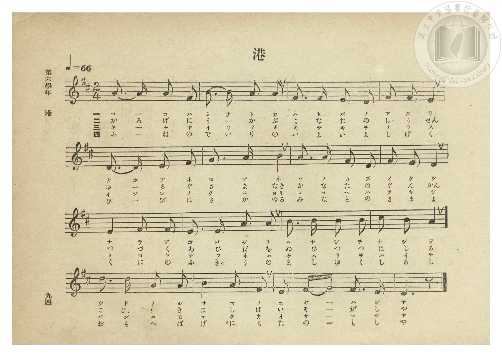
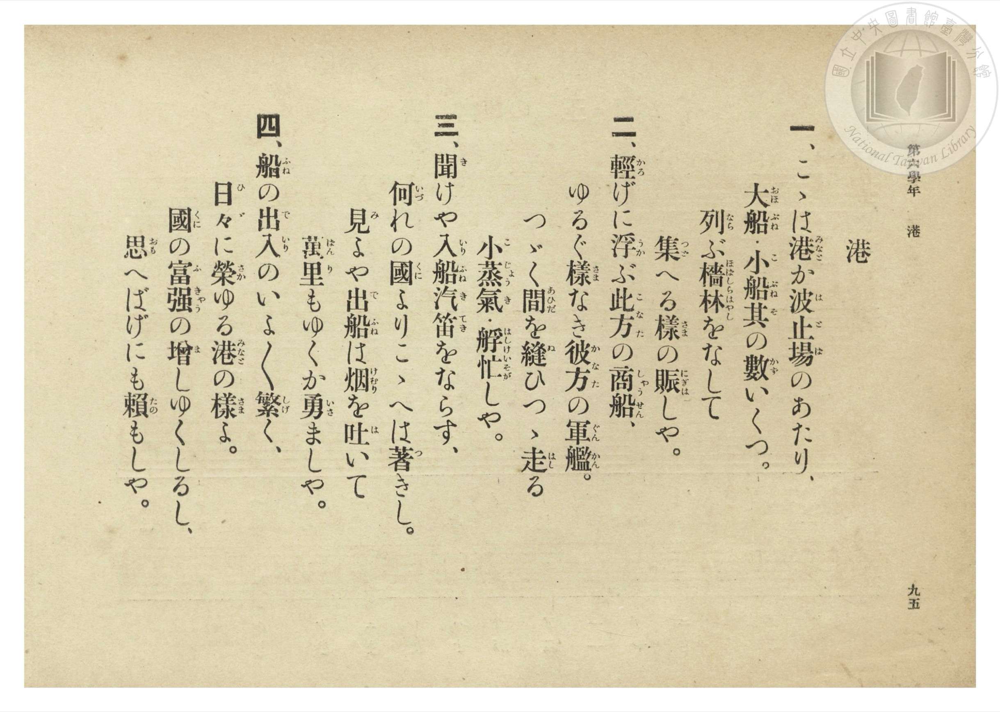

# 港

> Re:Shōka 使用 AI 協助辨識與重建樂譜，可能會有錯誤。歡迎回報。

- **NEUTRINO 歌聲合成版**：<br><audio controls src="minato_neutrino.mp3"></audio>
- **鋼琴伴奏版**：<br><audio controls src="minato.mp3"></audio>


- 文部省《尋常小學唱歌》
- 臺灣總督府《公學校唱歌集》（大正四年三月，索書號 0725 26）

## 說明

原書資訊與歌詞全文（對應 P100.jpg–P101.jpg，第六學年 pp. 94–95）：
調性與拍號：ニ調（D 大調）2/4 拍，速度 ♩=66


## 歌詞

```text
一、こゝは港（みなと）か波（は）止（と）場（ば）のあたり、
大（おほ）船（ぶね）・小（こ）船（ぶね）其（そ）の數（かず）いくつ。
列（なら）ぶ檣（ほばしら）林（はやし）をなして
集（つど）へる樣（さま）の賑（にぎは）しや。

二、輕（かろ）げに浮（うか）ぶ此（こ）方（なた）の商（しゃう）船（せん）、
ゆるぐ樣（さま）なき彼（か）方（なた）の軍（ぐん）艦（かん）。
つゞく間（あひだ）を縫（ぬ）ひつゝ走（はし）る
小（こ）蒸（じょう）氣（き）・艀（はしけ）忙（いそが）しや。

三、聞（き）けや入（いり）船（ふね）汽（き）笛（てき）をならす、
何（いづ）れの國（くに）よりこゝへは著（つ）きし。
見（み）よや出（で）船（ふね）は煙（けむり）を吐（は）いて
萬（ばん）里（り）もゆくか勇（いさ）ましや。

四、船（ふね）の出（で）入（いり）のいよ〳〵繁（しげ）く、
日（ひ）々（び）に榮（さか）ゆる港（みなと）の樣（さま）よ。
國（くに）の富（ふ）強（きゃう）の增（ま）しゆくしるし、
思（おも）へばげにも賴（たの）もしや。
```

## ABC

```abc
X:1
T:港
M:2/4
L:1/16
Q:1/4=66
K:D
V:V1 name="Piano" snm="Pia"
[V:V1]
A3 A A2 F2 | B3 B A2 A2 | F3 F E2 D2 | F2 F2 E4 |
w: 1.~こ _ こ は | み な と か | は と ば の | あ た り
w: 2.~か ろ げ に | う か ぶ こ | な た の し | ゃう せ ん
w: 3.~き _ け や | い り ふ ね | き て き を | な ら す
w: 4.~ふ _ ね の | で い り の | い よ い よ | し げ く
D3 D E2 F2 | G3 A B4 | A3 A F2 D2 | F2 E2 D4 |
w: 1.~お ほ ぶ ね | こ ぶ ね | そ の か ず | い く つ
w: 2.~ゆ _ る ぐ | さ ま な | か な た の | ぐ ん かん
w: 3.~い づ れ の | く に よ | こ こ へ は | つ き し
w: 4.~ひ _ び に | さ か ゆ | み な と の | さ ま よ
E4 F2 F2 | E3 E A2 A2 | B3 B B2 B2 | c2 B2 A4 |
w: 1.~な ら ぶ | ほ ば し ら | は や し を | な し て
w: 2.~つ づ く | あ ひ だ を | ぬ ひ つ つ | は し る
w: 3.~み よ や | で ふ ね は | け む り を | は い て
w: 4.~く に の | ふ きゃう _ の | ま し ゆ く | し る し
d3 d A2 A2 | B4 A2 F2 | E2 F G F3 E | D6 z2 |
w: 1.~つ ど へ る | さ ま の | に ぎ _ は し | や
w: 2.~こ じょう _ き | は し け | い そ _ が し | や
w: 3.~ば ん り も | ゆ く か | い さ _ ま し | や
w: 4.~お も へ ば | げ に も | た の _ も し | や
```

## TMD 檔案連結

- [主旋律 TMD 檔案](minato.tmd) [[在 TMD Studio 編輯](https://tmdlang.github.io/Tmd-TS/#tmd=s7IKdvYPcrWy4qpTUCpJTLdSSM7PyUlNLsnMz7PKzk9PzM7Ojy_OyM9OLM4ojTe0NDRVgqssy88pzU21Si9KTEmNN0OIF-eXFiWnWhUnZ-Tn58SXpFaUJOXnZ6PLxxckpqdaBRgaGCBkCoryy1LzEvOAuguKMvNKUlPA2hEKUssyU1JB0sXJiXnxZalFmWmZqSlITkotKga5HGpFSVFiXnFyUWYByDsIVflFJRn5QGcXZFRaZWQWl-QXZSYn5sRnJ-YlIhSVZKQCPVeQk5icii5YlpqRmZwDFNbSUni2Y72ClhaXoq2CmRmXva2CC5eNkb6JHUjHs2ntL5tXPJ_T-Lih6-mG7qc7djzd0P907Y6nUzY-W9vzuKEbbO6L9l3PGxc_37H3-dzFT3fNAaltXQNU9WzBQojCl7PbgGrf7-l4umT5s7WLn86e_XTnlic7Op_N6Xi_p-f5lkXPZu94MXO-goG5kamCkdn7PZ1KXFz6Wgq21AJcCgoKT_vmg6zZ3P5iRdeLjnags16snPe0dQXQjyCXbeh91t6pAIpMvayC9EcNk4FMQxAT5MI1a562rgX5e-cWhYICPQVLE6ACS1OgQ9_vmQUy_MWq_c8aloOM7e4F-gQo-ri5GygINNlFAehrMLMTGKwKQAVAE182zH-6a5nCo5krbYGBDjLhyY6Gxw2NjxsnP26a-7hxPTBSgHofN-5_3LjqceMKoObHjd3PNi8CCwKlOp-thbBBUk8XbAGzN4CVrXvc2PS4cf7jpi6ggWCfL1kOlu563LgbqOJFx04wd9vjxrUgDc27gZEKFpmMKfu0dRuYOxdi9LOpO8Dc7seNs8AiLY8b-x83Lnnc0AS2qWM6WHrV4yZgyACltz1btRgsshvouseN0yHiz-ZBlK1_3ATUD2R3Pm6aBPbo9MeNy0AGAVMMWMWSx40rwQbteNzU_WwFxKypjxv3QZzzYvNEsMjqx419kGAB29ECcg44UHcBE2njiz1ToY5uAoY9UAnQrtXPtq4DC7YBxaFOXbsEHgrPpkFCAegkYGSCrHo6FeIioPHNQF1IITX7cRNICzSwHze1AZ36uHEChmuBZvU-3bsH4hSsdrzYDXQfUGQCxMQXnctg7oZYAA5jUKA0zQMG-8tpQFGgNDCyNz1uXAAJxec7VoMF14BNBIoDFc99sRWYMsDhDQ3sbnBkIcf6JEi8znjc1A7x3bMNEOeDQ6x594vOBrgRjxuBod75dP9MsAgwBoEJtgcz7HeAguRF4zyEMY0TgfJPW5dC9TV1IYXiVkh6e7ZxL1z98zWzwexlUO2QNNIENGcmNLCf7IXELNANQEOBKnpAMTUHVNSA0yUwLICCHaCsAM1YO4BeeDERkvyA0Q00qxfkbEjQvlgG0QnKq2BtLU_bd4FFgBkI3aVAg563QoIA6K0GiG-Abnw6YQI8k4JdBk7QLyYAYwSURSFx-bIdGGAgd4H1NIESDci93U-7QYURWBvQZ0D9-1ADFVh0ggIV3SXrkN2JFsDgAgHI7njcsPlxw9bnOxuh6bhxEli2HxqWz6ZDtG0CJ7VWMHszWMXqZ8sgeQWYlMF5BZzEsZVQ69ATPchWSMmAFilAJ68HB0HjVpCT92yHxDo8c4EULIIkHUjuAYYCJIyADGD2AkYZxNUNwJIJXLY1NUELClBBA8rhQJEXmyEF43ygcdCQhgcnUDPlFQsUKGjpc3H5ZuYlluRbBWQm5uU71BjUVIOsULAxNNOyA7OwVWgKwKoFWPK_WNijoGECypHP1zfowGshTSwagDaBDKtRMFXQBUJTMG0MxDUKZmARM7AICNeAxUGyRkDSEC4CwiAREKwBm-ZjWAMsVyZDxSAsYAoG6wDGMFR0FRCvALO6oTIgFSD-CiDeAGatg8o0gXnzQWRTF6pdRiB5kAkguV4gexJY7Wqozjaomd1AvA3uGpDMKqjMfKg9wLiEyIATDVhgNthQmEegFhqDNPfCPTcRrKYFaiiIhjgSmBTB8muhMhAdwPwLZQPzNpJDgOUQWHYmql0mIHmQORC9ILMQgbIcKtoCDRSEDMwVHVA2iAWRAXkRFkT9cLvwJ6hdPeQkKFACASUTUNKAJCgTsIgpNGGBRGCJDiSPSFCw5IWeoCARD6z84VEJC1tIDIFEIWIQ04E1CVR8HTSJAJsZSCEECQFgwY1qFyhBNUGSDSjkIPomQPVNhZq4DxZv4LhESoLgZA1OqPDYAOmFpCJI5YtqHTg5QSOscSlQYQ-KZkgkgdIzJBIhUY3s6clAvAPMguUwkIegiQwc4egJahPMc42boWajeg6YV8ABAPE89jwLcx9IDyg4YImMmAS1o5OcBAUrY2BlDkzECKmEgpVZIBqEaxTMoSxIUkNNUJASAJH5QIkKJL4b6tsNsAwDlkcqoYDZHSaDkomh2WsZql3gEgqWyEBxDEt6sJINxN8ExAtQTFyDJAOJURAJcwXMfkiyQ01NkNiCxQiicIIVGFuBGFKUwFIMqBADqWyAFSVwV0DsgmQXNH-B0xKsEIGkIkS6gBRa8DoYyoPJgtILxA_QlAYPD4SvkNMu3vQEbMWQVUDFgQ0HUujpB8JDpDFjYNEFqfuM4AUbBBogQgOcoiCxDOxlwPIkPAdB8hY8r8BDAhJqffDYgPgbVARBygQIjEfYA05NsLwPbWDDwhpqJsQcRHoExS6i0AMVisAWNjF2gVMTqCaGFGCwtAFKsyiFJLQghfkVYg-iZCBoDzglQYt3oOmw8gxkM0gGlBaR0hjMfqRiFiKGz55aLi5dOwVIo0oByFLmAgA)]
- [鋼琴伴奏 TMD 檔案](minato_piano.tmd) [[在 TMD Studio 編輯](https://tmdlang.github.io/Tmd-TS/#tmd=s7IKdvYPcrWy4tLSUni2Y_37PR0vu_c8n7DlyZ4tT5f2P-_seL-nU0FLi0vRVsHMjMveVsGFy8ZI38SOq05B6dm09pfNK57PaXzc0PV0Q_fTHTuebuh_unbH0ykbn63tedzQrQRS9aJ91_PGxc937H0-d_HTXXNAalvXAFU9W7AQovDl7DagWqDNT5csf7Z28dPZs5_u3PJkR-ezOUDLe55vWfRs9o4XM-crGJgbmSoYmQEdpMTF5ZuZl1iSbxWQmZiXH-ThUGNQU82lAAQ2hmZadmCWvpaCLTpQeL5mzZMdDS8W9ihomCgAXft8fYOOQoChgYFeVkG6JhYNWvpgw2oUTBV0gdAUTBsDcY2CGVjEDCwCwjVgcZCsEZA0hIuAMEgEBGvApvkY1ig8bpwMFYOwHjeuB-t43LgfKroKiFeAWd1QGZAKEH8FEG8As9ZBZZrAvPkgsqkL1S4jkDzIBJBcL5A9Cax2NVRnG9TMbiDeBncNSGYVVGY-1J7HjdMhMk3NEG2PG2eDDYV5BGqhMUhzL9xzE8FqWqCGgmiIIx83bgXLr4XKQHQ8blwGZT9uAjkU5pDHTZ1g2ZmodpmA5EHmQPSCzEIEynKoaAs0UBAyMFd0QNkgFkQG5EVYEPXD7cKfoHb1kJOgQAkElExASQOSoEzAIqbQhAUSgSU6kDwiQcGSF3qCgkT848bd8KiEhS0khkCiEDGI6Y8b50LF10GTyOPGWUghBAmBx41LUO0CJagmSLIBhRxE3wSovqlQE_fB4g0cl0hJEJyswQkVHhsgvZBUBFSFPTlBI6xxKVBhD4pmSCSB0jMkEiFRjezpyUC8A8yC5TCQh6CJDBzh6AlqE8xzjZuhZqN6DphXwAEA8Tz2PAtzH0gPKDhgiYyYBLWjk5wEBStjYGUOTMQIqYSClVkgGoRrFMyhLEhSQ01QkBIAkflAiQokvhvq2w2wDAOWRyqhgNkdJoOSiaHZaxmqXeASCpbIQHEMS3qwkg3E3wTEC1BMXIMkA4lREAlzBcx-SLJDTU2Q2ILFCKJwghUYW4EYUpTAUgyoEAOpbIAVJXBXQOyCZBc0f4HTEqwQgaQiRLqAFFrAVAgvTpFlQekF4gdoSoOHB8JXyGkXb3oC1qhkFVBxYMOBFHr6gfAQacwYWHRB6j4jeMEGgQaI0ACnKEgsP25cCcuT8BwEyVvwvAIPCUio9cFjA-JvUBEEKRMgMB5hDzg1wfL-jMdN7YjQBeV4RCpFpEdQ7CIKPVCh-LgRVMoQtAucmkA1MaQAg6UNUJpFKSShBSnMrxB7ECUDQXvAKQlavANNh5VnIJtBMqC0iJTGYPYjFbMQMXz21KK2qXyQ21QmiCbV0_Vrnu5eDGwpAtt0z6bOeLKr--WiFU-3L3vW2Q1pMiKln3iFaMNYUL0GYwBFTOPjoVKm8UAhbEpNoEohIiANYBasHQbjQ1hgUxTMQEyz-FxUYZzuQNIJlDSA-F7XTgESANE-hrFgrUgiRhgixhgiJnARZS4A)]

## 分析

```text
================================================================================
📊 TMD Song Profile: [ 港 ]
================================================================================
⏱  Duration:       0:29 (29.1s), 16 measures total
🎼 Key & Tempo:    首調基準 D, != 66.0 BPM, <2/4>
   - 分析範圍：      由實際發聲的音符與和弦推測調性；播放脈絡另行呈現
🎤 人聲音域:    D4 (MIDI 62) – D5 (MIDI 74) [跨度: 12 個半音 / 1.0 個八度, 難度: easy]
   - 最低音:  D4 in [Minato #1 @ m.3, 0:05]
   - 最高音: D5 in [Minato #1 @ m.13, 0:21]
   - 適合: soprano, mezzo-soprano, contralto, tenor, baritone, bass
🏛  結構:      Minato (29.1s)
⚡ 編曲密度:        Peak 1 軌道同時演奏
🗝  調性診斷：       D 大調（純淨自然大調，未偵測到可信轉調）
   - 風格氣質:    純淨自然大調（陽光明朗、易唱易記，無明顯調外色彩）
   - 轉調歷程:    全曲維持單一推測調性（未偵測到可信轉調）
   - 核心骨幹音:  A, F#, D, B, E
   - 調性數值:    D 大調 [相關度: 0.80, 穩定度: Moderate, 自然音純度: 100.0%]
   - 候選調性 (K-S): D 大調 (0.80), A 大調 (0.76), F# 小調 (0.68)
   - 五度圈歷程:   +2
   - 各段落調性細節:
     • [Minato #1]: D 大調 (r: 0.80, 自然音純度: 100.0%)

  [ 五度圈游移軌跡 ]
               C  
         F            G  
      Bb              [D ]*
      Eb               A  
         Ab           E  
            Db       B  
               F# 
     (* = active key center)

  [ 十二半音累積音高分佈 ]
     C  :                            0.0%
     C# : ██                         1.6%
     D  : ██████████████████        17.5%
     D# :                            0.0%
     E  : █████████████████         16.7%
     F  :                            0.0%
     F# : ██████████████████████    20.6%
     G  : ███                        3.2%
     G# :                            0.0%
     A  : ████████████████████████  23.0%
     A# :                            0.0%
     B  : ██████████████████        17.5%
--------------------------------------------------------------------------------
Assignment 軌道音域：
  - Piano         : D4 – D5 (12 個半音 / 1.0 個八度, 56 個音符)
================================================================================
```


## 原書掃描頁






