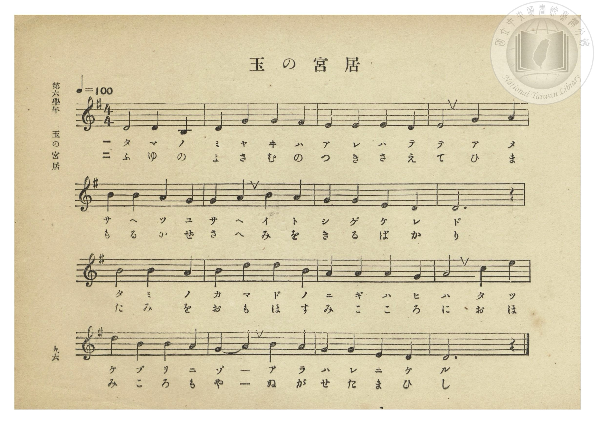
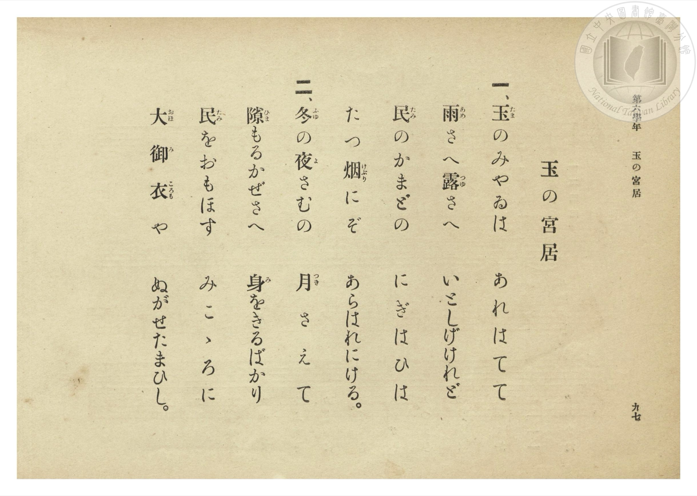

# 玉の宮居

> Re:Shōka 使用 AI 協助辨識與重建樂譜，可能會有錯誤。歡迎回報。

- **鋼琴伴奏版**：<br><audio controls src="tama_no_miyai.mp3"></audio>
- **NEUTRINO 歌聲合成版**：<br><audio controls src="tama_no_miyai_neutrino.mp3"></audio>

- 文部省《尋常小學唱歌》
- 臺灣總督府《公學校唱歌集》（大正四年三月，索書號 0725 26）

## 說明

原書資訊與歌詞全文（對應 P102.jpg–P103.jpg，第六學年 pp. 96–97）：
調性與拍號：ト調（G 大調／陽旋）4/4 拍，速度 ♩=100


## 歌詞

```text
一、玉（たま）のみやゐは　あれはてて
雨（あめ）さへ露（つゆ）さへ　いとしげけれど
民（たみ）のかまどの　にぎはひは
たつ煙（けぶり）にぞ　あらはれにける。

二、冬（ふゆ）の夜（よ）さむの　月（つき）さえて
隙（ひま）もるかぜさへ　身（み）をきるばかり
民（たみ）をおもほす　みこゝろに
大（おほ）御（み）衣（ころも）や　ぬがせたまひし。
```

## ABC

<div class="abc-score" data-abc-src="tama_no_miyai.abc" aria-label="五線譜載入中"></div>

[下載 ABC 原始檔](tama_no_miyai.abc)

## TMD 檔案連結

- [主旋律 TMD 檔案](tama_no_miyai.tmd) [[在 TMD Studio 編輯](https://tmdlang.github.io/Tmd-TS/#tmd=s7IKdvYPcrWy4qpTUCpJTLdSSM7PyUlNLsnMz7PKzk9PzM7Ojy_OyM9OLM4ojTe0NDRVgqssy88pzU21Si9KTEmNN0OIF-eXFiWnWhUnZ-Tn58SXpFaUJOXnZ6PLxxckpqdaBRgaGCFkCoryy1LzEvOAuguKMvNKUlPA2hEKUssyU1JB0sXJiXnxZalFmWmZqSlITkotKga5HGpFSVFiXnFyUWYByDsIVflFJRn5QGcXZFRaZWQWl-QXZSYn5sRnJ-YlIhSVZKQCPQeRrkQXzs0vSsxBNjAzPTMPKJqXVAoMLCUuLS2F532djxvXPV237unGVgUtLS5FWwVDAwMue1sFdy4bE30TO5DuZ9PaXzaveD6n8XFD19MN3U937Hi6of_p2h1Pp2x8trbncUM32I4X7bueNy5-vmPv87mLn-6aA1Lbugao6tmChRCFL2e3AdW-39PxdMnyZ2sXP509--nOLU92dD6b0_F-T8_zLYuezd7xYuZ8BQNzI1MFI7P3ezqVuLj0tRRsqQW4FBQUnvbNB1mzuf3Fiq4XHe1AZ71YOe9p6wqgH0Eu29D7rL1TARTfelkF6Y8aJgOZxiAmyIVr1jxtXQvy984tCgUFegqWZkAFluZAh77fMwtk-ItV-581LAcZ290L9AlQ9HFzB1AQaLK7AtDXYGb_y5l7n00HhkMnMHwVgCqBRr9smP901zKFRzNX2oKCH2TWkx0NjxsagfED1Py4cf7jxn1AHcC4ety4_3FTy-OmCY8b1z9uaHjc2PS4qQfEblwGRCCdL2evAOsBSjSC9Ux93Ljj5ZxNYMElj5va4IJg_S2PG1c8bpz-uHHS48aJYLNWgkx5tmEizGagoyE2dwNdAZQGsUE6Vz9u7APbvAlIgvSAVS953joTrHPi48Ztj5u6wJqBSufBXAvkrgfbAxQEWtj9uKEJ4uNdwLTU-LRtDVj3VphD1z1dMgck0gRMJWB3NwGNATkAnG7AXmoEhiHES0AuJAxmQdwAdBk43JqA9gJdD0Rz4F5_sWs1WA3Ye01A3_eC1WwAKWvqwhYGIEVdILMadz9unAn2z_7HjZMfN8193NQL9A84gS1ZDtbTBVQE1PN030K4JS8WLgazgRqAVjWBTWwBm7LmcSMwPGZD4hns6umgUAEaR3mqhwIFLX0urpDE3ES_fN_MysRMq4DMxLx8hxqDmmqQPQo2Flp2YAa2HKcATPvABPliYY-ChokCMPc_X9-gA88mmlg0AG0DGVajYBqvoAuGYIYxiIAKGkKxOUTMDEQhCLASqCgIglQagYTA5voY1oBSG1QOGGhgch1YCzCwQbymFjA5ASyzHirTBBbrgYsBkwtUBkRDzIKoaUTYZQSS3wqTb2pDtqupA8ybCpZpQHHFEjCvFyHfCFKLatcmuOtrwHkAd-jv6iEn9I1BYQ4NOVAI1sDDESYKEQFh5GCHxxoIGqAFO8QzO8Ak2JPgIEGXAQd_4wqozHQwbxKYnAiPBJDMSiSbwJYjAr0JEhXdYF0Qcg4WmyDRDTIbJAMOcKieDXCdINO6MGwikOCBOZa8IAdBRACDWKZQDGLXgMVhGBItIBZMlxlaeCOSOdin8AQG8SMk6YNCESGzGszrA5OQZA5KaCAZEA9iFshUSPwhJ3M0u-ChCgo7aHw07gaTM6EyEDdNRpBNoBiAuQJiFlg3WB-BMAc2CsgqZKAhh5qoKUzm4GTauA3sJYgHQB4CycyDewySQDuRAhdWukCiAGQGKOmBogpHIkcOQHDQQYIZpAuUhSD2rAGTsCwzG8yDRCAk-mHRC8pmqPbUcnHp2ikgFfwKQK4yFwA)]
- [鋼琴伴奏 TMD 檔案](tama_no_miyai_piano.tmd) [[在 TMD Studio 編輯](https://tmdlang.github.io/Tmd-TS/#tmd=s7IKdvYPcrWy4tLSUnje1_m4cd3Tdeuebmx9v6fjZfee5xO2PNmz5enS_uedHe_3dCpoaXEp2ioYGhhw2dsquHPZmOib2HHVKSg9m9b-snnF8zmNjxu6nm7ofrpjx9MN_U_X7ng6ZeOztT2PG7qVQKpetO963rj4-Y69z-cufrprDkht6xqgqmcLFkIUvpzdBlQLtPrpkuXP1i5-Onv2051bnuzofDYHaHvP8y2Lns3e8WLmfAUDcyNTBSMzoIuUuLhCEnMT_fJ9MysTM60CMhPz8oM8HGoMaqq5FIDAxkLLDszQ11KwRQcKz9esebKj4cXCHgUNEwWgi5-vb9BRCDA0MNLLKkjXxKJBSx9sWI2CabyCLhiCGcYgAipoCMXmEDEzEIUgwEqgoiAIUmkEEgKb62NYo_C4cT5U7nHjPjC5DqzlceN-EK-pBUxOAMush8o0gcV64GKPG5dBZUA0xCyImkaEXUYg-a0w-aY2ZLuaOsC8qWCZBhRXLAHzehHyjSC1qHZtgru-hgt_6O_qISf0jUFhDg05UAjWwMMRJgoRAWHkYIfHGggaoAU7xDM7wCTYk-AgQZcBB3_jCqjMdDBvEpicCI8EkMxKJJvAliMCvQkSFd1gXRByDhabINENMhskAw5wqJ4NcJ0g07owbCKQ4DvJDXIQRAQwiGUKxSB2DVgchiHRAmLBdJmhhTcimYN9Ck9gED9Ckj4oFBEyq8G8PjAJSeaghAaSAfEgZoFMhcQfcjJHswseqqCwg8ZH424wORMqA3HTZATZBIoBmCsgZoF1g_URCHNgQUZWIQMNOdRETWEyByfTxm1gL0E8APIQSGYe3GOQBNqJFLiw0gUSBSAzQEkPFFU4EjlyAIKDDhLMIF2gLASxZw2YhGWZ2WAeJAIh0Q-LXlA2Q7WnFku574Nc7psgyv2n_Utezm59tmv1075ZT3Z2P92-7Fln99NJPS8aN0EqN-RiPV7bCBKSYIYxkDKPj0fIGMZrA0MXQkKFQKV5vDa4CoAyMCVQNUAtgwjC7YJwYcIognADYVrQLYK7GxTf6ObjMANGY_oa5hK4OEQAailRxlPkfGDk6topIMVvtI9hLNhWdGEjuLAyFwA)]

## 分析

```text
================================================================================
📊 TMD Song Profile: [ 玉の宮居 ]
================================================================================
⏱  Duration:       0:38 (38.4s), 16 measures total
🎼 Key & Tempo:    首調基準 G, != 100.0 BPM, <4/4>
   - 分析範圍：      由實際發聲的音符與和弦推測調性；播放脈絡另行呈現
🎤 人聲音域:    B3 (MIDI 59) – E5 (MIDI 76) [跨度: 17 個半音 / 1.4 個八度, 難度: challenging]
   - 最低音:  B3 in [TamaNoMiyai #1 @ m.1, 0:01]
   - 最高音: E5 in [TamaNoMiyai #1 @ m.12, 0:28]
   - 適合: soprano, mezzo-soprano, contralto, tenor, baritone, bass
🏛  結構:      TamaNoMiyai (38.4s)
⚡ 編曲密度:        Peak 1 軌道同時演奏
🗝  調性診斷：       D 大調（純淨自然大調，未偵測到可信轉調）
   - 風格氣質:    純淨自然大調（陽光明朗、易唱易記，無明顯調外色彩）
   - 轉調歷程:    全曲維持單一推測調性（未偵測到可信轉調）
   - 核心骨幹音:  D, A, B, G, E
   - 調性數值:    D 大調 [相關度: 0.83, 穩定度: Moderate, 自然音純度: 100.0%]
   - 候選調性 (K-S): D 大調 (0.83), G 大調 (0.76), B 小調 (0.68)
   - 五度圈歷程:   +2
   - 各段落調性細節:
     • [TamaNoMiyai #1]: D 大調 (r: 0.83, 自然音純度: 100.0%)

  [ 五度圈游移軌跡 ]
               C  
         F            G  
      Bb              [D ]*
      Eb               A  
         Ab           E  
            Db       B  
               F# 
     (* = active key center)

  [ 十二半音累積音高分佈 ]
     C  :                            0.0%
     C# :                            0.0%
     D  : ████████████████████████  25.8%
     D# :                            0.0%
     E  : ████████████              12.9%
     F  :                            0.0%
     F# : ██                         1.6%
     G  : █████████████████         17.7%
     G# :                            0.0%
     A  : ████████████████████      21.0%
     A# :                            0.0%
     B  : ████████████████████      21.0%
--------------------------------------------------------------------------------
Assignment 軌道音域：
  - Piano         : B3 – E5 (17 個半音 / 1.4 個八度, 54 個音符)
================================================================================
```


## 原書掃描頁






