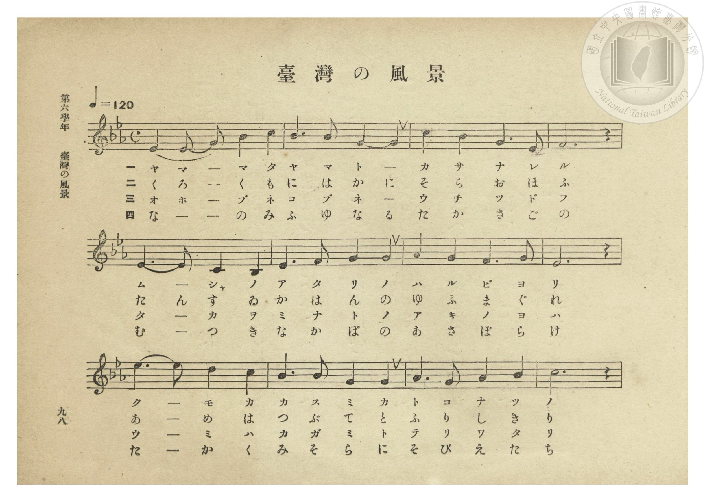
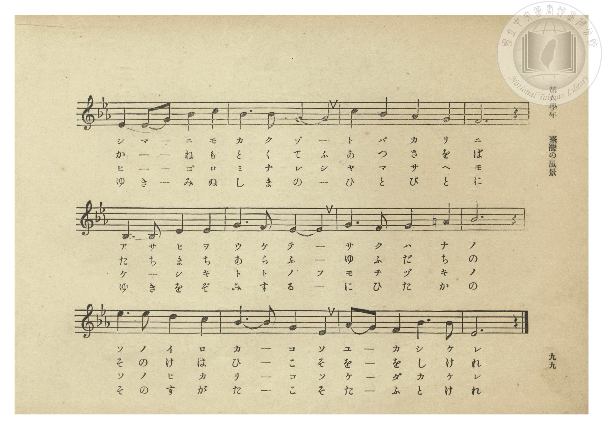
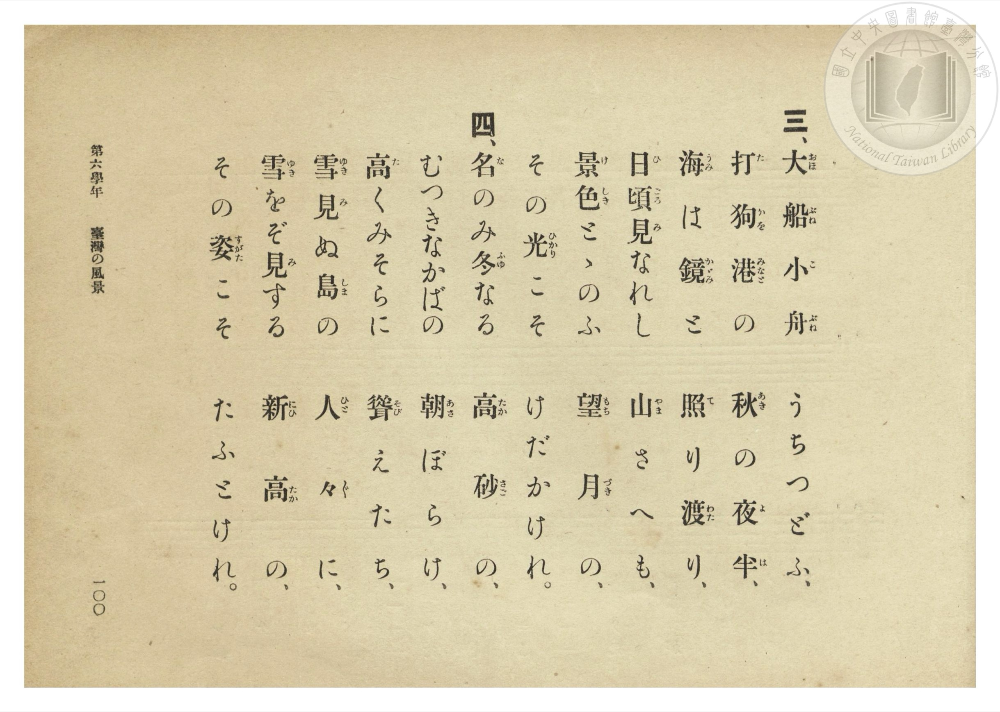
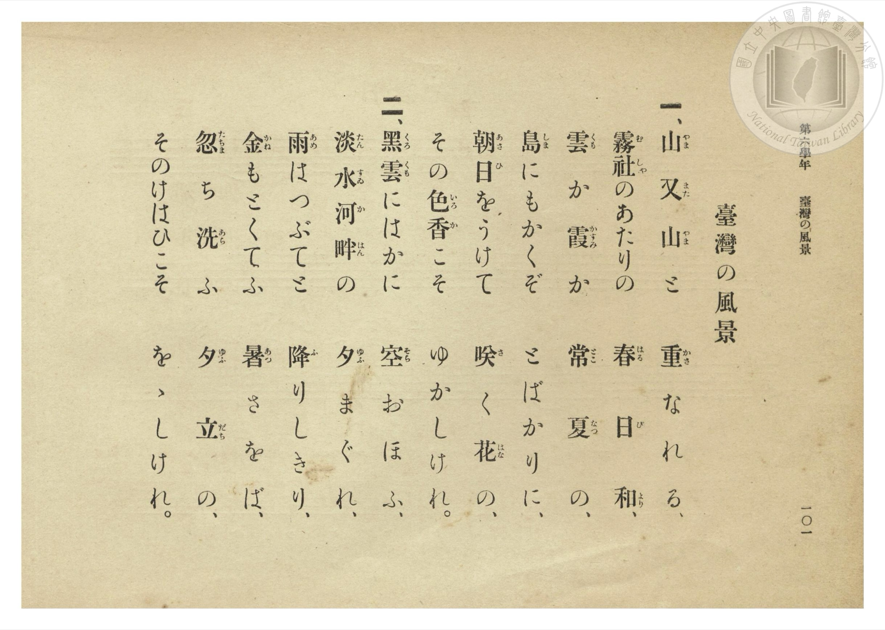

# 臺灣の風景

> Re:Shōka 使用 AI 協助辨識與重建樂譜，可能會有錯誤。歡迎回報。

- **NEUTRINO 歌聲合成版**：<br><audio controls src="taiwan_no_fukei_neutrino.mp3"></audio>
- **鋼琴伴奏版**：<br><audio controls src="taiwan_no_fukei.mp3"></audio>


- 曲：宮島慎三郎（臺灣總督府國語學校助教授）
- 臺灣總督府《公學校唱歌集》（大正四年三月，索書號 0725 26）

## 說明

原書資訊與歌詞全文（對應 P104.jpg–P107.jpg，第六學年 pp. 98–101）：
調性與拍號：變ホ長調（Eb 大調）4/4 拍，速度 ♩=120


## 歌詞

```text
一、山（やま）又（また）山（やま）と　重（かさ）なれる、
霧（む）社（しゃ）のあたりの　春（はる）日（び）和（より）、
雲（くも）か霞（かすみ）か　常（とこ）夏（なつ）の、
島（しま）にもかくぞ　とばかりに、
朝（あさ）日（ひ）をうけて　咲（さ）く花（はな）の、
その色（いろ）香（か）こそ　ゆかしけれ。

二、黑（くろ）雲（くも）にはかに　空（そら）おほふ、
淡（たん）水（すゐ）河（か）畔（はん）の　夕（ゆふ）まぐれ、
雨（あめ）はつぶてと　降（ふ）りしきり、
金（かね）もとくてふ　暑（あつ）さをば、
忽（たちま）ち洗（あら）ふ　夕（ゆふ）立（だち）の、
そのけはひこそ　をゝしけれ。

三、大（おほ）船（ぶね）小（こ）舟（ぶね）　うちつどふ、
打（た）狗（かを）港（みなと）の　秋（あき）の夜（よ）半（は）、
海（うみ）は鏡（かがみ）と　照（て）り渡（わた）り、
日（ひ）頃（ごろ）見（み）なれし　山（やま）さへも、
景（け）色（しき）とゝのふ　望（もち）月（づき）の、
その光（ひかり）こそ　けだかけれ。

四、名（な）のみ冬（ふゆ）なる　高（たか）砂（さご）の、
むつきなかばの　朝（あさ）ぼらけ、
高（たか）くみそらに　聳（そび）えたち、
雪（ゆき）見（み）ぬ島（しま）の　人（ひと）々（びと）に、
雪（ゆき）をぞ見（み）する　新（にひ）高（たか）の、
その姿（すがた）こそ　たふとけれ。
```

## ABC

```abc
X:1
T:臺灣の風景
C:曲：宮島慎三郎（臺灣總督府國語學校助教授）
M:4/4
L:1/16
Q:1/4=120
K:Eb
V:V1 name="Piano" snm="Pia"
[V:V1]
E4 E2 G2 B4 c4 | B6 B2 G8 | c4 B4 G6 E2 | F12 z4 |
w: 1.~や ま _ ま た | や ま と | か さ な れ | る
w: 2.~く ろ _ く も | に は か | そ ら お ほ | ふ
w: 3.~お ほ _ ぶ ね | こ ぶ ね | う ち つ ど | ふ
w: 4.~な _ _ の み | ふ ゆ な | た か さ ご | の
E6 E2 C4 B,4 | D6 F2 G4 G4 | A4 G4 F6 G2 | E12 z4 |
w: 1.~む _ しゃ の | あ た り の | は る び よ | り
w: 2.~た ん す ゐ | か は ん の | ゆ ふ ま ぐ | れ
w: 3.~た _ か を | み な と の | あ き の よ | は
w: 4.~む _ つ き | な か ば の | あ さ ぼ ら | け
e6 e2 d4 c4 | B6 B2 E4 E4 | F6 E2 F4 G4 | B12 z4 |
w: 1.~く _ も か | か す み か | と こ な つ | の
w: 2.~あ _ め は | つ ぶ て と | ふ り し き | り
w: 3.~う _ み は | か が み と | て り わ た | り
w: 4.~た _ か く | み そ ら に | そ び え た | ち
E4 E2 G2 B4 c4 | B6 B2 G8 | c4 B4 G4 E4 | F12 z4 |
w: 1.~し ま _ に も | か く ぞ | と ば か り | に
w: 2.~か _ _ ね も | と く て | あ つ さ を | ば
w: 3.~ひ _ _ ご ろ | み な れ | や ま さ へ | も
w: 4.~ゆ き _ み ぬ | し ま の | ひ と び と | に
B,6 B,2 E4 E4 | G6 F2 E8 | G6 F2 G4 =A4 | B12 z4 |
w: 1.~あ さ ひ を | う け て | さ く は な | の
w: 2.~た ち ま ち | あ ら ふ | ゆ ふ だ ち | の
w: 3.~け _ し き | と と の | も ち づ き | の
w: 4.~ゆ き を ぞ | み す る | に ひ た か | の
e6 e2 d4 c4 | B6 B2 G4 E4 | A2 G2 F4 B6 B2 | E12 z4 |
w: 1.~そ の い ろ | か _ こ そ | ゆ _ か し _ | れ
w: 2.~そ の け は | ひ _ こ そ | を _ を し _ | れ
w: 3.~そ の ひ か | り _ こ そ | け _ だ か _ | れ
w: 4.~そ の す が | た _ こ そ | た _ ふ と _ | れ
```

## TMD 檔案連結

- [主旋律 TMD 檔案](taiwan_no_fukei.tmd) [[在 TMD Studio 編輯](https://tmdlang.github.io/Tmd-TS/#tmd=s7IKdvYPcrWy4qpTUCpJTLdSSM7PyUlNLsnMz7PKzk9PzM7Ojy_OyM9OLM4ojTe0NDRVgqssy88pzU21Si9KTEmNN0OIF-eXFiWnWhUnZ-Tn58SXpFaUJOXnZ6PLxxckpqdaBRgamCBkCoryy1LzEvOAuguKMvNKUlPA2hEKUssyU1JB0sXJiXnxZalFmWmZqSlITkotKga5HGpFSVFiXnFyUWYByDsIVflFJRn5QGcXZFRaZWQWl-QXZSYn5sRnJ-YlIhSVZKQCPZeXWFJalIouWpCTmAwU1NJSeNG-63nj4seN614uWvFs5noFLS0uRVsFQyMDLntbBVcdLhsTfRM7kO5nsze93zPr6bp1Tzdve9ba92RH58vmvvd7OiAGPN-x9_ncxU93zXk6p_vFqnlP1-54tmDh066Vz6bOfNbX8X5PJ9gFaGofN3Q9bV0DVTtl47O1PS9ntz1u6Aaa-nTJ8mdrFz-dPfvpzi1Aq57NAZrR83zLomezd7yYOV_BwNzIVMHIDGwul76Wgi21AJeCgsLTvvkgaza3v1jR9aKjHeisFyvnPW1d8WxaO8hlG3qftXcqgOJdL6sg_VHDZCDTHMQEuXDNmqeta4E-AjpboaBAT8HSAqjA0MAQ6FJg6IFMf7Fq_7OG5SBzu3uBXgGKvljX9bh59sup24FSQAtckxSAvgezO4GBrwBUBzT5ZcP8p7uWKTyaudIWFDkgk57saHjc0Ph040agpsdNLY8b9wF1PO0HhlQHkP24EWh2J5rs48YVjxsaXrYDTQSq6X7cOBUsuOpxU8_jpm6gaSBzX85ZDtbTAJR7vgSoDah0-uOmZrDSdY8bm4BGP27qArEbGp7NWApWsB6oH6jg2XQIdzPI7kk9YHOAqAukF2o6KB0BVfQ_bmoCm9j9cs48mHNmPm4EeRvEbmh4umMHWHzF48bJIOOW9IO5qx43LoE6BWIiMEFC3Qj142qg0WDj-h83zgMaBDZiA0gE5OrVUG3P5swFawMqBYUCzOVA13U-bpr0uLHtcePEx43LQA6ZBHEyJLD6X3SBwxTo5cZVKA553DgXyHnRCVHd8rgJGMydL5fNhPgOrHQySA3QRU1A04EOBDp5IijsG5ogMboLyGx8uXsiLITABqAH2Gqw1UDdQJ80PF-5Cyw793ETMIUBZYE-3P24cSvMk9sXgqWBEQYKw2cbtoC5Mx83TQBxNwHjCeq251OnwCISpBISu0-XAP0MjD-ga7eCBYHJagLYwdC4XAENwqZGsDTQXUseN24DBRskpc2EpDSwZlDgAz3cC2JA9bdDfAr0y1qwCmBcAKMKGG1A_UAvNDybBVEAFIfE-VRw1GyAxfz-vVDfNS6ERf7CZ1umwxwFCRGQQWgeeb4aVMg8blwAVI8lCsExD_TLJqQIm_S4CSiFHmE7QMkamF3BpoGCHmjai46dYC4wGEC-eroBkm5BofqiA5gpEVLgtAl0EtDxwGBbiRRtnUDVII-B3NoN8Q8w9U4CxdmO9WDufnBOAIY_NKqeL4d4CRhUoFQDFHy6ZA4k_4Ec0QvMgqDYRWTEZ1u3g4WA9kPy3PqX_ZDEAoyOHpggKBaft0L8twwSi892gJU1AaMJ5D5EdCJnoZcLgOUFkD0FkohfLIO4DmIouLwBhiUwXtDLp6mPG3eA0gHUxJkQzwJTQScsX4GSENRpoBgBRhY4pcyZDTYI6H1QjIIrDKDipfDQQIngp63ApAFyKaRQQMmaoLgHpgtgICDHNLAqAsX0BEh6huX7xv1P29ZAUjgwbcH8Biq8Xq6eAUua4Ny1AJh3QUUIMERQ3dMEtBEY-b3g6ARaCiynwOUqaun0uHEPMDmDnATNOajGg_MMMEWASgFIufACVASDywVwWfy4EZZNYDkX6AVIfsCMnjUYJSrIRU92QUoaYJiBU11DK6SkhyVCWLmKZjQ4w85DtQBY_IDC6Nm0DWBBYIEGTjLofkKLs-Wg2hFcRwATDzjlIeIMqGcruOyAxRlQG-WtAShQ0NLn4gpJzCxPzPPLdyvNTs20CshMzMt3qDGoqQbZpGBjoWUHZmBriygAWwXAuvrFwh4FDRMFYHHwfH2DDrwBoYlFA9A-kGE1CoYKukBsrGAKpM2AuAbM0gWSxmAaJAISB4lCRAyBIkZQORA0AKkBm-ZjWANMbS1APjBWkcj5YFMgMhBRYEDCTQfGBVh0KphcBVHT1APWAZKBwXiEPUYgXf1gdb1gXRB2E9S81VB71sPNBomAZOaC1XWCxbqgqnaDZbZit8kYJAdSCVIHIreBybVQ8yZDzdgGFYP5qA0suhBMLoGqWYnPHhOQHMTvILXrwOR-qGkQPcD0DlUDCReQDChkkcMPRE8By4BMQLUHf-rZ1UNu6gGlCDOQFaZgexTMQZQuMImAkgsI1yiYQFmQZGMM14g9ATXAgwHUJoSHB8hXoBiGpChgmYoisx4eLsACAxpeHeA0BIln7GkIFH4glZOB7Jlg1gSoeZCUB05DQFkkm4CxAOKB4gSSvkH0BLBMD3abwGkIYhM8tpomQe0BxTEk3UPyBKpfgQUcXAzuI7BfcaQhpMADpTuIfkTaAtkOrACw2APJfXug9nSCZSZi2EOgBOokKw3FgS0AUuZACrUMgpROIBFI0jEE05BEBVGDNQmBywOITyC-g-UXWKzOhIY8QgZSHoFyNDSPgcMPe05CpB9IegTZ0wjWA4oZkDgsz4PKhWVgFsh85LzcBUreyDGEK52CUw8ozUFMhLgaZg_MPz1wGZg9IFuh9jSBS0d4KYzDHnAJhJZKweGInErnwktP5BIVkueADQBke8ClHwmpB9j8wUw9plSvv5BTE_a0A4kVSM0F8iWiXoGFdj8Qz4ObDsu3kFwFyd2gMEbURNjTDqxug9QcCFtgKRFkCyTtgNIMIqdC8jU4v8JLEZDduNLOJrg9U8B6oOkNueQBl1wQn6PX4JByYQdUBpbesaQdaLkIMh2WFtdAbQKZCzERkZtgLoOFHqjMRqRezHAjUHtNISftgCsscL2FKGcgqcYIXkEhREC0iTpYCF_RA6uipsI8CI8kSCYGFauw7AkRh1XcoAgHV2PgAohQ0QOtuoDZDBZVoAyH5AJgRkU0N2ARBElOwO4Hig4c9oCTD6wSQCuu4Ml0BVQ_PJlCEwnEZUtR9OCwB558IGohIQbJYsgJFVhowxuEiEQCCmXkhhAZjR_ggBpZRQ-eigtR1JgA2aDiBiaDt-0DL07XATE4G8KzK6K4gDRHQCoR2Q5SXENiCBRjeJoj4NSDbA9IPaJKQRQXqPaA4wQaM0TZA049yPZAsjs0juDVEJo9UNdA0ifEVwTsAVdcyPaAG3LAKhFiHqJKQ7UHkmIgzThIEYTbnlouLl07BZT-mQJQQJkLAA)]
- [鋼琴伴奏 TMD 檔案](taiwan_no_fukei_piano.tmd) [[在 TMD Studio 編輯](https://tmdlang.github.io/Tmd-TS/#tmd=s7IKdvYPcrWy4tLSUnjRvut54-LHjeteLlrxbOb693s6XnbveT5hy5M9W54u7X_e2fF-T6eClhaXoq2CoZEBl72tgqsOl42JvokdV52C0rPZm97vmfV03bqnm7c9a-17sqPzZXMf0AyIqc937H0-d_HTXXOezul-sWre07U7ni1Y-LRr5bOpM5_1gQxWApmBpvZxQ9fT1jVQtVM2Plvb83J22-OGbqCpT5csf7Z28dPZs5_u3AK06tkcoBk9z7csejZ7x4uZ8xUMzI1MFYzMwOZyhSRmlifm-eW7lWanZloFZCbm5Qd5ONQY1FRzKQCBjYWWHZihr6Vgiw4Unq9Z82RHw4uFPQoaJgpPN_Q_X9-goxBgaGCil1WQrolFg5Y-2LAaBUMFXSA2VjAF0mZAXANm6QJJYzANEgGJg0QhIoZAESOoHAgagNSATfMxrFF43NQC5D9u3IdEzgebApGBiD5uXAE3_XFjN1h0KphcBVHT1APWAZKBwXiEPUYgXf1gdb1gXRB2E9S81VB71sPNBomAZOaC1XWCxbqgqnaDZbZit8kYJAdSCVIHIreBybVQ8yZDzdgGFYP5qA0suhBMLoGqWYnPHhOQHMTvILXrwOR-qGkQPY-b2qBqIOECkgGFLHL4gegpYBmQCaj24E89u3rITT2gFGEGssIUbI-COYjSBSYRUHIB4RoFEygLkmyM4RqxJ6AGeDBMf9zUDA8PkK9AMQxJUY-bILECk1kPD5fHjZuh4dUBTkOQeMaehkDhB1I5GcieCWZNgJoHSXngNASURbIJGAsgHihOIOkbRE8Ay_RgtwmchiA2wWOraRLUHlAcQ9I9JE-g-vVxIyR9Q2IT6iOwX3GkIaTAA6U7iH5E2gLZ_rhxAxZ7ILlvD9SeTrDMRAx7CJRAnWSloTiwBUDKHEihlkGQ0gkkAkk6hmAakqggarAmIXB5APEJxHew_AKL1ZnQkEfIQMojUI6G5jFw-GHPSYj0A0mPIHsawXpAMQMSh-V5ULmwDMwCmY-cl7tAyRs5hnClU3DqAaU5iIkQV8PsgfmnBy4DswdkK9SeJnDpCC-FcdgDLoHQUik4HJFT6Vx46YlcokLy3OPGDmR7wKUfCakHWEtiph5TqtdfyKkJe9qBxAqk5gL5ElGvwEK7H4jnwU2H5VtIroLkblAYI2oi7GkHVrdBag6ELbCUCLIFknZAaQaRUyH5Gpxf4aUIyG5caWcT3J4pYD3Q9IZc8oBLLojP0WtwSLmwAyoDS-9Y0g60XASZDkuLa6A2gcyFmIjITTCXwUIPVGYjUi9muBGovaaQk3bAFRa43kKUM5BUYwSvoBAiINpEHSyEr-iBVVFTYR6ERxIkE4OKVVj2hIjDKm5QhIOrMXABRKjogVZdwGwGiypQhkNyATCjIpobsAiCJKfHjQtQdOCwB5x8YJUAWnEFT6YroPrhyRSaSCAuW4qiB4c98OQDUQsJMUgWQ06owEIb3iBEJBJQKCM3hMho_DxtXUtW0YOn4kIUNSZANqi4gcngbfvAi9N1QAzOhvDsiiguIM0RkEpEtoMU15AYAsUYnuYIOPUg2wNSj6hSEMUFqj3gOIHGDFH2gFMPsj2Q7A6NI3g1hGYP1DWQ9AnxFQF7wBUXsj3ghhywSoSYh6jSUO2BpBhIMw5SBOG2pxZr98wHuXtmAu2eAaM3XiHaMBZMmcSi8oEUMEFAJOB803ggyzQ-FswwgPoKrs0MJIuqDsUkIAMugWwXhkFgVVgdBJKBYWKcRKnPMD2CbhCUYQSkjAi7B7fPwAbk4gkhYMTq2imgxG20j2Es2HxMCSNcEsa4JEzgEspcAA)]

## 分析

```text
================================================================================
📊 TMD Song Profile: [ 臺灣の風景 ]
================================================================================
⏱  Duration:       0:48 (48.0s), 24 measures total
🎼 Key & Tempo:    首調基準 E,, != 120.0 BPM, <4/4>
   - 分析範圍：      由實際發聲的音符與和弦推測調性；播放脈絡另行呈現
🎤 人聲音域:    A#3 (MIDI 58) – D#5 (MIDI 75) [跨度: 17 個半音 / 1.4 個八度, 難度: challenging]
   - 最低音:  A#3 in [TaiwanNoFukei #1 @ m.5, 0:09]
   - 最高音: D#5 in [TaiwanNoFukei #1 @ m.9, 0:16]
   - 適合: soprano, mezzo-soprano, contralto, tenor, baritone, bass
🏛  結構:      TaiwanNoFukei (48.0s)
⚡ 編曲密度:        Peak 1 軌道同時演奏
🗝  調性診斷：       D# 大調（純淨自然大調，未偵測到可信轉調）
   - 風格氣質:    純淨自然大調（陽光明朗、易唱易記，無明顯調外色彩）
   - 轉調歷程:    全曲維持單一推測調性（未偵測到可信轉調）
   - 核心骨幹音:  D#, A#, G, F, C
   - 調性數值:    D# 大調 [相關度: 0.91, 穩定度: High, 自然音純度: 98.9%]
   - 候選調性 (K-S): D# 大調 (0.91), A# 大調 (0.78), G 小調 (0.70)
   - 五度圈歷程:   -3
   - 各段落調性細節:
     • [TaiwanNoFukei #1]: D# 大調 (r: 0.91, 自然音純度: 98.9%, 調外音: A)

  [ 五度圈游移軌跡 ]
               C  
         F            G  
      Bb               D  
     [Eb]*              A  
         Ab           E  
            Db       B  
               F# 
     (* = active key center)

  [ 十二半音累積音高分佈 ]
     C  : ███████                    7.8%
     C# :                            0.0%
     D  : ████                       3.9%
     D# : ████████████████████████  26.7%
     E  :                            0.0%
     F  : █████████████             13.9%
     F# :                            0.0%
     G  : ██████████████████        19.4%
     G# : ██                         1.7%
     A  : █                          1.1%
     A# : ███████████████████████   25.6%
     B  :                            0.0%
--------------------------------------------------------------------------------
Assignment 軌道音域：
  - Piano         : A#3 – D#5 (17 個半音 / 1.4 個八度, 78 個音符)
================================================================================
```


## 原書掃描頁










