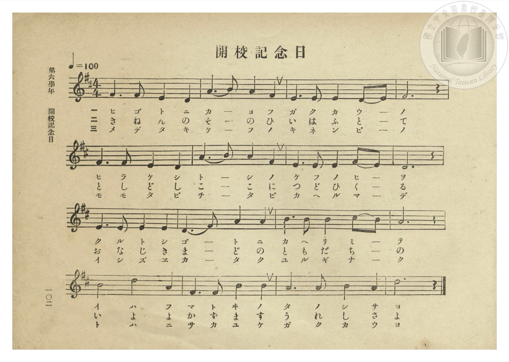
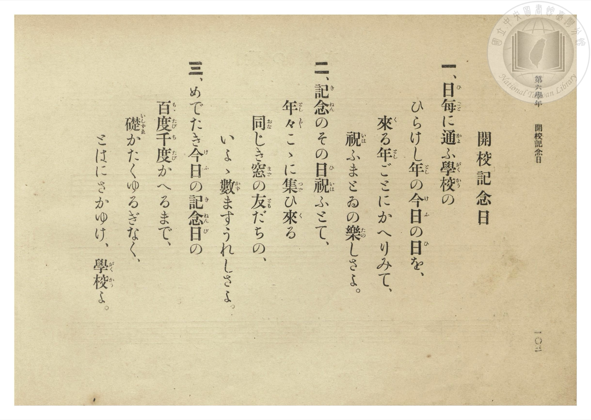

# 開校記念日

> Re:Shōka 使用 AI 協助辨識與重建樂譜，可能會有錯誤。歡迎回報。

- **NEUTRINO 歌聲合成版**：<br><audio controls src="kaiko_kinenbi_neutrino.mp3"></audio>
- **鋼琴伴奏版**：<br><audio controls src="kaiko_kinenbi.mp3"></audio>


- 文部省《尋常小學唱歌》
- 臺灣總督府《公學校唱歌集》（大正四年三月，索書號 0725 26）

## 說明

原書資訊與歌詞全文（對應 P108.jpg–P109.jpg，第六學年 pp. 102–103）：
調性與拍號：ニ調（D 大調）4/4 拍，速度 ♩=100


## 歌詞

```text
一、日（ひ）每（ごと）に通（かよ）ふ學（がく）校（かう）の
ひらけし年（とし）の今（け）日（ふ）の日（ひ）を、
來（く）る年（とし）ごとにかへりみて、
祝（いは）ふまとゐの樂（たの）しさよ。

二、記（き）念（ねん）のその日（ひ）祝（いは）ふとて、
年（とし）々（どし）こゝに集（つど）ひ來（く）る
同（おな）じき窓（まど）の友（とも）だちの、
いよ〳〵數（かず）ますうれしさよ。

三、めでたき今（け）日（ふ）の記（き）念（ねん）日（び）の
百（もゝ）度（たび）千（ち）度（たび）かへるまで、
礎（いしずゑ）かたくゆるぎなく、
とはにさかゆけ、學（がく）校（かう）よ。
```

## ABC

```abc
X:1
T:開校記念日
M:4/4
L:1/16
Q:1/4=100
K:D
V:V1 name="Piano" snm="Pia"
[V:V1]
F6 F2 E4 D4 | A6 B2 A4 F4 | E6 E2 E4 D2 E2 | F12 z4 |
w: 1.~ひ ご と に | か _ よ ふ | が く か う _ | の
w: 2.~き ね ん の | そ _ の ひ | い は ふ と _ | て
w: 3.~め で た き | け _ ふ の | き ね ん び _ | の
F6 F2 E4 D4 | A6 B2 A4 F4 | E6 E2 E4 F2 E2 | D12 z4 |
w: 1.~ひ ら け し | と _ し の | け ふ の ひ _ | を
w: 2.~と し ど し | こ _ こ に | つ ど ひ く _ | る
w: 3.~も も た び | ち _ た び | か へ る ま _ | で
E6 E2 E4 E4 | D6 F2 A4 A4 | B6 B2 B4 c2 B2 | A12 z4 |
w: 1.~く る と し | ご _ と に | か へ り み _ | て
w: 2.~お な じ き | ま _ ど の | と も だ ち _ | の
w: 3.~い し ず ゑ | か _ た く | ゆ る ぎ な _ | く
B8 d4 A4 | F6 F2 B4 B4 | A6 A2 B4 A4 | d12 z4 |
w: 1.~い は ふ | ま と ゐ の | た の し さ | よ
w: 2.~い よ よ | か ず ま す | う れ し さ | よ
w: 3.~と は に | さ か ゆ け | が く か う | よ
```

## TMD 檔案連結

- [主旋律 TMD 檔案](kaiko_kinenbi.tmd) [[在 TMD Studio 編輯](https://tmdlang.github.io/Tmd-TS/#tmd=s7IKdvYPcrWy4qpTUCpJTLdSSM7PyUlNLsnMz7PKzk9PzM7Ojy_OyM9OLM4ojTe0NDRVgqssy88pzU21Si9KTEmNN0OIF-eXFiWnWhUnZ-Tn58SXpFaUJOXnZ6PLxxckpqdaBRgaWCBkCoryy1LzEvOAuguKMvNKUlPA2hEKUssyU1JB0sXJiXnxZalFmWmZqSlITkotKga5HGpFSVFiXnFyUWYByDsIVflFJRn5QGcXZFRaZWQWl-QXZSYn5sRnJ-YlIhSVZKQCPQf1RE5mWiq6VFpqcUlmWWIOunhyalFqbn5eJkhGS0vh5bTuZwsWvlgx4-n-rc-mL1XQ0uJStFUwNDDgsrdVcOGyMdE3sQOZ8Gxa-8vmFc_nND5u6Hq6ofvpjh1PN_Q_Xbvj6ZSNz9b2PG7oBtvzon3X88bFz3fsfT538dNdc0BqW9cAVQGtgCh8ObsNqPb9no6nS5Y_W7v46ezZT3duebKj89mcjvd7ep5vWfRs9o4XM-crGJgbmSoYmb3f06nExaWvpWBLLcCloKDwtG8-yJrN7S9WdL3oaAc668XKeU9bVwD9CHLZht5n7Z0KoKjXyypIf9QwGci0BDFBLlyz5mnrWpC_d25RKCjQA4aUEVCFoYEx0Knv98wCGf9i1f5nDctBBnf3Av0CFH3c3A0UBJrtogD0N5jZCQxYBaACoJkvG-Y_3bVM4dHMlbagcAcZ8WRHw-OGRmB8APU8btwEVP5sfT-YPeVx4wog93Hj6pcNs8Ai3Y-bgGEHFNkKdBZYpOdxI1BxJzDQoQoa28AK1oGMBhr3uAnImfi4cTrQE2AVK4BsiIonu7vAIhNB-qHWb4VIIbvmcdMkoPvALt0HNBsoCrLwcVM3hokg9wIdC3bFjsdNXY8b9z9uXAbV_HzpXLDqlseN6yFeeNy4D6ShaQLIwhVNYNn5QDZYdvrjxqlAzz5uaIIE0i5gumsEJl2wKmBIdgLTMJi99nHTZIijHzfORXM6NjuBLoQ5Cd0DDa1g7kqYfyY_bgKauBqYjsHiS4BSYPFNaAEBNmtCD1gI6OlVYEUzgM58vgroNKAg0J8Qneue9oMyBNjbQA8DRRY8blwIcjvERSCngjy9-XHD1mdTITEMDExg5AOVAk2ZCYzex03AOEcPnh1A1zc-bmp83LgcHIi9eCIXTyjCVG5GpKHnM_eBhJqagIEB0rBrGSyiQIqe9jaDucDUhy4FSwZAEujy5bBksKQPFiVAP8x63ARyIFgpUFv_4yag94DsPmAogriwUAHG0HpwypoKzgNtoCTd0EggD0CCB6if8pIEChS09Lm4vBMzs_O9M_NS85IyrQIyE_PyHWoMaqpBFinYWGjZgRnYijEFYIECzOwvFvYoaJgoAIvU5-sbdOBljyYWDUDrQIbVKBgr6AKhsYIRkDQE4hoFU7CIGZgGydaA5XSBJESNEVwXBBqA1IBN8zGsARUMYFFgngWFLpi1GmwKMPigOoDhBxbfChXvgeroh6oBhjJUZh2SPfEIe4xAcr1QXWuB5k0Gs0CqQTJzYfaARSAuAom3QEXXQ-2GuA8kswy7PcZAuaZGqK7lQDwfzALZDNI1EW4PxDSY_Zgu24zTP_jjdFcPPeIUpLIGrJJAnDZ1Qn0NzGJQH4FCEOJbkAgiDCBhAwoZtFhomoQ9rMFxCjENZBawXEOxBxSOEDlIiMLS1BKo6EqoDaBUBLEHltqwxWkT1D9N8DiFxdBCuD2o4hDTgMUO1GRg0QOVWY5hD4F82klOnCLHFwjD4ssYHKcgXAOMX0gsg2hzIAmLd-xxCgonUBh0w_MpLKynwMMAW_6FhEEXmLUfKoMj_4DjFKQSpHYVEM8As2D5BxSCsNhDTjvQVACOnQVgGVCs4CkPQHEKz92gtDMLrB-UBlHKHWicwlIIqJSBhUAf1I0QHZCwITpOgQ1QcuIUEl_APBoHJCBRCMu6ICkQhkWhKZgHUQNWjitWIaEAKeWQy1hIWIPCFtgsQgltUJhA-LA8PBUaPqBSGleswu2BlOVgEjmNzILaCWxZQGVgod1DrD3gWEWULxD_wNIiSC-ID4w7cDxCShy8tQkWe2q5uHTtFJDrXQUgX5kLAA)]
- [鋼琴伴奏 TMD 檔案](kaiko_kinenbi_piano.tmd) [[在 TMD Studio 編輯](https://tmdlang.github.io/Tmd-TS/#tmd=s7IKdvYPcrWy4tLSUng5rfvZgoUvVsx4un_rs-lL3-_peNm95_mELU_2bHm6tP95Z8f7PZ0KWlpcirYKhgYGXPa2Ci5cNib6JnZcdQpKz6a1v2xe8XxO4-OGrqcbup_u2PF0Q__TtTueTtn4bG3P44ZuJZCqF-27njcufr5j7_O5i5_umgNS27oGqApoL0Thy9ltQLVAq58uWf5s7eKns2c_3bnlyY7OZ3OAtvc837Lo2ewdL2bOVzAwNzJVMDIDukiJi8s7MTM73zszLzUvKdMqIDMxLz_Iw6HGoKaaSwEIbCy07MAMfS0FW3Sg8HzNmic7Gl4s7FHQMFEAOvn5-gYdhQBDAwu9rIJ0TSwatPTBhtUoGCvoAqGxghGQNATiGgVTsIgZmAbJ1oDldIEkRI0RXBcEGoDUgE3zMaxReNy4CSz6uHEKEK8As1aDTXnc2A3V8bipAyy-FSreA9XRD1XzuLENKrMOyZ54hD1GILleqK61QPMmg1kg1SCZuTB7wCIQF4HEW6Ci66F2Q9wHklmG3R5joFxTI1TXciCeD2aBbAbpmgi3B2IazH5Ml23G6R_8cbqrhx5xClJZA1ZJIE6bOqG-ftw4HeojUAhCfAsSQYQBJGxAIYMWC02TsIc1OE4hpoHMety4EsUeUDhC5CAhCktTS6CiK6E2gFIRxB5YasMWp01Q_zTB4xQWQwvh9qCKQ0x73LgDavLjxn1QmeUY9hDIp53kxClyfIEwLL6MwXEKwjXA-IXEMog2B5KweMcep6BwAoVBNzyfwsJ6CjwMsOVfSBh0gVn7oTI48g84TkEqQWpXAfEMMAuWf0AhCIs95LQDTQXg2FkAlgHFCp7yABSn8NwNSjuzwPpBaRCl3IHGKSyFgEoZWAj0Qd0I0QEJG6LjFFjAkxOnkPgC5tE4IAGJQljWBUmBMCwKTcE8iBqwclyxCgkFSCmHXMZCwhoUto-bJqCENihMIHxYHp4KDR9QKY0rVuH2QMpyMImcRmZB7XzcOBMqAwvtHmLtAccqonyB-AeWFkF6QXxg3IHjEVLi4K1NsNhTi63a9UGudk0Q1e6Lvq6X7b3PWrc9bd3xctEKYKQ_6-59unbC0-3LnnV2Q9oXiMg1jFeINoxVMI2H0BABk1iYODBiQTKm8RAlIAzXA6QMoIFAqjlgBnaD8KuDmGUCMRtIARGK3QhzEGoQ7gEyoMIofGyOAQa5rp0CcqhH-xjGgs3GEDfCIW4MF1fmAgA)]

## 分析

```text
================================================================================
📊 TMD Song Profile: [ 開校記念日 ]
================================================================================
⏱  Duration:       0:38 (38.4s), 16 measures total
🎼 Key & Tempo:    首調基準 D, != 100.0 BPM, <4/4>
   - 分析範圍：      由實際發聲的音符與和弦推測調性；播放脈絡另行呈現
🎤 人聲音域:    D4 (MIDI 62) – D5 (MIDI 74) [跨度: 12 個半音 / 1.0 個八度, 難度: easy]
   - 最低音:  D4 in [KaikoKinenbi #1 @ m.1, 0:01]
   - 最高音: D5 in [KaikoKinenbi #1 @ m.13, 0:30]
   - 適合: soprano, mezzo-soprano, contralto, tenor, baritone, bass
🏛  結構:      KaikoKinenbi (38.4s)
⚡ 編曲密度:        Peak 1 軌道同時演奏
🗝  調性診斷：       A 大調（純淨自然大調，未偵測到可信轉調）
   - 風格氣質:    純淨自然大調（陽光明朗、易唱易記，無明顯調外色彩）
   - 轉調歷程:    全曲維持單一推測調性（未偵測到可信轉調）
   - 核心骨幹音:  A, E, F#, D, B
   - 調性數值:    A 大調 [相關度: 0.80, 穩定度: Moderate, 自然音純度: 100.0%]
   - 候選調性 (K-S): A 大調 (0.80), D 大調 (0.75), F# 小調 (0.63)
   - 五度圈歷程:   +3
   - 各段落調性細節:
     • [KaikoKinenbi #1]: A 大調 (r: 0.80, 自然音純度: 100.0%)

  [ 五度圈游移軌跡 ]
               C  
         F            G  
      Bb               D  
      Eb              [A ]*
         Ab           E  
            Db       B  
               F# 
     (* = active key center)

  [ 十二半音累積音高分佈 ]
     C  :                            0.0%
     C# : █                          0.8%
     D  : ███████████████████       18.3%
     D# :                            0.0%
     E  : ██████████████████████    21.7%
     F  :                            0.0%
     F# : █████████████████████     20.0%
     G  :                            0.0%
     G# :                            0.0%
     A  : ████████████████████████  23.3%
     A# :                            0.0%
     B  : ████████████████          15.8%
--------------------------------------------------------------------------------
Assignment 軌道音域：
  - Piano         : D4 – D5 (12 個半音 / 1.0 個八度, 54 個音符)
================================================================================
```


## 原書掃描頁






