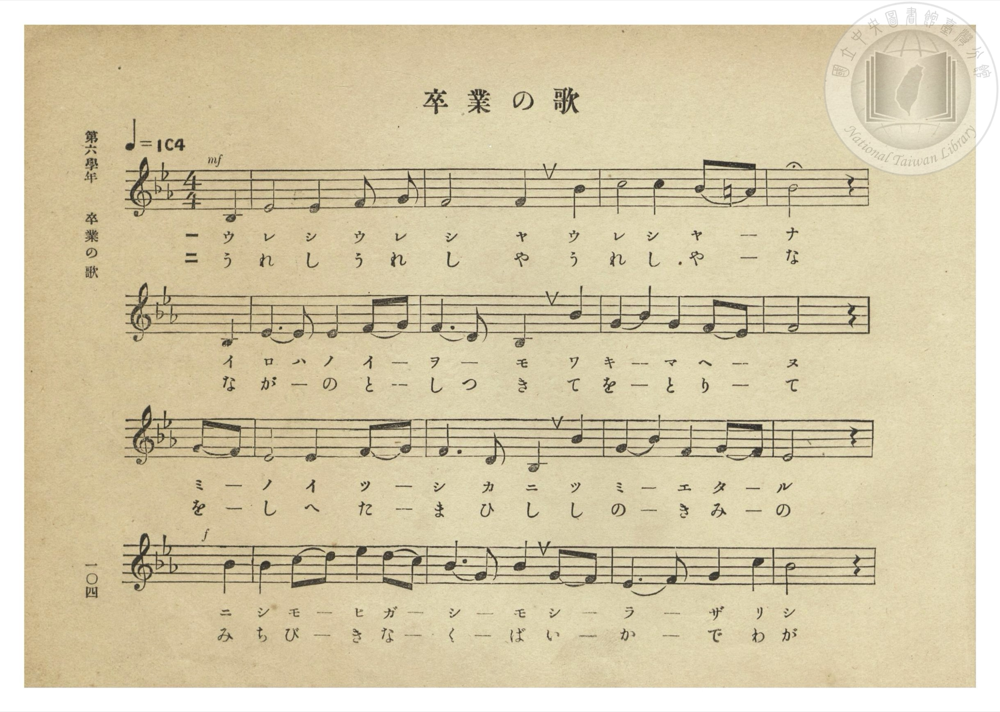
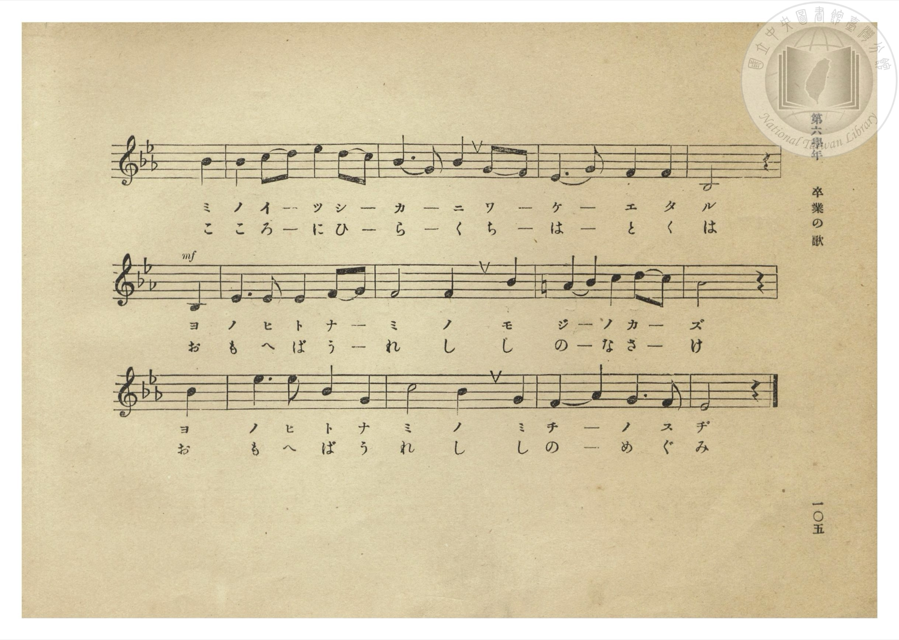
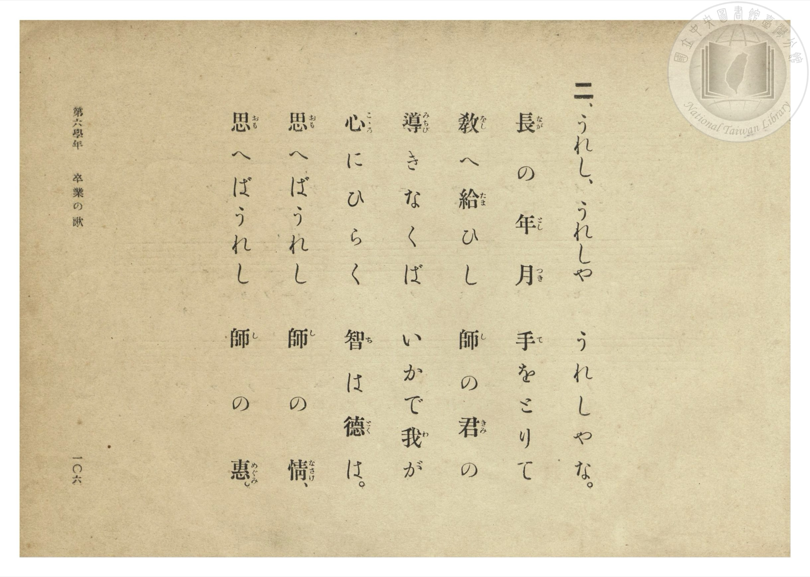
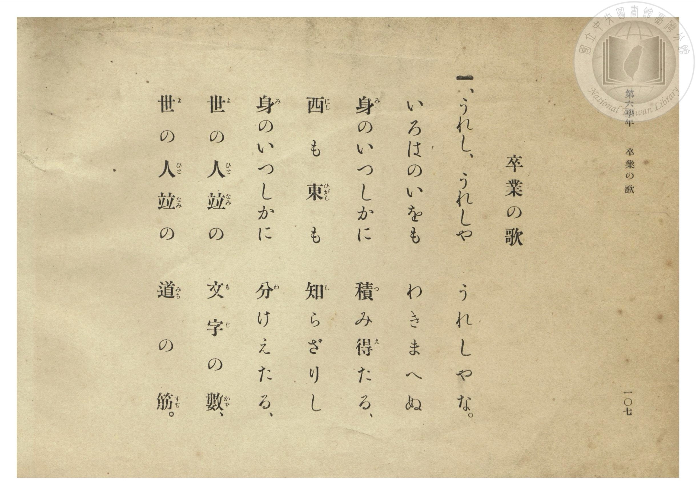

# 卒業の歌

> Re:Shōka 使用 AI 協助辨識與重建樂譜，可能會有錯誤。歡迎回報。

- **NEUTRINO 歌聲合成版**：<br><audio controls src="sotsugyo_no_uta_neutrino.mp3"></audio>
- **鋼琴伴奏版**：<br><audio controls src="sotsugyo_no_uta.mp3"></audio>


- 文部省《小學唱歌集》
- 臺灣總督府《公學校唱歌集》（大正四年三月，索書號 0725 26）

## 說明

原書資訊與歌詞全文（對應 P110.jpg–P113.jpg，第六學年 pp. 104–107）：
調性與拍號：變ホ長調（Eb 大調）4/4 拍（弱起第 4 拍進入），速度 ♩=104


## 歌詞

```text
一、うれし、うれしや　うれしやな。
いろはのいをも　わきまへぬ
身（み）のいつしかに　積（つ）み得（え）たる、
西（にし）も東（ひがし）も　知（し）らざりし
身（み）のいつしかに　分（わ）けえたる、
世（よ）の人（ひと）並（なみ）の　文（も）字（じ）の數（かず）、
世（よ）の人（ひと）並（なみ）の　道（みち）の筋（すぢ）。

二、うれし、うれしや　うれしやな。
長（なが）の年（とし）月（つき）　手（て）をとりて
教（をし）へ給（たま）ひし　師（し）の君（きみ）の
導（みちび）きなくば　いかで我（わ）が
心（こゝろ）にひらく　智（ち）は德（とく）は。
思（おも）へばうれし　師（し）の情（なさけ）、
思（おも）へばうれし　師（し）の惠（めぐみ）。
```

## ABC

```abc
X:1
T:卒業の歌
M:4/4
L:1/16
Q:1/4=104
K:Eb
V:V1 name="Piano" snm="Pia"
[V:V1]
!mf! z4 z4 z4 B,4 | E8 E4 F2 G2 | F8 F4 B4 | c8 c4 B2 =A2 |
w: 1.~う | れ し う れ | し や う | れ し や _
w: 2.~う | れ し う れ | し や う | れ し や _
B8 z4 B,4 | E6 E2 E4 F2 G2 | F6 D2 B,4 B4 | G4 B4 G4 F2 E2 |
w: 1.~な い | ろ は の い _ | を _ も わ | き _ ま へ _
w: 2.~な な | が _ の と _ | し つ き て | を _ と り _
F8 z4 G2 F2 | E8 E4 F2 G2 | F6 D2 B,4 B4 | G4 B4 F4 G2 F2 |
w: 1.~ぬ み _ | の い つ _ | し か に つ | み _ え た _
w: 2.~て を _ | し へ た _ | ま ひ し し | の _ き み _
!f! E8 z4 B4 | B4 c2 d2 e4 d2 c2 | B6 G2 B4 G2 F2 | E6 F2 G4 c4 |
w: 1.~る に | し も _ ひ が _ | し _ も し _ | ら _ ざ り
w: 2.~の み | ち び _ き な _ | く _ ば い _ | か _ で わ
B8 z4 B4 | B4 c2 d2 e4 d2 c2 | B6 G2 B4 G2 F2 | E6 G2 F4 F4 |
w: 1.~し み | の い _ つ し _ | か _ に わ _ | け _ え た
w: 2.~が こ | こ ろ _ に ひ _ | ら _ く ち _ | は _ と く
!mf! B,8 z4 B,4 | E6 E2 E4 F2 G2 | F8 F4 B4 | =A4 B4 c4 d2 c2 |
w: 1.~る よ | の ひ と な _ | み の も | じ _ の か _
w: 2.~は お | も へ ば う _ | れ し し | の _ な さ _
B8 z4 B4 | e6 e2 B4 G4 | c8 B4 G4 | F4 A4 G6 F2 |
w: 1.~ず よ | の ひ と な | み の み | ち _ の す
w: 2.~け お | も へ ば う | れ し し | の _ め ぐ
E8 z4 z4 |
w: 1.~ぢ
w: 2.~み
```

## TMD 檔案連結

- [主旋律 TMD 檔案](sotsugyo_no_uta.tmd) [[在 TMD Studio 編輯](https://tmdlang.github.io/Tmd-TS/#tmd=s7IKdvYPcrWy4qpTUCpJTLdSSM7PyUlNLsnMz7PKzk9PzM7Ojy_OyM9OLM4ojTe0NDRVgqssy88pzU21Si9KTEmNN0OIF-eXFiWnWhUnZ-Tn58SXpFaUJOXnZ6PLxxckpqdaBRgaGiBkCoryy1LzEvOAuguKMvNKUlPA2hEKUssyU1JB0sXJiXnxZalFmWmZqSlITkotKga5HGpFSVFiXnFyUWYByDsIVflFJRn5QGcXZFRaZWQWl-QXZSYn5sRnJ-YlIhSVZKQCPQf1RE5mWiq6VHJqUWpufl5mYg6yyZnpmXlWQOGkUmCoYUiUpxaXpBblxeem5uSnVCpxaWkpPO2d9Gzp2seN656t7VHQ0uJStFUwNDDhsrdVcNXhsjHRN7EDGfJsWvvL5hXP5zQ-buh6uqH_6dodT6dsBOp4ObvtcUM32J4X7bueNy5-vmPv87mLn-6aA1LYugao8NmChchq3-_peLpk-bO1i5_Onv1055YnOzqfzel4v6fn-ZZFz2bveDFzvoKBuZGpgpHZ-z2dSlxc-loKttQCXAoKCk_75oOs2dz-YkXXi452oLNerJz3tHUF0IMgl23ofdbeqQBKFXpZBemPGiYDmcYgJsiFa9Y8bV0L8vrOLQoFBXqgcAKqMDQwBzr1_Z5ZIONfrNr_rGE5yODuXqBfgKIv1nU9bp79cup2oBTQBtckBaD3wexOYOAqANWB7N2z8cXW7UALFMAiLxs2PW1dCja152XD_Ke7lik8mrnSFhQvIEue7Gh43ND4uLHtcVPP48bpKOymlscNDSjcxlWPG5pA2h43tjxu6n3cuB4Y2WD2pMdNTSDVTf2PG4Hi-x437njcuAbsjV2rga563AhyJVR14xKQeY3djxtXA_U8XwlyNlAQrGD_033TwVxgRAK58x83dQMdBTZoKcjTID2NQBWdQAufzd0IFtn0uBHkQoggyMT5QA8DxSEiQFOmPW7qAnKJcs7TjjaQgqZ-sIKJQIeguOLJjmlgaYjz1j3ZtQvmhBVAkSc7loG5qxAWNDRA0gPQaUCRp2shvpsBkX02dQeYC7R7FkiEbDteNk6GeOtx40KI4PO1oPzxuHHm48ZFYKObIBG-q4ecCAcmOpilPRDzgSkXLLICEs7gnAeKRWD8g61reNYJcQDQtcBYmARSCYqFZSDjnk2dCfYhUBQcSY07nm-F-Go-MPGARYC-Bbqu4ekOSHxBlK17OmE2mAtMY1DPg3Pihj647x83bgZLAFUAHQtMjhvAngL6BRjIy591TESK3R6w5v3NYM2THzfNBSZqsAQwjW0Cp5x-kEdmQsIfErDrn-6DBAXQ4xBT1kPD6FnDXLBEFySqwVlgA1JIo_vlWXMrLEynAlMaIv5JN2gB2FPAqJwADReIiygv56BAQUufiys4v6S4NL0y3y8_tCTRKiAzMS_focagphpkk4KNhZYdmIGtlFUAFkfAkubFwh4FDUj5pKANLJ6Apf_z9Q068DJSE4tOoMUgU2sUDBR04bg6N61WwTQeyKpRMASSIAiijRSMgSJGUBEQbQpWYwYVAdGmCibqQCGQBAiCjIOYBLbHx7BGAcSDYWCog00ABj1UAzDUoeIgMaAMmA-WaWrBpwMsC1K_CioOMR8sCrHbiN52g3g14GIBd7Tt6gFHG4mxBYkVQ4xYMY-HhDYkXoyhLBBtBFSLiDtQtBgDeYhYAWZNqI_WA_E6RNgBZSbBQ6EJTPZDfQvRAVK5D0zugIqvQQmF_SgxACwV4LogtqyA6oKENbCIg5oMLMvQ7QerBRZzUB0gebg9YFWEQntHJ_mhjZkHsIc2SA4ctnB94DwFylKIkACFONj_EH9BUtcStJDoBuLVKDKgsITIdYDJ-dAQ6kYJcZAe5BCHp2JwDMF1gWMNxN8ET_kgEtVlkJgAxyGSOHLM4g1xYNORnBAHhZSZgrmCYRwomIFMWIliDE3QiOAFRQik6EErddACG5JRwQkY6GEQCUqIqJkcIgsNhKZOeCBMA8vCkh1MPfbkvRAsuhkp8MDFAJAGZRuIeRvAJKzQgEUesP4E2wPLXrCMArFnMuHAfrJrCmZgG1IzsEFsSAoHqgG5C568EVUGWgJHTtyIBIbwMziBw_08ES6OJ4E3geSQwxwUNpACDJZhQDGMGocgGyCxA9KxHi4OLlLAssjikDAHxziBBN66lpwwx1WAI1erwIoUwgQlbuR4wZ7AIXkTkpshnoIlPESpAY4QcDIHic9AFQdHCkh8Fr7ABuuGlCWwhIyrHsUsTUAuAjbHoOKwyCY6sJ_saCYrsEEJGxjacfDaENFmQYiAAt4EygNFA2r5DcJkhTa87AQlPYQ4iJ4JFl-EFApIGYjSsG5qhMpPQHEVwpZaLi5dOwWUVqcCUECZCwA)]
- [鋼琴伴奏 TMD 檔案](sotsugyo_no_uta_piano.tmd) [[在 TMD Studio 編輯](https://tmdlang.github.io/Tmd-TS/#tmd=s7IKdvYPcrWy4tLSUnjaO-nZ0rWPG9c9W9vzfk_Hy-49zydsebJny9Ol_c87O97v6VTQ0uJStFUwNDDhsrdVcNXhsjHRN7HjqlNQejat_WXziudzGh83dD3d0P907Y6nUzYCjXk5u-1xQ7cSSMmL9l3PGxc_37H3-dzFT3fNASlsXQNU-GzBQmS1QIufLln-bO3ip7NnP9255cmOzmdzgHb3PN-y6NnsHS9mzlcwMDcyVTAyA7pHiYsrOL-kuDS9Mt8vP7Qk0SogMzEvP8jDocagpppLAQhsLLTswAx9LQVbdKDwfM2aJzsaXizsUdB4umfji63bFbQVTBSA7n--vkFHIcDQ0EAvqyBdE4tOLX2wqTUKBgq6cFydm1arYBoPZNUoGAJJEATRRgrGQBEjqAiINgWrMYOKgGhTBRN1oBBIAgRBxkFMAtvjY1ijAOLB8OPGNrAJj5t6oBoeN06HioPEgDJgPlimqQWfDrAsSP0qqDjEfLAoxG4jetsN4tVw4Y-2XT3gaCMxtiCxYogRK-bxkNCGxIsxlAWijYBqEXEHihZjIA8RK4-beqE-Wg_E6xBhB5SZBA-FJjDZD_UtRAdI5T4wuQMqvgYlFPajxMDjRkTYQWxZAdUFCevHjUugJj9uXIZuP1jt46YuqA6QPNwesCpCob2jk_zQxswD2EMbJAcOW7g-cJ4CZSlESIBCHOx_iL8gqWsJWkh0A_FqFBlQWELkOsDkfGgIdaOEOEgPcojDUzE4huC6wLEG4m-Cp3wQieoySEyA4xBJHDlm8YY4sPAjJ8RBIWWmYK5gGAcKZiATVqIYQxM0InhBEQIpetBKHbTAhmRUcAIGehhEghIiaiaHyEIDoakTHgjTwLKwZAdTjz15LwSLbkYKPHAxAKRB2QZi3gYwCSs0YJH3uHE52B5Y9oJlFIg9kwkH9pNdUzAD25CagQ1iQ1I4UA3IXfDkjagy0BI4cuJGJDCEn8EJHO7niXBxPAm8CSSHHOagsIEUYLAMA4ph1DgE2QCJHZCO9XBxcJEClkUWh4Q5OMYJJPDWteSEOa4CHLlaBVakECYocSPHC_YEDsmbkNwM8RQs4SFKDXCEgJM5SHwGqjg4UkDis_AFNlg3pCyBJWRc9ShmaQJy0ePGqVBxWGQTHdhPdjSTFdighA0M7Th4bYhosyBEQAFvAuWBogG1_AZhskIbXnaCkh5CHETPBIsvQgoFpAxEaVg3NULlJ6C4CmFLLdZGpw9yo9ME0eh8tmv1y2UrXvR1vWzvfbKz-_nURcAm9tPWHc-XrXu6fdmzzm5I-xq5QQmBwGCMV4g2jIVRoIIDyDKNj0UwgNEBYprF58YqGAEZRijKwKbAopIIs3CqIdMgTBFkg-CyIDkTNPsxHARWgNVBRJhDzUCCmkCaQSYQp6HzcQUQMIXp2imgJLJoH8NYsOGYEkZwCWUuAA)]

## 分析

```text
================================================================================
📊 TMD Song Profile: [ 卒業の歌 ]
================================================================================
⏱  Duration:       1:06 (66.9s), 29 measures total
🎼 Key & Tempo:    首調基準 E,, != 104.0 BPM, <4/4>
   - 分析範圍：      由實際發聲的音符與和弦推測調性；播放脈絡另行呈現
🎤 人聲音域:    A#3 (MIDI 58) – D#5 (MIDI 75) [跨度: 17 個半音 / 1.4 個八度, 難度: challenging]
   - 最低音:  A#3 in [SotsugyoNoUta #1 @ m.1, 0:01]
   - 最高音: D#5 in [SotsugyoNoUta #1 @ m.14, 0:31]
   - 適合: soprano, mezzo-soprano, contralto, tenor, baritone, bass
🏛  結構:      SotsugyoNoUta (66.9s)
⚡ 編曲密度:        Peak 1 軌道同時演奏
🗝  調性診斷：       A# 大調（純淨自然大調，未偵測到可信轉調）
   - 風格氣質:    純淨自然大調（陽光明朗、易唱易記，無明顯調外色彩）
   - 轉調歷程:    全曲維持單一推測調性（未偵測到可信轉調）
   - 核心骨幹音:  A#, D#, F, G, C
   - 調性數值:    A# 大調 [相關度: 0.90, 穩定度: Moderate, 自然音純度: 99.0%]
   - 候選調性 (K-S): A# 大調 (0.90), D# 大調 (0.82), G 小調 (0.59)
   - 五度圈歷程:   -2
   - 各段落調性細節:
     • [SotsugyoNoUta #1]: A# 大調 (r: 0.90, 自然音純度: 99.0%, 調外音: G#)

  [ 五度圈游移軌跡 ]
               C  
         F            G  
     [Bb]*              D  
      Eb               A  
         Ab           E  
            Db       B  
               F# 
     (* = active key center)

  [ 十二半音累積音高分佈 ]
     C  : ███████                    9.0%
     C# :                            0.0%
     D  : ███                        3.3%
     D# : █████████████████         22.4%
     E  :                            0.0%
     F  : ███████████████           19.5%
     F# :                            0.0%
     G  : ██████████                12.4%
     G# : █                          1.0%
     A  : █                          1.4%
     A# : ████████████████████████  31.0%
     B  :                            0.0%
--------------------------------------------------------------------------------
Assignment 軌道音域：
  - Piano         : A#3 – D#5 (17 個半音 / 1.4 個八度, 107 個音符)
================================================================================
```


## 原書掃描頁










