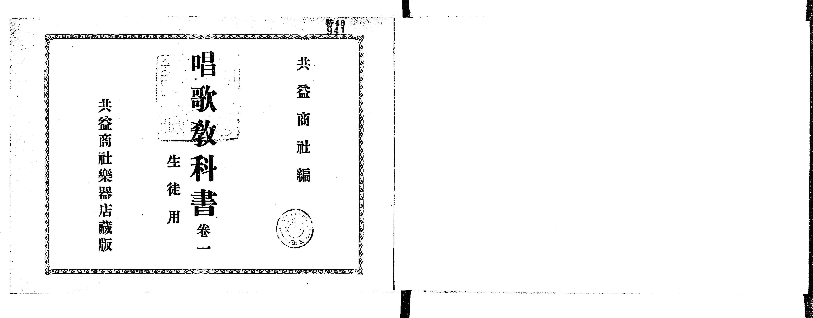
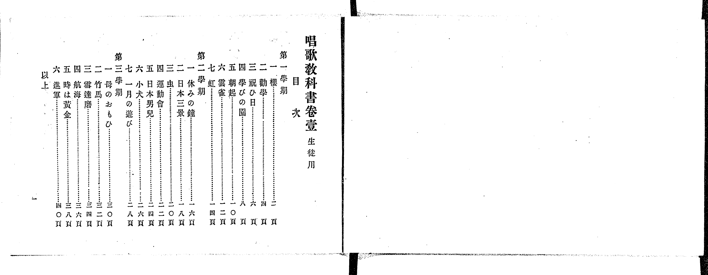
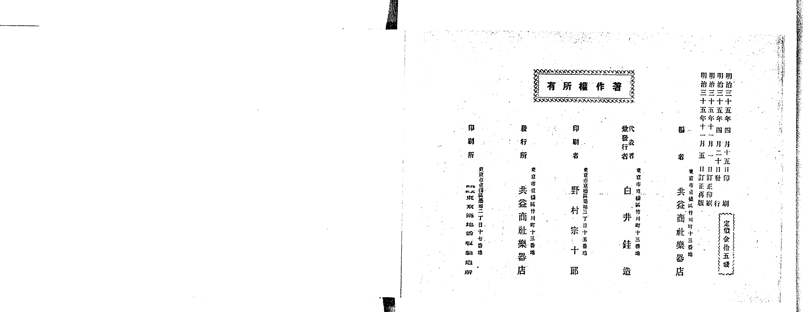
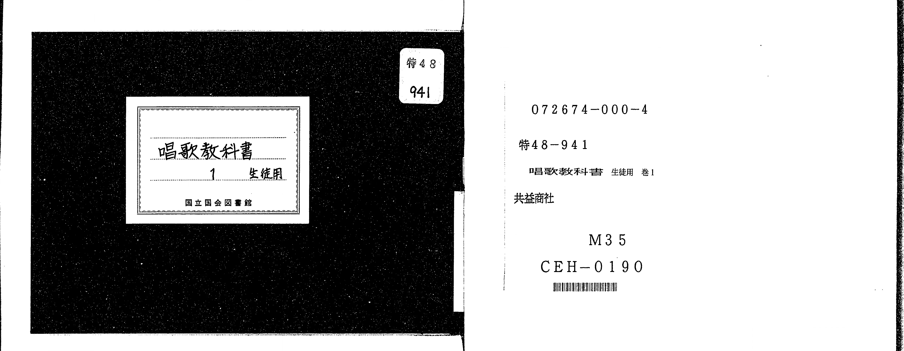

# 書訊與卷首／卷末掃描頁 — 《共益商社唱歌教科書》 巻一・生徒用（NDL PID 854862）

本頁收錄本冊之封面、扉頁、目次（もくろく）、樂典大要、版權頁與封底等原書掃描圖檔（共 5 頁）。

### P001.jpg

本冊封面（左頁），題「共益商社編 唱歌教科書 卷一 生徒用 共益商社樂器店出版」，右上貼有舊藏圖書分類籤。

### P002.jpg

目次頁（左頁）：列出第一學期（一櫻～七虹）、第二學期（一休みの鐘～七一月の遊び）、第三學期（一母のおもひ～六進軍）共 20 首曲名與頁碼。

### P023.jpg

版權頁（右頁）：標明「明治三十五年四月十五日印刷、明治三十五年四月二十日發行、明治三十五年十一月一日訂正印刷、明治三十五年十一月五日訂正再版」、「編者 東京市京橋區竹川町十三番地 共益商社樂器店」、「代表兼發行者 白井銈造」、「印刷者 野村宗十郎」、「印刷所 株式會社東京築地活版製造所」、「定價金拾五錢」。

### P024.jpg

封底裏留白與封底外頁。

### P025.jpg

日本國立國會圖書館（NDL）書標與微縮數位化資訊卡（書號 特48-941）。

