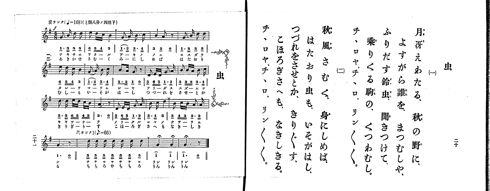

# 虫

> Re:Shōka 使用 AI 協助辨識與重建樂譜，可能會有錯誤。歡迎回報。

- **鋼琴伴奏版**：<br><audio controls src="mushi.mp3"></audio>
- **NEUTRINO 歌聲合成版**：<br><audio controls src="mushi_neutrino.mp3"></audio>

- 出處：共益商社樂器店《唱歌教科書 生徒用 巻一》第二十～二十一頁（第十曲）
- NDL Digital Collections PID 854862（https://dl.ndl.go.jp/pid/854862）掃描 P012.jpg

## 說明

原書資訊與歌詞全文（NDL PID 854862《唱歌教科書 生徒用 巻一》第二十～二十一頁，掃描 P012.jpg）：
調性與拍號：と調八分ノ四拍子（G 大調 4/8 拍），開頭標「愛ラシク (♩=168)」（按八分ノ四拍子及末段標記，應為 ♪=168，折合四分音符 ♩=84）；第十七小節複縱線後標「p (オソク) (♪=66)」（折合四分音符 ♩=33）
註記：第二學期第三曲（全卷第十曲）。全曲十九小節，分節歌，二節同一旋律。開頭標 f，第十六小節末為複縱線，第十七小節起轉 p 並放慢模仿蟲鳴，第十八、十九小節三處「リン」之高音 G5 附延長記號（fermata）。第二、六、十四、十七小節末印有換氣記號（V）。第三、七小節首二音「1_. 2__」印有圓滑線。第八小節第一拍簡譜漏印底線作「3.」，五線譜為附點八分音符 B4（應作「3_.」）。第二節末句右頁歌詞印片假名「チヽロヤ、チヽロ、リン〳〵〳〵。」，譜下配字印平假名。


## 歌詞

```text
一、
月冴えわたる、秋の野に、
よすがら誰を、まつむしや、
ふりだす鈴虫、聞きつけて、
乗りくる駒の、くつわむし。
チヽロヤ、チヽロ、リン〳〵〳〵。

二、
秋風さむく、身にしめば、
はたおり虫も、いそがはし、
つづれをさせとか、きり〲す、
こほろぎさへも、なきしきる。
チヽロヤ、チヽロ、リン〳〵〳〵。
```

## ABC

<div class="abc-score" data-abc-src="mushi.abc" aria-label="五線譜載入中"></div>

[下載 ABC 原始檔](mushi.abc)

## TMD 檔案連結

- [主旋律 TMD 檔案](mushi.tmd) [[在 TMD Studio 編輯](https://tmdlang.github.io/Tmd-TS/#tmd=s7IKdvYPcrWy4qpTUCpJTLdSSM7PyUlNLsnMz7PKrsxPzc6ML87Iz05Ugisoy88pzU21yk7MizeMtzA1sTAzQkgW55cWJadaFSdn5OfnxJekVpQk5edno8vHFySmp1oFGBgi6Swoyi9LzUvMA-ouKMrMK0lNAWtHKEgty0xJBUkXJwOtLkstykzLTE1BcldqUTHI1VArSooS84qTizILQF5BqEpPzStKtUrOyMxJKUrNiy_Oz0tHSKblF-VaFZcU5RdkZCYjhEsyUoEeTszLzE3MQRctTk0EmlGMLlySmZsan58Wn5JYiZDKL8pMz8yzyk3NzMpEChstLYUXM1craGlxKdoqWJhw2dsquHPZmOhb2IF0Pm3f9WLm1Pd7Zj1t3fh8dtfTqW3Pl-x7tqLp6cwVT3dNf9zQ9XTKxmdre55Nnfl8-cRns3coPJ8y_-m-Sc-nrFB4un33kx0Njxu6n69Z82RXz9Pexvd750EYQPGXCxrf7-kASgG5z2Zver-nE-xSPxcfBRegO0sScxSc4WmhWCHA00UBEttAXRklJQXFVvr6KTl6eUCcnq-XVaBfkJmiD1PR-ayv-Vl_vwIojoFywDDm0tdSsKUW4FJQUHjaNx_o3Reb21-s6HrR0Q4Mgxcr5z1tXfFsWjvQhSBvIJxMaTD1oHkH6EFgjIBc8WLV_mcNy0H2d_e-mDkfKPq4cQVQ8Gnr6qcdbY-b-57Ong2Uerp2AtBR7gpPlywHSioAI1cBKAo2pufltO6XC9Y-WzHzcUPPs5bZj5tXPm7a_rhpvYLGo5krbQ3NLDQfNwCVdjzr6cQ09Wl_17M5q5-t2wrU_2LFDJBT2zufN-1SeDRzFUgvSKBrxtMJHUAdQK0v529-vmYZUHKlrYUJ2PrZkBTwZEfz0w39z9c3vFjS_nzHxufbZz3d1wNxU4GCxuOmVY-b9gLdpAly1CpbMzOYm7CbbWwMNBscPCt2g101Cxq2a3c8mzMfxN7RCU5zHcAIe9q7HTkVPm5oAsXi7E0gV-2cC3EV0BtAG4AMYBwC2UCjgOynE3qAEfRsevfTfd1AXfBwVEgDKoEY-bR1LcQAYCABQwXuObgChL-3bn-xt1OhQOHJjmXPpux71rro2YqFT3bvfzF_08vNW5AMXP24oRHZaUCvADMoMJweN6963LwZGC5Pdna_XD0DGBwK7qYKL2e2PN297eXU7cBwACeQjrTUotzEkkSIVyHhAjKydS3EYGBgQm2AOQ3o9qe9G57N6XzWP_vZhsVwg8IQRuwAMhAaXi6bBjQU6ACgqwzj9RSM4uOBzoKY8XTO5Ge7JwKDAKITlKLAesCmNAAT1fMNC1-snfNsTz9Q_dNdU4Eqn-ydAzTIWA8c5cCwnwIUAyoBhifQcy93AzMdKFVCo98JmKw6gGkQqikeogvhVah_-pc-7d8MzFvQbNu74Xln-9PG9qcTesEh2fi4ee_j5rWPm5cA_YXggtiQQAairTCyCeIwoJOe7Oh-2QrMFtNBbt-5GWZgExcoLYIzeSOI9WxOx9O2LY8bOx439T9unP-4CZh8Gp8v737cuO5le9_jRlAUg9Q9bup43DjzcWPP46bOF6s2PG6aBHJB477HjUseNzU8bpz-uKkFprRx6-OmrseNC4AaXnZsARboQIkXjfMeN_aCVDdOfNy4DKr0yU6gPqDSfqC9L5dPAloKNhXoEqCpQEGwwUA3g0wlMSAg_gSnJxAL6KWXi1Y8bpwKNrQf5KJdq0HeA7kcaOUGuOPXg4KhsQvoLpDLm4AhCpRuedw4F-R5kCzQRVClQM8sfdwEDBKgy6c-bpwNLO8eN4ICEORVoL8aNoHCDKZ68uPG3Y-bgGEADFag6h0ws1eBA2Y6WA8o85LlW6AeyusSKFDQ0ufi8i0tzsi0CshMzMt3qDGoqQbZoGBjaKZlB2ZVKwJLzVoIMw1CA2u1x80twJSyFoi3AvEKhRqgyHogaz-Q3gPEq0EiTYsgPJC65j6wmj4g7gazVgDFdwLxGiB7JcghIJNrFAwVdIHQWMEUSIJwjYIZmGUCFAPJgEQgaoygIiZAEZicERAbIKlBMgdsvo8h0OrGJWA5YDQA8VQwqwOsB5gSwbz5EPmmbqh9jxuboOaD9EDodWDxdXDx1UAyHmoKyDSQ2Ewg7gGb1IlwgRHCPIgLQLY8bpwDtQnsnqYGqDzIPRDx_Sg2gejpYLsa4eIbEC5oXA8Vmw_EXWATQSTEBaDYA8cTKORBcbUJHB_zoDxgvDYvABu9HSqyBCw_FYhXQUUawHEHUgOKwV1Q0QVgPfCYJD7ejMAykHgzBXnBLB5Ew5RDlBkja0SKTFBkAbMmNMomwQNsHzxgoNENDFSQ-HSYeFMLUoBthQcSsDiDRx9IZiaYPQslWoBBj4hMsCjMXGBWh7sAZD5E_Vwo3YMUOTA9MBeAXAksZdB8A08SjbPB5AqoTmAeQkQmKBuCshgo6kDZbSOYBkVaGzzTQaMO2MKCZc7N0EgHZ0ywOFQ_KCMDIxMekaDsA4pKM2h01oCzGQwSiDZQdEEMACkDiYCMgBgAVIMUkbCcBcoTkMCYCA2aZUjWwYILlPNgEQbJJaD8CpKZDDVnH1L-BIlD8jbYZHA-hyYJpFwJdQHQVGDRDTcflgjQXQCyB1jQg9XB3A4OS3CEgXg74MkBomMV1H9IyQXIQ4rI7Qo1oPhqhGJQnC5B4YNkQZUCjILz0cpP5KipLqgFFeLGxrXAiECG4CwZB1ULZyCJwc1AiiVY9kEOiYUQDAwFUKZC5kPKQ2AVC4kUcJAiOGhycCOR8hakCKaxdbVcXLp2CuB6UAHIUOYCAA)]
- [鋼琴伴奏 TMD 檔案](mushi_piano.tmd) [[在 TMD Studio 編輯](https://tmdlang.github.io/Tmd-TS/#tmd=s7IKdvYPcrWy4tLSUngxc_X7PR0vu_c8n7DlyZ4tT5f2P-_seL-nU0FLi0vRVsHChMveVsGdy8ZE38KOq05B6Wn7rhczp77fM-tp68bns7ueTm17vmTfsxVNT2eueLpr-uOGrqdTNj5b2_Ns6sznyyc-m71D4fmU-U_3TXo-ZYXC0-27n-xoeNzQ_XzNmie7ep72Nr7fOw_CAIq_XNAIdAhQCsh9NnsT0AlKIPv8XHwUXDLTM0sScxSc83NyUpNLMvPzihUCPF0ULExNLMyMgLoySkoKiq309VNy9PKAOD1fL6tAvyAzRR-movNZX_Oz_n6FAANDI6BcuhIXl29pcUamVUBmYl5-kIdDjUFNNZcCENgYmmnZgVnVirYWJrUQZhqE1tdSeNzcovC4aS0QbwXiFQo1QJH1QNZ-IL0HiFeDRJoWQXggdc19YDV9QNwNZq0Aiu8E4jVA9koFLX2wyTUKhgq6QGisYAokQbhGwQzMMgGKgWRAIhA1RlARE6AITM4IiA2Q1CCZAzbfxxBodeMSsNzjxl4gngpmdYD1PG7qB_PmQ-SbuqH2PW5sgpoP0gOh14HF18HFVwPJeKgpINNAYjOBuAdsUifCBUYI8yAuANnyuHEO1Cawe5oaoPIg90DE96PYBKKng-1qhItvQLigcT1UbD4Qd4FNBJEQF4BiDxxPoJAHxdUmcHzMg_KA8dq8AGz0dqjIErD8VCBeBRVpAMcdSA0oBndBRReA9cBjkvh4MwLLQOLNFOQFs3gQDVMOUWaMrBEpMkGR9bgJFMwgehI8wPbBAwYa3cBABYlPh4k3tSAF2FZ4ID1uXACPPpDMTDB7Fkq0AIMeEZlgUZi5j5sgUQvSCTIfon4ulO5BihyYHpgLQK583LgUzTfwJNE4G0yugOoE5iFEZIKyISiLgaIOlN02gmlQpLXBMx006pqAmRSaOTdDIx2cMcHiUP2gjAyMTHhEgrIPKCrNoNFZA85mMEgg2kDRBTEApAwkAjICYgBQDVJEwnIWKE9AAmMiNGiWIVkHCy5QzoNFGCSXgPIrSGYy1Jx9SPkTJA7J22CTwfkcmiSQciXUBUBTHzf2wc2HJQJ0F4Dsedy4G6wO5nZwWIIjDMTbAU8OEB2roP5DSi5AHlJEbleoAcVXIxSD4nQJCh8ku-pxMyjqwBScj1Z-IkdNdUEtqBA3Nq4FRgQyBGfJOKhaOANJDG4GUizBsg9ySCyEYGAogDIVMh9SHnY9boJECjhIERw0ObiRSHkLUgTT2LpalGrQB7kaNIHWgsDoedHX9bK992nrjpezWyFNBKRQj1eINowFMmoUTIBMEwjTNB7INo1H51CgB4csLiOw6cJlF8w5mK5DZRpAAkzXTgEcZtE-QCkExwjMUeYCAA)]

## 分析

```text
================================================================================
📊 TMD Song Profile: [ 虫 ]
================================================================================
⏱  Duration:       0:33 (33.8s), 19 measures total
🎼 Key & Tempo:    首調基準 G, != 84.0 BPM, <4/8>
   - 分析範圍：      由實際發聲的音符與和弦推測調性；播放脈絡另行呈現
🎤 人聲音域:    D4 (MIDI 62) – G5 (MIDI 79) [跨度: 17 個半音 / 1.4 個八度, 難度: challenging]
   - 最低音:  D4 in [Mushi #1 @ m.9, 0:11]
   - 最高音: G5 in [Mushi #1 @ m.18, 0:24]
   - 適合: soprano, mezzo-soprano, tenor, baritone
🏛  結構:      Mushi (33.8s)
⚡ 編曲密度:        Peak 1 軌道同時演奏
🗝  調性診斷：       G 大調（純淨自然大調，未偵測到可信轉調）
   - 風格氣質:    純淨自然大調（陽光明朗、易唱易記，無明顯調外色彩）
   - 轉調歷程:    全曲維持單一推測調性（未偵測到可信轉調）
   - 核心骨幹音:  G, B, D, A, C
   - 調性數值:    G 大調 [相關度: 0.91, 穩定度: High, 自然音純度: 100.0%]
   - 候選調性 (K-S): G 大調 (0.91), B 小調 (0.69), D 大調 (0.64)
   - 五度圈歷程:   +1
   - 各段落調性細節:
     • [Mushi #1]: G 大調 (r: 0.91, 自然音純度: 100.0%)

  [ 五度圈游移軌跡 ]
               C  
         F           [G ]*
      Bb               D  
      Eb               A  
         Ab           E  
            Db       B  
               F# 
     (* = active key center)

  [ 十二半音累積音高分佈 ]
     C  : █████                      5.6%
     C# :                            0.0%
     D  : ████████████████████      23.2%
     D# :                            0.0%
     E  : ████                       4.9%
     F  :                            0.0%
     F# :                            0.0%
     G  : ████████████████████████  28.2%
     G# :                            0.0%
     A  : ███████████               12.7%
     A# :                            0.0%
     B  : ██████████████████████    25.4%
--------------------------------------------------------------------------------
Assignment 軌道音域：
  - Piano         : D4 – G5 (17 個半音 / 1.4 個八度, 70 個音符)
================================================================================
```


## 原書掃描頁




