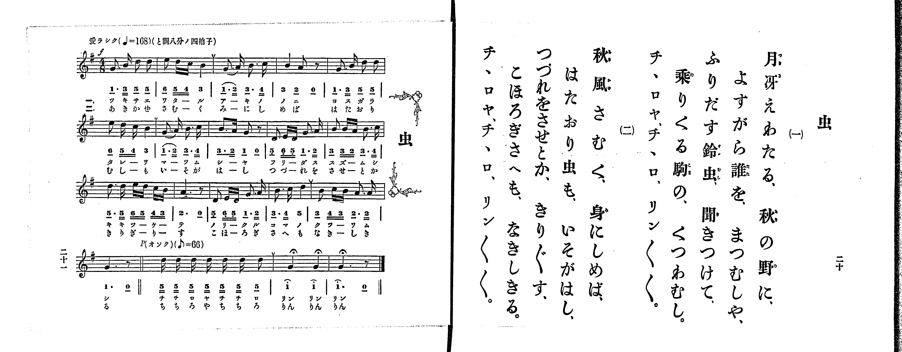

# 虫

> Re:Shoka 使用 AI 協助辨識與重建樂譜，可能會有錯誤。歡迎回報。

<audio controls src="mushi.mp3"></audio>

- 出處：共益商社樂器店《唱歌教科書 生徒用 巻一》第二十～二十一頁（第十曲）
- NDL Digital Collections PID 854862（https://dl.ndl.go.jp/pid/854862）掃描 P012.jpg

## 說明

原書資訊與歌詞全文（NDL PID 854862《唱歌教科書 生徒用 巻一》第二十～二十一頁，掃描 P012.jpg）：
調性與拍號：と調八分ノ四拍子（G 大調 4/8 拍），開頭標「愛ラシク (♩=168)」（按八分ノ四拍子及末段標記，應為 ♪=168，折合四分音符 ♩=84）；第十七小節複縱線後標「p (オソク) (♪=66)」（折合四分音符 ♩=33）
註記：第二學期第三曲（全卷第十曲）。全曲十九小節，分節歌，二節同一旋律。開頭標 f，第十六小節末為複縱線，第十七小節起轉 p 並放慢模仿蟲鳴，第十八、十九小節三處「リン」之高音 G5 附延長記號（fermata）。第二、六、十四、十七小節末印有換氣記號（V）。第三、七小節首二音「1_. 2__」印有圓滑線。第八小節第一拍簡譜漏印底線作「3.」，五線譜為附點八分音符 B4（應作「3_.」）。第二節末句右頁歌詞印片假名「チヽロヤ、チヽロ、リン〳〵〳〵。」，譜下配字印平假名。

## 歌詞

```text
一、
月冴えわたる、秋の野に、
よすがら誰を、まつむしや、
ふりだす鈴虫、聞きつけて、
乗りくる駒の、くつわむし。
チヽロヤ、チヽロ、リン〳〵〳〵。

二、
秋風さむく、身にしめば、
はたおり虫も、いそがはし、
つづれをさせとか、きり〲す、
こほろぎさへも、なきしきる。
チヽロヤ、チヽロ、リン〳〵〳〵。
```

## ABC

```abc
X:1
T:虫
M:4/8
L:1/16
Q:1/8=168
K:G
V:V1 name="Piano" snm="Pia"
[V:V1]
[Q:1/8=168] !f! G3 B d2 d2 | e2 d c B4 | G3 A B3 c | B4 A2 z2 |
G3 B d2 d2 | e2 d c B4 | G3 A B3 c | B3 A G2 z2 |
D2 E D G3 A | B2 B A B3 c | d3 d e d c B | A6 z2 |
D2 E D G3 A | B3 c d4 | B2 c B A3 A | G6 z2 |
!p! [Q:1/8=66] d d d d d d d2 | g4 g4 | g6 z2 |
```

## TMD 檔案連結

- [主旋律 TMD 檔案](mushi.tmd) [[在 TMD Studio 編輯](https://tmdlang.github.io/Tmd-TS/#tmd=s7IKdvYPcrWy4qpTUCpJTLdSSM7PyUlNLsnMz7PKrsxPzc6ML87Iz05Ugisoy88pzU21yk7MizeMtzA1sTAzQkgW55cWJadaFSdn5OfnxJekVpQk5edno8vHFySmp1oFGBgi6Swoyi9LzUvMA-ouKMrMK0lNAWtHKEgty0xJBUkXJwOtLkstykzLTE1BcldqUTHI1VArSooS84qTizILQF5BqEpPzStKtUrOyMxJKUrNiy_Oz0tHSKblF-VaFZcU5RdkZCYjhEsyUoEeTszLzE3MQRctTk0EmlGMLlySmZsan58Wn5JYqcSlpaXwYuZqBS0tLkVbBQsTLntbBXcuGxN9CzuQrqftu17MnPp-z6ynrRufz-56OrXt-ZJ9z1Y0PZ254umu6Y8bup5O2fhsbc-zqTOfL5_4bPYOhedT5j_dN-n5lBUKT7fvfrKj4XFD9_M1a57s6nna2_h-7zwIAyj-ckHj-z0dQCkg99nsTe_3dIJd6efio-CSmZ5Zkpij4AyP7GKFAE8XBUh0AnVllJQUFFvp66fk6OUBcXq-XlaBfkFmij5MReezvuZn_f0KoEgEygEDkUtfS8GWWoBLQUHhad98oHdfbG5_saLrRUc7MAxerJz3tHXFs2ntQBeCvIFwMqXB1IPmHaAHgTECcsWLVfufNSwH2d_d-2LmfKDo48YVQMGnraufdrQ9bu57Ons2UOrp2glAR7krPF2yHCipAIxcBaAo2Jiel9O6Xy5Y-2zFzMcNPc9aZj9uXvm4afvjpvUKGo9mrrQ1NLPQfNwAVNrxrKcT09Sn_V3P5qx-tm4rUP-LFTNATm3vfN60S-HRzFUgvSCBrhlPJ3QAdQC1vpy_-fmaZUDJlbYWJmDrZ0NSwJMdzU839D9f3_BiSfvzHRufb5_1dF8PxE0FChqPm1Y9btoLdJMmyFGrbM3MYG7CbraxMdBscPCs2A121Sxo2K7d8WzOfBB7Ryc4zXUAI-xp73bkVPi4oQkUi7M3gVy1cy7EVUBvAG0AMoBxCGQDjQKyn07oAUbQs-ndT_d1A3XBw1EhDagEYuTT1rUQA4CBBAwVuOfgChD-3rr9xd5OhQKFJzuWPZuy71nromcrFj7Zvf_F_E0vN29BMnD144ZGZKcBvQLMoMBwety86nHzZmC4PNnZ_XL1DGBwKLibKryc2fJ097aXU7cDwwGcQDrSUotyE0sSIV6FhAvIyNa1EIOBgQm1AeY0oNuf9m54NqfzWf_sZxsWww0KQxixA8hAaHi5bBrQUKADgK4yjNdTMIqPBzoLYsbTOZOf7Z4IDAKITlCKAusBm9IATFTPNyx8sXbOsz39QPVPd00Fqnyydw7QIGM9cJQDw34KUAyoBBieQM-93A3MdKBUCY1-J2Cy6gCmQaimeIguhFeh_ulf-rR_MzBvQbNt74bnne1PG9ufTugFh2Tj4-a9j5vXPm5eAvQXggtiQwIZiLbCyCaIw4BOerKj-2UrMFtMB7l952aYgU1coLQIzuSNINazOR1P27Y8bux43NT_uHH-4yZg8ml8vrz7ceO6l-19jxtBUQxS97ip43HjzMeNPY-bOl-s2vC4aRLIBY37HjcuedzU8Lhx-uOmFpjSxq2Pm7oeNy4AanjZsQVYoAMlXjTOe9zYC1LdOPFx4zKo0ic7gfqASvuB9r5cPgloKdhUoEuApgIFwQYD3QwylcSAgPgTnJ5ALKCXXi5a8bhxKtjQfpCLdq0GeQ_kcqCVG-COXw8KhsYuoLtALm8ChihQuuVx41yQ50GyQBdBlQI9s_RxEzBIgC6f-rhxNrC8e9wICkCQV4H-atgECjOY6smPG3c_bgKGATBYgap3wMxeBQ6Y6WA9oMxLlm-BeiivS6BAQUufi8u3tDgj0yogMzEv36HGoEahGmSFgo2hmZYdmFUNrqFrIew0CA2s1x43twDTylog3grEKxRqgCLrgaz9QHoPEK8GiTQtgvBA6pr7wGr6gLgbzFoBFN8JxGuA7JUgp4BMrlEwVNAFQmMFUyAJwjUKZmCWCVAMJAMSgagxgoqYAEVgckZAbICkBskcuMvBbgTZCnLnJrBb5kF5QD81LwC7fDtUZAlYfioQr4KKNIDdDVIDcv0uqOgCsB64L4h3sxFYBuJm03ggZRYPomHKIcqMkTUiPAIKflDQgpwNCuaNYBrk4DZ4YEOdDaxbYZGyGephcISAxaH6QREI9AjcE6BgA3nDDOqVGnDwwiABJ4OcCjEApAwkAjICYgBQDcIT2xVqQG5thGKQf5ag8EGyoKwAo-B8tDSD7KzqglpwyjU2rgW6AhmC4yIOqhjOQBKDG8JVy8Wla6cAziAKQIYyFwA)]
- [鋼琴伴奏 TMD 檔案](mushi_piano.tmd) [[在 TMD Studio 編輯](https://tmdlang.github.io/Tmd-TS/#tmd=s7IKdvYPcrWy4tLSUngxc_X7PR0vu_c8n7DlyZ4tT5f2P-_seL-nU0FLi0vRVsHChMveVsGdy8ZE38KOq05B6Wn7rhczp77fM-tp68bns7ueTm17vmTfsxVNT2eueLpr-uOGrqdTNj5b2_Ns6sznyyc-m71D4fmU-U_3TXo-ZYXC0-27n-xoeNzQ_XzNmie7ep72Nr7fOw_CAIq_XNAIdAhQCsh9NnsT0AlKIPv8XHwUXDLTM0sScxSc83NyUpNLMvPzihUCPF0ULExNLMyMgLoySkoKiq309VNy9PKAOD1fL6tAvyAzRR-movNZX_Oz_n6FAANDI6BcuhIXl29pcUamVUBmYl5-kIdDjUGNQjWXjaGZlh2XAhBUg_1eC2GnQWh9LYXHzS0Kj5vWAvFWIF6hUAMUWQ9k7QfSe4B4NUikaRGEB1LX3AdW0wfE3WDWCqD4TiBeA2SvVNDSB5tco2CooAuExgqmQBKEaxTMwCwToBhIBiQCUWMEFTEBisDkjIDYAEkNkjlwl4PdCLIV5M5NYLfMg_KAfmpeAHb5dqjIErD8VCBeBRVpALsbpAbk-l1Q0QVgPXBfEO9mI7AMxM2m8UDKLB5Ew5RDlBkja0R4BBT8oKAFORsUzBvBNMjBbfDAhjq7CRg50EjZDPUwOELA4lD9oAgEegTuCVCwgbxhBvVKDTh4YZCAk0FOhRgAUgYSARkBMQCoBuGJ7Qo1ILc2QjHIP0tQ-CDZVY-bQc4GU3A-WppBdlZ1QS045Rob1wJdgQzBcREHVQxnIInBDeGqRckbPrC8AbLTxgSaPYBeeNHX9bK992nrjpezWyEFB5LL4hWiDWOBjBoFEyDTBMI0jQeyTePRORTowSGLywhsunDZBXMOputQmQaQENO1UwAHmgKQocwFAA)]

## 分析

```text
================================================================================
📊 TMD Song Profile: [ 虫 ]
================================================================================
⏱  Duration:       0:33 (33.8s), 19 measures total
🎼 Key & Tempo:    首調基準 G, != 84.0 BPM, <4/8>
   - 分析範圍：      由實際發聲的音符與和弦推測調性；播放脈絡另行呈現
🎤 人聲音域:    D4 (MIDI 62) – G5 (MIDI 79) [跨度: 17 個半音 / 1.4 個八度, 難度: challenging]
   - 最低音:  D4 in [Mushi #1 @ m.9, 0:11]
   - 最高音: G5 in [Mushi #1 @ m.18, 0:24]
   - 適合: soprano, mezzo-soprano, tenor, baritone
🏛  結構:      Mushi (33.8s)
⚡ 編曲密度:        Peak 1 軌道同時演奏
🗝  調性診斷：       G 大調（純淨自然大調，未偵測到可信轉調）
   - 風格氣質:    純淨自然大調（陽光明朗、易唱易記，無明顯調外色彩）
   - 轉調歷程:    全曲維持單一推測調性（未偵測到可信轉調）
   - 核心骨幹音:  G, B, D, A, C
   - 調性數值:    G 大調 [相關度: 0.91, 穩定度: High, 自然音純度: 100.0%]
   - 候選調性 (K-S): G 大調 (0.91), B 小調 (0.69), D 大調 (0.64)
   - 五度圈歷程:   +1
   - 各段落調性細節:
     • [Mushi #1]: G 大調 (r: 0.91, 自然音純度: 100.0%)

  [ 五度圈游移軌跡 ]
               C  
         F           [G ]*
      Bb               D  
      Eb               A  
         Ab           E  
            Db       B  
               F# 
     (* = active key center)

  [ 十二半音累積音高分佈 ]
     C  : █████                      5.6%
     C# :                            0.0%
     D  : ████████████████████      23.2%
     D# :                            0.0%
     E  : ████                       4.9%
     F  :                            0.0%
     F# :                            0.0%
     G  : ████████████████████████  28.2%
     G# :                            0.0%
     A  : ███████████               12.7%
     A# :                            0.0%
     B  : ██████████████████████    25.4%
--------------------------------------------------------------------------------
Assignment 軌道音域：
  - Piano         : D4 – G5 (17 個半音 / 1.4 個八度, 70 個音符)
================================================================================
```


## 原書掃描頁




