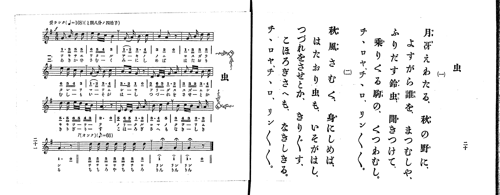

# 虫

> Re:Shōka 使用 AI 協助辨識與重建樂譜，可能會有錯誤。歡迎[回報](https://github.com/TMDLang/reshoka/issues)。

- **鋼琴伴奏版**：<br><audio controls src="mushi.mp3"></audio>
- **NEUTRINO 歌聲合成版**：<br><audio controls src="mushi_neutrino.mp3"></audio>

- 出處：共益商社樂器店《唱歌教科書 生徒用 巻一》第二十～二十一頁（第十曲）
- NDL Digital Collections PID 854862（https://dl.ndl.go.jp/pid/854862）掃描 P012.jpg

## 說明

原書資訊與歌詞全文（NDL PID 854862《唱歌教科書 生徒用 巻一》第二十～二十一頁，掃描 P012.jpg）：
調性與拍號：と調八分ノ四拍子（G 大調 4/8 拍），開頭標「愛ラシク (♩=168)」（按八分ノ四拍子及末段標記，應為 ♪=168，折合四分音符 ♩=84）；第十七小節複縱線後標「p (オソク) (♪=66)」（折合四分音符 ♩=33）
註記：第二學期第三曲（全卷第十曲）。全曲十九小節，分節歌，二節同一旋律。開頭標 f，第十六小節末為複縱線，第十七小節起轉 p 並放慢模仿蟲鳴，第十八、十九小節三處「リン」之高音 G5 附延長記號（fermata）。第二、六、十四、十七小節末印有換氣記號（V）。第三、七小節首二音「1_. 2__」印有圓滑線。第八小節第一拍簡譜漏印底線作「3.」，五線譜為附點八分音符 B4（應作「3_.」）。第二節末句右頁歌詞印片假名「チヽロヤ、チヽロ、リン〳〵〳〵。」，譜下配字印平假名。


## 歌詞

```text
一、
月冴えわたる、秋の野に、
よすがら誰を、まつむしや、
ふりだす鈴虫、聞きつけて、
乗りくる駒の、くつわむし。
チヽロヤ、チヽロ、リン〳〵〳〵。

二、
秋風さむく、身にしめば、
はたおり虫も、いそがはし、
つづれをさせとか、きり〲す、
こほろぎさへも、なきしきる。
チヽロヤ、チヽロ、リン〳〵〳〵。
```

## ABC

<div class="abc-score" data-abc-src="mushi.abc" aria-label="五線譜載入中"></div>

[下載 ABC 原始檔](mushi.abc)

## TMD 檔案連結

- [主旋律 TMD 檔案](mushi.tmd) [[在 TMD Studio 編輯](https://tmdlang.github.io/Tmd-TS/#tmd=s7IKdvYPcrWy4qpTUCpJTLdSSM7PyUlNLsnMz7PKrsxPzc6ML87Iz05Ugisoy88pzU21yk7MizeMtzA1sTAzQkgW55cWJadaFSdn5OfnxJekVpQk5edno8vHFySmp1oFGBgi6Swoyi9LzUvMA-ouKMrMK0lNAWtHKEgty0xJBUkXJwOtLkstykzLTE1BcldqUTHI1VArSooS84qTizILQF5BqEpPzStKtUrOyMxJKUrNiy_Oz0tHSKblF-VaFZcU5RdkZCYjhEsyUoEeTszLzE3MQRctTk0EmlGMLlySmZsan58Wn5JYiZDKL8pMz8yzyk3NzMrEEjb5RSUZ-elFiQUZlVYZmcUlQOXJiTnxwIAGhr6WlsKLmasVtLS4FG0VLEy47G0V3LlsTPQt7ED6n7bvejFz6vs9s562bnw-u-vp1LbnS_Y9W9H0dOaKp7umP27oejpl47O1Pc-mzny-fOKz2TsUnk-Z_3TfpOdTVig83b77yY6Gxw3dz9esebKr52lv4_u98yAMoPjLBY3v93QApYDcZ7M3vd_TCXavn4uPggvQMyWJOQrO8ARTrBDg6aIASRJAXRklJQXFVvr6KTl6eUCcnq-XVaBfkJmiD1PR-ayv-Vl_vwIoIQDlgBHBpa-lYEstwKWgoPC0bz7Quy82t79Y0fWiox0YBi9WznvauuLZtHagC0HeQDiZ0mDqQfMO0IPAGAG54sWq_c8aloPs7-59MXM-UPRx4wqg4NPW1U872h439z2dPRso9XTtBKCj3BWeLlkOlFQARq4CUBRsTM_Lad0vF6x9tmLm44aeZy2zHzevfNy0_XHTegWNRzNX2hqaWWg-bgAq7XjW04lp6tP-rmdzVj9btxWo_8WKGSCntnc-b9ql8GjmKpBekEDXjKcTOoA6gFpfzt_8fM0yoORKWwsTsPWzISngyY7mpxv6n69veLGk_fmOjc-3z3q6rwfipgIFjcdNqx437QW6SRPkqFW2ZmYwN2E329gYaDY4eFbsBrtqFjRs1-54Nmc-iL2jE5zmOoAR9rR3O3IqfNzQBIrF2ZtArto5F-IqoDeANgAZwDgEsoFGAdlPJ_QAI-jZ9O6n-7qBuuDhqJAGVAIx8mnrWogBwEAChgrcc3AFCH9v3f5ib6dCgcKTHcueTdn3rHXRsxULn-ze_2L-ppebtyAZuPpxQyOy04BeAWZQYDg9bl71uHkzMFye7Ox-uXoGMDgU3E0VXs5sebp728up24HhAE4gHWmpRbmJJYkQr0LCBWRk61qIwcDAhNoAcxrQ7U97Nzyb0_msf_azDYvhBoUhjNgBZCA0vFw2DWgo0AFAVxnG6ykYxccDnQUx4-mcyc92TwQGAUQnKEWB9YBNaQAmqucbFr5YO-fZnn6g-qe7pgJVPtk7B2iQsR44yoFhPwUoBlQCDE-g517uBmY6UKqERr8TMFl1ANMgVFM8RBfCq1D_9C992r8ZmLeg2bZ3w_PO9qeN7U8n9IJDsvFx897HzWsfNy8B-gvBBbEhgQxEW2FkE8RhQCc92dH9shWYLaaD3L5zM8zAJi5QWgRn8kYQ69mcjqdtWx43djxu6n_cOP9xEzD5ND5f3v24cd3L9r7HjaAoBql73NTxuHHm48aex02dL1ZteNw0CeSCxn2PG5c8bmp43Dj9cVMLTGnj1sdNXY8bFwA1vOzYAizQgRIvGuc9buwFqW6c-LhxGVTpk51AfUCl_UB7Xy6fBLQUbCrQJUBTgYJgg4FuBplKYkBA_AlOTyAW0EsvF6143DgVbGg_yEW7VoO8B3I50MoNcMevBwVDYxfQXSCXNwFDFCjd8rhxLsjzIFmgi6BKgZ5Z-rgJGCRAl0993DgbWN49bgQFIMirQH81bAKFGUz15MeNux83AcMAGKxA1TtgZq8CB8x0sB5Q5iXLt0A9lNclUKCgpc_F5VtanJFpFZCZmJfvUGNQUw2yQcHG0EzLDsyqVgSWmrUQZhqEBtZqj5tbgCllLRBvBeIVCjVAkfVA1n4gvQeIV4NEmhZBeCB1zX1gNX1A3A1mrQCK7wTiNUD2SpBDQCbXKBgq6AKhsYIpkAThGgUzMMsEKAaSAYlA1BhBRUyAIjA5IyA2QFKDZA7YfB9DoNWNS8BywGgA4qlgVgdYDzAlgnnzIfJN3VD7Hjc2Qc0H6YHQ68Di6-Diq4FkPNQUkGkgsZlA3AM2qRPhAiOEeRAXgGx53DgHahPYPU0NUHmQeyDi-1FsAtHTwXY1wsU3IFzQuB4qNh-Iu8AmgkiIC0CxB44nUMiD4moTOD7mQXnAeG1eADZ6O1RkCVh-KhCvgoo0gOMOpAYUg7ugogvAeuAxSXy8GYFlIPFmCvKCWTyIhimHKDNG1ogUmaDIAmZNaJRNggfYPnjAQKMbGKgg8ekw8aYWpADbCg8kYHEGjz6QzEwwexZKtACDHhGZYFGYucCsDncByHyI-rlQugcpcmB6YC4AuRJYyqD5Bp4kGmeDyRVQncA8hIhMUDYEZTFQ1IGy20YwDYq0Nnimg0YdsIUFy5yboZEOzphgcah-UEYGRiY8IkHZBxSVZtDorAFnMxgkEG2g6IIYAFIGEgEZATEAqAYpImE5C5QnIIExERo0y5CsgwUXKOfBIgySS0D5FSQzGWrOPqT8CRKH5G2wyeB8Dk0SSLkS6gKgqcCiG24-LBGguwBkD7CgB6uDuR0cluAIA_F2wJMDRMcqqP-QkguQhxSR2xVqQPHVCMWgOF2CwgfJgioFGAXno5WfyFFTXVALKsSNjWuBEYEMwVkyDqoWzkASg5uBFEuw7IMcEgshGBgKoEyFzIeUh8AqFhIp4CBFcNDk4EYi5S1IEUxj62q5uHTtFMD1oAKQocwFAA)]
- [鋼琴伴奏 TMD 檔案](mushi_piano.tmd) [[在 TMD Studio 編輯](https://tmdlang.github.io/Tmd-TS/#tmd=s7IKdvYPcrWy4qpTUCpJTLdSyC8qychPL0osyKi0ysgsLskvykxOzInPTsxLVOLS0lJ4MXP1-z0dL7v3PJ-w5cmeLU-X9j_v7Hi_p1NBS4tL0VbBwoTL3lbBncvGRN_CDmTo0_ZdL2ZOfb9n1tPWjc9ndz2d2vZ8yb5nK5qezlzxdNf0xw1dT6dsfLa259nUmc-XT3w2e4fC8ynzn-6b9HzKCoWn23c_2dHwuKH7-Zo1T3b1PO1tfL93HoQBFH-5oBHoEKAUkPts9iagE5RA9vm5-Ci4ZKZnliTmKDjn5-SkJpdk5ucVKwR4uihYmJpYmBkBdWWUlBQUW-nrp-To5QFxer5eVoF-QWaKPkxF57O-5mf9_QoBBoZGQLl0JS4u39LijEyrgMzEvPwgD4cag5pqLgUgsDE007IDs6oVbS1MaiHMNAitr6XwuLlF4XHTWiDeCsQrFGqAIuuBrP1Aeg8QrwaJNC2C8EDqmvvAavqAuBvMWgEU3wnEa4DslQpa-mCTaxQMFXSB0FjBFEiCcI2CGZhlAhQDyYBEIGqMoCImQBGYnBEQGyCpQTIHbL6PIdDqxiVguceNvUA8FczqAOt53NQP5s2HyDd1Q-173NgENR-kB0KvA4uvg4uvBpLxUFNApoHEZgJxD9ikToQLjBDmQVwAsuVx4xyoTWD3NDVA5UHugYjvR7EJRE8H29UIF9-AcEHjeqjYfCDuApsIIiEuAMUeOJ5AIQ-Kq03g-JgH5QHjtXkB2OjtUJElYPmpQLwKKtIAjjuQGlAM7oKKLgDrgcck8fFmBJaBxJspyAtm8SAaphyizBhZI1JkgiLrcRMomEH0JHiA7YMHDDS6gYEKEp8OE29qQQqwrfBAety4AB59IJmZYPYslGgBBj0iMsGiMHMfN0GiFqQTZD5E_Vwo3YMUOTA9MBeAXPm4cSmab-BJonE2mFwB1QnMQ4jIBGVDUBYDRR0ou20E06BIa4NnOmjUNQEzKTRzboZGOjhjgsWh-kEZGRiZ8IgEZR9QVJpBo7MGnM1gkEC0gaILYgBIGUgEZATEAKAapIiE5SxQnoAExkRo0CxDsg4WXKCcB4swSC4B5VeQzGSoOfuQ8idIHJK3wSaD8zk0SSDlSqgLgKY-buyDmw9LBOguANnzuHE3WB3M7eCwBEcYiLcDnhwgOlZB_YeUXIA8pIjcrlADiq9GKAbF6RIUPkh21eNmUNSBKTgfrfxEjprqglpQIW5sXAuMCGQIzpJxULVwBpIY3AykWIJlH-SQWAjBwFAAZSpkPqQ87HrcBIkUcJAiOGhycCOR8hakCKaxdbUo1aAPcjVoAq0FgdHzoq_rZXvv09YdL2e3QpoISKEerxBtGAtk1CiYAJkmEKZpPJBtGo_OoUAPDllcRmDThcsumHMwXYfKNIAEmK6dAjjMon2AUgiOEZijzAUA)]

## 分析

```text
================================================================================
📊 TMD Song Profile: [ 虫 ]
================================================================================
⏱  Duration:       0:33 (33.8s), 19 measures total
🎼 Key & Tempo:    首調基準 G, != 84.0 BPM, <4/8>
   - 分析範圍：      由實際發聲的音符與和弦推測調性；播放脈絡另行呈現
🎤 人聲音域:    D4 (MIDI 62) – G5 (MIDI 79) [跨度: 17 個半音 / 1.4 個八度, 難度: challenging]
   - 最低音:  D4 in [Mushi #1 @ m.9, 0:11]
   - 最高音: G5 in [Mushi #1 @ m.18, 0:24]
   - 適合: soprano, mezzo-soprano, tenor, baritone
🏛  結構:      Mushi (33.8s)
⚡ 編曲密度:        Peak 1 軌道同時演奏
🗝  調性診斷：       G 大調（純淨自然大調，未偵測到可信轉調）
   - 風格氣質:    純淨自然大調（陽光明朗、易唱易記，無明顯調外色彩）
   - 轉調歷程:    全曲維持單一推測調性（未偵測到可信轉調）
   - 核心骨幹音:  G, B, D, A, C
   - 調性數值:    G 大調 [相關度: 0.91, 穩定度: High, 自然音純度: 100.0%]
   - 候選調性 (K-S): G 大調 (0.91), B 小調 (0.69), D 大調 (0.64)
   - 五度圈歷程:   +1
   - 各段落調性細節:
     • [Mushi #1]: G 大調 (r: 0.91, 自然音純度: 100.0%)

  [ 五度圈游移軌跡 ]
               C  
         F           [G ]*
      Bb               D  
      Eb               A  
         Ab           E  
            Db       B  
               F# 
     (* = active key center)

  [ 十二半音累積音高分佈 ]
     C  : █████                      5.6%
     C# :                            0.0%
     D  : ████████████████████      23.2%
     D# :                            0.0%
     E  : ████                       4.9%
     F  :                            0.0%
     F# :                            0.0%
     G  : ████████████████████████  28.2%
     G# :                            0.0%
     A  : ███████████               12.7%
     A# :                            0.0%
     B  : ██████████████████████    25.4%
--------------------------------------------------------------------------------
Assignment 軌道音域：
  - Piano         : D4 – G5 (17 個半音 / 1.4 個八度, 70 個音符)
================================================================================
```


## 原書掃描頁




