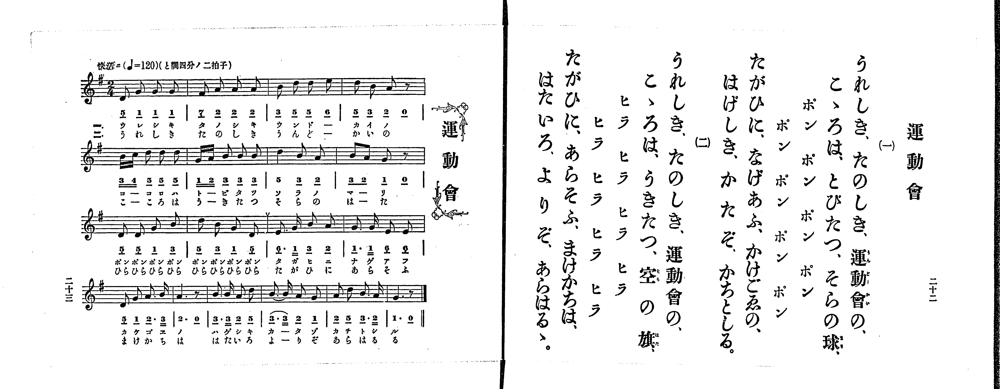

# 運動會

*找不到鋼琴伴奏版 TMD，未產生音訊。*

- 出處：共益商社樂器店《唱歌教科書 生徒用 巻一》第二十二～二十三頁（第十一曲）
- NDL Digital Collections PID 854862（https://dl.ndl.go.jp/pid/854862）掃描 P013.jpg

## 說明

原書資訊與歌詞全文（NDL PID 854862《唱歌教科書 生徒用 巻一》第二十二～二十三頁，掃描 P013.jpg）：
調性與拍號：と調四分ノ二拍子（G 大調 2/4 拍），♩=120，「快活ニ」
註記：第二學期第四曲（全卷第十一曲）。全曲十八小節（前三行各四小節，第四行六小節），分節歌，二節同一旋律。第十小節末印有換氣記號（V）。第十六小節首二音「3_. 3__」印有圓滑線（配字「カータゾ」／「よーりぞ」）。第二節「ヒラ ヒラ ヒラ ヒラ」右頁印片假名，譜下配字印平假名。五線譜與簡譜一致。

## 歌詞

```text
一、
うれしき、たのしき、運動會の、
こゝろは、とびたつ、そらの球、
ポン　ポン　ポン　ポン
ポン　ポン　ポン　ポン
たがひに、なげあふ、かけごゑの、
はげしき、かたぞ、かちとしる。

二、
うれしき、たのしき、運動會の、
こゝろは、うきたつ、空の旗、
ヒラ　ヒラ　ヒラ　ヒラ
ヒラ　ヒラ　ヒラ　ヒラ
たがひに、あらそふ、まけかちは、
はたいろ、よりぞ、あらはるゝ。
```

## ABC

```abc
X:1
T:運動會
M:2/4
L:1/16
Q:1/4=120
K:G
V:V1 name="Piano" snm="Pia"
[V:V1]
D2 G2 G2 G2 | F2 A2 A2 A2 | B2 d2 d2 e2 | d2 B2 A2 z2 |
B c d2 d2 d2 | G A B2 B2 B2 | d4 B2 A2 | B2 A2 G2 z2 |
D2 D2 G2 B2 | d2 B2 G2 D2 | E3 G B2 A2 | G3 G E2 E2 |
D2 G2 A3 B | A6 z2 | B3 B A2 d2 | B3 B A2 G2 |
A2 d2 B3 A | G6 z2 | D2 G2 G2 G2 | F2 A2 A2 A2 |
B2 d2 d2 e2 | d2 B2 A2 z2 | B c d2 d2 d2 | G A B2 B2 B2 |
d4 B2 A2 | B2 A2 G2 z2 | D2 D2 G2 B2 | d2 B2 G2 D2 |
E3 G B2 A2 | G3 G E2 E2 | D2 G2 A3 B | A6 z2 |
B3 B A2 d2 | B3 B A2 G2 | A2 d2 B3 A | G6 z2 |
```

## TMD 檔案連結

- [主旋律 TMD 檔案](undokai.tmd) [[在 TMD Studio 編輯](https://tmdlang.github.io/Tmd-TS/#tmd=s7IKdvYPcrWy4qpTUCpJTLdSSM7PyUlNLsnMz7PKrsxPzc6ML87Iz05Ugisoy88pzU21yk7MizeMtzA1sTAzQkgW55cWJadaFSdn5OfnxJekVpQk5edno8vHFySmp1oFGBgaI2QKivLLUvMS84C6C4oy80pSU8DaEQpSyzJTUkHSxclAq8tSizLTMlNTkNyVWlQMcjXUipKixLzi5KLMApBXEKrSU_OKUq2SMzJzUopS8-KL8_PSEZJp-UW5VsUlRfkFGZnJCOGSjFSgh6F-yslMS8WQKsgvArpUS0vhZWP30-6pz-Y0K2hpcSnaKhgaGXDZ2yq4c9kY6ZvYgbQ9bd_1YubU93tmPW3d-Hx219Opbc-X7Hu2ounpzBVPd01_3ND1dMrGZ2t7nk2d-Xz5xGezdyg8nzL_6b5Jz6esUHi6ffeTHQ2PG7qfr1nzZFfP095GIPl-7zwoe0fnywWN7_d0AGXB3IZnsze939MJdqyfi4-CS2Z6ZklijoIzPIaLFQI8XRQgcQjUmFFSUlBspa-fkqOXB8Tp-XpZBfoFmSn6MBWdz_qan_X3K4BiDigHDDkufS0FW2oBLgUFhad984GefrG5_cWKrhcd7cCQeLFy3tPWFc-mtQNdCPIGwslUCKweNB8B_QiMGpBDXqza_6xhOcgJ3b0vZs4Hij5uXAEUfDp79tOOtsfNfUCDgFJP104Austd4emS5UBJBWAsKwBFwcb0PJq50haYAICsxw09T_evfrZl9-Pm7scNvWDzV-x-sWIG0Fio-9bueDZnPijqZs8Gx1sH0NNPe7ejRebjhiZQYMzeBBR82rr66Yb-5-sbQIo7e4FeerGw5-mEFpALoeI9EANB4q1rYYIgpwG9AGQDgw7IBtoOZD-d0AOyZXr3031AJzZB7IVoeTZn9dPeDc_mdD7rn_1sw2Kgs8EB0hEGcRBUKcyCl8umAU18OX8z0NPG8XoKxvHxQC9DDHg6Z_Kz3ROfb58F1P2yFRh4wATf87hp9ePmPY-b9j9u2gdU-X5PP1iwAyzY9bhxHlgQahPEsSAFzZMeN69UwEaBrOvfDIxfoKXPO9ufNrY_nQA0oefF2jlPdnRD7AVKPd25GSIFNPnJrilAVwEVACP8-YaFYJUNL9q3AKW4QLEFTkqNINbjxrbHTT2PG6c_bgRqbHzcOP9x4zo4F57_QYIwDZMfN8193NT7uHE9WMOKx42bwdqWgLlAqU6g6ucTmmEamuc-bgaGXgMuBvGKQLYA3brpceNqsF2rHjdOetzY9LhxK5jb_bhx4uPGKY-bgCTCuevBiuD-AyoCmgKMBAh7IdgD0x83gVIJJGx2AdM3lcKmDaQUFjbPV-4CKn02HZhIoAEDiV2gD7EziFeEHjBN4EiYCwuYfeCAgfgW5DB4wAC1tYCcC1QETKDQ1AnXvx4UKkD_AAMGqIHyAhEKFLT0ubhC81KA1XCmVUBmYl6-Q41BjUI1yBIFG0MzLTswC1gUP25aBgyANUB6OxCvVagBkvuBIn0oIiA1m4G4E4j3gEVWA_ESsDqgVSCzahRM4xV0FQyRcI2COUjICAnXKBgDSVMoNgOLgFggUZC8AUgE4TaQnXug9Fog7gfZ3dwBEW2eDHVrC9hFe4EsUH7uA6uZB1WzCuE-YwUTuM0gXAN0pBHYZhiGuAUEYe6BuBfEAnkI1XXgTIOdArkAryzI3U3AUG-eBMTdYPVdQJFNQLwIyJ6KFqrwoEW4EsQCiYClahTMQBRIBOFykCxIBCwFJpBCFhR_G4F4CxCvANsPCbd-qCsQcQ9UCY4DkIv3wUUaIfEAVAfStRpLKgA5AuTMGigLAsFBCHYkSA4kA4kKZBFI2oHJQWSM4B5CMoerlotL104BmtAVUJnKXAA)]

## 分析

```text
================================================================================
📊 TMD Song Profile: [ 運動會 ]
================================================================================
⏱  Duration:       0:36 (36.0s), 36 measures total
🎼 Key & Tempo:    首調基準 G, != 120.0 BPM, <2/4>
   - 分析範圍：      由實際發聲的音符與和弦推測調性；播放脈絡另行呈現
🎤 人聲音域:    D4 (MIDI 62) – E5 (MIDI 76) [跨度: 14 個半音 / 1.2 個八度, 難度: moderate]
   - 最低音:  D4 in [Undokai #1 @ m.1, 0:00]
   - 最高音: E5 in [Undokai #1 @ m.3, 0:02]
   - 適合: soprano, mezzo-soprano, contralto, tenor, baritone, bass
🏛  結構:      Undokai (18.0s) -> Undokai (18.0s)
⚡ 編曲密度:        Peak 1 軌道同時演奏
🗝  調性診斷：       D 調性不明確（純淨自然大調，未偵測到可信轉調）
   - 風格氣質:    純淨自然大調（陽光明朗、易唱易記，無明顯調外色彩）
   - 轉調歷程:    全曲維持單一推測調性（未偵測到可信轉調）
   - 核心骨幹音:  B, D, A, G, E
   - 調性數值:    D 調性不明確 [相關度: 0.78, 穩定度: Ambiguous, 自然音純度: 99.3%]
   - 候選調性 (K-S): D 大調 (0.78), G 大調 (0.77), B 小調 (0.69)
   - 五度圈歷程:   +2 -> +2
   - 各段落調性細節:
     • [Undokai #1]: D 調性不明確 (r: 0.78, 自然音純度: 99.3%, 調外音: C)
     • [Undokai #2]: D 調性不明確 (r: 0.78, 自然音純度: 99.3%, 調外音: C)

  [ 五度圈游移軌跡 ]
               C  
         F            G  
      Bb              [D ]*
      Eb               A  
         Ab           E  
            Db       B  
               F# 
     (* = active key center)

  [ 十二半音累積音高分佈 ]
     C  : █                          0.7%
     C# :                            0.0%
     D  : ███████████████████████   23.5%
     D# :                            0.0%
     E  : ███████                    6.6%
     F  :                            0.0%
     F# : █                          1.5%
     G  : ████████████████████      20.6%
     G# :                            0.0%
     A  : ███████████████████████   22.8%
     A# :                            0.0%
     B  : ████████████████████████  24.3%
--------------------------------------------------------------------------------
Assignment 軌道音域：
  - Piano         : D4 – E5 (14 個半音 / 1.2 個八度, 130 個音符)
================================================================================
```


## 原書掃描頁




