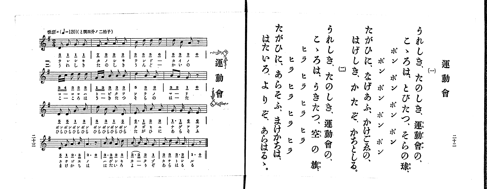

# 運動會

> Re:Shōka 使用 AI 協助辨識與重建樂譜，可能會有錯誤。歡迎回報。

- **鋼琴伴奏版**：<br><audio controls src="undokai.mp3"></audio>
- **NEUTRINO 歌聲合成版**：<br><audio controls src="undokai_neutrino.mp3"></audio>

- 出處：共益商社樂器店《唱歌教科書 生徒用 巻一》第二十二～二十三頁（第十一曲）
- NDL Digital Collections PID 854862（https://dl.ndl.go.jp/pid/854862）掃描 P013.jpg

## 說明

原書資訊與歌詞全文（NDL PID 854862《唱歌教科書 生徒用 巻一》第二十二～二十三頁，掃描 P013.jpg）：
調性與拍號：と調四分ノ二拍子（G 大調 2/4 拍），♩=120，「快活ニ」
註記：第二學期第四曲（全卷第十一曲）。全曲十八小節（前三行各四小節，第四行六小節），分節歌，二節同一旋律。第十小節末印有換氣記號（V）。第十六小節首二音「3_. 3__」印有圓滑線（配字「カータゾ」／「よーりぞ」）。第二節「ヒラ ヒラ ヒラ ヒラ」右頁印片假名，譜下配字印平假名。五線譜與簡譜一致。


## 歌詞

```text
一、
うれしき、たのしき、運動會の、
こゝろは、とびたつ、そらの球、
ポン　ポン　ポン　ポン
ポン　ポン　ポン　ポン
たがひに、なげあふ、かけごゑの、
はげしき、かたぞ、かちとしる。

二、
うれしき、たのしき、運動會の、
こゝろは、うきたつ、空の旗、
ヒラ　ヒラ　ヒラ　ヒラ
ヒラ　ヒラ　ヒラ　ヒラ
たがひに、あらそふ、まけかちは、
はたいろ、よりぞ、あらはるゝ。
```

## ABC

<div class="abc-score" data-abc-src="undokai.abc" aria-label="五線譜載入中"></div>

[下載 ABC 原始檔](undokai.abc)

## TMD 檔案連結

- [主旋律 TMD 檔案](undokai.tmd) [[在 TMD Studio 編輯](https://tmdlang.github.io/Tmd-TS/#tmd=s7IKdvYPcrWy4qpTUCpJTLdSSM7PyUlNLsnMz7PKrsxPzc6ML87Iz05Ugisoy88pzU21yk7MizeMtzA1sTAzQkgW55cWJadaFSdn5OfnxJekVpQk5edno8vHFySmp1oFGBgaI2QKivLLUvMS84C6C4oy80pSU8DaEQpSyzJTUkHSxclAq8tSizLTMlNTkNyVWlQMcjXUipKixLzi5KLMApBXEKrSU_OKUq2SMzJzUopS8-KL8_PSEZJp-UW5VsUlRfkFGZnJCOGSjFSgh6F-yslMS8WQKsgvQnJpflFmemaeVW5qZlYmljAAqs3ITy9KLMiotMrILC4BKk9OzIkHBigwlLW0FF42dj_tnvpsTrOClhaXoq2CoZEBl72tgjuXjZG-iR3ImKftu17MnPp-z6ynrRufz-56OrXt-ZJ9z1Y0PZ254umu6Y8bup5O2fhsbc-zqTOfL5_4bPYOhedT5j_dN-n5lBUKT7fvfrKj4XFD9_M1a57s6nna2wgk3--dB2Xv6Hy5oPH9ng6gLJjb8Gz2pvd7OsGO93PxUXAB-qwkMUfBGZ5KihUCPF0UIOkAqDGjpKSg2EpfPyVHLw-I0_P1sgr0CzJT9GEqOp_1NT_r71cAxT5QDhj6XPpaCrbUAlwKCgpP--YDPf1ic_uLFV0vOtqBIfFi5bynrSueTWsHuhDkDYSTqRBYPWg-AvoRGDUgh7xYtf9Zw3KQE7p7X8ycDxR93LgCKPh09uynHW2Pm_uABgGlnq6dAHSXu8LTJcuBkgrAWFYAioKN6Xk0c6UtMAEAWY8bep7uX_1sy-7Hzd2PG3rB5q_Y_WLFDKCxUPet3fFsznxQ1M2eDY63DqCnn_ZuR4vMxw1NoMCYvQko-LR19dMN_c_XN4AUd_YCvfRiYc_TCS0gF0LFeyAGgsRb18IEQU4DegHIBgYdkA20Hch-OqEHZMv07qf7gE5sgtgL0fJszuqnvRuezel81j_72YbFQGeDA6QjDOIgqFKYBS-XTQOa-HL-ZqCnjeP1FIzj44FehhjwdM7kZ7snPt8-C6j7ZSsw8IAJvudx0-rHzXseN-1_3LQPqPL9nn6wYAdYsOtx4zywINQmiGNBCponPW5eqYCNAlnXvxkYv0BLn3e2P21sfzoBaELPi7VznuzohtgLlHq6czNECmjyk11TgK4CKgBG-PMNC8EqG160bwFKcYFiC5yUGkGsx41tj5t6HjdOf9wI1Nj4uHH-48Z1cC48_4MEYRomP26a-7ip93HjerCGFY8bN4O1LQFzgVKdQNXPJzTDNDTPfdwMDL0GXAziFYFsAbp10-PG1WC7Vj1unPS4selx41Ywt_tx48THjVMeNwFJhHPXgxXB_QdUBDQFGAkQ9kKwB6Y_bgKlEkjY7AKmbyqFTRtIKSxsnq_cBVT6bDowkUADBhK7QB9iZxCvCD1gmsCRMBcWMPvAAQPxLchh8IABamsBOReoCJhAoakTrn89KFSA_gEGDFAD5QUiFCho6XNxhealAKvyTKuAzMS8fIcag5pqkB0KNoZmWnZgFrAkfty0DOj_NUB6OxCvVagBkvuBIn0oIiA1m4G4E4j3gEVWA_ESsDqgTSCzahRM4xV0FQyRcI2COUjICAnXKBgDSVMoNgOLgFggUZC8AUgEbJ6PIdCaxjYgH5g-QGTjdDDZC9YDDFYwbx0WGYieyWCxlUASBEHi3WCRFrg-kNugdhnRzy5wmIPCcg-UXgvE_SBNzR0Q0ebJ0DhoAYf0XiALVEz1gdXMg6pZhQh3YwUTeIiCcA0w8I3AIQrDkDAGQVg4Q-IBxAJFFHqoQ_wDJptAPgUmU6i_VoB5m8EkJFSWQGXmQm0Apmq4r0Hi--DiXVjCHLdN4JAFhzOxNoF0gsXB6lFDHFy-YadAoYpXFhQXTcAc0jwJiLvB6ruAIpuAeBGQPRUtB8CzASLkQSyQCFiqRsEMRIFEELEBkgWJgKXABHJ87IUlMZwM4lWBwgYk1APEm8Cs1VCZVVAZoDcbm8CsrWixtQkW5DgZxKvC7Q6Q3ZDYhcQ1sjvAuQdU9mwE4i1AvAIcH5C80Q-NFUS5BVQJzmegGNwHF2mE5DWgOpCu1VhKMFCkgKKtBsqCQHA2AUcaSA4kA8luyCKQcg8mB5ExgkcwkjlI0QspLCaCySlQz08EBwUoacMgJO3AkjkkmlALI5A5iAwArGeQxIH1EpgEZWBIMQYKDZgOuPlIkQ3KuDBXQdSBzEDOaNhcNR-IwcUeODuD7OiAuQpcACBcBU5i0HQB1Q10D3ZX1XJx6dopQOszBSBTmQsA)]
- [鋼琴伴奏 TMD 檔案](undokai_piano.tmd) [[在 TMD Studio 編輯](https://tmdlang.github.io/Tmd-TS/#tmd=s7IKdvYPcrWy4qpTUCpJTLdSyC8qychPL0osyKi0ysgsLskvykxOzInPTsxLVOLS0lJ42dj9tHvqsznN7_d0vOze83zClid7tjxd2v-8s-P9nk4FLS0uRVsFQyMDLntbBXcuGyN9EzuQ2U_bd72YOfX9nllPWzc-n931dGrb8yX7nq1oejpzxdNd0x83dD2dsvHZ2p5nU2c-Xz7x2ewdCs-nzH-6b9LzKSsUnm7f_WRHw-OG7udr1jzZ1fO0txFIvt87D8re0flyQSPQMUBZMLfh2exNQJcogWz1c_FRcMlMzyxJzFFwzs_JSU0uyczPK1YI8HRRsDA1sTAzAmrMKCkpKLbS10_J0csD4vR8vawC_YLMFH2Yis5nfc3P-vsVAgwMjYFy6UpcXKF5KfnZiZlWAZmJeflBHg41BjXVXApAYGNopmUHZulrKTxuWqbwuHkNkN4OxGsVaoDkfqBIH4oISM1mIO4E4j1gkdVAvASsTksfbFaNgmm8gq6CIRKuUTAHCRkh4RoFYyBpCsVmYBEQCyQKkjcAiYDN8zEEWtPYBuQ_buoBkY3TwWQvWM_jxvlg3josMhA9k8FiK4EkCILEu8EiLXB9ILdB7TKin13gMAeF5R4ovRaI-0Gamjsgos2ToXHQAg7pvUDWSnBIg9TMg6pZhQh3YwUTeIiCcA0w8I3AIQrDkDAGQVg4Q-IBxAJFFHqoQ_wDJptAPn3cuB7qrxVg3mYwCQmVJVCZuVAbHjd1wn0NEt8HF-_CEua4bQKHLDicibUJpBMsDlaPGuLNcyEJGAsFClW8sqC4aALmkOZJQNwNVt8FFNkExIuA7KloOQCeDRAhD2KBRMBSNQpmIAokgogNkCxIBCwFJpDjYy8sieFkEK8KFDYgoR4g3gRmrYbKrILKAL3Z2ARmbUWLrU2wIMfJIF4VbneA7IbELiSukd0Bzj2gsmcjEG8B4hXg-IDkjX5orCDKLaBKcD4DxeA-uEgjJK8B1YF0rcZSgoEiBRRtNVAWBIKzCTjSQHIgGUh2QxaBlHswOYiMETyCkcxBil5IYTERTE6Ben4iOChASRsGIWkHlswh0YRaGIHMQWSAx43zkMQfNy4Ek6AMDCnGQKEB0wE3HymyQRkX5iqIOpAZyBkNm6vmAzG42ANnZ5AdHTBXgQsAhKvASQyaLqC6ge7B7qpatOrMB7k6M0HUZi_6ul629z5t3fFydiukzkdErmG8QrRhLJABimcg2zQewjEBsk3QxaF6sMrh5mDaRMhSeMIjbDg2m1BkgXYZQMJK104BGlzRPkDbkblGYK4yFwA)]

## 分析

```text
================================================================================
📊 TMD Song Profile: [ 運動會 ]
================================================================================
⏱  Duration:       0:18 (18.0s), 18 measures total
🎼 Key & Tempo:    首調基準 G, != 120.0 BPM, <2/4>
   - 分析範圍：      由實際發聲的音符與和弦推測調性；播放脈絡另行呈現
🎤 人聲音域:    D4 (MIDI 62) – E5 (MIDI 76) [跨度: 14 個半音 / 1.2 個八度, 難度: moderate]
   - 最低音:  D4 in [Undokai #1 @ m.1, 0:00]
   - 最高音: E5 in [Undokai #1 @ m.3, 0:02]
   - 適合: soprano, mezzo-soprano, contralto, tenor, baritone, bass
🏛  結構:      Undokai (18.0s)
⚡ 編曲密度:        Peak 1 軌道同時演奏
🗝  調性診斷：       D 調性不明確（純淨自然大調，未偵測到可信轉調）
   - 風格氣質:    純淨自然大調（陽光明朗、易唱易記，無明顯調外色彩）
   - 轉調歷程:    全曲維持單一推測調性（未偵測到可信轉調）
   - 核心骨幹音:  B, D, A, G, E
   - 調性數值:    D 調性不明確 [相關度: 0.78, 穩定度: Ambiguous, 自然音純度: 99.3%]
   - 候選調性 (K-S): D 大調 (0.78), G 大調 (0.77), B 小調 (0.69)
   - 五度圈歷程:   +2
   - 各段落調性細節:
     • [Undokai #1]: D 調性不明確 (r: 0.78, 自然音純度: 99.3%, 調外音: C)

  [ 五度圈游移軌跡 ]
               C  
         F            G  
      Bb              [D ]*
      Eb               A  
         Ab           E  
            Db       B  
               F# 
     (* = active key center)

  [ 十二半音累積音高分佈 ]
     C  : █                          0.7%
     C# :                            0.0%
     D  : ███████████████████████   23.5%
     D# :                            0.0%
     E  : ███████                    6.6%
     F  :                            0.0%
     F# : █                          1.5%
     G  : ████████████████████      20.6%
     G# :                            0.0%
     A  : ███████████████████████   22.8%
     A# :                            0.0%
     B  : ████████████████████████  24.3%
--------------------------------------------------------------------------------
Assignment 軌道音域：
  - Piano         : D4 – E5 (14 個半音 / 1.2 個八度, 65 個音符)
================================================================================
```


## 原書掃描頁




