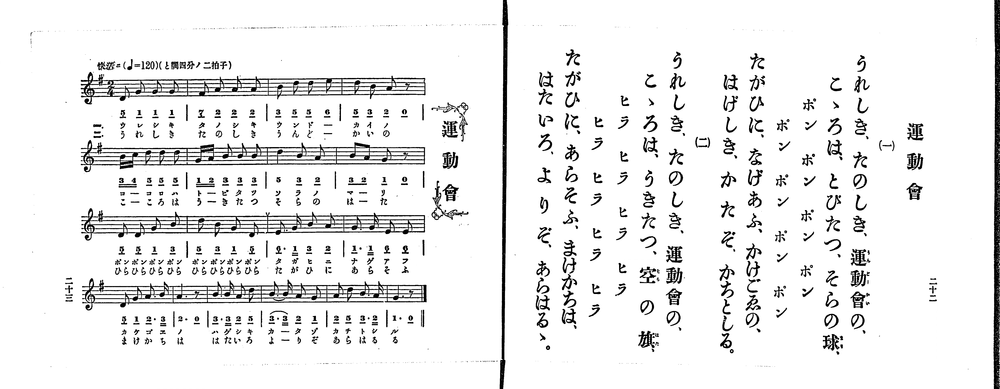

# 運動會

> Re:Shōka 使用 AI 協助辨識與重建樂譜，可能會有錯誤。歡迎回報。

- **鋼琴伴奏版**：<br><audio controls src="undokai.mp3"></audio>
- **NEUTRINO 歌聲合成版**：<br><audio controls src="undokai_neutrino.mp3"></audio>

- 出處：共益商社樂器店《唱歌教科書 生徒用 巻一》第二十二～二十三頁（第十一曲）
- NDL Digital Collections PID 854862（https://dl.ndl.go.jp/pid/854862）掃描 P013.jpg

## 說明

原書資訊與歌詞全文（NDL PID 854862《唱歌教科書 生徒用 巻一》第二十二～二十三頁，掃描 P013.jpg）：
調性與拍號：と調四分ノ二拍子（G 大調 2/4 拍），♩=120，「快活ニ」
註記：第二學期第四曲（全卷第十一曲）。全曲十八小節（前三行各四小節，第四行六小節），分節歌，二節同一旋律。第十小節末印有換氣記號（V）。第十六小節首二音「3_. 3__」印有圓滑線（配字「カータゾ」／「よーりぞ」）。第二節「ヒラ ヒラ ヒラ ヒラ」右頁印片假名，譜下配字印平假名。五線譜與簡譜一致。


## 歌詞

```text
一、
うれしき、たのしき、運動會の、
こゝろは、とびたつ、そらの球、
ポン　ポン　ポン　ポン
ポン　ポン　ポン　ポン
たがひに、なげあふ、かけごゑの、
はげしき、かたぞ、かちとしる。

二、
うれしき、たのしき、運動會の、
こゝろは、うきたつ、空の旗、
ヒラ　ヒラ　ヒラ　ヒラ
ヒラ　ヒラ　ヒラ　ヒラ
たがひに、あらそふ、まけかちは、
はたいろ、よりぞ、あらはるゝ。
```

## ABC

```abc
X:1
T:運動會
M:2/4
L:1/16
Q:1/4=120
K:G
V:V1 name="Piano" snm="Pia"
[V:V1]
D2 G2 G2 G2 | F2 A2 A2 A2 | B2 d2 d2 e2 | d2 B2 A2 z2 |
w: 1.~う れ し き | た の し き | う ん ど _ | か い の
w: 2.~う れ し き | た の し き | う ん ど _ | か い の
B c d2 d2 d2 | G A B2 B2 B2 | d4 B2 A2 | B2 A2 G2 z2 |
w: 1.~こ _ こ ろ は | と _ び た つ | そ ら の | ま _ り
w: 2.~こ _ こ ろ は | う _ き た つ | そ ら の | は _ た
D2 D2 G2 B2 | d2 B2 G2 D2 | E3 G B2 A2 | G3 G E2 E2 |
w: 1.~ぽん ぽん ぽん ぽん | ぽん ぽん ぽん ぽん | た が ひ に | な げ あ ふ
w: 2.~ひら ひら ひら ひら | ひら ひら ひら ひら | た が ひ に | あ ら そ ふ
D2 G2 A3 B | A6 z2 | B3 B A2 d2 | B3 B A2 G2 |
w: 1.~か け ご ゑ | の | は げ し き | か _ た ぞ
w: 2.~ま け か ち | は | は た い ろ | よ _ り ぞ
A2 d2 B3 A | G6 z2 |
w: 1.~か ち と し | る
w: 2.~あ ら は る | る
```

## TMD 檔案連結

- [主旋律 TMD 檔案](undokai.tmd) [[在 TMD Studio 編輯](https://tmdlang.github.io/Tmd-TS/#tmd=s7IKdvYPcrWy4qpTUCpJTLdSSM7PyUlNLsnMz7PKrsxPzc6ML87Iz05Ugisoy88pzU21yk7MizeMtzA1sTAzQkgW55cWJadaFSdn5OfnxJekVpQk5edno8vHFySmp1oFGBgaI2QKivLLUvMS84C6C4oy80pSU8DaEQpSyzJTUkHSxclAq8tSizLTMlNTkNyVWlQMcjXUipKixLzi5KLMApBXEKrSU_OKUq2SMzJzUopS8-KL8_PSEZJp-UW5VsUlRfkFGZnJCOGSjFSgh6F-yslMS8WQKsgvQnJpflFmemaeVW5qZlYmUhhoaSm8bOx-2j312ZxmBS0tLkVbBUMjAy57WwV3LhsjfRM7kAFP23e9mDn1_Z5ZT1s3Pp_d9XRq2_Ml-56taHo6c8XTXdMfN3Q9nbLx2dqeZ1NnPl8-8dnsHQrPp8x_um_S8ykrFJ5u3_1kR8Pjhu7na9Y82dXztLcRSL7fOw_K3tH5ckHj-z0dQFkwt-HZ7E3v93SCne3n4qPgAnR0SWKOgjM8ARQrBHi6KECiGKgxo6SkoNhKXz8lRy8PiNPz9bIK9AsyU_RhKjqf9TU_6-9XAEUsUA4YsFz6Wgq21AJcCgoKT_vmAz39YnP7ixVdLzragSHxYuW8p60rnk1rB7oQ5A2Ek6kQWD1oPgL6ERg1IIe8WLX_WcNykBO6e1_MnA8Ufdy4Aij4dPbspx1tj5v7gAYBpZ6unQB0l7vC0yXLgZIKwFhWAIqCjel5NHOlLTABAFmPG3qe7l_9bMvux83djxt6weav2P1ixQygsVD3rd3xbM58UNTNng2Otw6gp5_2bkeLzMcNTaDAmL0JKPi0dfXTDf3P1zeAFHf2Ar30YmHP0wktIBdCxXsgBoLEW9fCBEFOA3oByAYGHZANtB3IfjqhB2TL9O6n-4BObILYC9HybM7qp70bns3pfNY_-9mGxUBngwOkIwziIKhSmAUvl00Dmvhy_magp43j9RSM4-OBXoYY8HTO5Ge7Jz7fPguo-2UrMPCACb7ncdPqx817Hjftf9y0D6jy_Z5-sGAHWLDrceM8sCDUJohjQQqaJz1uXqmAjQJZ178ZGL9AS593tj9tbH86AWhCz4u1c57s6IbYC5R6unMzRApo8pNdU4CuAioARvjzDQvBKhtetG8BSnGBYguclBpBrMeNbY-beh43Tn_cCNTY-Lhx_uPGdXAuPP-DBGEaJj9umvu4qfdx43qwhhWPGzeDtS0Bc4FSnUDVzyc0wzQ0z33cDAy9BlwM4hWBbAG6ddPjxtVgu1Y9bpz0uLHpceNWMLf7cePEx41THjcBSYRz14MVwf0HVAQ0BRgJEPZCsAemP24CpRJI2OwCpm8qhU0bSCksbJ6v3AVU-mw6MJFAAwYSu0AfYmcQrwg9YJrAkTAXFjD7wAED8S3IYfCAAWprATkXqAiYQKGpE65_PShUgP4BBgxQA-UFIhQoaOlzcYXmpQBr6UyrgMzEvHyHGoOaapAdCjaGZlp2YBawJH7ctAzo_zVAejsQr1WoAZL7gSJ9KCIgNZuBuBOI94BFVgPxErA6oE0gs2oUTOMVdBUMkXCNgjlIyAgJ1ygYA0lTKDYDi4BYIFGQvAFIBGyejyHQmsY2IB-YPkBk43Qw2QvWAwxWMG8dFhmInslgsZVAEgRB4t1gkRa4PpDboHYZ0c8ucJiDwnIPlF4LxP0gTc0dENHmydA4aAGH9F4gC1RM9YHVzIOqWYUId2MFE3iIgnANMPCNwCEKw5AwBkFYOEPiAcQCRRR6qEP8AyabQD4FJlOov1aAeZvBJCRUlkBl5kJtAKZquK9B4vvg4l1Ywhy3TeCQBYczsTaBdILFwepRQxxcvmGnQKGKVxYUF03AHNI8CYi7weq7gCKbgHgRkD0VLQfAswEi5EEskAhYqkbBDESBRBCxAZIFiYClwARyfOyFJTGcDOJVgcIGJNQDxJvArNVQmVVQGaA3G5vArK1osbUJFuQ4GcSrwu0OkN2Q2IXENbI7wLkHVPZsBOItQLwCHB-QvNEPjRVEuQVUCc5noBjcBxdphOQ1oDqQrtVYSjBQpICirQbKgkBwNgFHGkgOJAPJbsgikHIPJgeRMYJHMJI5SNELKSwmgskpUM9PBAcFKGnDICTtwJI5JJpQCyOQOYgMAKxnkMSB9RKYBGVgSDEGCg2YDrj5SJENyrgwV0HUgcxAzmjYXDUfiMHFHjg7g-zogLkKXAAgXAVOYtB0AdUNdA92V9VycenaKUDrMwUgU5kLAA)]
- [鋼琴伴奏 TMD 檔案](undokai_piano.tmd) [[在 TMD Studio 編輯](https://tmdlang.github.io/Tmd-TS/#tmd=s7IKdvYPcrWy4tLSUnjZ2P20e-qzOc3v93S87N7zfMKWJ3u2PF3a_7yz4_2eTgUtLS5FWwVDIwMue1sFdy4bI30TO646BaWn7btezJz6fs-sp60bn8_uejq17fmSfc9WND2dueLprumPG7qeTtn4bG3Ps6kzny-f-Gz2DoXnU-Y_3Tfp-ZQVCk-3736yo-FxQ_fzNWue7Op52tsIJN_vnQdl7-h8uaAR6BigLJjb8Gz2JqBLlEC2-rn4KLhkpmeWJOYoOOfn5KQml2Tm5xUrBHi6KFiYmliYGQE1ZpSUFBRb6eun5OjlAXF6vl5WgX5BZoo-TEXns77mZ_39CgEGhsZAuXQlLq7QvJT87MRMq4DMxLz8IA-HGoOaai4FILAxNNOyA7P0tRQeNy1TeNy8BkhvB-K1CjVAcj9QpA9FBKRmMxB3AvEesMhqIF4CVqelDzarRsE0XkFXwRAJ1yiYg4SMkHCNgjGQNIViM7AIiAUSBckbgETA5vkYAq1pbAPyHzf1gMjG6WCyF6znceN8MG8dFhmInslgsZVAEgRB4t1gkRa4PpDboHYZ0c8ucJiDwnIPlF4LxP0gTc0dENHmydA4aAGH9F4gayU4pEFq5kHVrEKEu7GCCTxEQbgGGPhG4BCFYUgYgyAsnCHxAGKBIgo91CH-AZNNIJ8-blwP9dcKMG8zmISEyhKozFyoDY-bOuG-Bonvg4t3YQlz3DaBQxYczsTaBNIJFgerRw3x5rmQBIyFAoUqXllQXDQBc0jzJCDuBqvvAopsAuJFQPZUtBwAzwaIkAexQCJgqRoFMxAFEkHEBkgWJAKWAhPI8bEXlsRwMohXBQobkFAPEG8Cs1ZDZVZBZYDebGwCs7aixdYmWJDjZBCvCrc7QHZDYhcS18juAOceUNmzEYi3APEKcHxA8kY_NFYQ5RZQJTifgWJwH1ykEZLXgOpAulZjKcFAkQKKthooCwLB2QQcaSA5kAwkuyGLQMo9mBxExggewUjmIEUvpLCYCCanQD0_ERwUoKQNg5C0A0vmkGhCLYxA5iAywOPGeUjijxsXgklQBoYUY6DQgOmAm48U2aCMC3MVRB3IDOSMhs1V84EYXOyBszPIjg6Yq8AFAMJV4CQGTRdQ3UD3YHdVLVp15oNcnZkgarMXfV0v23uftu54ObsVUucjItcwXiHaMBbIAMUzkG0aD-GYANkm6OJQPVjlcHMwbSJkKTzhETYcm00oskC7DCBhpWunAA2uaB-g7chcIzBXmQsA)]

## 分析

```text
================================================================================
📊 TMD Song Profile: [ 運動會 ]
================================================================================
⏱  Duration:       0:18 (18.0s), 18 measures total
🎼 Key & Tempo:    首調基準 G, != 120.0 BPM, <2/4>
   - 分析範圍：      由實際發聲的音符與和弦推測調性；播放脈絡另行呈現
🎤 人聲音域:    D4 (MIDI 62) – E5 (MIDI 76) [跨度: 14 個半音 / 1.2 個八度, 難度: moderate]
   - 最低音:  D4 in [Undokai #1 @ m.1, 0:00]
   - 最高音: E5 in [Undokai #1 @ m.3, 0:02]
   - 適合: soprano, mezzo-soprano, contralto, tenor, baritone, bass
🏛  結構:      Undokai (18.0s)
⚡ 編曲密度:        Peak 1 軌道同時演奏
🗝  調性診斷：       D 調性不明確（純淨自然大調，未偵測到可信轉調）
   - 風格氣質:    純淨自然大調（陽光明朗、易唱易記，無明顯調外色彩）
   - 轉調歷程:    全曲維持單一推測調性（未偵測到可信轉調）
   - 核心骨幹音:  B, D, A, G, E
   - 調性數值:    D 調性不明確 [相關度: 0.78, 穩定度: Ambiguous, 自然音純度: 99.3%]
   - 候選調性 (K-S): D 大調 (0.78), G 大調 (0.77), B 小調 (0.69)
   - 五度圈歷程:   +2
   - 各段落調性細節:
     • [Undokai #1]: D 調性不明確 (r: 0.78, 自然音純度: 99.3%, 調外音: C)

  [ 五度圈游移軌跡 ]
               C  
         F            G  
      Bb              [D ]*
      Eb               A  
         Ab           E  
            Db       B  
               F# 
     (* = active key center)

  [ 十二半音累積音高分佈 ]
     C  : █                          0.7%
     C# :                            0.0%
     D  : ███████████████████████   23.5%
     D# :                            0.0%
     E  : ███████                    6.6%
     F  :                            0.0%
     F# : █                          1.5%
     G  : ████████████████████      20.6%
     G# :                            0.0%
     A  : ███████████████████████   22.8%
     A# :                            0.0%
     B  : ████████████████████████  24.3%
--------------------------------------------------------------------------------
Assignment 軌道音域：
  - Piano         : D4 – E5 (14 個半音 / 1.2 個八度, 65 個音符)
================================================================================
```


## 原書掃描頁




