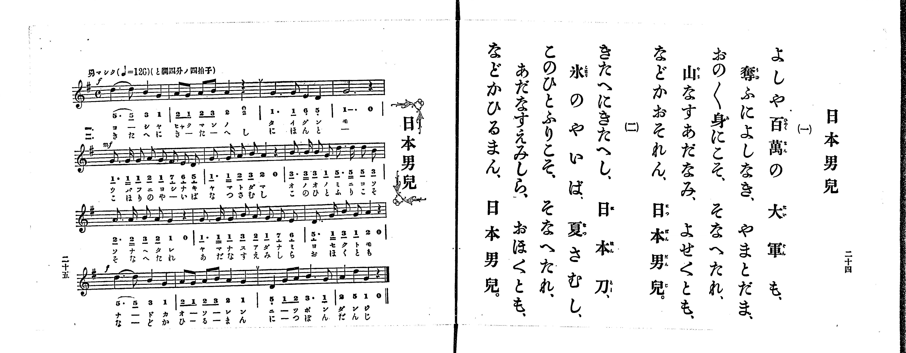

# 日本男兒

> Re:Shoka 使用 AI 協助辨識與重建樂譜，可能會有錯誤。歡迎回報。

<audio controls src="nihon_danji.mp3"></audio>

- 出處：共益商社樂器店《唱歌教科書 生徒用 巻一》第二十四～二十五頁（第十二曲）
- NDL Digital Collections PID 854862（https://dl.ndl.go.jp/pid/854862）掃描 P014.jpg

## 說明

原書資訊與歌詞全文（NDL PID 854862《唱歌教科書 生徒用 巻一》第二十四～二十五頁，掃描 P014.jpg）：
調性與拍號：と調四分ノ四拍子（G 大調 4/4 拍），♩=126，「勇マシク」
註記：第二學期第五曲（全卷第十二曲）。全曲十四小節（第一、四行各四小節，第二、三行各三小節），分節歌二節。開頭標 f，第二行（第五小節起）標 mf，第四行（第十一小節起）標 f。第二、十二小節末印有換氣記號（V）。第一、十一小節首二音「5. 5_」印有圓滑線。第二小節第四拍五線譜與簡譜皆上下並記四分休止符（0）與四分音符（2，A4）：第一節「百萬の」（ヒャクマンノ）於第四拍休止，第二節「きたへし」（きーたーへし）於第四拍唱「2」（し），故分別建立 NihonDanji1 與 NihonDanji2 依序播放。五線譜與簡譜一致。

## 歌詞

```text
一、
よしや百萬の、大軍も、
奪ふによしなき、やまとだま、
おの〳〵身にこそ、そなへたれ、
山なすあだなみ、よせくとも、
などかおそれん、日本男兒。

二、
きたへにきたへし、日本刀、
氷のやいば、夏さむし、
このひとふりこそ、そなへたれ、
あだなすえみしら、おほくとも、
などかひるまん、日本男兒。
```

## ABC

```abc
X:1
T:日本男兒
M:4/4
L:1/16
Q:1/4=126
K:G
V:V1 name="Piano" snm="Pia"
[V:V1]
!f! d6 d2 B4 G4 | A2 G2 A2 B2 A4 z4 | G6 G2 E4 D4 | G12 z4 |
!mf! G3 G G2 A2 G2 F2 E2 D2 | G3 G A2 B2 A4 z4 | B3 B B2 G2 d3 d d2 B2 | A3 A B2 A2 G4 z4 |
G3 G G2 B2 A2 G2 F2 E2 | D3 G B2 G2 A4 z4 | !f! d6 d2 B4 G4 | A2 G2 A2 B2 A4 G4 |
D4 G2 A2 B6 G2 | A4 d4 G4 z4 | !f! d6 d2 B4 G4 | A2 G2 A2 B2 A4 A4 |
G6 G2 E4 D4 | G12 z4 | !mf! G3 G G2 A2 G2 F2 E2 D2 | G3 G A2 B2 A4 z4 |
B3 B B2 G2 d3 d d2 B2 | A3 A B2 A2 G4 z4 | G3 G G2 B2 A2 G2 F2 E2 | D3 G B2 G2 A4 z4 |
!f! d6 d2 B4 G4 | A2 G2 A2 B2 A4 G4 | D4 G2 A2 B6 G2 | A4 d4 G4 z4 |
```

## TMD 檔案連結

- [主旋律 TMD 檔案](nihon_danji.tmd) [[在 TMD Studio 編輯](https://tmdlang.github.io/Tmd-TS/#tmd=s7IKdvYPcrWy4qpTUCpJTLdSSM7PyUlNLsnMz7PKrsxPzc6ML87Iz05Ugisoy88pzU21yk7MizeMtzA1sTAzQkgW55cWJadaFSdn5OfnxJekVpQk5edno8vHFySmp1oFGBiaIGQKivLLUvMS84C6C4oy80pSU8DaEQpSyzJTUkHSxclAq8tSizLTMlNTkNyVWlQMcjXUipKixLzi5KLMApBXEKrSU_OKUq2SMzJzUopS8-KL8_PSEZJp-UW5VsUlRfkFGZnJCOGSjFSgh3MzczJLEosqlbi0tBSeTV_6bM6a51O2P22dpKClxaVoq2BoZMZlb6vgzmVjom9iB9L8tH3Xi5lT3--Z9bR14_PZXU-ntj1fsu_ZiqanM1c83TX9cUPX0ykbn63teTZ15vPlE5_N3qHwfMr8p_smPZ-yQuHp9t1PdjQ8buh-vmbNk109T3sbn86e_X7vPAj7ya4pLxc0vt_TAZQFc3uezd70fk8n2Ml-Lj4KLpnpQLfmKDjDI7NYIcDTRQESXUCNGSUlBcVW-vopOXp5QJyer5dVoF-QmaIPU9H5rK_5WX-_AiiSgHLAQOLS11KwpRbgUlBQeNo3H-jpF5vbX6zoetHRDgyJFyvnPW1d8WxaO9CFIG8gnEyFwOpB8xHQj8CoATnkxar9zxqWg5zQ3fti5nyg6OPGFUBBoClPO9oeN_cBGUCpp2snAN3lrvB0yXKgpAIwlhWAomBjeh7NXGkLTABA1uOGnqfd7Y-b5z1u2v64af3jhl6wFSt2v1gxA2gy1IlrdzybMx_MngKOug6gv5_2bkeLz8cNTaDwmL0J4qWnG_qfr2-ARDvYwyDBFwt7nk5oQZLtgVgBlH2yoxMiC2TAZEGOBXoKyAYGJlAZkAG05eW07pcL1j5bMVMhDW4AUCvUql1TILpfbN0OShhAVblQZRD7EQlxRwO6yjSg6XAHQfwGUfJszuqnvRuezel81j_72YbFwNABB31HGMTfCC8iGfty2TSg_pfzNwMD2VRPwTQeGLoQQ57Omfxs98Tn22fBrYPogLgRGE1ATwBlX6ydA4zm5xsWAhnPZ7U92dH1ZEf3kx3LgLZDIvvJnonP1i56vmYZ0CUGQJcAVUMkgJZCRIF5o8fRBJJ4II4EB2HP85n7XkxY87hxHdBNQGWPmyc9bl4MSgDAlNC8GZiIQAEybQ_CQWCb4KENMeRxY-_jxvmPG3c8bgSWD2BzgCLNe0CCIBIkjmYOMFsANQIzCEQ1SBqU1qe2Ah39tGPp0927nq_uVvDLzMjPc0nMy8o0VAD6CYlvpPBk39ynu_qfTVr7bMo-YPBhhhTQjy_atwCluEBJGRItINbjJpCFj5takPzeCModu3sfNzVBFT1duupx49bHjauhqhuB3F6gHFDb48Z9wIz2uHEBiAE1srELbAwwhre-2LUapK1x8uPGuSANQBKkGRgG8x83gZIT2PiNG8GiMx83NoFNArL3g40H2jb7cWM_yAa4Y8DSKx83doPtmQsypmkyUA65OIf7E5xkIbrgsQJ0DnIMQTU-7YAFybMN20HuB_kNiDaAwwPohKmPmxogGiDmAb207nHjJrDvtz5uAroFryeR_Ab0J9Bj-8HhDswnQA1Azbvx-HPT4yYguQ-7P4FKKS_LoUBBS5-LCymdWQVkJublO9QY1ChUgyxSsDE007IDs6rTasE0sEZ53LwCiPcA09J2IL1EoQZIgnIOUGA9kDkPiDcDcR9Iomk_EC8B4g1gUZDSRSBbQUbVKJgq6MIhiG0MZRtC6RoFIygPRINkQTQIGsBVwNTC9JnFwwyEMVDVIEO4KRAv5iL5sWkZ0KkTgHgqEHdD_Az2bxeQXgv2CNBbYM92AHEDmA3y8Cqw1-F083yI_iZgkDTtRXgd4iRDuOdAtDnIxWD3g92OUITb95AQMwbTINWQEDWFhybEZ2AP7YU4vnkGJFaa16B4AuStnUC8COoZkMr5YBUgj--Gxi3Iq0jxB3GPEdxtsHBGjx2IN5FVIbwKTAWQiDKEewLDm5gpEOQ8YAps7gQ6bDU83EFpEuRNkMwaeIIDxR5IpBmI58JFQZ4ExckOaiRHhAp4qkNWhpw-YaEGiyssocZVi5wrjYjMlY29QAxMbY07gBgcJiARkM9BomAaJDMdLLMaiEGROhlIrwCHxx5qhAOMplm2bAQ5GORwYAJoXAekW6BeA9KNG8BeAyaERmCqbgRm3CZgJEM9DNIHVN-4CexhYBEONQMkPncAsyXQcoiTQXEDjKemHrBzm4B4AVRmJhADM14jMNMCPQOsQ8AqQI4HBkRjP8RDTU2DIFuCnAuOjZVA3A12JjC8wdkSmgkb94ETHTQJgkVAcQXMtFBRoKfBiXLG4MyWunYo7TIULtAAOwVlLgA)]

## 分析

```text
================================================================================
📊 TMD Song Profile: [ 日本男兒 ]
================================================================================
⏱  Duration:       0:53 (53.3s), 28 measures total
🎼 Key & Tempo:    首調基準 G, != 126.0 BPM, <4/4>
   - 分析範圍：      由實際發聲的音符與和弦推測調性；播放脈絡另行呈現
🎤 人聲音域:    D4 (MIDI 62) – D5 (MIDI 74) [跨度: 12 個半音 / 1.0 個八度, 難度: easy]
   - 最低音:  D4 in [NihonDanji1 #1 @ m.3, 0:05]
   - 最高音: D5 in [NihonDanji1 #1 @ m.1, 0:00]
   - 適合: soprano, mezzo-soprano, contralto, tenor, baritone, bass
🏛  結構:      NihonDanji1 (26.7s) -> NihonDanji2 (26.7s)
⚡ 編曲密度:        Peak 1 軌道同時演奏
🗝  調性診斷：       G 大調（純淨自然大調，未偵測到可信轉調）
   - 風格氣質:    純淨自然大調（陽光明朗、易唱易記，無明顯調外色彩）
   - 轉調歷程:    全曲維持單一推測調性（未偵測到可信轉調）
   - 核心骨幹音:  G, A, D, B, E
   - 調性數值:    G 大調 [相關度: 0.86, 穩定度: High, 自然音純度: 100.0%]
   - 候選調性 (K-S): G 大調 (0.86), D 大調 (0.68), G 小調 (0.54)
   - 五度圈歷程:   +1 -> +1
   - 各段落調性細節:
     • [NihonDanji1 #1]: G 大調 (r: 0.86, 自然音純度: 100.0%)
     • [NihonDanji2 #1]: G 大調 (r: 0.85, 自然音純度: 100.0%)

  [ 五度圈游移軌跡 ]
               C  
         F           [G ]*
      Bb               D  
      Eb               A  
         Ab           E  
            Db       B  
               F# 
     (* = active key center)

  [ 十二半音累積音高分佈 ]
     C  :                            0.0%
     C# :                            0.0%
     D  : █████████████             19.3%
     D# :                            0.0%
     E  : ███                        4.0%
     F  :                            0.0%
     F# : █                          2.0%
     G  : ████████████████████████  36.1%
     G# :                            0.0%
     A  : ██████████████            21.8%
     A# :                            0.0%
     B  : ███████████               16.8%
--------------------------------------------------------------------------------
Assignment 軌道音域：
  - Piano         : D4 – D5 (12 個半音 / 1.0 個八度, 143 個音符)
================================================================================
```


## 原書掃描頁




