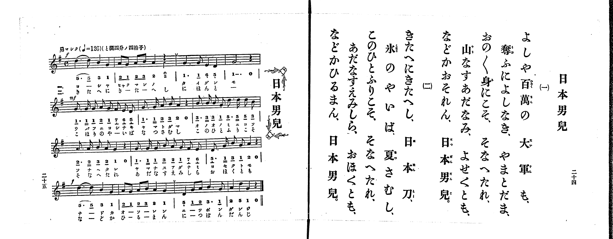

# 日本男兒

> Re:Shōka 使用 AI 協助辨識與重建樂譜，可能會有錯誤。歡迎回報。

- **鋼琴伴奏版**：<br><audio controls src="nihon_danji.mp3"></audio>
- **NEUTRINO 歌聲合成版**：<br><audio controls src="nihon_danji_neutrino.mp3"></audio>

- 出處：共益商社樂器店《唱歌教科書 生徒用 巻一》第二十四～二十五頁（第十二曲）
- NDL Digital Collections PID 854862（https://dl.ndl.go.jp/pid/854862）掃描 P014.jpg

## 說明

原書資訊與歌詞全文（NDL PID 854862《唱歌教科書 生徒用 巻一》第二十四～二十五頁，掃描 P014.jpg）：
調性與拍號：と調四分ノ四拍子（G 大調 4/4 拍），♩=126，「勇マシク」
註記：第二學期第五曲（全卷第十二曲）。全曲十四小節（第一、四行各四小節，第二、三行各三小節），分節歌二節。開頭標 f，第二行（第五小節起）標 mf，第四行（第十一小節起）標 f。第二、十二小節末印有換氣記號（V）。第一、十一小節首二音「5. 5_」印有圓滑線。第二小節第四拍五線譜與簡譜皆上下並記四分休止符（0）與四分音符（2，A4）：第一節「百萬の」（ヒャクマンノ）於第四拍休止，第二節「きたへし」（きーたーへし）於第四拍唱「2」（し），故分別建立 NihonDanji1 與 NihonDanji2 依序播放。五線譜與簡譜一致。


## 歌詞

```text
一、
よしや百萬の、大軍も、
奪ふによしなき、やまとだま、
おの〳〵身にこそ、そなへたれ、
山なすあだなみ、よせくとも、
などかおそれん、日本男兒。

二、
きたへにきたへし、日本刀、
氷のやいば、夏さむし、
このひとふりこそ、そなへたれ、
あだなすえみしら、おほくとも、
などかひるまん、日本男兒。
```

## ABC

```abc
X:1
T:日本男兒
M:4/4
L:1/16
Q:1/4=126
K:G
V:V1 name="Piano" snm="Pia"
[V:V1]
!f! d6 d2 B4 G4 | A2 G2 A2 B2 A4 z4 | G6 G2 E4 D4 | G12 z4 |
w: よ _ し や | ひゃ く ま ん の | た い ぐ ん | も
!mf! G3 G G2 A2 G2 F2 E2 D2 | G3 G A2 B2 A4 z4 | B3 B B2 G2 d3 d d2 B2 | A3 A B2 A2 G4 z4 |
w: う ば ふ に よ し な き | や ま と だ ま | お の お の み に こ そ | そ な へ た れ
G3 G G2 B2 A2 G2 F2 E2 | D3 G B2 G2 A4 z4 | !f! d6 d2 B4 G4 | A2 G2 A2 B2 A4 G4 |
w: や ま な す あ だ な み | よ せ く と も | な _ ど か | お _ そ _ れ ん
D4 G2 A2 B6 G2 | A4 d4 G4 z4 | !f! d6 d2 B4 G4 | A2 G2 A2 B2 A4 A4 |
w: に _ つ ぽ ん | だ ん じ | き た へ に | き _ た _ へ し
G6 G2 E4 D4 | G12 z4 | !mf! G3 G G2 A2 G2 F2 E2 D2 | G3 G A2 B2 A4 z4 |
w: に ほ ん と | _ | こ ほ り の や _ い ば | な つ さ む し
B3 B B2 G2 d3 d d2 B2 | A3 A B2 A2 G4 z4 | G3 G G2 B2 A2 G2 F2 E2 | D3 G B2 G2 A4 z4 |
w: こ の ひ と ふ り こ そ | そ な へ た れ | あ だ な す え み し ら | お ほ く と も
!f! d6 d2 B4 G4 | A2 G2 A2 B2 A4 G4 | D4 G2 A2 B6 G2 | A4 d4 G4 z4 |
w: な _ ど か | ひ _ る _ ま ん | に _ つ ぽ ん | だ ん じ
```

## TMD 檔案連結

- [主旋律 TMD 檔案](nihon_danji.tmd) [[在 TMD Studio 編輯](https://tmdlang.github.io/Tmd-TS/#tmd=s7IKdvYPcrWy4qpTUCpJTLdSSM7PyUlNLsnMz7PKrsxPzc6ML87Iz05Ugisoy88pzU21yk7MizeMtzA1sTAzQkgW55cWJadaFSdn5OfnxJekVpQk5edno8vHFySmp1oFGBiaIGQKivLLUvMS84C6C4oy80pSU8DaEQpSyzJTUkHSxclAq8tSizLTMlNTkNyVWlQMcjXUipKixLzi5KLMApBXEKrSU_OKUq2SMzJzUopS8-KL8_PSEZJp-UW5VsUlRfkFGZnJCOGSjFSgh3MzczJLEosqEeL5RZnpmXlWuamZWZlIftXSUng2femzOWueT9n-tHWSgpYWl6KtgqGRGZe9rYI7l42JvokdyIyn7btezJz6fs-sp60bn8_uejq17fmSfc9WND2dueLprumPG7qeTtn4bG3Ps6kzny-f-Gz2DoXnU-Y_3Tfp-ZQVCk-3736yo-FxQ_fzNWue7Op52tv4dPbs93vnQdhPdk15uaDx_Z4OoCyY2_Ns9qb3ezrBLvdz8VFwAbq7JDFHwRke18UKAZ4uCpDYBGrMKCkpKLbS10_J0csD4vR8vawC_YLMFH2Yis5nfc3P-vsVQHEIlAOGIZe-loIttQCXgoLC0775QE-_2Nz-YkXXi452YEi8WDnvaeuKZ9PagS4EeQPhZCoEVg-aj4B-BEYNyCEvVu1_1rAc5ITu3hcz5wNFHzeuAAoCTXna0fa4uQ_IAEo9XTsB6C53hadLlgMlFYCxrAAUBRvT82jmSltgAgCyHjf0PO1uf9w873HT9sdN6x839IKtWLH7xYoZQJOhTly749mc-WD2FHDUdQD9_bR3O1p8Pm5oAoXH7E0QLz3d0P98fQMk2sEeBgm-WNjzdEILkmwPxAqg7JMdnRBZIAMmC3Is0FNANjAwgcqADKAtL6d1v1yw9tmKmQppcAOAWqFW7ZoC0f1i63ZQwgCqyoUqg9iPSIg7GtBVpgFNhzsI4jeIkmdzVj_t3fBsTuez_tnPNiwGhg446DvCIP5GeBHJ2JfLpgH1v5y_GRjIpnoKpvHA0IUY8nTO5Ge7Jz7fPgtuHUQHxI3AaAJ6Aij7Yu0cYDQ_37AQyHg-q-3Jjq4nO7qf7FgGtB0S2U_2THy2dtHzNcuALjEAugSoGiIBtBQiCswbPY4mkMQDcSQ4CHuez9z3YsKax43rgG4CKnvcPOlx82JQAgCmhObNwEQECpBpexAOAtsED22IIY8bex83zn_cuONxI7B8AJsDFGneAxIEkSBxNHOA2QKoEZhBIKpB0qC0PrUV6OinHUuf7t71fHW3gl9mRn6eS2JeVqahAtBPSHwjhSf75j7d1f9s0tpnU_YBgw8zpIB-fNG-BSjFBUrKkGgBsR43gSx83NSC5PdGUO7Y3fu4qQmq6OnSVY8btz5uXA1V3Qjk9gLlgNoeN-4DZrTHjQtADKiRjV1gY4AxvPXFrtUgbY2THzfOBWkAkiDNwDCY_7gJlJzAxm_cCBad-bixCWwSkL0fbDzQttmPG_tBNsAdA5Ze-bixG2zPXJAxTZOBcsjFOdyf4CQL0QWPFaBzkGMIqvFpByxInm3YDnI_yG9AtAEcHkAnTH3c1ADRADEP6KV1jxs3gX2_9XET0C14PYnkN6A_gR7bDw53YD4BagBq3o3Hn5seNwHJfdj9CVRKeVkOBQpa-lxcSOnMKiAzMS_focagphpkj4KNoZmWHZhVnVYLpoEVyuPmFUC8B5iUtgPpJQo1QBKUcYAC64HMeUC8GYj7QBJN-4F4CRBvAIuClC4CWQoyqkbBVEEXDkFsYyjbEErXKBhBeSAaJAuiQdAArgKmFqbPLB5mIIyBqgYZwk0Bu8cH5N4ONCXASIOxmlrgBoKjqBks3Q8m94EVTAaz10GVIewHJgwUI0EGPW6cADcYpA-qsqkJh1vhpkGiIxcpPpqWAYN1AhBPBeJuSPyA46YLSK8FBzowCsAR0wHEDWA2yK5V4GiC083zIfqbgNHXtBcRTZDgM4RHBIg2B7kHHNbgcEYowh1TkNg1BtMg1ZDYN4XHPCIWGtugAQVMNY1bwazV4IACxQ4kRoC5BUz2QoMNEjegiABmKjBrAZSPGRldULXroGxIlAFzKFR8NSi3g1lz4c4Ch_NeSJg2z4Ak7OY1KGELCu2dQLwIGsYglfPBKkDxsRuaPUAxgJQFIMFkBA8yWFJFT-CQ0EdWhYgBYEaCeM8QHrYYoY8IW5CfIOEHLLLALFDiBBZcmCGFEqqQ8J4JJkGJFBbCEHFQ2CHyD7AYh2cNcGzAkzVaMkYuVUDhBSxVmjuBylfD0yeonAGFO0hmDbwQAaVykEgzEM-Fi4JCHZR2d1CjiEGogJckyMpgECQGi0ZYmsYSjYjwB4UXMgQW-nBWN9xOWCqFpUIwCx5HKEUGOG8gTFsCJvcii4FVg1SCYgxV_-PGGVAWImZqkesEI-LqBGBGBCUkUJICOQhkGVAEFEcgUTANkpkOdTCw_gM7ApQ8QDG3hxoxBqOpXSmACxlEAIOzCzjrQPiw4EdWiSjxkVXCqhLMSNsNIpEiBZRpICqxOxJvfQAsvCDhC8xRoEIOmI0hMQCkgUUqJBGCEgqwkQOUBeYaaLyA9IEKxU1gF4CKXogZIPG5A1kfQAIG5il4iQ2vkWFV6gZo4ELyGMyLIJUNYD4sApBrA5jZEI_DSyxwvQPSCQkAzNoAyIUVouA0DsycIOOawNkMIjMTiIHlPbBwBFkNbPxBMzbYI8DiERzKwKJxaNQG4FIfUu6j1gaQWhlUA0DrZqBHUWtaiHdJqQ1ADgKn2ZVA3A1pckFrA2jZD6qUgDkGWp6ARUDRDawroKJAZ4JLmBnDoTYApUxIeoSJIto2NK8NdO1QOqMoXKBf7RSUuQA)]
- [鋼琴伴奏 TMD 檔案](nihon_danji_piano.tmd) [[在 TMD Studio 編輯](https://tmdlang.github.io/Tmd-TS/#tmd=s7IKdvYPcrWy4tLSUng2femzOWueT9n-tHXS-z0dL7v3PJ-w5cmeLU-X9j_v7Hi_p1NBS4tL0VbB0MiMy95WwZ3LxkTfxI6rTkHpafuuFzOnvt8z62nrxuezu55ObXu-ZN-zFU1PZ654umv644aup1M2Plvb82zqzOfLJz6bvUPh-ZT5T_dNej5lhcLT7buf7Gh43ND9fM2aJ7t6nvY2Pp09-_3eeRD2k11TXi5oBDoGKAvm9jybvQnoEiWQrX4uPgoumemZJYk5Cs75OTmpySWZ-XnFCgGeLgoWpiYWZkZAjRklJQXFVvr6KTl6eUCcnq-XVaBfkJmiD1PR-ayv-Vl_v0KAgaEJUC5diYvLLzMjP88lMS8r09AqIDMxLz_Iw6HGoKaaSwEIbAzNtOzArOq0WjCtr6XwuHkFEO9ReNy0HUgvUagBkpMeNy8GCqwHMucB8WYg7gNJNO0H4iVAvAEsClK6SEFLH2xUjYKpgi4cgtjGULYhlK5RMILyQDRIFkSDoAFcBUwtTJ9ZPMxAGANVDTKEmwJ2jw_IvR1oSh43ToexmlrgBj5u3PS4qRks3Q8m94EVTAaz10GVIex_3DgfxUiQQY8bJ8ANBumDqmxqwuFWuGmQ6MhFio-mZcBgnQDEU4G4GxI_4LjpAtJrwYEOjAJwxHQAcQOYDbJrFTia4HTzfIj-JmD0Ne1FRBMk-AzhEQGizUHuAYc1OJwRinDHFCR2jcE0SDUk9k3hMY-IhcY2aEABU03jVjBrNTigQLEDiZHHjavAZC802CBxA4qIx40rwKwFUD5mZHRB1a6DsiFR9rhxP1R8NRBDonIu3FngcN4LCdPmGZCE3bwGJWxBob0TiBdBwxikcj5YBSg-dkOzBygGkLIAJJiM4EEGS6roCRwS-siqEDEAzEgQ7xnCwxYj9BFhC_ITJPweN-4As0CJ83FTD2ZIoYQqJLxngklQIoWFMEQcFHaI_PO4cTY8a4BjA56s0ZIxcqkCCi9gqdLcCVS-Gp4-QeUMKNxBMmvghQgolYNEmoF4LlwUFOqgtLuDGkUMQgW8JEFWBoMgMVg0wtI0lmhEhD8ovJDh48aVcFY33E5YKoWlQjALHkcoRQY4byBMWwIm9yKLgVWDVIJiDFX_48YZUBYiZmqx1Ao-yLWCCbRSAEbbi76ul-29T1t3vJzdCqk-kcqNeIVow1gYVQMOSSDbND4WwYAEDFytCZAygahF0w2LT0wTEGpxmUqKC-hpLpAyQA9vI2JrYWDRB8q6oEwMSgKg6AWKgHIFSBRMg2SmQ5PI40ZQCTQZnCFBeWUPNfIIjKZ2NQwu1hFJGlxAgQsrCB-W4JFVIupYZJWwyhszm-wGkUjZAFRMQVRidyTeGhhYXUDCF1iGgaoVYMEJiQEgDazEINkelDUfNwLr6CZgOQWNF5A-UDW0CewCUGUHMQMkPncga2BIwMA8Ba8j4W0gWCNmAzRwIaUazIsglQ1gPiwCkOtfmNkQj8PrCHBND9IJCQDM-hfIhVVb4DQOLA5BxjWBCzaIzEwgBtawwOoIZPXjpk5oUQr2CLBCAocysDIaGvUvuJ6F1LSo9S-kHQSqc6GtIaBHUds2EO-SUv-CHAROsyuBuBtsGDBVgutfaG0LagYAcwy0PAGLgKIbWDtDRYHOBJcwM4ZD_QtKmZD0CBNFtCbpWP9C64PR-pem9a-unQJSk0cBhQtMW3YKylwA)]

## 分析

```text
================================================================================
📊 TMD Song Profile: [ 日本男兒 ]
================================================================================
⏱  Duration:       0:53 (53.3s), 28 measures total
🎼 Key & Tempo:    首調基準 G, != 126.0 BPM, <4/4>
   - 分析範圍：      由實際發聲的音符與和弦推測調性；播放脈絡另行呈現
🎤 人聲音域:    D4 (MIDI 62) – D5 (MIDI 74) [跨度: 12 個半音 / 1.0 個八度, 難度: easy]
   - 最低音:  D4 in [NihonDanji1 #1 @ m.3, 0:05]
   - 最高音: D5 in [NihonDanji1 #1 @ m.1, 0:00]
   - 適合: soprano, mezzo-soprano, contralto, tenor, baritone, bass
🏛  結構:      NihonDanji1 (26.7s) -> NihonDanji2 (26.7s)
⚡ 編曲密度:        Peak 1 軌道同時演奏
🗝  調性診斷：       G 大調（純淨自然大調，未偵測到可信轉調）
   - 風格氣質:    純淨自然大調（陽光明朗、易唱易記，無明顯調外色彩）
   - 轉調歷程:    全曲維持單一推測調性（未偵測到可信轉調）
   - 核心骨幹音:  G, A, D, B, E
   - 調性數值:    G 大調 [相關度: 0.86, 穩定度: High, 自然音純度: 100.0%]
   - 候選調性 (K-S): G 大調 (0.86), D 大調 (0.68), G 小調 (0.54)
   - 五度圈歷程:   +1 -> +1
   - 各段落調性細節:
     • [NihonDanji1 #1]: G 大調 (r: 0.86, 自然音純度: 100.0%)
     • [NihonDanji2 #1]: G 大調 (r: 0.85, 自然音純度: 100.0%)

  [ 五度圈游移軌跡 ]
               C  
         F           [G ]*
      Bb               D  
      Eb               A  
         Ab           E  
            Db       B  
               F# 
     (* = active key center)

  [ 十二半音累積音高分佈 ]
     C  :                            0.0%
     C# :                            0.0%
     D  : █████████████             19.3%
     D# :                            0.0%
     E  : ███                        4.0%
     F  :                            0.0%
     F# : █                          2.0%
     G  : ████████████████████████  36.1%
     G# :                            0.0%
     A  : ██████████████            21.8%
     A# :                            0.0%
     B  : ███████████               16.8%
--------------------------------------------------------------------------------
Assignment 軌道音域：
  - Piano         : D4 – D5 (12 個半音 / 1.0 個八度, 143 個音符)
================================================================================
```


## 原書掃描頁




