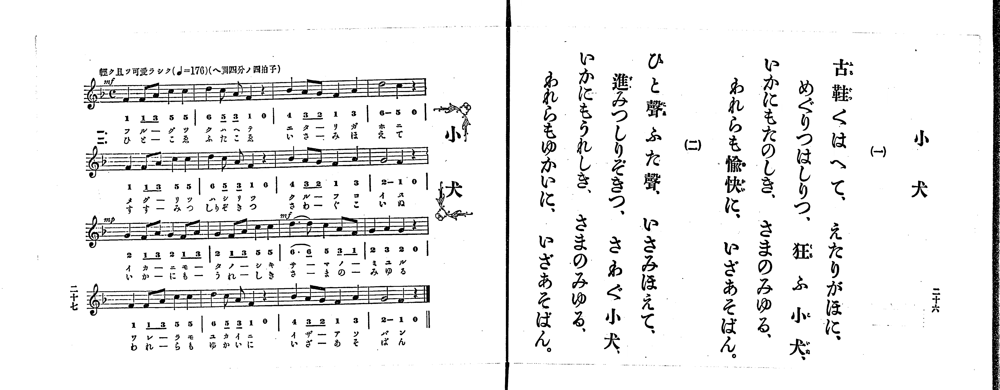

# 小犬

*找不到鋼琴伴奏版 TMD，未產生音訊。*

- 出處：共益商社樂器店《唱歌教科書 生徒用 巻一》第二十六～二十七頁（第十三曲）
- NDL Digital Collections PID 854862（https://dl.ndl.go.jp/pid/854862）掃描 P015.jpg

## 說明

原書資訊與歌詞全文（NDL PID 854862《唱歌教科書 生徒用 巻一》第二十六～二十七頁，掃描 P015.jpg）：
調性與拍號：ヘ調四分ノ四拍子（F 大調 4/4 拍），♩=176，「輕ク且ツ可愛ラシク」
註記：第二學期第六曲（全卷第十三曲）。全曲十六小節，分節歌，二節同一旋律。開頭標 mf，第三行第一小節（第九小節）標 mp，第三行第三小節（第十一小節）標 mf。第十一小節首二音「6. 6_」印有圓滑線（配字「サーマノー」／「さーまのー」）。五線譜與簡譜一致。

## 歌詞

```text
一、
古鞋くはへて、えたりがほに、
めぐりつはしりつ、狂ふ小犬、
いかにもたのしき、さまのみゆる、
われらも愉快に、いざあそばん。

二、
ひと聲ふた聲、いさみほえて、
進みつしりぞきつ、さわぐ小犬、
いかにもうれしき、さまのみゆる、
われらもゆかいに、いざあそばん。
```

## ABC

```abc
X:1
T:小犬
M:4/4
L:1/16
Q:1/4=176
K:F
V:V1 name="Piano" snm="Pia"
[V:V1]
!mf! F4 F2 A2 c4 c4 | d4 c2 A2 F4 z4 | B4 A2 G2 F4 A4 | d8 c4 z4 |
F4 F2 A2 c4 c4 | d4 c2 A2 F4 z4 | B4 A2 G2 F4 A4 | G8 F4 z4 |
!mp! G4 F2 A2 G4 F2 A2 | G4 F2 A2 c4 c4 | !mf! d6 d2 c4 A2 F2 | G4 A4 G4 z4 |
F4 F2 A2 c4 c4 | d4 c2 A2 F4 z4 | B4 A2 G2 F4 A4 | G8 F4 z4 |
!mf! F4 F2 A2 c4 c4 | d4 c2 A2 F4 z4 | B4 A2 G2 F4 A4 | d8 c4 z4 |
F4 F2 A2 c4 c4 | d4 c2 A2 F4 z4 | B4 A2 G2 F4 A4 | G8 F4 z4 |
!mp! G4 F2 A2 G4 F2 A2 | G4 F2 A2 c4 c4 | !mf! d6 d2 c4 A2 F2 | G4 A4 G4 z4 |
F4 F2 A2 c4 c4 | d4 c2 A2 F4 z4 | B4 A2 G2 F4 A4 | G8 F4 z4 |
```

## TMD 檔案連結

- [主旋律 TMD 檔案](koinu.tmd) [[在 TMD Studio 編輯](https://tmdlang.github.io/Tmd-TS/#tmd=s7IKdvYPcrWy4qpTUCpJTLdSSM7PyUlNLsnMz7PKrsxPzc6ML87Iz05Ugisoy88pzU21yk7MizeMtzA1sTAzQkgW55cWJadaFSdn5OfnxJekVpQk5edno8vHFySmp1oFGBiaImQKivLLUvMS84C6C4oy80pSU8DaEQpSyzJTUkHSxclAq8tSizLTMlNTkNyVWlQMcjXUipKixLzi5KLMApBXEKrSU_OKUq2SMzJzUopS8-KL8_PSEZJp-UW5VsUlRfkFGZnJCOGSjFSghxPzMnMTc5S4tLQUnm7of961RkFLi0vRVsHQ3IzL3lbBjcvGRN_EDqTpafuuFzOnvt8z62nrxuezu55ObXu-ZN-zFU1PZ654umv644aup1M2Plvb82zqzOfLJz6bvUPh-ZT5T_dNej5lhcLT7buf7Gh43ND9fM2aJ7t6nvY2Pm1d-37vPAj7yY7mlwsa3-_pAMqCuZ3PZm96v6cT7FQ_Fx8Fl8z0zJLEHAVneCQWKwR4uihAogmoMaOkpKDYSl8_JUcvD4jT8_WyCvQLMlP0YSo6n_U1P-vvVwBFDlAOGDhc-loKttQCXAoKCk_75gM9_WJz-4sVXS862oEh8WLlvKetK55Nawe6EOQNhJOpEFg9aD4C-hEYNSCHvFi1_1nDcpATuntfzJwPFH3cPAMo-HT27KcdbY-b-4AMoNTTtROA7nJTeLpkOVBSARjLCkBRsDE9j2autAUmACDrcUPPiz1THzetf7JjyuPmlqf965-1zH7cvPJx03ag4OOGXrCNK3a_WDEDaBHUxWt3PJszHxSZrWvBMdkBDIanvdvRovdxQxMoeGZvgvgQlPrWNwCtBDoSyAAGDpANNA3IfjqhBxgiz6Z3P93XDdT1clr3ywVrn62YqZCbBlQDsnRH54uFEEYDzBxQanqycy6M2wlWX4ChvhNZPdh5cBMgWtKANqJJvVw2Deiwl_M3A0PHTE_BLB4YDk97Nzyb0_l0zuRnuyc-3z4LaN7LVmAYA_NFz-OmrY-b9zxungcMexCjARjK_SDxxqkgbuO-x43rYOKgUHmyawrQhBdr5wDj8PmGhUAG0OYX7VuAUlyg4AanjkZwmutf8nJe9-PG_seN6x837njcuAwo8bix43Hj_MdNXY8bgVbsfty4Gqr6cRNQbgJYYglYw3Qou6HxeXfT48atkAIAprqx5XEj0OzVj5uAcvNBbgRqaOwF2zAV6urG_Y-b2h43AWMFakP_4yagfzuBep61dD7dvxpiO9isaY8bgQbNfdy44XHTZLhfdgGTGNS-TY8bV7wAkVuB9oEYUI1Ay_aDPQL0F8iDINUvG4DqgKJAj0B8MQ_kNLBfQBqA7micgMc7QDcDw4YU74AkQPqBpuD2EVAP5YUJFCho6XNxeedn5pVaBWQm5uU71BjUKFSDrFCwsdCyAzOqc9NqwQxgYfa4eSoQrwbiPUCHbwDSLQo1QNZ6IKsfiGcAcRtYZAUQ74eoa14FZK8BiTbPBuJukKUg82oUDBV0gdhYwRRIg3CNghmYZQyWMQCLmABJYwUjsIgxXA0IgnSA1SBctxDqKqitENeBXNa0HVkE7F6oL0A-atoMFl0C5PVQ6jojqOvgaqCBWIAIRJBFTTDru4F4EZgNcgIoyPqgwQt0ctNasOhWqNp5cFmQt-YD8TKwR-BOBlkOcjKMRoggPAGKT2gYmoGFQP6BKAT5AESjhSootNZAnbAS7FyQ9UCrQZ4Ah1o3LPyatkEdD_RS016wuglAvJn6oVrLxaVrpwBOuwrIDGUuAA)]

## 分析

```text
================================================================================
📊 TMD Song Profile: [ 小犬 ]
================================================================================
⏱  Duration:       0:43 (43.6s), 32 measures total
🎼 Key & Tempo:    首調基準 F, != 176.0 BPM, <4/4>
   - 分析範圍：      由實際發聲的音符與和弦推測調性；播放脈絡另行呈現
🎤 人聲音域:    F4 (MIDI 65) – D5 (MIDI 74) [跨度: 9 個半音 / 0.8 個八度, 難度: easy]
   - 最低音:  F4 in [Koinu #1 @ m.1, 0:00]
   - 最高音: D5 in [Koinu #1 @ m.2, 0:01]
   - 適合: soprano, mezzo-soprano, contralto, tenor, baritone, bass
🏛  結構:      Koinu (21.8s) -> Koinu (21.8s)
⚡ 編曲密度:        Peak 1 軌道同時演奏
🗝  調性診斷：       F 大調（純淨自然大調，未偵測到可信轉調）
   - 風格氣質:    純淨自然大調（陽光明朗、易唱易記，無明顯調外色彩）
   - 轉調歷程:    全曲維持單一推測調性（未偵測到可信轉調）
   - 核心骨幹音:  F, C, G, A, D
   - 調性數值:    F 大調 [相關度: 0.90, 穩定度: High, 自然音純度: 100.0%]
   - 候選調性 (K-S): F 大調 (0.90), C 大調 (0.71), D 小調 (0.64)
   - 五度圈歷程:   -1 -> -1
   - 各段落調性細節:
     • [Koinu #1]: F 大調 (r: 0.90, 自然音純度: 100.0%)
     • [Koinu #2]: F 大調 (r: 0.90, 自然音純度: 100.0%)

  [ 五度圈游移軌跡 ]
               C  
        [F ]*          G  
      Bb               D  
      Eb               A  
         Ab           E  
            Db       B  
               F# 
     (* = active key center)

  [ 十二半音累積音高分佈 ]
     C  : ███████████████████       20.2%
     C# :                            0.0%
     D  : ████████████              12.3%
     D# :                            0.0%
     E  :                            0.0%
     F  : ████████████████████████  25.4%
     F# :                            0.0%
     G  : █████████████████         18.4%
     G# :                            0.0%
     A  : █████████████████         18.4%
     A# : █████                      5.3%
     B  :                            0.0%
--------------------------------------------------------------------------------
Assignment 軌道音域：
  - Piano         : F4 – D5 (9 個半音 / 0.8 個八度, 134 個音符)
================================================================================
```


## 原書掃描頁




