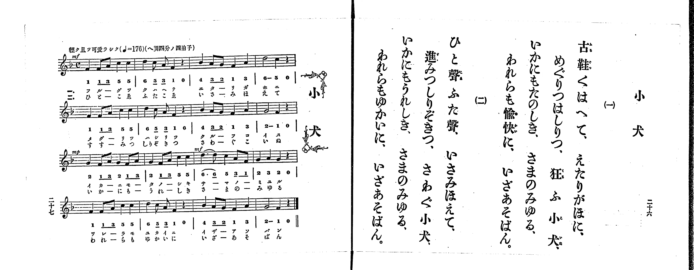

# 小犬

> Re:Shōka 使用 AI 協助辨識與重建樂譜，可能會有錯誤。歡迎回報。

- **鋼琴伴奏版**：<br><audio controls src="koinu.mp3"></audio>
- **NEUTRINO 歌聲合成版**：<br><audio controls src="koinu_neutrino.mp3"></audio>

- 出處：共益商社樂器店《唱歌教科書 生徒用 巻一》第二十六～二十七頁（第十三曲）
- NDL Digital Collections PID 854862（https://dl.ndl.go.jp/pid/854862）掃描 P015.jpg

## 說明

原書資訊與歌詞全文（NDL PID 854862《唱歌教科書 生徒用 巻一》第二十六～二十七頁，掃描 P015.jpg）：
調性與拍號：ヘ調四分ノ四拍子（F 大調 4/4 拍），♩=176，「輕ク且ツ可愛ラシク」
註記：第二學期第六曲（全卷第十三曲）。全曲十六小節，分節歌，二節同一旋律。開頭標 mf，第三行第一小節（第九小節）標 mp，第三行第三小節（第十一小節）標 mf。第十一小節首二音「6. 6_」印有圓滑線（配字「サーマノー」／「さーまのー」）。五線譜與簡譜一致。


## 歌詞

```text
一、
古鞋くはへて、えたりがほに、
めぐりつはしりつ、狂ふ小犬、
いかにもたのしき、さまのみゆる、
われらも愉快に、いざあそばん。

二、
ひと聲ふた聲、いさみほえて、
進みつしりぞきつ、さわぐ小犬、
いかにもうれしき、さまのみゆる、
われらもゆかいに、いざあそばん。
```

## ABC

<div class="abc-score" data-abc-src="koinu.abc" aria-label="五線譜載入中"></div>

[下載 ABC 原始檔](koinu.abc)

## TMD 檔案連結

- [主旋律 TMD 檔案](koinu.tmd) [[在 TMD Studio 編輯](https://tmdlang.github.io/Tmd-TS/#tmd=s7IKdvYPcrWy4qpTUCpJTLdSSM7PyUlNLsnMz7PKrsxPzc6ML87Iz05Ugisoy88pzU21yk7MizeMtzA1sTAzQkgW55cWJadaFSdn5OfnxJekVpQk5edno8vHFySmp1oFGBiaImQKivLLUvMS84C6C4oy80pSU8DaEQpSyzJTUkHSxclAq8tSizLTMlNTkNyVWlQMcjXUipKixLzi5KLMApBXEKrSU_OKUq2SMzJzUopS8-KL8_PSEZJp-UW5VsUlRfkFGZnJCOGSjFSghxPzMnMTcxCi-UWZ6Zl5VrmpmVmZWHyaX1SSkZ9elFiQUWmVkVlcAlSenJgTDww2YFhqaSk83dD_vGuNgpYWl6KtgqG5GZe9rYIbl42JvokdyIyn7btezJz6fs-sp60bn8_uejq17fmSfc9WND2dueLprumPG7qeTtn4bG3Ps6kzny-f-Gz2DoXnU-Y_3Tfp-ZQVCk-3736yo-FxQ_fzNWue7Op52tv4tHXt-73zIOwnO5pfLmh8v6cDKAvmdj6bven9nk6wy_1cfBRcgN4qScxRcIYnhGKFAE8XBUhUAzVmlJQUFFvp66fk6OUBcXq-XlaBfkFmij5MReezvuZn_f0KoAgGygEDmEtfS8GWWoBLQUHhad98oKdfbG5_saLrRUc7MCRerJz3tHXFs2ntQBeCvIFwMhUCqwfNR0A_AqMG5JAXq_Y_a1gOckJ374uZ84Gij5tnAAWfzp79tKPtcXMfkAGUerp2AtBdbgpPlywHSioAY1kBKAo2pufRzJW2wAQAZD1u6HmxZ-rjpvVPdkx53NzytH_9s5bZj5tXPm7aDhR83NALtnHF7hcrZgAtgrp47Y5nc-aDIrN1LTgmO4DB8LR3O1r0Pm5oAgXP7E0QH4JS3_oGoJVARwIZwMABsoGmAdlPJ_QAQ-TZ9O6n-7qBul5O6365YO2zFTMVctOAakCW7uh8sRDCaICZA0pNT3bOhXE7weoLMNR3IqsHOw9uAkRLGtBGNKmXy6YBHfZy_mZg6JjpKZjFA8Phae-GZ3M6n86Z_Gz3xOfbZwHNe9kKDGNgvuh53LT1cfOex83zgGEPYjQAQ7kfJN44FcRt3Pe4cR1MHBQqT3ZNAZrwYu0cYBw-37AQyADa_KJ9C1CKCxTc4NTRCE5z_Utezut-3Nj_uHH948YdjxuXASUeN3Y8bpz_uKnrcSPQit2PG1dDVT9uAspNAEssAWuYDmU3ND7vbnrcuBVSAMBUN7Y8bgSavfpxE1BuPsiNQA2NvWAbpkJd3bj_cVPb4yZgrEBt6H_cBPRvJ1DPs5bOp_tXQ2wHmzXtcSPQoLmPGzc8bpoM98suYBKD2rfpceOKFyByK9A-EAOqEWjZfrBHgP4CeRCk-mUDUB1QFOgRiC_mgZwG9gtIA9AdjRPweAfoZmDYkOIdkARIP9AU3D4C6qG8MIECBS19Li7v_My8UquAzMS8fIcag5pqkA0KNhZadmBGdW5aLZgBLMseN08F4tVAvAfo7g1AukWhBshaD2T1A_EMIG4Di6wA4v0Qdc2rgOw1INHm2UDcDbITZF6NgqGCLhAbK5gCaRCuUTADs4zBMgZgERMgaaxgBBYxhqsBQZAOsBqwaT6GQAsatwL5wKAFkY0TwOQSsB5g6gXzgA5t3AHEy4C8eKhMB1hmPlhnF5jdA5XZDbUJGBsw9RC7jECym8AyK8DkZLDuiVB9YFcATQSJQ0RhdrWAZaaCyf1gEmQHzBUQu-BuQ4T6QmhoQ0MTEuqgEG_ajiwCjgdo7IBiqmkzWHQJkNdDaagbQd0HV4MI9aZGRHhDQxAW6uvBvOlgcYgoLCTA8QGNKUh4gcIQFkaQkFiDJdRngmUgJCQEYXaBsihYYB4Q96JZBw7yJkgigCQMQtZV5xYg0j0oDJtgIdsNxIvAbJDnQam8D5ojgLHRtBYsuhWqFugWqCwoxoBJonkZOI7gsQEKV1BswGiECCJ-QFkQmuzNwEKgqIIoBEUOiEbPCJCEBgleUOIFFi5Q_4ITeuM6aMSAyF6kMIKExD64GpA4OJib2uARhh4luO2C6AFlJ8rtAmcEUAJfAw3aleBoAAUrMEhBkQNO6N2wJN-0DRopwKhq2gtWNwGIN9MyI0ASNdi_TZ3IIQHxETCMQKGFVJzAQ28amASpBpb1UJkNsDBqAqVVtFCng121XFy6dgrg2kEByFDmAgA)]
- [鋼琴伴奏 TMD 檔案](koinu_piano.tmd) [[在 TMD Studio 編輯](https://tmdlang.github.io/Tmd-TS/#tmd=s7IKdvYPcrWy4qpTUCpJTLdSyC8qychPL0osyKi0ysgsLskvykxOzInPTsxLVOLS0lJ4uqH_edea93s6XnbveT5hy5M9W54u7X_e2fF-T6eClhaXoq2CobkZl72tghuXjYm-iR3I4Kftu17MnPp-z6ynrRufz-56OrXt-ZJ9z1Y0PZ254umu6Y8bup5O2fhsbc-zqTOfL5_4bPYOhedT5j_dN-n5lBUKT7fvfrKj4XFD9_M1a57s6nna2_i0de37vfMg7Cc7ml8uaAQ6BigL5nY-m70J6BIlkK1-Lj4KLpnpmSWJOQrO-Tk5qcklmfl5xQoBni4KFqYmFmZGQI0ZJSUFxVb6-ik5enlAnJ6vl1WgX5CZog9T0fmsr_lZf79CgIGhKVAuXYmLyzs_M6_UKiAzMS8_yMOhxqCmmksBCGwstOzAjOrctFowQ19L4XHzVCBeDcR7FB43bQDSLQo1QNZ6IKsfiGcAcRtYZAUQ74eoa14FZK8BiTbPBuJuBS19sHk1CoYKukBsrGAKpEG4RsEMzDIGyxiARUyApLGCEVjEGK4GBEE6wGrApvkYAi1o3ArkP27qBpGNE8DkErCex439YB7QoY07gHgZkBcPlekAy8wH6-wCs3ugMruhNj1uXA1TD7HLCCS7CSyzAkxOBuueCNUHdgXQRJA4RBRmVwtYZiqY3A8mQXbAXAGxC-42RKgvhIY2NDQhoQ4K8abtyCLgeIDGDiimmjaDRZcAeT2UhroR1H1wNYhQb2pEhDc0BGGhvh7Mmw4Wh4jCQgIcH9CYgoQXKAxhYQQJiTVYQn0mWAZCQkIQZtd0mOXzgLgXzTpwkDdBEgEkYRCyrjq3AJHuQWHYBAvZbiBeBGaDPA9K5X3QHAGMjaa1YNGtULVAt0BlQTEGTBLNy8BxBI8NULiCYgNGI0QQ8QPKgtBkbwYWAkUVRCEockA0ekaAJDRI8IIS7-OmJqh_wQm9cR00YkBkL1IYQUJiH1wNSBwczE1t8AhDjxLcdkH0gLIT5XaBMwIoga-BBu1KcDSAghUYpKDIASf0bliSb9oGjRRgVDXtBaubAMSbaZkRIIka7N-mTuSQgPgIGEag0EIqTuChNw1MglQ_bpwLldkAC6MmUFpFC3U62FWLUjn4IFcOJtDKARgpL_q6Xrb3Pm3d8XJ2K6T-RArheIVow1gYVQMKTyDTBCECVQcVNY0H0qbx-FRSYiKcg6YWLk6UajT7sOungmsReg0gcaFrpwCOjmgfoDCCYwTmKHMBAA)]

## 分析

```text
================================================================================
📊 TMD Song Profile: [ 小犬 ]
================================================================================
⏱  Duration:       0:21 (21.8s), 16 measures total
🎼 Key & Tempo:    首調基準 F, != 176.0 BPM, <4/4>
   - 分析範圍：      由實際發聲的音符與和弦推測調性；播放脈絡另行呈現
🎤 人聲音域:    F4 (MIDI 65) – D5 (MIDI 74) [跨度: 9 個半音 / 0.8 個八度, 難度: easy]
   - 最低音:  F4 in [Koinu #1 @ m.1, 0:00]
   - 最高音: D5 in [Koinu #1 @ m.2, 0:01]
   - 適合: soprano, mezzo-soprano, contralto, tenor, baritone, bass
🏛  結構:      Koinu (21.8s)
⚡ 編曲密度:        Peak 1 軌道同時演奏
🗝  調性診斷：       F 大調（純淨自然大調，未偵測到可信轉調）
   - 風格氣質:    純淨自然大調（陽光明朗、易唱易記，無明顯調外色彩）
   - 轉調歷程:    全曲維持單一推測調性（未偵測到可信轉調）
   - 核心骨幹音:  F, C, G, A, D
   - 調性數值:    F 大調 [相關度: 0.90, 穩定度: High, 自然音純度: 100.0%]
   - 候選調性 (K-S): F 大調 (0.90), C 大調 (0.71), D 小調 (0.64)
   - 五度圈歷程:   -1
   - 各段落調性細節:
     • [Koinu #1]: F 大調 (r: 0.90, 自然音純度: 100.0%)

  [ 五度圈游移軌跡 ]
               C  
        [F ]*          G  
      Bb               D  
      Eb               A  
         Ab           E  
            Db       B  
               F# 
     (* = active key center)

  [ 十二半音累積音高分佈 ]
     C  : ███████████████████       20.2%
     C# :                            0.0%
     D  : ████████████              12.3%
     D# :                            0.0%
     E  :                            0.0%
     F  : ████████████████████████  25.4%
     F# :                            0.0%
     G  : █████████████████         18.4%
     G# :                            0.0%
     A  : █████████████████         18.4%
     A# : █████                      5.3%
     B  :                            0.0%
--------------------------------------------------------------------------------
Assignment 軌道音域：
  - Piano         : F4 – D5 (9 個半音 / 0.8 個八度, 67 個音符)
================================================================================
```


## 原書掃描頁




