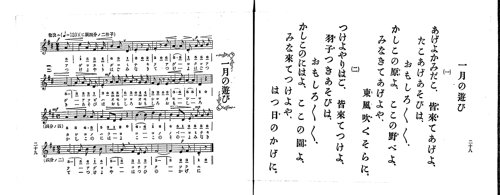

# 一月の遊び

<audio controls src="ichigatsu_no_asobi.mp3"></audio>

- 出處：共益商社樂器店《唱歌教科書 生徒用 巻一》第二十八～二十九頁（第十四曲）
- NDL Digital Collections PID 854862（https://dl.ndl.go.jp/pid/854862）掃描 P016.jpg

## 說明

原書資訊與歌詞全文（NDL PID 854862《唱歌教科書 生徒用 巻一》第二十八～二十九頁，掃描 P016.jpg）：
調性與拍號：に調四分ノ二拍子（D 大調 2/4 拍），♩=120，「愉快ニ」，弱起半拍（八分音符）；第三行改「四分ノ四」（4/4 拍，四小節）；第四行改回「四分ノ二」（2/4 拍，七小節）
註記：第二學期第七曲（全卷第十四曲）。分節歌，二節同一旋律。開頭標 f，第一行末小節標 p，第二行第三小節標 mf，第三行開頭標 mf、第四小節標 mp，第四行第六小節標 p；多處印有漸強漸弱記號、斷音記號與換氣記號（V）。第一行弱起八分音符五線譜為 A4（中音 5），簡譜誤印下加一點作「5_.」；第二行第三小節（第九小節）後半拍五線譜為單符尾八分音符 A4 二音（5_ 5_），簡譜於「0 5 5」下多印一條底線。

## 歌詞

```text
一、
あげよかみだこ、皆來てあげよ、
たこあげあそびは、
おもしろ〳〵、
かしこの原よ、ここの野べよ、
みなきてあげよや、
東風吹くそらに。

二、
つけよやりはご、皆來てつけよ、
羽子つきあそびは、
おもしろ〳〵、
かしこのにはよ、ここの園よ、
みな來てつけよや、
はつ日のかげに。
```

## ABC

```abc
X:1
T:一月の遊び
M:2/4
L:1/16
Q:1/4=120
K:D
V:V1 name="Piano" snm="Pia"
[V:V1]
[Q:1/4=120] !f! z2 z2 z2 A2 | d4 A2 F G | B4 A2 D2 | E4 z2 E2 |
F4 z2 B2 | A6 A2 | !p! D2 A2 A2 B2 | A8 |
A2 A2 F2 D2 | !mf! E2 z2 A2 A2 | B2 A2 z2 G G | F2 E2 z2 E2 |
A6 B2 | A4 A4 | D4 z4 | [M:4/4] !mf! A4 A4 B6 A2 |
A4 F2 D2 E4 z4 | B6 B2 d4 B4 | !mp! B4 A2 D2 E2 A2 A2 B2 | [M:2/4] A8 |
A2 B2 d2 B2 | A8 | A2 F2 D2 E2 | F8 |
!p! F4 E2 F2 | D4 z2 z2 | [Q:1/4=120] !f! z2 z2 z2 A2 | d4 A2 F G |
B4 A2 D2 | E4 z2 E2 | F4 z2 B2 | A6 A2 |
!p! D2 A2 A2 B2 | A8 | A2 A2 F2 D2 | !mf! E2 z2 A2 A2 |
B2 A2 z2 G G | F2 E2 z2 E2 | A6 B2 | A4 A4 |
D4 z4 | [M:4/4] !mf! A4 A4 B6 A2 | A4 F2 D2 E4 z4 | B6 B2 d4 B4 |
!mp! B4 A2 D2 E2 A2 A2 B2 | [M:2/4] A8 | A2 B2 d2 B2 | A8 |
A2 F2 D2 E2 | F8 | !p! F4 E2 F2 | D4 z2 z2 |
```

## TMD 檔案連結

- [主旋律 TMD 檔案](ichigatsu_no_asobi.tmd) [[在 TMD Studio 編輯](https://tmdlang.github.io/Tmd-TS/#tmd=s7IKdvYPcrWy4qpTUCpJTLdSSM7PyUlNLsnMz7PKrsxPzc6ML87Iz05Ugisoy88pzU21yk7MizeMtzA1sTAzQkgW55cWJadaFSdn5OfnxJekVpQk5edno8vHFySmp1oFGBiaIWQKivLLUvMS84C6C4oy80pSU8DaEQpSyzJTUkHSxclAq8tSizLTMlNTkNyVWlQMcjXUipKixLzi5KLMApBXEKrSU_OKUq2SMzJzUopS8-KL8_PSEZJp-UW5VsUlRfkFGZnJCOGSjFSgh4sL8ouQnAMVTE0EGlGsxKWlpfBkR8OzOR2PG9e9bOx63LhZQUuLS9FWwdDIgMveVsGFy8ZI38QOpP1p-64XM6e-3zPraevG57O7nk5te75k37MVTU9nrni6a_rjhq6nUzY-W9vzbOrM58snPpu9Q-H5lPlP9016PmWFwtPtu4G2PG7ofr5mzZNdPU97G5-2rn6_dx6E_WTn3JcLGt_v6QDKgqRmz342e9P7PZ1gR_u5-Ci4ZKZnliTmKDjD47hYIcDTRQESi0CNGSUlBcVW-vopOXp5QJyer5dVoF-QmaIPU9H5rK_5WX-_AijugHLAsOPS11KwpRbgUlBQeNo3H-jpF5vbX6zoetHRDgyJFyvnPW1d8WxaO9CFIG8gnEyFwOpB8xHQj8CoATnkxar9zxqWg5zQ3fti5nyg6OPG1UBBYLg-7Wh73NwHNAgo9XTtBKC7XBSeLlkOlFQAxrICUBRsTM-jmSttgQkAyHrc0POspfPp_tWPm7sfNwCle57u2fhi6_anvV1g1R1AtwFNfTl_8_M1y8CaZ4OcvaPzxcKeZ1N2ArXDrQUywCZ0mMCsAstt6H--vgGuEygC0fl09jxkzUA3QzTD3dnzZEczXDPY3yt2v1gxA-hdaLit3fFsznywY5rB6Qno1BVPe7ejJbLHDU1AG4CmAGMDZOiuHiD76QSg6Q3Ppnc_3Qf0ddPLad0vF6x9tmKmQhpQCdjIBpAr56yGOAAkUwCV2dUDlIEEAUIyF64PFC4I43LTHjc0QnyNpBhqFCQoQIzWtSj2zH66ZBYwJz7t3fBsTuezPTue7tkOJjcCvQ-McKCRz6ZtB8YIhAtKCP2zn21YDOECwyEM4m24P6AxihSRT3ZNeb591ou1c5437VJwNAHqebJjLVBKwRSSPp5vWAiUfLFqCdANT3Z0P-1aADTp5e55T_bOAUaaabweOK7AKQEjPCD5HJiM4ZH3dB8wYYOSE7K1T6etAzrk6YZ9yO4CukUBaCKQAzTFNF7BNB7ZPc-m7QHabqBgqmAKtB_kriWzwA5seLZo7tNdU4FmA73NBUor4AzWCGI9bmx63DjpcROwAOx-3Lj_ceOCx42TQbEyq-3JvrbHjcsQCmAa5oNUQERB5Fxgofm4cT1cuutxE1B0-uOm3scNmx83bIVLAM2fDta6DlhWQAwEc0EiL9v7HjfuRLYF6JRVjxt7UVzQ1AKVfjZ348tFK55O2Pm4sR_kgqZOYB6Hew6UV6CmLHncOBGqswlYuq9_3DgF1XMwBRANz_ftBZYLYFGgzeR5DuQSoA5U_z2dgxKEIM-huwDuObAzlzybvhRsGNBgYDiDPQeUo7yshgIFLX0uLk9ghZqeWFJc6pfvWJyflGkVkJmYl-9QY1CjUA2yTcHG0EzLDsyqBteDtRA2pH6EctIgNLA-0YDkJE2Fx02LFGqA5CaFx80rgPRqID0fJNLcAORthvO6gLy1YFYbip49YDGQzv0Q9UA5oHtB1tQoGCjowrEpENcoGMYBKRAEcY0VTIBCZkgihmBFRlARkDYQuwaoEiECUl8DVg2DUKOBZHVBLZgHwmB1MP-CHAty6B6wAx837QWyJ4NF-oG8VUAa4qXtQNZaHCIg1UC9EC-DxSGeX4vwMLKrQBAiAvErsu9A_qjOTUM4FhIMIBZIygQcMCAtMMWQYEA2HjUYYDQkGGBBBRaBpglgVQZLE0CLEeECjHCQX8BR3QcLkeaVkLACRizIryA5UMgh1PQB8Uy4GlAigSURjLCA0bB4RsQYTAYWNsjxDvEMsh4QG558YBKYyQdkSHUu1nSAnDFAfgcmZeQ0AckCIJElcHGQjxuBeCo4HNbDxUHpZyWY100o9uHuxky4CEXIQYBI7gg1MBFQAgepAfFR4xqEa7hqubh07RTQCwsFHGLKXAA)]

## 分析

```text
================================================================================
📊 TMD Song Profile: [ 一月の遊び ]
================================================================================
⏱  Duration:       1:00 (60.0s), 52 measures total
🎼 Key & Tempo:    首調基準 D, != 120.0 BPM, <2/4>
   - 分析範圍：      由實際發聲的音符與和弦推測調性；播放脈絡另行呈現
🎤 人聲音域:    D4 (MIDI 62) – D5 (MIDI 74) [跨度: 12 個半音 / 1.0 個八度, 難度: easy]
   - 最低音:  D4 in [IchigatsuNoAsobi #1 @ m.3, 0:02]
   - 最高音: D5 in [IchigatsuNoAsobi #1 @ m.2, 0:01]
   - 適合: soprano, mezzo-soprano, contralto, tenor, baritone, bass
🏛  結構:      IchigatsuNoAsobi (30.0s) -> IchigatsuNoAsobi (30.0s)
⚡ 編曲密度:        Peak 1 軌道同時演奏
🗝  調性診斷：       A 大調（純淨自然大調，未偵測到可信轉調）
   - 風格氣質:    純淨自然大調（陽光明朗、易唱易記，無明顯調外色彩）
   - 轉調歷程:    全曲維持單一推測調性（未偵測到可信轉調）
   - 核心骨幹音:  A, B, D, F#, E
   - 調性數值:    A 大調 [相關度: 0.80, 穩定度: Moderate, 自然音純度: 98.6%]
   - 候選調性 (K-S): A 大調 (0.80), D 大調 (0.69), A 小調 (0.60)
   - 五度圈歷程:   +3 -> +3
   - 各段落調性細節:
     • [IchigatsuNoAsobi #1]: A 大調 (r: 0.80, 自然音純度: 98.6%, 調外音: G)
     • [IchigatsuNoAsobi #2]: A 大調 (r: 0.80, 自然音純度: 98.6%, 調外音: G)

  [ 五度圈游移軌跡 ]
               C  
         F            G  
      Bb               D  
      Eb              [A ]*
         Ab           E  
            Db       B  
               F# 
     (* = active key center)

  [ 十二半音累積音高分佈 ]
     C  :                            0.0%
     C# :                            0.0%
     D  : ████████                  14.2%
     D# :                            0.0%
     E  : ██████                    10.4%
     F  :                            0.0%
     F# : ███████                   12.7%
     G  : █                          1.4%
     G# :                            0.0%
     A  : ████████████████████████  42.5%
     A# :                            0.0%
     B  : ███████████               18.9%
--------------------------------------------------------------------------------
Assignment 軌道音域：
  - Piano         : D4 – D5 (12 個半音 / 1.0 個八度, 144 個音符)
================================================================================
```


## 原書掃描頁




