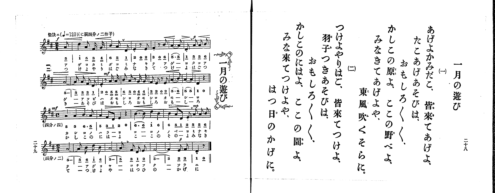

# 一月の遊び

> Re:Shōka 使用 AI 協助辨識與重建樂譜，可能會有錯誤。歡迎回報。

- **鋼琴伴奏版**：<br><audio controls src="ichigatsu_no_asobi.mp3"></audio>
- **NEUTRINO 歌聲合成版**：<br><audio controls src="ichigatsu_no_asobi_neutrino.mp3"></audio>

- 出處：共益商社樂器店《唱歌教科書 生徒用 巻一》第二十八～二十九頁（第十四曲）
- NDL Digital Collections PID 854862（https://dl.ndl.go.jp/pid/854862）掃描 P016.jpg

## 說明

原書資訊與歌詞全文（NDL PID 854862《唱歌教科書 生徒用 巻一》第二十八～二十九頁，掃描 P016.jpg）：
調性與拍號：に調四分ノ二拍子（D 大調 2/4 拍），♩=120，「愉快ニ」，弱起半拍（八分音符）；第三行改「四分ノ四」（4/4 拍，四小節）；第四行改回「四分ノ二」（2/4 拍，七小節）
註記：第二學期第七曲（全卷第十四曲）。分節歌，二節同一旋律。開頭標 f，第一行末小節標 p，第二行第三小節標 mf，第三行開頭標 mf、第四小節標 mp，第四行第六小節標 p；多處印有漸強漸弱記號、斷音記號與換氣記號（V）。第一行弱起八分音符五線譜為 A4（中音 5），簡譜誤印下加一點作「5_.」；第二行第三小節（第九小節）後半拍五線譜為單符尾八分音符 A4 二音（5_ 5_），簡譜於「0 5 5」下多印一條底線。


## 歌詞

```text
一、
あげよかみだこ、皆來てあげよ、
たこあげあそびは、
おもしろ〳〵、
かしこの原よ、ここの野べよ、
みなきてあげよや、
東風吹くそらに。

二、
つけよやりはご、皆來てつけよ、
羽子つきあそびは、
おもしろ〳〵、
かしこのにはよ、ここの園よ、
みな來てつけよや、
はつ日のかげに。
```

## ABC

<div class="abc-score" data-abc-src="ichigatsu_no_asobi.abc" aria-label="五線譜載入中"></div>

[下載 ABC 原始檔](ichigatsu_no_asobi.abc)

## TMD 檔案連結

- [主旋律 TMD 檔案](ichigatsu_no_asobi.tmd) [[在 TMD Studio 編輯](https://tmdlang.github.io/Tmd-TS/#tmd=s7IKdvYPcrWy4qpTUCpJTLdSSM7PyUlNLsnMz7PKrsxPzc6ML87Iz05Ugisoy88pzU21yk7MizeMtzA1sTAzQkgW55cWJadaFSdn5OfnxJekVpQk5edno8vHFySmp1oFGBiaIWQKivLLUvMS84C6C4oy80pSU8DaEQpSyzJTUkHSxclAq8tSizLTMlNTkNyVWlQMcjXUipKixLzi5KLMApBXEKrSU_OKUq2SMzJzUopS8-KL8_PSEZJp-UW5VsUlRfkFGZnJCOGSjFSgh4sL8ouQnAMVTE0EGlGMEM4vykzPzLPKTc3MysTif6ARGfnpRYkFGZVWGZnFJUDlyYk58cDABIawlpbCkx0Nz-Z0PG5c97Kx63HjZgUtLS5FWwVDIwMue1sFFy4bI30TO5BhT9t3vZg59f2eWU9bNz6f3fV0atvzJfuerWh6OnPF013THzd0PZ2y8dnanmdTZz5fPvHZ7B0Kz6fMf7pv0vMpKxSebt8NtOVxQ_fzNWue7Op52tv4tHX1-73zIOwnO-e-XND4fk8HUBYkNXv2s9mb3u_pBHvBz8VHwQXov5LEHAVneDopVgjwdFGApASgxoySkoJiK339lBy9PCBOz9fLKtAvyEzRh6nofNbX_Ky_XwEU_0A5YPhz6Wsp2FILcCkoKDztmw_09IvN7S9WdL3oaAeGxIuV8562rng2rR3oQpA3EE6mQmD1oPkI6Edg1IAc8mLV_mcNy0FO6O59MXM-UPRx42qgIDBcn3a0PW7uAxoElHq6dgLQXS4KT5csB0oqAGNZASgKNqbn0cyVtsAEAGQ9buh51tL5dP_qx83djxuA0j1P92x8sXX7094usOoOoNuApr6cv_n5mmVgzbNBzt7R-WJhz7MpO4Ha4dYCGWATOkxgVoHlNvQ_X98A1wkUgeh8OnsesmagmyGa4e7sebKjGa4Z7O8Vu1-smAH0LjTc1u54Nmc-2DHN4PQEdOqKp73b0RLZ44YmoA1AU4CxATJ0Vw-Q_XQC0PSGZ9O7n-4D-rrp5bTulwvWPlsxUyENqARsZAPIlXNWQxwAkimAyuzqAcpAggAhmQvXBwoXhHG5aY8bGiG-RlIMNQoSFCBG61oUe2Y_XTILmBOf9m54Nqfz2Z4dT_dsB5Mbgd4HRjjQyGfTtgNjBMIFJYT-2c82LIZwgeEQBvE23B_QGEWKyCe7pjzfPuvF2jnPm3YpOJoA9TzZsRYopWAKSR_PNywESr5YtQTohic7up92LQCa9HL3vCd75wAjzTReDxxX4JSAER6QfA5MxvDIe7oPmLBByQnZ2qfT1gEd8nTDPmR3Ad2iADQRyAGaYhqvYBqP7J5n0_YAbTdQMFUwBdoPcteSWWAHNjxbNPfprqlAs4He5gKlFXAGawSxHjc2PW6c9LgJWAB2P27c_7hxwePGyaBYmdX2ZF_b48ZlCAUwDfNBKiCiIHIusNB83LgeLt31uAkoOv1xU-_jhs2PG7bCJYDmTwdrXQcsKyAGgrkgkZftfY8bdyLbAnTKqseNvSguaGqBSj-bu_HlohVPJ-x83NgPckFTJzCPwz0HyitQU5Y8bpwI1dkELN3XP26cguo5mAKIhuf79gLLBbAo0GbyPAdyCVAHqv-ezkEJQpDn0F0A9xzYmUueTV8KNgxoMDCcwZ4DylFeVkOBgpY-F5cnsFJOTywpLvXLdyzOT8q0CshMzMt3qNE1rKkG2aZgY2imZQdmVYPrwVoIWxFUOkLZaRAaWJ1oQDKSpsLjpkUKNUByk8Lj5hVAejWQng8SaW4A8jbDeV1A3lowqw1Fzx6wGEjnfoh6oBzQuSBrahQMFHTh2BSIaxQM44AUCIK4xgomQCEzJBFDsCIjqAhIG4hdA1SJEAGprwGrhkGo0UCyuqAWzANhsDqwQ3wMaxTigTwYBqYWsA5gbEFNAMYpWLwbFN9gmQUwmcbJYHI_VMcqqDjEnF6o6DIUUXTTYRAUZhB75iOZDFYNcacRujuXQE2aiOrOphYg7gLLrIe7cwrJ7kQ3HdOdINNhJoNVw9IPKPJBEb8HHOGPm_YC2ZPBIv1A3iogDUki24GstThEQKqBeiFJCCwOSUxrEQkIOZYhLoPFLihFIFILKF1U56YhIh-SrEAskJQJOKGBtMAUQ5IVsvGoyQpGQ5IVLOmBReBJClsEQ6ICFKXA8ghMboYGMigoIcHeBSKbYIlkOpgHiiCYLEgOuwwkakA60aILrBY9CkE6YZGN5HJgIoMkiKHm8mobYGsMVqwBIxuRFoGFFij9gIurPlgqbF4JSZ_AwglkJkgOlFoRavqAeCZcDaiggxVzGOkPRsPKKpgYQgUsPSKXXRDvIOsBseFFIEwCswgEGVKdi7MsA5VTEA2I4IOUJjAIrI0gQYkoH5o64SxQ3kYJXjTdqOZBzIKpg7GBLQAU8yAlD6TcgZY3SMmNePeuhosgXE6Je0FJGVUUv3uR605Q2gJWd8jlHKSaBIksgYuDUlQjEE8Fp7P1cHFQmbgSzOsmVKLB0wVm5YZQhJzEEFUiQg1MBFQJgtSA-KjlFwgjJyNYdYAwAxJUkFIAVLpBAgvkrxYcaiGV2EIwuRWitrEfq1qIenDZAk6MyNENq_KQEw0u14EqIkilRdh1kAoMomMT1E5YQsDmOlBChfgcu-tqubh07RTQ22IKQDFlLgA)]
- [鋼琴伴奏 TMD 檔案](ichigatsu_no_asobi_piano.tmd) [[在 TMD Studio 編輯](https://tmdlang.github.io/Tmd-TS/#tmd=s7IKdvYPcrWy4qpTUCpJTLdSyC8qychPL0osyKi0ysgsLskvykxOzInPTsxLVOLS0lJ4sqPh2ZyOx43rXjZ2PW7c_H5Px8vuPc8nbHmyZ8vTpf3POzve7-lU0NLiUrRVMDQy4LK3VXDhsjHSN7ED2fC0fdeLmVPf75n1tHXj89ldT6e2PV-y79mKpqczVzzdNf1xQ9fTKRufre15NnXm8-UTn83eofB8yvyn-yY9n7JC4en23UCrHzd0P1-z5smunqe9jU9bV7_fOw_CfrJz7ssFjUDHAGVBUrNnP5u9CegSJZCtfi4-Ci6Z6ZkliTkKzvk5OanJJZn5ecUKAZ4uChamJhZmRkCNGSUlBcVW-vopOXp5QJyer5dVoF-QmaIPU9H5rK_5WX-_QoCBoRlQLl2Ji8szOSMzPbGkuNQv37E4PynTKiAzMS8_yMOhRtewpppLAQhsDM207MCsanAo1ELYirbAwIGy0yC0vpaCxtM9G19s3a6p8LhpkUINkNyk8Lh5BZBeDaTng0SaG4C8zXBeF5C3FsxqQ9GzBywG0rkfoh4op6UPtqZGwUBBF45NgbhGwTAOSIEgiGusYAIUMkMSMQQrMoKKgLSB2DVAlQgRkPoasGoYhBoNJKsLasE8EAarAzvEx7BGIR7Ig-HHjU1gHY8bJ0FNeNzUARbvBuL9YJkFMJnGyWByP1THKqg4xJxeqOgyFFF002EQFGYQe-YjmQxWDXGnEbo7l0BNmojqzqYWIO4Cy6yHu3MKye5ENx3TnSDTYSaDVcPSDyjyQRG_Bxzhj5v2AtmTwSL9QN4qIA1JItuBrLU4RECqgXohSQgsDklMaxEJCDmWIS6DxS4oRSBSCyhdVOemISIfkqxALJCUCTihgbTAFEOSFbLxqMkKRkOSFSzpgUXgSQpbBEOiAhSljxvngsnN0EAGBSUk2LtAZBMskUwH80ARBJMFyWGXgUQNSCdadIHVokchSCcsspFcDkxkkAQx1FxebWOCKNaAkY1Ii8BCC5R-wMVVHywVNq-EpE9g4QQyEyQHSq0INX1APBOuBlTQwYo5jPQHo2FlFUwMoQKWHpHLLoh3kPWA2PAiECaBWQSCDKnOxVmWgcopiAZE8EFKExgEVpqQoESUD02dcBYob6MEL5puVPMgZsHUwdiPG3eimAcpeSDlDrS8QUpuxLt3NVwE4XJK3AtKyqii-N2LXHeC0hawukMu5yDVJEhkCVwclKIagXgqOJ2th4uDysSVYF43oRINni4wKzeEIuQkhqgSEWpgIqBKEKQGxEctv0AYORnBqgOEGZCggpQCoNINElggf7XgUAupxBaCya0QtY39WNVC1IPLFnBiRI5uWJWHnGhwuQ5UEUEqLcKug1RgEB2boHbCEgI214ESKsTn2F1Xi6sp5oPSFDOBtsSAKehFX9fL9t6nrTtezm6FtFwRicEwXiHaMBbIQGGaAJkmqExY4okH8k3jMZRh0YzXBqzmEG8HjIlpB5J6fHbgUobbDuwOwaoZmz-AcgaQ2NO1U0CPwGgfoDas4kZgcWUuAA)]

## 分析

```text
================================================================================
📊 TMD Song Profile: [ 一月の遊び ]
================================================================================
⏱  Duration:       0:29 (29.0s), 25 measures total
🎼 Key & Tempo:    首調基準 D, != 120.0 BPM, <2/4>
   - 分析範圍：      由實際發聲的音符與和弦推測調性；播放脈絡另行呈現
🎤 人聲音域:    D4 (MIDI 62) – D5 (MIDI 74) [跨度: 12 個半音 / 1.0 個八度, 難度: easy]
   - 最低音:  D4 in [IchigatsuNoAsobi #1 @ m.3, 0:02]
   - 最高音: D5 in [IchigatsuNoAsobi #1 @ m.2, 0:01]
   - 適合: soprano, mezzo-soprano, contralto, tenor, baritone, bass
🏛  結構:      IchigatsuNoAsobi (29.0s)
⚡ 編曲密度:        Peak 1 軌道同時演奏
🗝  調性診斷：       A 大調（純淨自然大調，未偵測到可信轉調）
   - 風格氣質:    純淨自然大調（陽光明朗、易唱易記，無明顯調外色彩）
   - 轉調歷程:    全曲維持單一推測調性（未偵測到可信轉調）
   - 核心骨幹音:  A, B, D, F#, E
   - 調性數值:    A 大調 [相關度: 0.80, 穩定度: Moderate, 自然音純度: 98.6%]
   - 候選調性 (K-S): A 大調 (0.80), D 大調 (0.69), A 小調 (0.60)
   - 五度圈歷程:   +3
   - 各段落調性細節:
     • [IchigatsuNoAsobi #1]: A 大調 (r: 0.80, 自然音純度: 98.6%, 調外音: G)

  [ 五度圈游移軌跡 ]
               C  
         F            G  
      Bb               D  
      Eb              [A ]*
         Ab           E  
            Db       B  
               F# 
     (* = active key center)

  [ 十二半音累積音高分佈 ]
     C  :                            0.0%
     C# :                            0.0%
     D  : ████████                  14.2%
     D# :                            0.0%
     E  : ██████                    10.4%
     F  :                            0.0%
     F# : ███████                   12.7%
     G  : █                          1.4%
     G# :                            0.0%
     A  : ████████████████████████  42.5%
     A# :                            0.0%
     B  : ███████████               18.9%
--------------------------------------------------------------------------------
Assignment 軌道音域：
  - Piano         : D4 – D5 (12 個半音 / 1.0 個八度, 72 個音符)
================================================================================
```


## 原書掃描頁




