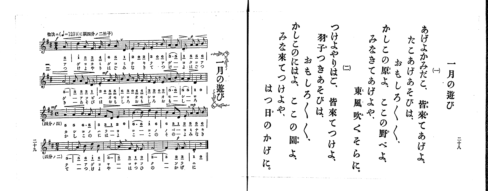

# 一月の遊び

> Re:Shōka 使用 AI 協助辨識與重建樂譜，可能會有錯誤。歡迎回報。

- **NEUTRINO 歌聲合成版**：<br><audio controls src="ichigatsu_no_asobi_neutrino.mp3"></audio>
- **鋼琴伴奏版**：<br><audio controls src="ichigatsu_no_asobi.mp3"></audio>


- 出處：共益商社樂器店《唱歌教科書 生徒用 巻一》第二十八～二十九頁（第十四曲）
- NDL Digital Collections PID 854862（https://dl.ndl.go.jp/pid/854862）掃描 P016.jpg

## 說明

原書資訊與歌詞全文（NDL PID 854862《唱歌教科書 生徒用 巻一》第二十八～二十九頁，掃描 P016.jpg）：
調性與拍號：に調四分ノ二拍子（D 大調 2/4 拍），♩=120，「愉快ニ」，弱起半拍（八分音符）；第三行改「四分ノ四」（4/4 拍，四小節）；第四行改回「四分ノ二」（2/4 拍，七小節）
註記：第二學期第七曲（全卷第十四曲）。分節歌，二節同一旋律。開頭標 f，第一行末小節標 p，第二行第三小節標 mf，第三行開頭標 mf、第四小節標 mp，第四行第六小節標 p；多處印有漸強漸弱記號、斷音記號與換氣記號（V）。第一行弱起八分音符五線譜為 A4（中音 5），簡譜誤印下加一點作「5_.」；第二行第三小節（第九小節）後半拍五線譜為單符尾八分音符 A4 二音（5_ 5_），簡譜於「0 5 5」下多印一條底線。


## 歌詞

```text
一、
あげよかみだこ、皆來てあげよ、
たこあげあそびは、
おもしろ〳〵、
かしこの原よ、ここの野べよ、
みなきてあげよや、
東風吹くそらに。

二、
つけよやりはご、皆來てつけよ、
羽子つきあそびは、
おもしろ〳〵、
かしこのにはよ、ここの園よ、
みな來てつけよや、
はつ日のかげに。
```

## ABC

```abc
X:1
T:一月の遊び
M:2/4
L:1/16
Q:1/4=120
K:D
V:V1 name="Piano" snm="Pia"
[V:V1]
[Q:1/4=120] !f! z2 z2 z2 A2 | d4 A2 F G | B4 A2 D2 | E4 z2 E2 |
w: 1.~あ | げ よ か み | だ こ み | な き
w: 2.~つ | け よ や り | は ご み | な き
F4 z2 B2 | A6 A2 | !p! D2 A2 A2 B2 | A8 |
w: 1.~て あ | げ _ | よ た こ あ | げ
w: 2.~て つ | け _ | よ は ご つ | き
A2 A2 F2 D2 | !mf! E2 z2 A2 A2 | B2 A2 z2 G G | F2 E2 z2 E2 |
w: 1.~_ あ そ び | は お も | し ろ お も | し ろ お
w: 2.~_ あ そ び | は お も | し ろ お も | し ろ お
A6 B2 | A4 A4 | D4 z4 | [M:4/4] !mf! A4 A4 B6 A2 |
w: 1.~も _ | し _ | ろ | か し こ の
w: 2.~も _ | し _ | ろ | か し こ の
A4 F2 D2 E4 z4 | B6 B2 d4 B4 | !mp! B4 A2 D2 E2 A2 A2 B2 | [M:2/4] A8 |
w: 1.~は ら _ よ | こ _ こ の | の べ _ よ み な き | て
w: 2.~に は _ よ | こ _ こ の | そ の _ よ み な き | て
A2 B2 d2 B2 | A8 | A2 F2 D2 E2 | F8 |
w: 1.~_ あ げ よ | や | _ こ ち ふ | く
w: 2.~_ つ け よ | や | _ は つ ひ | の
!p! F4 E2 F2 | D4 z2 z2 |
w: 1.~_ そ ら | に
w: 2.~_ か げ | に
```

## TMD 檔案連結

- [主旋律 TMD 檔案](ichigatsu_no_asobi.tmd) [[在 TMD Studio 編輯](https://tmdlang.github.io/Tmd-TS/#tmd=s7IKdvYPcrWy4qpTUCpJTLdSSM7PyUlNLsnMz7PKrsxPzc6ML87Iz05Ugisoy88pzU21yk7MizeMtzA1sTAzQkgW55cWJadaFSdn5OfnxJekVpQk5edno8vHFySmp1oFGBiaIWQKivLLUvMS84C6C4oy80pSU8DaEQpSyzJTUkHSxclAq8tSizLTMlNTkNyVWlQMcjXUipKixLzi5KLMApBXEKrSU_OKUq2SMzJzUopS8-KL8_PSEZJp-UW5VsUlRfkFGZnJCOGSjFSgh4sL8ouQnAMVTE0EGlGMEM4vykzPzLPKTc3MykTyv5aWwpMdDc_mdDxuXPeysetx42YFLS0uRVsFQyMDLntbBRcuGyN9EzuQMU_bd72YOfX9nllPWzc-n931dGrb8yX7nq1oejpzxdNd0x83dD2dsvHZ2p5nU2c-Xz7x2ewdCs-nzH-6b9LzKSsUnm7fDbTlcUP38zVrnuzqedrb-LR19fu98yDsJzvnvlzQ-H5PB1AWJDV79rPZm97v6QQ73s_FR8EF6PSSxBwFZ3gSKFYI8HRRgEQyUGNGSUlBsZW-fkqOXh4Qp-frZRXoF2Sm6MNUdD7ra37W368AilqgHDBoufS1FGypBbgUFBSe9s0HevrF5vYXK7pedLQDQ-LFynlPW1c8m9YOdCHIGwgnUyGwetB8BPQjMGpADnmxav-zhuUgJ3T3vpg5Hyj6uHE1UBAYrk872h439wENAko9XTsB6C4XhadLlgMlFYCxrAAUBRvT82jmSltgAgCyHjf0PGvpfLp_9ePm7scNQOmep3s2vti6_WlvF1h1B9BtQFNfzt_8fM0ysObZIGfv6HyxsOfZlJ1A7XBrgQywCR0mMKvAchv6n69vgOsEikB0Pp09D1kz0M0QzXB39jzZ0QzXDPb3it0vVswAehcabmt3PJszH-yYZnB6Ajp1xdPe7WiJ7HFDE9AGoCnA2AAZuqsHyH46AWh6w7Pp3U_3AX3d9HJa98sFa5-tmKmQBlQCNrIB5Mo5qyEOAMkUQGV29QBlIEGAkMyF6wOFC8K43LTHDY0QXyMphhoFCQoQo3Utij2zny6ZBcyJT3s3PJvT-WzPjqd7toPJjUDvAyMcaOSzaduBMQLhghJC_-xnGxZDuMBwCIN4G-4PaIwiReSTXVOeb5_1Yu2c5027FBxNgHqe7FgLlFIwhaSP5xsWAiVfrFoCdMOTHd1PuxYATXq5e96TvXOAkWYarweOK3BKwAgPSD4HJmN45D3dB0zYoOSEbO3TaeuADnm6YR-yu4BuUQCaCOQATTGNVzCNR3bPs2l7gLYbKJgqmALtB7lrySywAxueLZr7dNdUoNlAb3OB0go4gzWCWI8bmx43TnrcBCwAux837n_cuOBx42RQrMxqe7Kv7XHjMoQCmIb5IBUQURA5F1hoPm5cD5fuetwEFJ3-uKn3ccPmxw1b4RJA86eDta4DlhUQA8FckMjL9r7HjTuRbQE6ZdXjxl4UFzS1QKWfzd34ctGKpxN2Pm7sB7mgqROYx-GeA-UVqClLHjdOhOpsApbu6x83TkH1HEwBRMPzfXuB5QJYFGgzeZ4DuQSoA9V_T-egBCHIc-gugHsO7Mwlz6YvBRsGNBgYzmDPAeUoL6uhQEFLn4vLE1jfpieWFJf65TsW5ydlWgVkJublO9QY1FSDLFOwMTTTsgOzqsHVYC2ErQgqHKHsNAgNrE00IPlIU-Fx0yKFGiC5SeFx8wogvRpIzweJNDcAeZvhvC4gby2Y1YaiZw9YDKRzP0Q9UA7oWpA1NQoGCrpwbArENQqGcUAKBEFcYwUToJAZkoghWJERVASkDcSuAapEiIDU14BVwyDUaCBZXVAL5oEwWB3YIT6GNQrxQB4MAxMLWAcwsqAmAKMULN4Nim6wzAKYTONkMLkfqmMVVBxiTi9UdBmKKLrpMAgKM4g985FMBquGuNMI3Z1LoCZNRHVnUwsQd4Fl1sPdOYVkd6KbjulOkOkwk8GqYekHFPmgiN8DjvDHTXuB7MlgkX4gbxWQhiSR7UDWWhwiINVAvZAkBBaHJKa1iASEHMsQl8FiF5QiEKkFlC6qc9MQkQ9JViAWSMoEnNBAWmCKIckK2XjUZAWjIckKlvTAIvAkhS2CIVEBilJgcQQmN0MDGRSUkGDvApFNsEQyHcwDRRBMFiSHXQYSNSCdaNEFVosehSCdsMhGcjkwkUESxFBzebUNsDEGK9aAkY1Ii8BCC5R-wMVVHywVNq-EpE9g4QQyEyQHSq0INX1APBOuBlTQwYo5jPQHo2FlFUwMoQKWHpHLLoh3kPWA2PAiECaBWQSCDKnOxVmWgcopiAZE8EFKExgEVkaQoESUD02dcBYob6MEL5puVPMgZsHUwdjABgCKeZCSB1LuQMsbpORGvHtXw0UQLqfEvaCkjCqK373IdScobQGrO-RyDlJNgkSWwMVBKaoRiKeC09l6uDioTFwJ5nUTKtHg6QKzckMoQk5iiCoRoQYmAqoEQWpAfNTyC4SRkxGsOkCYAQkqSCkAKt0ggQXyVwsOtZBKbCGY3ApR29iPVS1EPbhsASdG5OiGVXnIiQaX60AVEaTSIuw6SAUG0bEJaicsIWBzHSihQnyO3XW1XFy6dgroTTEFoJgyFwA)]
- [鋼琴伴奏 TMD 檔案](ichigatsu_no_asobi_piano.tmd) [[在 TMD Studio 編輯](https://tmdlang.github.io/Tmd-TS/#tmd=s7IKdvYPcrWy4tLSUniyo-HZnI7HjeteNnY9btz8fk_Hy-49zydsebJny9Ol_c87O97v6VTQ0uJStFUwNDLgsrdVcOGyMdI3seOqU1B62r7rxcyp7_fMetq68fnsrqdT254v2fdsRdPTmSue7pr-uKHr6ZSNz9b2PJs68_nyic9m71B4PmX-032Tnk9ZofB0-26g1Y8bup-vWfNkV8_T3sanravf750HYT_ZOfflgkagY4CyIKnZs5_N3gR0iRLIVj8XHwWXzPTMksQcBef8nJzU5JLM_LxihQBPFwULUxMLMyOgxoySkoJiK339lBy9PCBOz9fLKtAvyEzRh6nofNbX_Ky_XyHAwNAMKJeuxMXlmZyRmZ5YUlzql-9YnJ-UaRWQmZiXH-ThUGNQU82lAAQ2hmZadmBWNTgQaiFsRVtg2EDZaRBaX0tB4-mejS-2btdUeNy0SKEGSG5SeNy8AkivBtLzQSLNDUDeZjivC8hbC2a1oejZAxYD6dwPUQ-U09IHW1OjYKCgC8emQFyjYBgHpEAQxDVWMAEKmSGJGIIVGUFFQNpA7BqgSoQISH0NWDUMQo0GktUFtWAeCIPVgR3iY1ijEA_kwfDjxiawjseNk6AmPG7qAIt3A_F-sMwCmEzjZDC5H6pjFVQcYk4vVHQZiii66TAICjOIPfORTAarhrjTCN2dS6AmTUR1Z1MLEHeBZdbD3TmFZHeim47pTpDpMJPBqmHpBxT5oIjfA47wx017gezJYJF-IG8VkIYkke1A1locIiDVQL2QJAQWhySmtYgEhBzLEJfBYheUIhCpBZQuqnPTEJEPSVYgFkjKBJzQQFpgiiHJCtl41GQFoyHJCpb0wCLwJIUtgiFRAYrSx41zweRmaCCDghIS7F0gsgmWSKaDeaAIgsmC5LDLQKIGpBMtusBq0aMQpBMW2UguByYySIIYai6vtjFBFGvAyEakRWChBUo_4OKqD5YKm1dC0iewcAKZCZIDpVaEmj4gnglXAyroYMUcRvqD0bCyCiaGUAFLj8hlF8Q7yHpAbHgRCJPALAJBhlTn4izLQOUURAMi-CClCQwC60xIUCLKh6ZOOAuUt1GCF003qnkQs2DqYOzHjTtRzIOUPJByB1reICU34t27Gi6CcDkl7gUlZVRR_O5FrjtBaQtY3SGXc5BqEiSyBC4OSlGNQDwVnM7Ww8VBZeJKMK-bUIkGTxeYlRtCEXISQ1SJCDUwEVAlCFID4qOWXyCMnIxg1QHCDEhQQUoBUOkGCSyQv1pwqIVUYgvB5FaI2sZ-rGoh6sFlCzgxIkc3rMpDTjS4XAeqiCCVFmHXQSowiI5NUDthCQGb60AJFeJz7K6rxdUS80FuiZlAG2LABPSir-tle-_T1h0vZ7dC2q2ItGAYrxBtGAtkoDBNgEwTVCYs7cQD-abxGMqwaMZrA1ZziLcDxsS0A0k9PjtwKcNtB3aHYNWMzR9AOQNI5OnaKaDHX7QPUBtWcSOwuDIXAA)]

## 分析

```text
================================================================================
📊 TMD Song Profile: [ 一月の遊び ]
================================================================================
⏱  Duration:       0:30 (30.0s), 26 measures total
🎼 Key & Tempo:    首調基準 D, != 120.0 BPM, <2/4>
   - 分析範圍：      由實際發聲的音符與和弦推測調性；播放脈絡另行呈現
🎤 人聲音域:    D4 (MIDI 62) – D5 (MIDI 74) [跨度: 12 個半音 / 1.0 個八度, 難度: easy]
   - 最低音:  D4 in [IchigatsuNoAsobi #1 @ m.3, 0:02]
   - 最高音: D5 in [IchigatsuNoAsobi #1 @ m.2, 0:01]
   - 適合: soprano, mezzo-soprano, contralto, tenor, baritone, bass
🏛  結構:      IchigatsuNoAsobi (30.0s)
⚡ 編曲密度:        Peak 1 軌道同時演奏
🗝  調性診斷：       A 大調（純淨自然大調，未偵測到可信轉調）
   - 風格氣質:    純淨自然大調（陽光明朗、易唱易記，無明顯調外色彩）
   - 轉調歷程:    全曲維持單一推測調性（未偵測到可信轉調）
   - 核心骨幹音:  A, B, D, F#, E
   - 調性數值:    A 大調 [相關度: 0.80, 穩定度: Moderate, 自然音純度: 98.6%]
   - 候選調性 (K-S): A 大調 (0.80), D 大調 (0.69), A 小調 (0.60)
   - 五度圈歷程:   +3
   - 各段落調性細節:
     • [IchigatsuNoAsobi #1]: A 大調 (r: 0.80, 自然音純度: 98.6%, 調外音: G)

  [ 五度圈游移軌跡 ]
               C  
         F            G  
      Bb               D  
      Eb              [A ]*
         Ab           E  
            Db       B  
               F# 
     (* = active key center)

  [ 十二半音累積音高分佈 ]
     C  :                            0.0%
     C# :                            0.0%
     D  : ████████                  14.2%
     D# :                            0.0%
     E  : ██████                    10.4%
     F  :                            0.0%
     F# : ███████                   12.7%
     G  : █                          1.4%
     G# :                            0.0%
     A  : ████████████████████████  42.5%
     A# :                            0.0%
     B  : ███████████               18.9%
--------------------------------------------------------------------------------
Assignment 軌道音域：
  - Piano         : D4 – D5 (12 個半音 / 1.0 個八度, 72 個音符)
================================================================================
```


## 原書掃描頁




