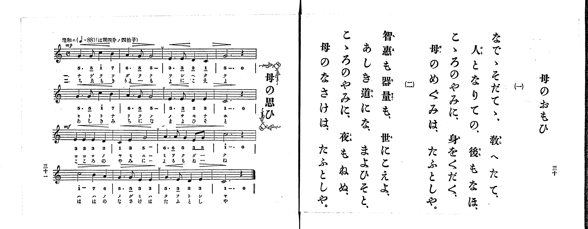

# 母のおもひ

> Re:Shōka 使用 AI 協助辨識與重建樂譜，可能會有錯誤。歡迎回報。

- **鋼琴伴奏版**：<br><audio controls src="haha_no_omoi.mp3"></audio>
- **NEUTRINO 歌聲合成版**：<br><audio controls src="haha_no_omoi_neutrino.mp3"></audio>

- 出處：共益商社樂器店《唱歌教科書 生徒用 巻一》第三十～三十一頁（第十五曲）
- NDL Digital Collections PID 854862（https://dl.ndl.go.jp/pid/854862）掃描 P017.jpg

## 說明

原書資訊與歌詞全文（NDL PID 854862《唱歌教科書 生徒用 巻一》第三十～三十一頁，掃描 P017.jpg）：
調性與拍號：は調四分ノ四拍子（C 大調 4/4 拍），♩=88，「温和ニ」
註記：第三學期第一曲（全卷第十五曲）。目次與歌詞頁（右頁）標題作「母のおもひ」，樂譜頁（左頁）標題作「母の思ひ」。全曲十六小節，分節歌，二節同一旋律。開頭標 mp，第三行（第九小節起）標 mf；各行印有漸強漸弱記號，每行第二小節末印有換氣記號（V）。第一行第三小節第三、四拍五線譜為四分音符 D4、C4（2、1），簡譜誤加底線作八分音符「2_ 1_」。第三行末小節第二節譜下配字作「ね」，右頁歌詞作「夜もねぬ、」。


## 歌詞

```text
一、
なでゝそだてゝ、教へたて、
人となりての、後もなほ、
こゝろのやみに、身をくだく、
母のめぐみは、たふとしや。

二、
智惠も器量も、世にこえよ、
あしき道にな、まよひそと、
こゝろのやみに、夜もねぬ、
母のなさけは、たふとしや。
```

## ABC

<div class="abc-score" data-abc-src="haha_no_omoi.abc" aria-label="五線譜載入中"></div>

[下載 ABC 原始檔](haha_no_omoi.abc)

## TMD 檔案連結

- [主旋律 TMD 檔案](haha_no_omoi.tmd) [[在 TMD Studio 編輯](https://tmdlang.github.io/Tmd-TS/#tmd=s7IKdvYPcrWy4qpTUCpJTLdSSM7PyUlNLsnMz7PKrsxPzc6ML87Iz05Ugisoy88pzU21yk7MizeMtzA1sTAzQkgW55cWJadaFSdn5OfnxJekVpQk5edno8vHFySmp1oFGBiaI2QKivLLUvMS84C6C4oy80pSU8DaEQpSyzJTUkHSxclAq8tSizLTMlNTkNyVWlQMcjXUipKixLzi5KLMApBXEKrSU_OKUq2SMzJzUopS8-KL8_PSEZJp-UW5VsUlRfkFGZnJCOGSjFSgh9MSczNzKtFFU3PzUS3IL8pMz8yzyk3NzMrEEgD5RSUZ-elFiQUZlVYZmcUlQOXJiTnxwNAEBrGWlsKz9b2PG9c9bux63NT0uHGTgpYWl6KtgoUFl72tgjOXjYm-iR3IrKftu17MnPp-z6ynrRufz-56OrXt-ZJ9z1Y0PZ254umu6Y8bup5O2fhsbc-zqTOfL5_4bPYOhedT5j_dN-n5lBUKT7fvfrKj4XFD9_M1a57s6Hza2_h-7zwIAyj-ckHj-z0dQCkQd9eUZ7M3vd_TCXa-n4uPggvQbyWJOQrO8ERSrBDg6aIASQZAjRklJQXFVvr6KTl6eUCcnq-XVaBfkJmiD1PR-ayv-Vl_vwIo8oFywMDn0tdSsKUW4FJQUHjaNx_o4xeb21-s6HrR0Q4Mhhcr5z1tXfFsWjvQhSBvIJxMaUj1oHkH6EFgpIBc8WLV_mcNy0H2d_e-mDkfKPq4cT1Q8Ons2U872h439wEZQKmnaycAHeWs8HTJcqCkAjB-FYCiYGN6Hs1caWthAWQ8buh5tmPl00k9j5u7Hzf0go1fsfvFihlAU6FuW7vj2Zz5YHYDOM46gB5-2rsdLSIfNzQ9n73u2ZqF8HCBxPfT_s1gRuezFTNfLux5sncOyErUpAi0GOTfFU0v1s6B6tq-DJeuZw1zIVqANoKCfvYmoDOetq59uqH_-foGoDnAMAAygG4Asp_s6gGyn07oATl-evfTfUBPNr2c1v1ywVqgyQq5BUA1EG--WAhUD0qdT3bOhRj1Yut2iAMUctPe75n9dEILUM3T3g3P5nQ-27Pj6Z7tYHIjMKzAkQB0Xj9QAciEXT0QE57NWQ1V3z_72YbFMJUdYdDwAocpVA8woMF6IOzHDY2QSASG7_Pts4Dh8rxpFyR-X87f_HzNMgUXE6AaZxOgacCU1mgIidbnGxYClb5YteRp14Knu6YCdQJD7mnrarg2YCgaxSsYxkOCD-5zkEPhtoODDGjMkx3dL1uBqWg6JPQfN66FxBMkRiFxDJF6umQOOCLXPm5cA3QMxHAuUFoCJ_JGEOtx46rHjcsfNwEjD4gWPG5cBmI3NAJzx-PGHY8b54NEIEqf7Nr1uHEFSENTF0gUmFKAwbGvB2wH0JTdcCMng8xoAqelppbHjfsfN64Gyr3Ytfpx06THjf1ge_qhqqFprqnxceMEsNL1IKeC7N0Ktm06yAiYs3cBMwZE18xdz5oXAG0GFn8v2_tBTmgAZtFpIJuA1jd2PG7qgDsH6Lzpjxt7X4IkgNKrwBbsA6kAJliQt1cQcDlaQCI5G-TvqY8bJ-J0NlAp5WUcFCho6XNxeSRmJPrl--fmZ1oFZCbm5TvUGNRUg6xRsLHQsgMzqnMLasEMYDn7uLkLiNuBuE3hcdNehRogqwHCA2IQbxNQfDuQngGk94NF2kAWgfTXKJgq6AKhqYJhHJAyB-IaBTOoEEQKJGIMpo0VjICkIVgEJgeCBiARsHE-hkDTG1eBRYGJDoiXgVlzwXqAqQIqswwqAzEdmGag4tOBeAeYNR-qA6YKBOMR9hiB5BZCdDVNBOImsK5eqHnA4q0dqgkiBbOoA2rRalBKALNAIggZdIvA4TsJiDuguAscfqug4dsH5vUBcSMQL4LLz6YgfEHsGnAo4wrfTVBPrABjEAsU4mB_I4XvOoS3oWxQiMFCCqqjcTee8IUEHCRWQCELzC1QXdCQBwcjJLYh4vugQQ4MKbArETEPciemPdW5aYh03LQZgpvXwkN2CRDPB-JuIN4DFgHxQOl5PTSVg0WBPHh4g4IPhkHBCQlKEA8R3JAIMAOLGANJoBpQ7OAKb0hCAZNNkHAAhSfI3hZ4qIDCAhEOIBGQamDKaewHy4JSPkgGxMMV3iTbA0vOTcDwgcbrWqg9a7DaA07O_VAMCWJQktgADdh-sKH7gaypkOQOLDYg0QAPXnhAgZIyKBwRKRwW6jARYpPzeqg4hIXwdCNUdALc6yB5kA5Q4QDib4VngOlIAYUreHHYAy-ugH5unEi2PbVcXLp2CoiyWwHIU-YCAA)]
- [鋼琴伴奏 TMD 檔案](haha_no_omoi_piano.tmd) [[在 TMD Studio 編輯](https://tmdlang.github.io/Tmd-TS/#tmd=s7IKdvYPcrWy4qpTUCpJTLdSyC8qychPL0osyKi0ysgsLskvykxOzInPTsxLVOLS0lJ4tr73ceO6x41dj5uaHjduer-n42X3nucTtjzZs-Xp0v7nnR3v93QqaGlxKdoqWFhw2dsqOHPZmOib2IEseNq-68XMqe_3zHrauvH57K6nU9ueL9n3bEXT05krnu6a_rih6-mUjc_W9jybOvP58onPZu9QeD5l_tN9k55PWaHwdPvuJzsaHjd0P1-z5smOzqe9je_3zoMwgOIvFzQCHQKUAnF3TXk2G-iuTiWQlX4uPgoumemZJYk5Cs75OTmpySWZ-XnFCgGeLgoWpiYWZkZAjRklJQXFVvr6KTl6eUCcnq-XVaBfkJmiD1PR-ayv-Vl_v0KAgaE5UC5diYvLIzEj0S_fPzc_0yogMzEvP8jDocagpppLAQhsLLTswIzq3IJaMENfS-FxcxcQtwNxm8Ljpr0KNUBWA4QHxCDeJqD4diA9A0jvB4u0KWjpg_XXKJgq6AKhqYJhHJAyB-IaBTOoEEQKJGIMpo0VjICkIVgEJgeCBiARsHE-hkDTG1eBRR83LgfiZWDWXLCex40LoDLLoDIQ0x83TYKKTwfiHWDWfKgOmCoQjEfYYwSSWwjR1TQRiJvAunqh5gETUTtUE0QKZlEH1KLVQDwZzAKJIGTQLQKH7yQg7oDiLnD4rYKGbx-Y1wfEjUC8CC4_m4LwBbFrwKGMK3w3QT2xAoxBLFCIg_2NFL7rEN6GskEhBgspqI7G3XjCFxJwkFgBhezjxv1QXdCQBwcjJLYh4vugQQ4MKbArETEPciemPdW5aYh03LQZgpvXwkN2CRDPB-JuIN4DFgHxQOl5PTSVg0WBPHh4g4IPhkHBCQlKEA8R3JAIMAOLGANJoBpQ7OAKb0hCAZNNkHAAhSfI3hZ4qIDCAhEOIBGQamDKaewHy4JSPkgGxMMV3iTbA0vOTcDwgcbrWqg9a7DaA07O_VAMCWJQktgADdh-sKH7gaypkOQOLDYg0QAPXnhAgZIyKBwRKRwW6jARYpPzeqg4hIXwdCNUdALc6yB5kA5Q4QDib4VngOlIAYUreHHYAy-ugH5unEi2PbWYRbcPctFtAi26gVHwoq_rZXvv09YdL2e3Qqo3pPCNV4g2jFUwjQfSpvGxQJEaBRMg2yQWJgXxElwlTBQU7DBNCN3kmoqiEs0mklWi2UQFE_GrNIBEh66dAiJGon2AcmgiRmARZS4A)]

## 分析

```text
================================================================================
📊 TMD Song Profile: [ 母のおもひ ]
================================================================================
⏱  Duration:       0:43 (43.6s), 16 measures total
🎼 Key & Tempo:    首調基準 C, != 88.0 BPM, <4/4>
   - 分析範圍：      由實際發聲的音符與和弦推測調性；播放脈絡另行呈現
🎤 人聲音域:    C4 (MIDI 60) – C5 (MIDI 72) [跨度: 12 個半音 / 1.0 個八度, 難度: easy]
   - 最低音:  C4 in [HahaNoOmoi #1 @ m.3, 0:07]
   - 最高音: C5 in [HahaNoOmoi #1 @ m.1, 0:01]
   - 適合: soprano, mezzo-soprano, contralto, tenor, baritone, bass
🏛  結構:      HahaNoOmoi (43.6s)
⚡ 編曲密度:        Peak 1 軌道同時演奏
🗝  調性診斷：       C 大調（純淨自然大調，未偵測到可信轉調）
   - 風格氣質:    純淨自然大調（陽光明朗、易唱易記，無明顯調外色彩）
   - 轉調歷程:    全曲維持單一推測調性（未偵測到可信轉調）
   - 核心骨幹音:  G, C, E, A, D
   - 調性數值:    C 大調 [相關度: 0.87, 穩定度: Moderate, 自然音純度: 100.0%]
   - 候選調性 (K-S): C 大調 (0.87), E 小調 (0.78), G 大調 (0.76)
   - 五度圈歷程:   +0
   - 各段落調性細節:
     • [HahaNoOmoi #1]: C 大調 (r: 0.87, 自然音純度: 100.0%)

  [ 五度圈游移軌跡 ]
              [C ]*
         F            G  
      Bb               D  
      Eb               A  
         Ab           E  
            Db       B  
               F# 
     (* = active key center)

  [ 十二半音累積音高分佈 ]
     C  : ███████████████████       25.0%
     C# :                            0.0%
     D  : █████                      6.7%
     D# :                            0.0%
     E  : ████████████████          21.7%
     F  :                            0.0%
     F# :                            0.0%
     G  : ████████████████████████  31.7%
     G# :                            0.0%
     A  : ████████                  10.0%
     A# :                            0.0%
     B  : ████                       5.0%
--------------------------------------------------------------------------------
Assignment 軌道音域：
  - Piano         : C4 – C5 (12 個半音 / 1.0 個八度, 49 個音符)
================================================================================
```


## 原書掃描頁




