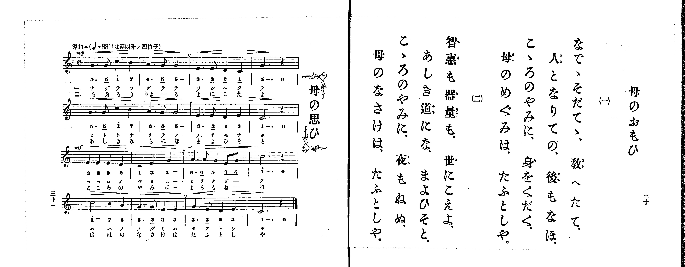

# 母のおもひ

> Re:Shoka 使用 AI 協助辨識與重建樂譜，可能會有錯誤。歡迎回報。

<audio controls src="haha_no_omoi.mp3"></audio>

- 出處：共益商社樂器店《唱歌教科書 生徒用 巻一》第三十～三十一頁（第十五曲）
- NDL Digital Collections PID 854862（https://dl.ndl.go.jp/pid/854862）掃描 P017.jpg

## 說明

原書資訊與歌詞全文（NDL PID 854862《唱歌教科書 生徒用 巻一》第三十～三十一頁，掃描 P017.jpg）：
調性與拍號：は調四分ノ四拍子（C 大調 4/4 拍），♩=88，「温和ニ」
註記：第三學期第一曲（全卷第十五曲）。目次與歌詞頁（右頁）標題作「母のおもひ」，樂譜頁（左頁）標題作「母の思ひ」。全曲十六小節，分節歌，二節同一旋律。開頭標 mp，第三行（第九小節起）標 mf；各行印有漸強漸弱記號，每行第二小節末印有換氣記號（V）。第一行第三小節第三、四拍五線譜為四分音符 D4、C4（2、1），簡譜誤加底線作八分音符「2_ 1_」。第三行末小節第二節譜下配字作「ね」，右頁歌詞作「夜もねぬ、」。

## 歌詞

```text
一、
なでゝそだてゝ、教へたて、
人となりての、後もなほ、
こゝろのやみに、身をくだく、
母のめぐみは、たふとしや。

二、
智惠も器量も、世にこえよ、
あしき道にな、まよひそと、
こゝろのやみに、夜もねぬ、
母のなさけは、たふとしや。
```

## ABC

```abc
X:1
T:母のおもひ
M:4/4
L:1/16
Q:1/4=88
K:C
V:V1 name="Piano" snm="Pia"
[V:V1]
!mp! G6 G2 c4 B4 | A6 G2 G8 | E6 E2 D4 C4 | G,12 z4 |
G6 G2 c4 B4 | A6 G2 G8 | E6 E2 D4 E4 | C12 z4 |
!mf! E4 E4 E4 D4 | C4 E4 G8 | A6 A2 G4 E2 G2 | c12 z4 |
c8 B4 A4 | G6 G2 E4 E4 | G6 E2 D4 E4 | C12 z4 |
!mp! G6 G2 c4 B4 | A6 G2 G8 | E6 E2 D4 C4 | G,12 z4 |
G6 G2 c4 B4 | A6 G2 G8 | E6 E2 D4 E4 | C12 z4 |
!mf! E4 E4 E4 D4 | C4 E4 G8 | A6 A2 G4 E2 G2 | c12 z4 |
c8 B4 A4 | G6 G2 E4 E4 | G6 E2 D4 E4 | C12 z4 |
```

## TMD 檔案連結

- [主旋律 TMD 檔案](haha_no_omoi.tmd) [[在 TMD Studio 編輯](https://tmdlang.github.io/Tmd-TS/#tmd=s7IKdvYPcrWy4qpTUCpJTLdSSM7PyUlNLsnMz7PKrsxPzc6ML87Iz05Ugisoy88pzU21yk7MizeMtzA1sTAzQkgW55cWJadaFSdn5OfnxJekVpQk5edno8vHFySmp1oFGBiaI2QKivLLUvMS84C6C4oy80pSU8DaEQpSyzJTUkHSxclAq8tSizLTMlNTkNyVWlQMcjXUipKixLzi5KLMApBXEKrSU_OKUq2SMzJzUopS8-KL8_PSEZJp-UW5VsUlRfkFGZnJCOGSjFSgh9MSczNzKtFFU3PzIRZoaSk8W9_7uHHd48aux01Njxs3KWhpcSnaKlhYcNnbKjhz2Zjom9iBdD9t3_Vi5tT3e2Y9bd34fHbX06ltz5fse7ai6enMFU93TX_c0PV0ysZna3ueTZ35fPnEZ7N3KDyfMv_pvknPp6xQeLp995MdDY8bup-vWfNkR-fT3sb3e-dBGEDxlwsa3-_pAEqBuLumPJu96f2eTrCD_Vx8FFwy0zNLEnMUnOERXKwQ4OmiAIlCoMaMkpKCYit9_ZQcvTwgTs_XyyrQL8hM0Yep6HzW1_ysv18BFHFAOWDAcelrKdhSC3ApKCg87ZsP9PGLze0vVnS96GgHBsOLlfOetq54Nq0d6EKQNxBOpjSketC8A_QgMFJArnixav-zhuUg-7t7X8ycDxR93LgeKPh09uynHW2Pm_uADKDU07UTgI5yVni6ZDlQUgEYvwpAUbAxPY9mrrS1sAAyHjf0PNux8umknsfN3Y8besHGr9j9YsUMoKlQt63d8WzOfDC7ARxnHUAPP-3djhaRjxuans9e92zNQni4QOL7af9mMKPz2YqZLxf2PNk7B2QlalIEWgzy74qmF2vnQHVtX4ZL17OGuRAtQBtBQT97E9AZT1vXPt3Q_3x9A9AcYBgAGUA3ANlPdvUA2U8n9IAcP7376T6gJ5teTut-uWAt0GSF3AKgGog3XywEqgelzic750KMerF1O8QBCrlp7_fMfjqhBajmae-GZ3M6n-3Z8XTPdjC5ERhW4EgAOq8fqABkwq4eiAnP5qyGqu-f_WzDYpjKjjBoeIHDFKoHGNBgPRD244ZGSCQCw_f59lnAcHnetAsSvy_nb36-ZpmCiwlQjbMJ0DRgSms0hETr8w0LgUpfrFrytGvB011TgTqBIfe0dTVcGzAUjeIVDOMhwQf3OcihcNvBQQY05smO7petwFQ0HRL6jxvXQuIJEqOQOIZIPV0yBxyRax83rgE6BmI4FygtgRN5I4j1uHHV48blj5uAkQdECx43LgOxGxqBueNx447HjfNBIhClT3btety4AqShqQskCkwpwODY1wO2A2jKbriRk0FmNIHTUlPL48b9jxtXA-Ve7Fr9uGnS48Z-sD39UNXQNNfU-LhxAljpepBTQfZuBds2HWQEzNm7gBkDomvmrmfNC4A2A4u_l-39ICc0ALPoNJBNQOsbOx43dcCdA3Te9MeNvS9BEkDpVWAL9oFUABMsyNsrCLgcLSCRnA3y99THjRNxOhuolPIyDgoUtPS5uDwSMxL98v1z8zOtAjIT8_IdagxqFKpB9ijYWGjZgRnVuQW1YAawoH3c3AXE7UDcpvC4aa9CDZDVAOEBMYi3CSi-HUjPANL7wSJtIJtA-msUTBV0gdBUwTAOSJkDcY2CGVQIIgUSMQbTxgpGQNIQLGIaD5UEQQOQEMI9k4C4A4q7wPatgrqnD8zrA-JGIF4El59NgXtA7BqwqzCdU52bhginps0Q3LwW7pIlQDwfiLuBeA9YBMQDhdd6aCiCRYE8uPtA1sEwyHqI1SAewnkQB5uBRYyBJFANyDc4gqsfiiFOWgi0bgPUIf1gy_cDWVMhwQmMRoiz4c6BGwwKKpC9iBCEuRImgj-4arm4dO0UEIlPAYOnzAUA)]

## 分析

```text
================================================================================
📊 TMD Song Profile: [ 母のおもひ ]
================================================================================
⏱  Duration:       1:27 (87.3s), 32 measures total
🎼 Key & Tempo:    首調基準 C, != 88.0 BPM, <4/4>
   - 分析範圍：      由實際發聲的音符與和弦推測調性；播放脈絡另行呈現
🎤 人聲音域:    G3 (MIDI 55) – C5 (MIDI 72) [跨度: 17 個半音 / 1.4 個八度, 難度: challenging]
   - 最低音:  G3 in [HahaNoOmoi #1 @ m.4, 0:08]
   - 最高音: C5 in [HahaNoOmoi #1 @ m.1, 0:01]
   - 適合: mezzo-soprano, contralto, tenor, baritone, bass
🏛  結構:      HahaNoOmoi (43.6s) -> HahaNoOmoi (43.6s)
⚡ 編曲密度:        Peak 1 軌道同時演奏
🗝  調性診斷：       C 大調（純淨自然大調，未偵測到可信轉調）
   - 風格氣質:    純淨自然大調（陽光明朗、易唱易記，無明顯調外色彩）
   - 轉調歷程:    全曲維持單一推測調性（未偵測到可信轉調）
   - 核心骨幹音:  G, C, E, A, D
   - 調性數值:    C 大調 [相關度: 0.87, 穩定度: Moderate, 自然音純度: 100.0%]
   - 候選調性 (K-S): C 大調 (0.87), E 小調 (0.78), G 大調 (0.76)
   - 五度圈歷程:   +0 -> +0
   - 各段落調性細節:
     • [HahaNoOmoi #1]: C 大調 (r: 0.87, 自然音純度: 100.0%)
     • [HahaNoOmoi #2]: C 大調 (r: 0.87, 自然音純度: 100.0%)

  [ 五度圈游移軌跡 ]
              [C ]*
         F            G  
      Bb               D  
      Eb               A  
         Ab           E  
            Db       B  
               F# 
     (* = active key center)

  [ 十二半音累積音高分佈 ]
     C  : ███████████████████       25.0%
     C# :                            0.0%
     D  : █████                      6.7%
     D# :                            0.0%
     E  : ████████████████          21.7%
     F  :                            0.0%
     F# :                            0.0%
     G  : ████████████████████████  31.7%
     G# :                            0.0%
     A  : ████████                  10.0%
     A# :                            0.0%
     B  : ████                       5.0%
--------------------------------------------------------------------------------
Assignment 軌道音域：
  - Piano         : G3 – C5 (17 個半音 / 1.4 個八度, 98 個音符)
================================================================================
```


## 原書掃描頁




