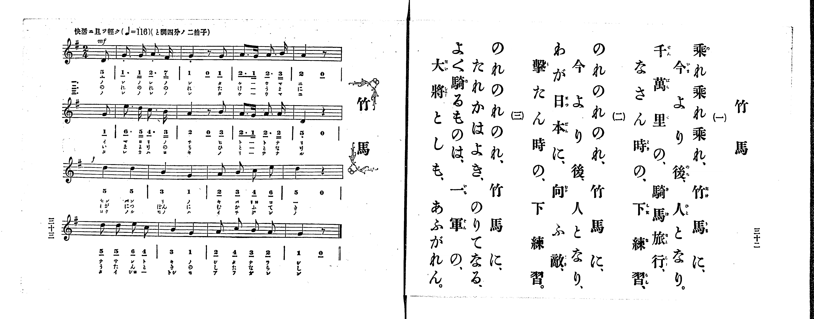

# 竹馬

> Re:Shōka 使用 AI 協助辨識與重建樂譜，可能會有錯誤。歡迎回報。

- **NEUTRINO 歌聲合成版**：<br><audio controls src="takeuma_neutrino.mp3"></audio>
- **鋼琴伴奏版**：<br><audio controls src="takeuma.mp3"></audio>


- 出處：共益商社樂器店《唱歌教科書 生徒用 巻一》第三十二～三十三頁（第十六曲）
- NDL Digital Collections PID 854862（https://dl.ndl.go.jp/pid/854862）掃描 P018.jpg

## 說明

原書資訊與歌詞全文（NDL PID 854862《唱歌教科書 生徒用 巻一》第三十二～三十三頁，掃描 P018.jpg）：
調性與拍號：と調四分ノ二拍子（G 大調 2/4 拍），♩=116，「快活ニ且ツ輕ク」，弱起半拍（八分音符）
註記：第三學期第二曲（全卷第十六曲）。分節歌，三節同一旋律（譜下配字一、三節印片假名，二節印平假名）。開頭標 mf，第三行標 f。第一、二行各以八分音符弱起開始，第一行末以四分音符加八分休止符收尾（與第二行弱起合成完整小節），第二行末為四分音符加四分休止符（第三、四行無弱起），第四行末為四分音符加八分休止符。第一行前二小節五線譜附斷音記號。五線譜與簡譜一致。


## 歌詞

```text
一、
乘れ乘れ乘れ、竹馬に、
今より後、人となり、
千萬里の、騎馬旅行、
なさん時の、下練習。

二、
のれのれのれ、竹馬に、
今より後、人となり、
わが日本に、向ふ敵、
撃たん時の、下練習。

三、
のれのれのれ、竹馬に、
たれかはよき、のりてなる、
よく騎るものは、一軍の、
大將としも、あふがれん。
```

## ABC

```abc
X:1
T:竹馬
M:2/4
L:1/16
Q:1/4=116
K:G
V:V1 name="Piano" snm="Pia"
[V:V1]
!mf! z2 z2 z2 D2 | G3 G A3 F | G4 z2 G2 | A3 G A3 B |
w: 1.~の | れ の れ の | れ た | け _ う ま
w: 2.~の | れ の れ の | れ た | け _ う ま
w: 3.~の | れ の れ の | れ た | け _ う ま
A4 z2 G2 | e3 d c3 B | A4 z2 B2 | A3 G A3 A |
w: 1.~に い | ま よ り の | ち ひ | と _ と な
w: 2.~に い | ま よ り の | ち ひ | と _ と な
w: 3.~に た | れ か は よ | き の | り _ て な
D4 z4 | !f! d4 d4 | B4 G4 | A2 B2 c2 e2 |
w: 1.~り | せん ばん | り の | き ば りょ こ
w: 2.~り | わが にっ | ぽん に | む か ふ て
w: 3.~る | よく のる | もの は | い ち ぐ ん
d4 z4 | d2 d2 e2 c2 | B4 G4 | A2 c2 B2 A2 |
w: 1.~_ | な さ ん と | き の | し た な ら
w: 2.~き | う た ん と | き の | し た な ら
w: 3.~の | た い しょ _ | と し | も あ ふ が
G4 z2 z2 |
w: 1.~し
w: 2.~し
w: 3.~れん
```

## TMD 檔案連結

- [主旋律 TMD 檔案](takeuma.tmd) [[在 TMD Studio 編輯](https://tmdlang.github.io/Tmd-TS/#tmd=s7IKdvYPcrWy4qpTUCpJTLdSSM7PyUlNLsnMz7PKrsxPzc6ML87Iz05Ugisoy88pzU21yk7MizeMtzA1sTAzQkgW55cWJadaFSdn5OfnxJekVpQk5edno8vHFySmp1oFGBhaIGQKivLLUvMS84C6C4oy80pSU8DaEQpSyzJTUkHSxclAq8tSizLTMlNTkNyVWlQMcjXUipKixLzi5KLMApBXEKrSU_OKUq2SMzJzUopS8-KL8_PSEZJp-UW5VsUlRfkFGZnJCOGSjFSgh4sL8ouQnAMRzM3MySxJLKpEFwfaXpaagxDNL8pMz8yzyk3NzMpEChYtLYXnq3e-XLZGQUuLS9FWwdDQjMveVsGdy8ZI38QOpPtp-64XM6e-3zPraevG57O7nk5te75k37MVTU9nrni6a_rjhq6nUzY-W9vzbOrM58snPpu9Q-H5lPlP9016PmWFwtPtu5_saHjc0P18zZonOzqf9jY-2dXzfu88KHtH58sFje_3dABlgdynrWufzd70fk8n2M1-Lj4KLkAXlyTmKDjDE0SxQoCniwIkyoEaM0pKCoqt9PVTcvTygDg9Xy-rQL8gM0UfpqLzWV_zs_5-BVBEA-WAAc2lr6VgSy3ApaCg8LRvPtDTLza3v1jR9aKjHRgSL1bOe9q64tm0dqALQd5AOJkKgdWD5iOgH4FRA3LIi1X7nzUsBzmhu_fFzPlA0ceNK4CCT2fPftrR9ri5D2gcUOrp2glAd7krPF2yHCipAIxlBaAo2JieRzNX2gITAJD1uKHn6f7Vz7bsftzc_WTHlMfNLS_2TH3ctP5xA1Bpz9M9G19s3f60twuss-Np62qgDS_nb36-ZhnQILBjVux-sWIG0A1Qz6zd8WzOfBAb6AZQJAP1rHjaux0t5h83NAENer6-ARhEQGuAGoHspxOAjIZn07uf7usGanyxds6THd0vW4EemQ4OL1DQgJT1bnje2f60sf3pBJATgRZBBJ_u3AwTBJn_clr3ywVrn62YqZCbBlQGcd6LhT0gkTSgPFgAbOquHqDw0wktT3YvRfYgxO9AY54uBzoHYkADyIA5q0EqwYENVdm1AKLxyZ6Jz9YuAoo8m7Lt6YZ9IE90tEMCA2QFJDAndDzrmPB0HTBpbHm6oR_odkiUwJUBzX_etAvdfDAXbj4kLwE9BHQ_UAqo63nLQoj5cNMg4thNQ3UtPDRAjuzsBToD4rAnu6Y83z4LGA8vZ7Y8m7YdqB0Y1cAUB1QPlwJ5cMNCcFw1vGjfApTiAiULSNCCWTtnPG7qQSaBEpCS6HHjapii3V2PmzoeN3U93QeSfrJrFzBJP25cBRSBqnja2_xiwpqX7T2PG9cBhV6u6AMa8Gx6K9DJUBUg5Y3ApDv52cwmiCJg8nm-fcvz_ZPgrtqFULwO5BJkkhxXPW7qf9zY82z60mdzoPqeTpj4uHHrs6lboSqeTWp-3Dgfv6vA0Ui0q8DGAaW7HzeuBzmvsRcoAVbd9bhxGdh53XDnAaX7gWEFEmoC2w_UA3JCw4vdvRDngAN3yfKnG9rBnpsOUgcyD6h6K9BvIKuaJoOcClRHeUEKBQpa-lxcIYnZqaW5iVYBmYl5-Q41BjXVIDsUbAzNtOzArOrctFowA1iUa0BSt6YCsHxTqAGSa8AsGA0VadoPYjVtBPL2AOllQHoeWK5bQeNx0xJNkL0gA2sUDBR04dg0HkjUKBgCSV0gaQSmzePhQhBVIHYNVBKmyBgugqQGbIOPYY0CyFgYBgY2WD8wPMGqQXxkNkIGpn4-RH3jRKjo48Y2KL0PLL4aRXULwmajAbPZmL42g1XDEggoph83rwDiVfAU0QjEk8CsDkiKaO4C81Yh0oEZ2DxTBRMwjR6fxmD3oMa5EVAEnGJgikAQEekgp4Kd3AS0s6kL2bONC1Gcvwnq2RVwz0JYwCwMDhqIXohqJDuA0UtzO4ARiYiobiBeD7cPZFovih2wSIaZBSyFUOzoxmpHNSJvP24Ctj42A-NlAoiCRBA0CpvWgoRBIo-blwO5EOk9iPgzhRoKo2vAcQaJL5gIKN5AoqA4BsU3Qhe26JsNLO_gPtmA4KB6EeRpqCg4OIBKwQEErDHawVyQthqoIqxxCK464Oatfty4GMnIvciOgKV6kKYGsAgoSIHlM5gEBTZ6pKBHJagaQDgdESUgOVC1AJeDxDPEQFDGhqSnx40TwJ6D-AmhHtUqcCbsAirbCqQhEQVKnqAYhMTldnABDVbTvBIqghKRIAyKIFBE4YpIkBxIBsRGLaBBGDkiV4FdPhXuckjaRw4q1GicDhYBFSpQvU2dSDIw_4LrCqScCCqgoLpoYwsoAqHqITECrKJBSQxmICJrwwwAxypYBEJC0gkorYGzNSJpIWyq5eLStVOA1sgKQKYyFwA)]
- [鋼琴伴奏 TMD 檔案](takeuma_piano.tmd) [[在 TMD Studio 編輯](https://tmdlang.github.io/Tmd-TS/#tmd=s7IKdvYPcrWy4tLSUni-eufLZWve7-l42b3n-YQtT_Zsebq0_3lnx_s9nQpaWlyKtgqGhmZc9rYK7lw2Rvomdlx1CkpP23e9mDn1_Z5ZT1s3Pp_d9XRq2_Ml-56taHo6c8XTXdMfN3Q9nbLx2dqeZ1NnPl8-8dnsHQrPp8x_um_S8ykrFJ5u3_1kR8Pjhu7na9Y82dH5tLfxya6e93vnQdk7Ol8uaAQ6BigL5D5tXfts9iagS5RAtvq5-Ci4ZKZnliTmKDjn5-SkJpdk5ucVKwR4uihYmJpYmBkBNWaUlBQUW-nrp-To5QFxer5eVoF-QWaKPkxF57O-5mf9_QoBBoYWQLl0JS6ukMTs1NLcRKuAzMS8_CAPhxqDmmouBSCwMTTTsgOzqnPTasEMfS0Fjad7Nr7Yul1T4XFzn0INkFwDZsFoqEjTfhCraSOQtwdILwPS88By3Qoaj5uWaCpo6YMNrFEwUNCFY9N4IFGjYAgkdYGkEZg2j4cLQVSB2DVQSZgiY7gIkhqwDT6GNQogY2H4ceM6sP7HTT1g1SA-MhshA1M_H6K-cSJU9HFjG5TeBxZfjaK6BWGz0YDZbExfm8GqYQkEFNOPm1cA8Sp4imgE4klgVgckRTR3gXmrEOnADGyeqYIJmEaPT2Owe1Dj3AgoAk4xMEUgiIh0kFPBTm4C2tnUhezZxoUozt8E9ewKuGchrMeNq8BBA9ELUY1kBzB6aW4HMCIREdUNxOvh9oFM60WxAxbJMLMeNy5DsaMbqx3ViLz9uGn34-bNwHiZAKIgEQSNwqa1IGGQyOPm5UAuRHoPIv5MoYbC6BpwnEHiCyYCijeQKCiOQfGN0IUt-mY_bpoM98kGBAfViyBPQ0XBwQFUCg6grsdN7WAuSFsNVBHWOGzqf9wIS_3AlP24cTGSkXuRHQFL9SBNDWARUJA-btwKJkGBjR4p6FHZ8bixH-F0RJSA5JoQnoHFM8RAUMaGpKfHjRPAnoP4CaEe1SpwJuwCKtsKpCERBUqeoBiExOV2cAENVtO8EiqCEpEgDIogUEThikiQHEgGxEYtoEEYOSJXgV0-Fe5ySNpHDirUaJwOFgEVKlC9TZ1IMjD_gusKpJwIKqCgumhjCygCoeohMTIdksRgBiKyNswAcKyCRSAkJJ2A0ho4WyOSFsKmWrQK2Qe5QjaB1sfACH7R1_Wyvfdp646Xs1shrRZEDBrGK0QbxgIZoPIRyDaNh3CwisNiHVmhCZBtgsUAEMcArgXJOOxMDEuQ5JCsIKADZCEwVHTtFKABE-0DVI3MNULlGoO5ylwA)]

## 分析

```text
================================================================================
📊 TMD Song Profile: [ 竹馬 ]
================================================================================
⏱  Duration:       0:17 (17.6s), 17 measures total
🎼 Key & Tempo:    首調基準 G, != 116.0 BPM, <2/4>
   - 分析範圍：      由實際發聲的音符與和弦推測調性；播放脈絡另行呈現
🎤 人聲音域:    D4 (MIDI 62) – E5 (MIDI 76) [跨度: 14 個半音 / 1.2 個八度, 難度: moderate]
   - 最低音:  D4 in [Takeuma #1 @ m.1, 0:00]
   - 最高音: E5 in [Takeuma #1 @ m.6, 0:05]
   - 適合: soprano, mezzo-soprano, contralto, tenor, baritone, bass
🏛  結構:      Takeuma (17.6s)
⚡ 編曲密度:        Peak 1 軌道同時演奏
🗝  調性診斷：       G 大調（純淨自然大調，未偵測到可信轉調）
   - 風格氣質:    純淨自然大調（陽光明朗、易唱易記，無明顯調外色彩）
   - 轉調歷程:    全曲維持單一推測調性（未偵測到可信轉調）
   - 核心骨幹音:  A, G, D, B, C
   - 調性數值:    G 大調 [相關度: 0.81, 穩定度: Moderate, 自然音純度: 100.0%]
   - 候選調性 (K-S): G 大調 (0.81), D 大調 (0.76), A 小調 (0.55)
   - 五度圈歷程:   +1
   - 各段落調性細節:
     • [Takeuma #1]: G 大調 (r: 0.81, 自然音純度: 100.0%)

  [ 五度圈游移軌跡 ]
               C  
         F           [G ]*
      Bb               D  
      Eb               A  
         Ab           E  
            Db       B  
               F# 
     (* = active key center)

  [ 十二半音累積音高分佈 ]
     C  : ███████                    8.0%
     C# :                            0.0%
     D  : ██████████████████        20.5%
     D# :                            0.0%
     E  : ██████                     6.2%
     F  :                            0.0%
     F# : █                          0.9%
     G  : █████████████████████     23.2%
     G# :                            0.0%
     A  : ████████████████████████  26.8%
     A# :                            0.0%
     B  : █████████████             14.3%
--------------------------------------------------------------------------------
Assignment 軌道音域：
  - Piano         : D4 – E5 (14 個半音 / 1.2 個八度, 44 個音符)
================================================================================
```


## 原書掃描頁




