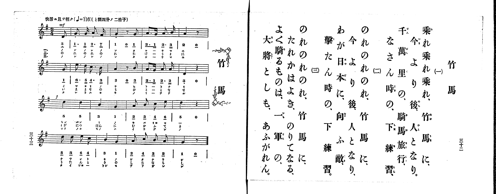

# 竹馬

> Re:Shōka 使用 AI 協助辨識與重建樂譜，可能會有錯誤。歡迎回報。

- **鋼琴伴奏版**：<br><audio controls src="takeuma.mp3"></audio>
- **NEUTRINO 歌聲合成版**：<br><audio controls src="takeuma_neutrino.mp3"></audio>

- 出處：共益商社樂器店《唱歌教科書 生徒用 巻一》第三十二～三十三頁（第十六曲）
- NDL Digital Collections PID 854862（https://dl.ndl.go.jp/pid/854862）掃描 P018.jpg

## 說明

原書資訊與歌詞全文（NDL PID 854862《唱歌教科書 生徒用 巻一》第三十二～三十三頁，掃描 P018.jpg）：
調性與拍號：と調四分ノ二拍子（G 大調 2/4 拍），♩=116，「快活ニ且ツ輕ク」，弱起半拍（八分音符）
註記：第三學期第二曲（全卷第十六曲）。分節歌，三節同一旋律（譜下配字一、三節印片假名，二節印平假名）。開頭標 mf，第三行標 f。第一、二行各以八分音符弱起開始，第一行末以四分音符加八分休止符收尾（與第二行弱起合成完整小節），第二行末為四分音符加四分休止符（第三、四行無弱起），第四行末為四分音符加八分休止符。第一行前二小節五線譜附斷音記號。五線譜與簡譜一致。


## 歌詞

```text
一、
乘れ乘れ乘れ、竹馬に、
今より後、人となり、
千萬里の、騎馬旅行、
なさん時の、下練習。

二、
のれのれのれ、竹馬に、
今より後、人となり、
わが日本に、向ふ敵、
撃たん時の、下練習。

三、
のれのれのれ、竹馬に、
たれかはよき、のりてなる、
よく騎るものは、一軍の、
大將としも、あふがれん。
```

## ABC

<div class="abc-score" data-abc-src="takeuma.abc" aria-label="五線譜載入中"></div>

[下載 ABC 原始檔](takeuma.abc)

## TMD 檔案連結

- [主旋律 TMD 檔案](takeuma.tmd) [[在 TMD Studio 編輯](https://tmdlang.github.io/Tmd-TS/#tmd=s7IKdvYPcrWy4qpTUCpJTLdSSM7PyUlNLsnMz7PKrsxPzc6ML87Iz05Ugisoy88pzU21yk7MizeMtzA1sTAzQkgW55cWJadaFSdn5OfnxJekVpQk5edno8vHFySmp1oFGBhaIGQKivLLUvMS84C6C4oy80pSU8DaEQpSyzJTUkHSxclAq8tSizLTMlNTkNyVWlQMcjXUipKixLzi5KLMApBXEKrSU_OKUq2SMzJzUopS8-KL8_PSEZJp-UW5VsUlRfkFGZnJCOGSjFSgh4sL8ouQnAMRzM3MySxJLKpEFwfaXpaagxDNL8pMz8yzyk3NzMrEEixAkzPy04sSCzIqrTIyi0uAypMTc-KBYQwMeC0theerd75ctkZBS4tL0VbB0NCMy95WwZ3LxkjfxA5kxtP2XS9mTn2_Z9bT1o3PZ3c9ndr2fMm-Zyuans5c8XTX9McNXU-nbHy2tufZ1JnPl098NnuHwvMp85_um_R8ygqFp9t3P9nR8Lih-_maNU92dD7tbXyyq-f93nlQ9o7Olwsa3-_pAMoCuU9b1z6bven9nk6wy_1cfBRcgN4qScxRcIanmmKFAE8XBUi6AGrMKCkpKLbS10_J0csD4vR8vawC_YLMFH2Yis5nfc3P-vsVQKkBKAeMDS59LQVbagEuBQWFp33zgZ5-sbn9xYquFx3twJB4sXLe09YVz6a1A10I8gbCyVQIrB40HwH9CIwakENerNr_rGE5yAndvS9mzgeKPm5cARR8Onv20462x819QOOAUk_XTgC6y13h6ZLlQEkFYCwrAEXBxvQ8mrnSFpgAgKzHDT1P969-tmX34-buJzumPG5uebFn6uOm9Y8bgEp7nu7Z-GLr9qe9XWCdHU9bVwNteDl_8_M1y4AGgR2zYveLFTOAboB6Zu2OZ3Pmg9hAN4AiGahnxdPe7Wgx_7ihCWjQ8_UNwCACWgPUCGQ_nQBkNDyb3v10XzdQ44u1c57s6H7ZCvTIdHB4gYIGpKx3w_PO9qeN7U8ngJwItAgi-HTnZpggyPyX07pfLlj7bMVMhdw0oDKI814s7AGJpAHlwQJgU3f1AIWfTmh5snspsgchfgca83Q50DkQAxpABsxZDVIJDmyoyq4FEI1P9kx8tnYRUOTZlG1PN-wDeaKjHRIYICsggTmh41nHhKfrgEljy9MN_UC3Q6IErgxo_vOmXejmg7lw8yF5CeghoPuBUkBdz1sWQsyHmwYRx24aqmvhoQFyZGcv0BkQhz3ZNeX59lnAeHg5s-XZtO1A7cCoBqY4oHq4FMiDGxaC46rhRfsWoBQXKFlAghbM2jnjcVMPMgmUgJREjxtXwxTt7nrc1PG4qevpPpD0k127gEn6ceMqoAhUxdPe5hcT1rxs73ncuA4o9HJFH9CAZ9NbgU6GqgApbwQm3cnPZjZBFAGTz_PtW57vnwR31S6E4nUglyCT5LjqcVP_48aeZ9OXPpsD1fd0wsTHjVufTd0KVfFsUvPjxvn4XQWORqJdBTYOKN39uHE9yHmNvUAJsOqux43LwM7rhjsPKN0PDCuQUBPYfqAekBMaXuzuhTgHHLhLlj_d0A723HSQOpB5QNVbgX4DWdU0GeRUoDrKC1IoUNDS5-IKScxOLc1NtArITMzLd6jRNaypBlmiYGNopmUHZlXnptWCGcCyXAOSvDUVgAWcQg2QXANmwWioSNN-EKtpI5C3B0gvA9LzwHLdChqPm5ZogiwGGVijYKCgC8em8UCiRsEQSOoCSSMwbR4PF4KoArFroJIwRcZwESQ1YBt8DGsUQMbCMDC0wfqBAQpWDeIjsxEyMPXzIeobJ0JFHze2Qel9YPHVKKpbEDYbDZjNxvS1GawalkBAMf24eQUQr4KniEYgngRmdUBSRHMXmLcKkQ7MwOaZKpiAafT4NAa7BzXOjYAi4BQDUwSCiEgHORXs5CagnU1dyJ5tXIji_E1Qz66AexbCAuZhcNBA9EJUI9kBjF6a2wGMSEREdQPxerh9INN6UeyARTLMLGAxhGJHN1Y7qhF5-3ETsPmxGRgvE0AUJIKgUdi0FiQMEnncvBzIhUjvQcSfKdRQGF0DjjNIfMFEQPEGEgXFMSi-EbqwRd9sYIEH98kGBAfViyBPQ0XBwQFUCg4gYJXRDuaCtNVAFWGNQ3DdATdv9ePGxUhG7kV2BCzVgzQ1gEVAQQosoMEkKLDRIwU9KkH1AMLpiCgByYHqBbgcJJ4hBoIyNiQ9PW6cAPYcxE8I9ahWgTNhF1DZViANiShQ8gTFICQut4MLaLCa5pVQEZSIBGFQBIEiCldEguRAMiA2agENwsgRuQrs8qlwl0PSPnJQoUbjdLAIqFCB6m3qRJKB-RdcVyDlRFABBdVFG1tAEQhVD4kRYB0NSmIwAxFZG2YAOFbBIhASkk5AaQ2crRFJC2FTLReXrp0CtEpWADKVuQA)]
- [鋼琴伴奏 TMD 檔案](takeuma_piano.tmd) [[在 TMD Studio 編輯](https://tmdlang.github.io/Tmd-TS/#tmd=s7IKdvYPcrWy4qpTUCpJTLdSyC8qychPL0osyKi0ysgsLskvykxOzInPTsxLVOLS0lJ4vnrny2Vr3u_peNm95_mELU_2bHm6tP95Z8f7PZ0KWlpcirYKhoZmXPa2Cu5cNkb6JnYgg5-273oxc-r7PbOetm58Prvr6dS250v2PVvR9HTmiqe7pj9u6Ho6ZeOztT3Pps58vnzis9k7FJ5Pmf9036TnU1YoPN2--8mOhscN3c_XrHmyo_Npb-OTXT3v986Dsnd0vlzQCHQMUBbIfdq69tnsTUCXKIFs9XPxUXDJTM8sScxRcM7PyUlNLsnMzytWCPB0UbAwNbEwMwJqzCgpKSi20tdPydHLA-L0fL2sAv2CzBR9mIrOZ33Nz_r7FQIMDC2AculKXFwhidmppbmJVgGZiXn5QR4ONbqGNdVcCkBgY2imZQdmVeem1YIZ-loKGk_3bHyxdbumwuPmPoUaILkGzILRUJGm_SBW00Ygbw-QXgak54HluhU0Hjct0VTQ0gcbWKNgoKALx6bxQKJGwRBI6gJJIzBtHg8XgqgCsWugkjBFxnARJDVgG3wMaxRAxsLw48Z1YP2Pm3rAqkF8ZDZCBqZ-PkR940So6OPGNii9Dyy-GkV1C8JmowGz2Zi-NoNVwxIIKKYfN68A4lXwFNEIxJPArA5IimjuAvNWIdKBGdg8UwUTMI0en8Zg96DGuRFQBJxiYIpAEBHpIKeCndwEtLOpC9mzjQtRnL8J6tkVcM9CWI8bV4GDBqIXohrJDmD00twOYEQiIqobiNfD7QOZ1otiByySYWY9blyGYkc3VjuqEXn7cdPux82bgfEyAURBIggahU1rQcIgkcfNy4FciPQeRPyZQg2F0TXgOIPEF0wEFG8gUVAcg-IboQtb9M1-3DQZ7pMNCA6qF0GehoqCgwOoFBxAXY-b2sFckLYaqCKscdjU_7gRlvqBKftx42IkI_ciOwKW6kGaGsAioCB93LgVTIICGz1S0KOy43FjP8LpiCgByTUhPAOLZ4iBoIwNSU-PGyeAPQfxE0I9qlXgTNgFVLYVSEMiCpQ8QTEIicvt4AIarKZ5JVQEJSJBGBRBoIjCFZEgOZAMiI1aQIMwckSuArt8KtzlkLSPHFSo0TgdLAIqVKB6mzqRZGD-BdcVSDkRVEBBddHGFlAEQtVDYmQ6JInBDERkbZgB4FgFi0BISDoBpTVwtkYkLYRNtWg1sg9KjWwCrZCBMfyir-tle-_T1h0vZ7dC2i2IKDSMV4g2jAUyQAUkkG0aD-FgFYdFO7JCEyDbBIsBII4BXAuScdiZGJYgySFZQUAHyEJgsOjaKUBDJtoHqBqZa4TKNQZzlbkA)]

## 分析

```text
================================================================================
📊 TMD Song Profile: [ 竹馬 ]
================================================================================
⏱  Duration:       0:16 (16.6s), 16 measures total
🎼 Key & Tempo:    首調基準 G, != 116.0 BPM, <2/4>
   - 分析範圍：      由實際發聲的音符與和弦推測調性；播放脈絡另行呈現
🎤 人聲音域:    D4 (MIDI 62) – E5 (MIDI 76) [跨度: 14 個半音 / 1.2 個八度, 難度: moderate]
   - 最低音:  D4 in [Takeuma #1 @ m.1, 0:00]
   - 最高音: E5 in [Takeuma #1 @ m.6, 0:05]
   - 適合: soprano, mezzo-soprano, contralto, tenor, baritone, bass
🏛  結構:      Takeuma (16.6s)
⚡ 編曲密度:        Peak 1 軌道同時演奏
🗝  調性診斷：       G 大調（純淨自然大調，未偵測到可信轉調）
   - 風格氣質:    純淨自然大調（陽光明朗、易唱易記，無明顯調外色彩）
   - 轉調歷程:    全曲維持單一推測調性（未偵測到可信轉調）
   - 核心骨幹音:  A, G, D, B, C
   - 調性數值:    G 大調 [相關度: 0.81, 穩定度: Moderate, 自然音純度: 100.0%]
   - 候選調性 (K-S): G 大調 (0.81), D 大調 (0.76), A 小調 (0.55)
   - 五度圈歷程:   +2
   - 各段落調性細節:
     • [Takeuma #1]: D 調性不明確 (r: 0.77, 自然音純度: 91.7%, 調外音: C)

  [ 五度圈游移軌跡 ]
               C  
         F            G  
      Bb              [D ]*
      Eb               A  
         Ab           E  
            Db       B  
               F# 
     (* = active key center)

  [ 十二半音累積音高分佈 ]
     C  : ███████                    8.0%
     C# :                            0.0%
     D  : ██████████████████        20.5%
     D# :                            0.0%
     E  : ██████                     6.2%
     F  :                            0.0%
     F# : █                          0.9%
     G  : █████████████████████     23.2%
     G# :                            0.0%
     A  : ████████████████████████  26.8%
     A# :                            0.0%
     B  : █████████████             14.3%
--------------------------------------------------------------------------------
Assignment 軌道音域：
  - Piano         : D4 – E5 (14 個半音 / 1.2 個八度, 44 個音符)
================================================================================
```


## 原書掃描頁




