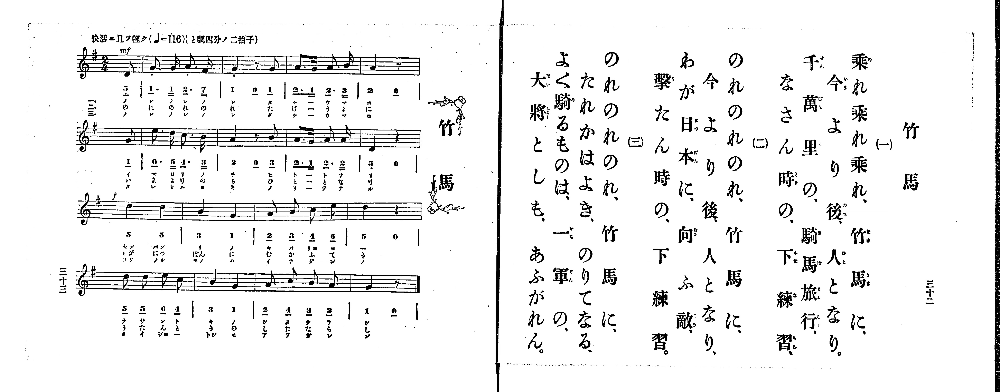

# 竹馬

*找不到鋼琴伴奏版 TMD，未產生音訊。*

- 出處：共益商社樂器店《唱歌教科書 生徒用 巻一》第三十二～三十三頁（第十六曲）
- NDL Digital Collections PID 854862（https://dl.ndl.go.jp/pid/854862）掃描 P018.jpg

## 說明

原書資訊與歌詞全文（NDL PID 854862《唱歌教科書 生徒用 巻一》第三十二～三十三頁，掃描 P018.jpg）：
調性與拍號：と調四分ノ二拍子（G 大調 2/4 拍），♩=116，「快活ニ且ツ輕ク」，弱起半拍（八分音符）
註記：第三學期第二曲（全卷第十六曲）。分節歌，三節同一旋律（譜下配字一、三節印片假名，二節印平假名）。開頭標 mf，第三行標 f。第一、二行各以八分音符弱起開始，第一行末以四分音符加八分休止符收尾（與第二行弱起合成完整小節），第二行末為四分音符加四分休止符（第三、四行無弱起），第四行末為四分音符加八分休止符。第一行前二小節五線譜附斷音記號。五線譜與簡譜一致。

## 歌詞

```text
一、
乘れ乘れ乘れ、竹馬に、
今より後、人となり、
千萬里の、騎馬旅行、
なさん時の、下練習。

二、
のれのれのれ、竹馬に、
今より後、人となり、
わが日本に、向ふ敵、
撃たん時の、下練習。

三、
のれのれのれ、竹馬に、
たれかはよき、のりてなる、
よく騎るものは、一軍の、
大將としも、あふがれん。
```

## ABC

```abc
X:1
T:竹馬
M:2/4
L:1/16
Q:1/4=116
K:G
V:V1 name="Piano" snm="Pia"
[V:V1]
!mf! z2 z2 z2 D2 | G3 G A3 F | G4 z2 G2 | A3 G A3 B |
A4 z2 G2 | e3 d c3 B | A4 z2 B2 | A3 G A3 A |
D4 z4 | !f! d4 d4 | B4 G4 | A2 B2 c2 e2 |
d4 z4 | d2 d2 e2 c2 | B4 G4 | A2 c2 B2 A2 |
G4 z2 z2 | !mf! z2 z2 z2 D2 | G3 G A3 F | G4 z2 G2 |
A3 G A3 B | A4 z2 G2 | e3 d c3 B | A4 z2 B2 |
A3 G A3 A | D4 z4 | !f! d4 d4 | B4 G4 |
A2 B2 c2 e2 | d4 z4 | d2 d2 e2 c2 | B4 G4 |
A2 c2 B2 A2 | G4 z2 z2 | !mf! z2 z2 z2 D2 | G3 G A3 F |
G4 z2 G2 | A3 G A3 B | A4 z2 G2 | e3 d c3 B |
A4 z2 B2 | A3 G A3 A | D4 z4 | !f! d4 d4 |
B4 G4 | A2 B2 c2 e2 | d4 z4 | d2 d2 e2 c2 |
B4 G4 | A2 c2 B2 A2 | G4 z2 z2 |
```

## TMD 檔案連結

- [主旋律 TMD 檔案](takeuma.tmd) [[在 TMD Studio 編輯](https://tmdlang.github.io/Tmd-TS/#tmd=s7IKdvYPcrWy4qpTUCpJTLdSSM7PyUlNLsnMz7PKrsxPzc6ML87Iz05Ugisoy88pzU21yk7MizeMtzA1sTAzQkgW55cWJadaFSdn5OfnxJekVpQk5edno8vHFySmp1oFGBhaIGQKivLLUvMS84C6C4oy80pSU8DaEQpSyzJTUkHSxclAq8tSizLTMlNTkNyVWlQMcjXUipKixLzi5KLMApBXEKrSU_OKUq2SMzJzUopS8-KL8_PSEZJp-UW5VsUlRfkFGZnJCOGSjFSgh4sL8ouQnAMRzM3MySxJLKpEFwfaXpaao8SlpaXwfPXOl8vWKGhpcSnaKhgamnHZ2yq4c9kY6ZvYgTQ9bd_1YubU93tmPW3d-Hx219Opbc-X7Hu2ounpzBVPd01_3ND1dMrGZ2t7nk2d-Xz5xGezdyg8nzL_6b5Jz6esUHi6ffeTHQ2PG7qfr1nzZEfn097GJ7t63u-dB2Xv6Hy5oPH9ng6gLJD7tHXts9mb3u_pBDvVz8VHwSUzHej2HAVneIwXKwR4uihA4hSoMaOkpKDYSl8_JUcvD4jT8_WyCvQLMlP0YSo6n_U1P-vvVwDFJFAOGJJc-loKttQCXAoKCk_75gM9_WJz-4sVXS862oEh8WLlvKetK55Nawe6EOQNhJOpEFg9aD4C-hEYNSCHvFi1_1nDcpATuntfzJwPFH3cuAIo-HT27KcdbY-b-4DGAaWerp0AdJe7wtMly4GSCsBYVgCKgo3peTRzpS0wAQBZjxt6nu5f_WzL7sfN3U92THnc3PJiz9THTesfNwCV9jzds_HF1u1Pe7vAOjuetq4G2vBy_ubna5YBDQI7ZsXuFytmAN0A9czaHc_mzAexgW4ARTJQz4qnvdvRYv5xQxPQoOfrG4BBBLQGqBHIfjoByGh4Nr376b5uoMYXa-c82dH9shXokeng8AIFDUhZ74bnne1PG9ufTgA5EWgRRPDpzs0wQZD5L6d1v1yw9tmKmQq5aUBlEOe9WNgDEkkDyoMFwKbu6gEKP53Q8mT3UmQPQvwONObpcqBzIAY0gAyYsxqkEhzYUJVdCyAan-yZ-GztIqDIsynbnm7YB_JERzskMEBWQAJzQsezjglP1wGTxpanG_qBbodECVwZ0PznTbvQzQdz4eZD8hLQQ0D3A6WAup63LISYDzcNIo7dNFTXwkMD5MjOXqAzIA57smvK8-2zgPHwcmbLs2nbgdqBUQ1McUD1cCmQBzcsBMdVw4v2LUApLlCygAQtmLVzxuOmHmQSKAEpiR43roYp2t31uKnjcVPX030g6Se7dgGT9OPGVUARqIqnvc0vJqx52d7zuHEdUOjlij6gAc-mtwKdDFUBUt4ITLqTn81sgigCJp_n27c83z8J7qpdCMXrQC5BJslx1eOm_seNPc-mL302B6rv6YSJjxu3Ppu6Fari2aTmx43z8bsKHI1EuwpsHFC6-3HjepDzGnuBEmDVXY8bl4Gd1w13HlC6HxhWIKEmsP1APSAnNLzY3QtxDjhwlyx_uqEd7LnpIHUg84CqtwL9BrKqaTLIqUB1lBekUKCgpc_FFZKYnVqam2gVkJmYl-9QY1CjUA2yRMHG0EzLDsyqzk2rBTOAZbkGJHlrKgALOIUaILkGzILRUJGm_SBW00Ygbw-QXgak54HluhU0Hjct0QRZDDKwRsFAQReOTeOBRI2CIZDUBZJGYNo8Hi4EUQVi10AlYYqM4SJIamBOBtn9uHkFEK-Cu7ERiCeBWR0QNzZ3gXmrEC4zA5tmqmCC1QZjLK4wAoqA_QBTBIIQZ1QjQvBxE7CQ3wy0awKIglgKdVbTWpAwSORx83IgFyK9B-EmU6ihMLoG7A6IG2AiILeAREHuBvkBoQvVSeCQ6QLashVIQ2wChgXYCRDHbAfHI1hN80qoCIpLQBhkA8gmXC4ByYFkQGzUeAThGq5aLi5dOwVoGlTAyVTmAgA)]

## 分析

```text
================================================================================
📊 TMD Song Profile: [ 竹馬 ]
================================================================================
⏱  Duration:       0:52 (52.8s), 51 measures total
🎼 Key & Tempo:    首調基準 G, != 116.0 BPM, <2/4>
   - 分析範圍：      由實際發聲的音符與和弦推測調性；播放脈絡另行呈現
🎤 人聲音域:    D4 (MIDI 62) – E5 (MIDI 76) [跨度: 14 個半音 / 1.2 個八度, 難度: moderate]
   - 最低音:  D4 in [Takeuma #1 @ m.1, 0:00]
   - 最高音: E5 in [Takeuma #1 @ m.6, 0:05]
   - 適合: soprano, mezzo-soprano, contralto, tenor, baritone, bass
🏛  結構:      Takeuma (17.6s) -> Takeuma (17.6s) -> Takeuma (17.6s)
⚡ 編曲密度:        Peak 1 軌道同時演奏
🗝  調性診斷：       G 大調（純淨自然大調，未偵測到可信轉調）
   - 風格氣質:    純淨自然大調（陽光明朗、易唱易記，無明顯調外色彩）
   - 轉調歷程:    全曲維持單一推測調性（未偵測到可信轉調）
   - 核心骨幹音:  A, G, D, B, C
   - 調性數值:    G 大調 [相關度: 0.81, 穩定度: Moderate, 自然音純度: 100.0%]
   - 候選調性 (K-S): G 大調 (0.81), D 大調 (0.76), A 小調 (0.55)
   - 五度圈歷程:   +1 -> +1 -> +1
   - 各段落調性細節:
     • [Takeuma #1]: G 大調 (r: 0.81, 自然音純度: 100.0%)
     • [Takeuma #2]: G 大調 (r: 0.81, 自然音純度: 100.0%)
     • [Takeuma #3]: G 大調 (r: 0.81, 自然音純度: 100.0%)

  [ 五度圈游移軌跡 ]
               C  
         F           [G ]*
      Bb               D  
      Eb               A  
         Ab           E  
            Db       B  
               F# 
     (* = active key center)

  [ 十二半音累積音高分佈 ]
     C  : ███████                    8.0%
     C# :                            0.0%
     D  : ██████████████████        20.5%
     D# :                            0.0%
     E  : ██████                     6.2%
     F  :                            0.0%
     F# : █                          0.9%
     G  : █████████████████████     23.2%
     G# :                            0.0%
     A  : ████████████████████████  26.8%
     A# :                            0.0%
     B  : █████████████             14.3%
--------------------------------------------------------------------------------
Assignment 軌道音域：
  - Piano         : D4 – E5 (14 個半音 / 1.2 個八度, 132 個音符)
================================================================================
```


## 原書掃描頁




