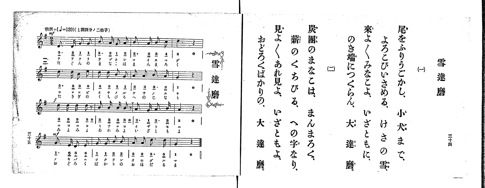

# 雪達磨

> Re:Shōka 使用 AI 協助辨識與重建樂譜，可能會有錯誤。歡迎[回報](https://github.com/TMDLang/reshoka/issues)。

- **鋼琴伴奏版**：<br><audio controls src="yukidaruma.mp3"></audio>
- **NEUTRINO 歌聲合成版**：<br><audio controls src="yukidaruma_neutrino.mp3"></audio>

- 出處：共益商社樂器店《唱歌教科書 生徒用 巻一》第三十四～三十五頁（第十七曲）
- NDL Digital Collections PID 854862（https://dl.ndl.go.jp/pid/854862）掃描 P019.jpg

## 說明

原書資訊與歌詞全文（NDL PID 854862《唱歌教科書 生徒用 巻一》第三十四～三十五頁，掃描 P019.jpg）：
調性與拍號：と調四分ノ二拍子（G 大調 2/4 拍），♩=120，「快活ニ」
註記：第三學期第三曲（全卷第十七曲）。全曲十六小節，分節歌，二節同一旋律。開頭標 mf，第三行（第九小節起）標 f，第四行（第十三小節起）標 mf。第十小節末印有換氣記號（V）。五線譜與簡譜一致。


## 歌詞

```text
一、
尾をふりうごかし、小犬まで、
よろこびいさめる、けさの雪、
來よ〳〵みなこよ、いざともに、
のき端につくらん、大達磨。

二、
炭團のまなこは、まんまろく、
薪のくちびる、への字なり、
見よ〳〵あれ見よ、いざともよ、
おどろくばかりの、大達磨。
```

## ABC

<div class="abc-score" data-abc-src="yukidaruma.abc" aria-label="五線譜載入中"></div>

[下載 ABC 原始檔](yukidaruma.abc)

## TMD 檔案連結

- [主旋律 TMD 檔案](yukidaruma.tmd) [[在 TMD Studio 編輯](https://tmdlang.github.io/Tmd-TS/#tmd=s7IKdvYPcrWy4qpTUCpJTLdSSM7PyUlNLsnMz7PKrsxPzc6ML87Iz05Ugisoy88pzU21yk7MizeMtzA1sTAzQkgW55cWJadaFSdn5OfnxJekVpQk5edno8vHFySmp1oFGBhaImQKivLLUvMS84C6C4oy80pSU8DaEQpSyzJTUkHSxclAq8tSizLTMlNTkNyVWlQMcjXUipKixLzi5KLMApBXEKrSU_OKUq2SMzJzUopS8-KL8_PSEZJp-UW5VsUlRfkFGZnJCOGSjFSgh8tTE4GMInTh4tREoCHF6MKJeZm5iTkI0fyizPTMPKvc1MysTCzhkl9UkpGfXpRYkFFplZFZXAJUnpyYEw8MZGDIa2kpvJy96mXjlOeLVyhoaXEp2ioYGhlw2dsquHPZGOmb2IGMedq-68XMqe_3zHrauvH57K6nU9ueL9n3bEXT05krnu6a_rih6-mUjc_W9jybOvP58onPZu9QeD5l_tN9k55PWaHwdPvuJzsaHjd0P1-z5smOzqe9jU9nz36_dx6E_WTXlJcLGt_v6QDKgrg7mp_N3vR-TyfY8X4uPgouQJ-VJOYoOMNTTrFCgKeLAiRtADVmlJQUFFvp66fk6OUBcXq-XlaBfkFmij5MReezvuZn_f0KoBQBlAPGCJe-loIttQCXgoLC0775QE-_2Nz-YkXXi452YEi8WDnvaeuKZ9PagS4EeQPhZCoEVg-aj4B-BEYNyCEvVu1_1rAc5ITu3hcz5wNFHzeuAAoCTXna0fa4ue_Jrh6g1NO1E4Ducld4umQ5UFIBGMsKQFGwMT2PZq60BSYAIOtxQ8_T_aufbdn9uLn7cUMv2PwVu1-smAE0Fuq-tTuezZkPYYPjrQPo6ae929Ei83FDEygwZm8C-ad17dMN_c_XNwAtADoJyAAGBZANdBiQ_XRCD9D_z6Z3P90HtLLp5bTulwvWPlsxUyE3DagGYtGLhUD1oPTyZOdciFEvtm4HRTNQGVQV0LtwVWCHdKIrzE0DGg-RhUg9m7P6ae-GZ3M6n_XPfrZhMdCX4PDrCIO4Hxj0z7fPerF2DjBsn29YCGQA3fmifQtQigsUMOBYawSnhQ37HjdNety49XFT1-PGtseNUx43dj9uBGYSsE1dax437nvcuByq-nFTx-Om3seNkx83bn7c2PK4cerjpsbHTUDPNz5unAjiNq4DZk-o6if72kAaGjY_btj6uHH_48ZVIJ0gEaBqoOZpwNh-3NT0uHE1zPjGdY8be5-vXg8SalzyuLH_cVPn46bJIMcsWQ7J9HAv7ALGOFjX86a1T-fMAOsFOhVsR-N6sB1ArwHZQBLo5H6o6hfTgCqASvsfNy4E-QLq-B1Awadrp4P0AwMCqnRZN5L7mx439cBEUN0PFoG4HxiGK6HWNW4AhSQoVNehux-olPKcDAUKWvpcXJGl2ZkpiUWluYlWAZmJefkONQY11SBrFGwMzbTswKzq3LRaMANYnDxu3gTFU4F4lUINMGaXAfEWIF4NxNvBIpuBeAlQvgeI54FEmttBtoHMqFEwjVfQBUIgZQikQLhGwRgsZATmGaGIgGgTsIgpWERXwQBK14DN8zEEWTgJLAKigQkSzOoC6wEmTIhM4xQg7gazpkNlJkNlWoB4DZi1DyqzHGoDxKFwm4xAcvOhulYC7QCZAIwkqC6QbhB_FdRsYFpClQGqh7CB8QyV6cdqEzicVwDxWkhYNk8GhyowRJu2AnkLgXg1WGQjVKQPiJeBRdYihTMkmMEhaAYPQRAGiUDCHRTWIAwL7RqwOK5Q7oD6oxfuw81Qf7SAeVPBso1gEhTWIJmJCBlwSIHk2sAyoDAgFMogm_pQQhkUYsAMCLcdYdMOuLrHjTPgcQFyNygtYNpUjZSqwaEMDHEoDUqx84G4C1kEHP7bgLwOIF4EVtONGtqmYAgJO0gKNgZDmAgopEEhD6GN4SJYQxsSwsAwB7EgYQ9yP0hmP9RvmDKgeADJTQPiFdDQbgLLrMYT2mDzwDbtRzOvCSwDzMYYMjhtgqYSjNBGKUSACRaYVB83TwAHIigogbmwaT2QBuar5s1gc4D-a54NxA2w5A4sSuDBDUmmZvGQ0gRIg1wFK08gIY-cvmF5AW_6hqVPcKrbAGaBQg0kswTMA6e9pk4wCYodkAwobT1u3A0mF0DDAewjaK7HHuKQFAkpRUD5AGI2SAZiL7ikAqdbRMonxaZaLi5dOwVE4a4A5ClzAQA)]
- [鋼琴伴奏 TMD 檔案](yukidaruma_piano.tmd) [[在 TMD Studio 編輯](https://tmdlang.github.io/Tmd-TS/#tmd=s7IKdvYPcrWy4qpTUCpJTLdSyC8qychPL0osyKi0ysgsLskvykxOzInPTsxLVOLS0lJ4OXvVy8YpzxeveL-n42X3nucTtjzZs-Xp0v7nnR3v93QqaGlxKdoqGBoZcNnbKrhz2Rjpm9iBzH7avuvFzKnv98x62rrx-eyup1Pbni_Z92xF09OZK57umv64oevplI3P1vY8mzrz-fKJz2bvUHg-Zf7TfZOeT1mh8HT77ic7Gh43dD9fs-bJjs6nvY1PZ89-v3cehP1k15SXCxqBjgHKgrg7mp_N3gR0iRLIVj8XHwWXzPTMksQcBef8nJzU5JLM_LxihQBPFwULUxMLMyOgxoySkoJiK339lBy9PCBOz9fLKtAvyEzRh6nofNbX_Ky_XyHAwNASKJeuxMUVWZqdmZJYVJqbaBWQmZiXH-ThUGNQU82lAAQ2hmZadmBWdW5aLZihr6XwuHkTFE8F4lUKNQqPm5YB8RYgXg3E28Eim4F4CVC-B4jngUSa2xW09MFm1CiYxivoAiGQMgRSIFyjYAwWMgLzjFBEQLQJWMQULKKrYACla8Dm-RiCLJwEFgHRjxu3glldYD2PG9sgMo1TgLgbzJoOlZkMlWkB4jVg1j6ozHKoDRCHwm0yAsnNh-paCbQDZMLjxnVQXSDdIP4qqNmPG9ejygDVQ9iPm3qhMv1YbQKH8wogXgsJy-bJ4FAFhmjTViBvIRCvBotshIr0AfEysMhapHCGBDM4BM3gIQjCIBFIuIPCGoRhoV0DFscVyh1Qf_TCfbgZ6o8WMG8qWLYRTILCGiQzESEDDimQXBtYBhQGhEIZZFMfSiiDQuxx40K47QibdsDVPW6cAY8LkLtBaQHTpmqkVA0OZWCIQ2lQip0PxF3IIuDw3wbkdQDxIrCabtTQNgVDSNhBUrAxGMJEQCENCnkIbQwXwRrakBAGhjmIBQl7kPtBMvuhfsOUAcUDSG4aEK-AhnYTWGY1ntAGmwe2aT-aeU1gGWA2xpDBaRM0lWCENkohAkywwKT6uHkCOBBBQQnMhU3rgTQwXzVvBpsD9F_zbCBugCV3YFECD25IMjWLh5QmQBrkKlh5Agl55PQNywt40zcsfYJT3QYwCxRqIJklYB447TV1gklQ7IBkQGnrceNuMLkAGg5gH0FzPfYQh6RISCkCygcQs0EyEHvBJRU43SJSPik21WKW7T7IZbsJtGgHRsaLvq6X7b1PW3e8nN0KqQORQjleIdowFsgAldpAtmk8Fg5MEVSPCZBrgipDQAeSMsIWkmSLASQodO0UEKER7QNUjCZiBBZR5gIA)]

## 分析

```text
================================================================================
📊 TMD Song Profile: [ 雪達磨 ]
================================================================================
⏱  Duration:       0:16 (16.0s), 16 measures total
🎼 Key & Tempo:    首調基準 G, != 120.0 BPM, <2/4>
   - 分析範圍：      由實際發聲的音符與和弦推測調性；播放脈絡另行呈現
🎤 人聲音域:    D4 (MIDI 62) – E5 (MIDI 76) [跨度: 14 個半音 / 1.2 個八度, 難度: moderate]
   - 最低音:  D4 in [Yukidaruma #1 @ m.1, 0:00]
   - 最高音: E5 in [Yukidaruma #1 @ m.5, 0:04]
   - 適合: soprano, mezzo-soprano, contralto, tenor, baritone, bass
🏛  結構:      Yukidaruma (16.0s)
⚡ 編曲密度:        Peak 1 軌道同時演奏
🗝  調性診斷：       G 大調（純淨自然大調，未偵測到可信轉調）
   - 風格氣質:    純淨自然大調（陽光明朗、易唱易記，無明顯調外色彩）
   - 轉調歷程:    全曲維持單一推測調性（未偵測到可信轉調）
   - 核心骨幹音:  D, B, G, A, E
   - 調性數值:    G 大調 [相關度: 0.81, 穩定度: Moderate, 自然音純度: 100.0%]
   - 候選調性 (K-S): G 大調 (0.81), D 大調 (0.77), B 小調 (0.68)
   - 五度圈歷程:   +1
   - 各段落調性細節:
     • [Yukidaruma #1]: G 大調 (r: 0.81, 自然音純度: 100.0%)

  [ 五度圈游移軌跡 ]
               C  
         F           [G ]*
      Bb               D  
      Eb               A  
         Ab           E  
            Db       B  
               F# 
     (* = active key center)

  [ 十二半音累積音高分佈 ]
     C  : ██                         1.9%
     C# :                            0.0%
     D  : ████████████████████████  25.9%
     D# :                            0.0%
     E  : ████                       4.6%
     F  :                            0.0%
     F# :                            0.0%
     G  : █████████████████████     22.2%
     G# :                            0.0%
     A  : ████████████████████      21.3%
     A# :                            0.0%
     B  : ██████████████████████    24.1%
--------------------------------------------------------------------------------
Assignment 軌道音域：
  - Piano         : D4 – E5 (14 個半音 / 1.2 個八度, 52 個音符)
================================================================================
```


## 原書掃描頁




