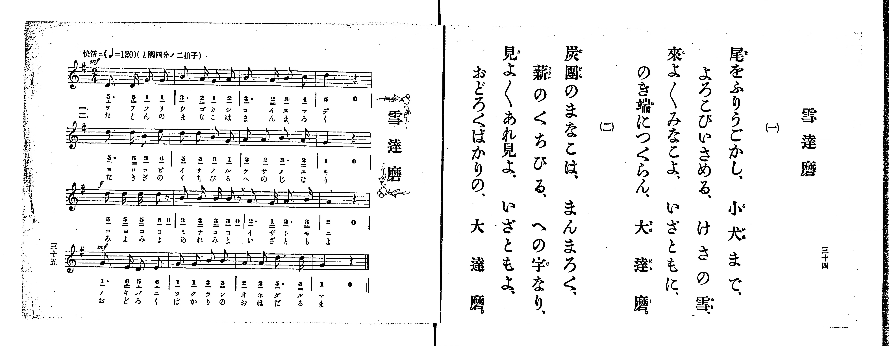

# 雪達磨

> Re:Shoka 使用 AI 協助辨識與重建樂譜，可能會有錯誤。歡迎回報。

<audio controls src="yukidaruma.mp3"></audio>

- 出處：共益商社樂器店《唱歌教科書 生徒用 巻一》第三十四～三十五頁（第十七曲）
- NDL Digital Collections PID 854862（https://dl.ndl.go.jp/pid/854862）掃描 P019.jpg

## 說明

原書資訊與歌詞全文（NDL PID 854862《唱歌教科書 生徒用 巻一》第三十四～三十五頁，掃描 P019.jpg）：
調性與拍號：と調四分ノ二拍子（G 大調 2/4 拍），♩=120，「快活ニ」
註記：第三學期第三曲（全卷第十七曲）。全曲十六小節，分節歌，二節同一旋律。開頭標 mf，第三行（第九小節起）標 f，第四行（第十三小節起）標 mf。第十小節末印有換氣記號（V）。五線譜與簡譜一致。

## 歌詞

```text
一、
尾をふりうごかし、小犬まで、
よろこびいさめる、けさの雪、
來よ〳〵みなこよ、いざともに、
のき端につくらん、大達磨。

二、
炭團のまなこは、まんまろく、
薪のくちびる、への字なり、
見よ〳〵あれ見よ、いざともよ、
おどろくばかりの、大達磨。
```

## ABC

```abc
X:1
T:雪達磨
M:2/4
L:1/16
Q:1/4=120
K:G
V:V1 name="Piano" snm="Pia"
[V:V1]
!mf! D3 D G2 G2 | B3 A G2 A2 | B3 A B2 c2 | d4 z4 |
d3 d B2 e2 | d2 d2 B2 G2 | A2 A2 B3 A | G4 z4 |
!f! d2 d d d2 z2 | B2 B B B2 z2 | A3 G A3 B | A4 z4 |
!mf! G3 E D2 E2 | G2 G2 B2 B2 | A2 A2 d3 d | G4 z4 |
```

## TMD 檔案連結

- [主旋律 TMD 檔案](yukidaruma.tmd) [[在 TMD Studio 編輯](https://tmdlang.github.io/Tmd-TS/#tmd=s7IKdvYPcrWy4qpTUCpJTLdSSM7PyUlNLsnMz7PKrsxPzc6ML87Iz05Ugisoy88pzU21yk7MizeMtzA1sTAzQkgW55cWJadaFSdn5OfnxJekVpQk5edno8vHFySmp1oFGBhaImQKivLLUvMS84C6C4oy80pSU8DaEQpSyzJTUkHSxclAq8tSizLTMlNTkNyVWlQMcjXUipKixLzi5KLMApBXEKrSU_OKUq2SMzJzUopS8-KL8_PSEZJp-UW5VsUlRfkFGZnJCOGSjFSgh8tTE4GMInTh4tREoCHF6MKJeZm5iTlKXFpaCi9nr3rZOOX54hUKWlpcirYKhkYGXPa2Cu5cNkb6JnYgfU_bd72YOfX9nllPWzc-n931dGrb8yX7nq1oejpzxdNd0x83dD2dsvHZ2p5nU2c-Xz7x2ewdCs-nzH-6b9LzKSsUnm7f_WRHw-OG7udr1jzZ0fm0t_Hp7Nnv986DsJ_smvJyQeP7PR1AWRB3R_Oz2Zve7-kEu9bPxUfBJTM9syQxR8EZHuvFCgGeLgqQeAVqzCgpKSi20tdPydHLA-L0fL2sAv2CzBR9mIrOZ33Nz_r7FUCxCZQDhiaXvpaCLbUAl4KCwtO--UBPv9jc_mJF14uOdmBIvFg572nrimfT2oEuBHkD4WQqBFYPmo-AfgRGDcghL1btf9awHOSE7t4XM-cDRR83rgAKAk152tH2uLnvya4eoNTTtROA7nJXeLpkOVBSARjLCkBRsDE9j2autAUmACDrcUPP0_2rn23Z_bi5-3FDL9j8FbtfrJgBNBbqvrU7ns2ZD2GD460D6OmnvdvRIvNxQxMoMGZvAvmnde3TDf3P1zcALQA6CcgABgWQDXQYkP10Qg_Q_8-mdz_dB7Sy6eW07pcL1j5bMVMhNw2oBmLRi4VA9aD08mTnXIhRL7ZuB0UzUBlUFdC7cFVgh3SiK8xNAxoPkYVIPZuz-mnvhmdzOp_1z362YTHQl-Dw6wiDuB8Y9M-3z3qxdg4wbJ9vWAhkAN35on0LUIoLFDDgWGsEp4UN-x43TXrcuPVxU9fjxrbHjVMeN3Y_bgRmErBNXWseN-573LgcqvpxU8fjpt7HjZMfN25-3NjyuHHq46bGx01Azzc-bpwI4jauA2ZPqOon-9pAGho2P27Y-rhx_-PGVSCdIBGgaqDmacDYftzU9LhxNcz4xnWPG3ufr14PEmpc8rix_3FT5-OmySDHLFkOyfRwL-wCxjhY1_OmtU_nzADrBToVbEfjerAdQK8B2UAS6OR-qOoX04AqgEr7HzcuBPkC6vgdQMGna6eD9AMDAqp0WTeS-5seN_XARFDdDxaBuB8Yhiuh1jVuAIUkKFTXobsfqJTynAwFClr6XFyRpdmZKYlFpbmJVgGZiXn5DjUGNQrVIHsUbAzNtOzArOrctFowA1iePG7eBMVTgXiVQg0wapcB8RYgXg3E28Eim4F4CVC-B4jngUSa20HWgcyoUTCNV9AFQiBlCKRAuEbBGCxkBOYZoYiAaBOwiClYRFfBAErXINy0AojXQuxtngx2AdD2pq1A3kIgXg0W2QgV6QPiZWCRtUhugjgJbJsZ3DYQBolA3AhyFwjDXFYDFsd0UTVSaIFdBHQdlAaFxHwg7kIWAbt1G5DXAcSLwGq6UV1mCoYQeyAhYwyGMBGQq0CuhNDGcBEMl6FEJDAggEHwuHkC2EKQtS1AkfVAeiUQbwY7bRWQNRuIG2DBCIxOuNMg3jeLh8QokAa5BRanEFcihxssjLGFWy0Xl66dAiI1KgB5ylwA)]
- [鋼琴伴奏 TMD 檔案](yukidaruma_piano.tmd) [[在 TMD Studio 編輯](https://tmdlang.github.io/Tmd-TS/#tmd=s7IKdvYPcrWy4tLSUng5e9XLxinPF694v6fjZfee5xO2PNmz5enS_uedHe_3dCpoaXEp2ioYGhlw2dsquHPZGOmb2HHVKSg9bd_1YubU93tmPW3d-Hx219Opbc-X7Hu2ounpzBVPd01_3ND1dMrGZ2t7nk2d-Xz5xGezdyg8nzL_6b5Jz6esUHi6ffeTHQ2PG7qfr1nzZEfn097Gp7Nnv987D8J-smvKywWNQMcAZUHcHc3PZm8CukQJZKufi4-CS2Z6ZklijoJzfk5OanJJZn5esUKAp4uChamJhZkRUGNGSUlBsZW-fkqOXh4Qp-frZRXoF2Sm6MNUdD7ra37W368QYGBoCZRLV-LiiizNzkxJLCrNTbQKyEzMyw_ycKgxqFGo5rIxNNOy41IAgurctFowQ19L4XHzJiieCsSrFGoUHjctA-ItQLwaiLeDRTYD8RKgfA8QzwOJNLcraOmDzahRMI1X0AVCIGUIpEC4RsEYLGQE5hmhiIBoE7CIKVhEV8EAStcg3LQCiNdC7G2eDHYB0PamrUDeQiBeDRbZCBXpA-JlYJG1SG6COAlsmxncNhAGiUDcCHIXCMNcVgMWx3RRNVJogV0EdB2UBoXEfCDuQhYBu3UbkNcBxIvAarpRXWYKhhB7ICFjDIYwEZCrQK6E0MZwEQyXoUQkMCCAQfC4eQLYQpC1LUCR9UB6JRBvBjttFZA1G4gbYMEIjE640yDeN4uHxCiQBrkFFqcQVyKHGyyMsYVbLWZC9IElRJBlNibQtAh0-Yu-rpftvU9bd7yc3QrJsUhOileINowFMkDJDMg2jcfCgSmC6jEBck1QZQjoQFJG2EKSbDGAhIWunQIiOBSAPGUuAA)]

## 分析

```text
================================================================================
📊 TMD Song Profile: [ 雪達磨 ]
================================================================================
⏱  Duration:       0:16 (16.0s), 16 measures total
🎼 Key & Tempo:    首調基準 G, != 120.0 BPM, <2/4>
   - 分析範圍：      由實際發聲的音符與和弦推測調性；播放脈絡另行呈現
🎤 人聲音域:    D4 (MIDI 62) – E5 (MIDI 76) [跨度: 14 個半音 / 1.2 個八度, 難度: moderate]
   - 最低音:  D4 in [Yukidaruma #1 @ m.1, 0:00]
   - 最高音: E5 in [Yukidaruma #1 @ m.5, 0:04]
   - 適合: soprano, mezzo-soprano, contralto, tenor, baritone, bass
🏛  結構:      Yukidaruma (16.0s)
⚡ 編曲密度:        Peak 1 軌道同時演奏
🗝  調性診斷：       G 大調（純淨自然大調，未偵測到可信轉調）
   - 風格氣質:    純淨自然大調（陽光明朗、易唱易記，無明顯調外色彩）
   - 轉調歷程:    全曲維持單一推測調性（未偵測到可信轉調）
   - 核心骨幹音:  D, B, G, A, E
   - 調性數值:    G 大調 [相關度: 0.81, 穩定度: Moderate, 自然音純度: 100.0%]
   - 候選調性 (K-S): G 大調 (0.81), D 大調 (0.77), B 小調 (0.68)
   - 五度圈歷程:   +1
   - 各段落調性細節:
     • [Yukidaruma #1]: G 大調 (r: 0.81, 自然音純度: 100.0%)

  [ 五度圈游移軌跡 ]
               C  
         F           [G ]*
      Bb               D  
      Eb               A  
         Ab           E  
            Db       B  
               F# 
     (* = active key center)

  [ 十二半音累積音高分佈 ]
     C  : ██                         1.9%
     C# :                            0.0%
     D  : ████████████████████████  25.9%
     D# :                            0.0%
     E  : ████                       4.6%
     F  :                            0.0%
     F# :                            0.0%
     G  : █████████████████████     22.2%
     G# :                            0.0%
     A  : ████████████████████      21.3%
     A# :                            0.0%
     B  : ██████████████████████    24.1%
--------------------------------------------------------------------------------
Assignment 軌道音域：
  - Piano         : D4 – E5 (14 個半音 / 1.2 個八度, 52 個音符)
================================================================================
```


## 原書掃描頁




