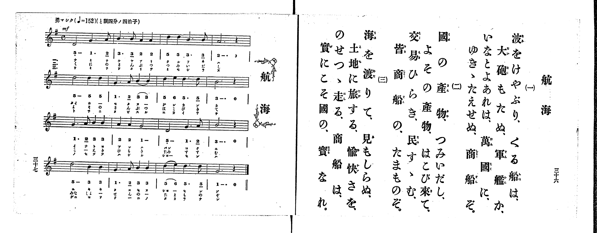

# 航海

> Re:Shōka 使用 AI 協助辨識與重建樂譜，可能會有錯誤。歡迎回報。

- **鋼琴伴奏版**：<br><audio controls src="kokai.mp3"></audio>
- **NEUTRINO 歌聲合成版**：<br><audio controls src="kokai_neutrino.mp3"></audio>

- 出處：共益商社樂器店《唱歌教科書 生徒用 巻一》第三十六～三十七頁（第十八曲）
- NDL Digital Collections PID 854862（https://dl.ndl.go.jp/pid/854862）掃描 P020.jpg

## 說明

原書資訊與歌詞全文（NDL PID 854862《唱歌教科書 生徒用 巻一》第三十六～三十七頁，掃描 P020.jpg）：
調性與拍號：と調四分ノ四拍子（G 大調 4/4 拍），♩=152，「勇マシク」
註記：第三學期第四曲（全卷第十八曲）。全曲十六小節，分節歌，三節同一旋律（譜下配字一、三節印片假名，二節印平假名）。開頭標 mf。第六小節後二音「3 3」、第七小節後二音「5. 5_」、第十五小節前二音「5 6」印有圓滑線。第十五～十六小節第三節譜下配字誤植為「ターカラ｜レ」（漏「ナ」字），右頁歌詞作「寶なれ。」。五線譜與簡譜一致。


## 歌詞

```text
一、
波をけやぶり、くる船は、
大砲もたぬ、軍艦か、
いなとよあれは、萬國に、
ゆきゝたえせぬ、商船ぞ。

二、
國の産物、つみいだし、
よその産物、はこび來て、
交易ひらき、民すゝむ、
皆商船の、たまものぞ。

三、
海を渡りて、見もしらぬ、
土地に旅する、愉快さを、
のせつゝ走る、商船は、
實にこそ國の、寶なれ。
```

## ABC

```abc
X:1
T:航海
M:4/4
L:1/16
Q:1/4=152
K:G
V:V1 name="Piano" snm="Pia"
[V:V1]
!mf! D8 G6 A2 | B6 B2 A4 A4 | d4 d4 B6 B2 | A12 z4 |
w: 1.~な み を | け や ぶ り | く る ふ ね | は
w: 2.~く に の | さ ん ぶ つ | つ み い だ | し
w: 3.~う み を | わ た り て | み も し ら | ぬ
d8 d4 d4 | G6 A2 B4 B4 | d4 e4 d6 d2 | B12 z4 |
w: 1.~たい ほ _ | も た ぬ _ | ぐ ん か ん | か
w: 2.~よ そ の | さ ん ぶ つ | は こ び き | て
w: 3.~と ち に | た び す る | ゆ か い さ | を
G6 A2 B4 B4 | A4 A4 G8 | D8 G6 A2 | B12 z4 |
w: 1.~い な と よ | あ れ は | ばん こ く | に
w: 2.~こ _ え き | ひ ら き | たみ す す | む
w: 3.~の せ つ つ | は し る | しょ せ ん | は
d8 B4 B4 | G6 A2 B4 B4 | d4 e4 d6 d2 | G12 z4 |
w: 1.~ゆ き き | た え せ ぬ | しょ _ せ ん | ぞ
w: 2.~みな しょ _ | せ ん _ の | た ま も の | ぞ
w: 3.~げに こ そ | く _ に の | た か ら な | れ
```

## TMD 檔案連結

- [主旋律 TMD 檔案](kokai.tmd) [[在 TMD Studio 編輯](https://tmdlang.github.io/Tmd-TS/#tmd=s7IKdvYPcrWy4qpTUCpJTLdSSM7PyUlNLsnMz7PKrsxPzc6ML87Iz05Ugisoy88pzU21yk7MizeMtzA1sTAzQkgW55cWJadaFSdn5OfnxJekVpQk5edno8vHFySmp1oFGBgZIGQKivLLUvMS84C6C4oy80pSU8DaEQpSyzJTUkHSxclAq8tSizLTMlNTkNyVWlQMcjXUipKixLzi5KLMApBXEKrSU_OKUq2SMzJzUopS8-KL8_PSEZJp-UW5VsUlRfkFGZnJCOGSjFSgh8sTS1KL0AXBthTkFyG5Ey5RlpqDEM0vykzPzLPKTc3MykQKFy0thRcdq55t3a6gpcWlaKtgaGrEZW-r4M5lY6JvYgfS_bR914uZU9_vmfW0dePz2V1Pp7Y9X7Lv2YqmpzNXPN01_XFD19MpG5-t7Xk2debz5ROfzd6h8HzK_Kf7Jj2fskLh6fbdT3Y0PG7ofr5mzZMdnU97G5-2rn2_dx6E_WRH88sFje_3dABlwVKrn83e9H5PJ9jNfi4-Ci5AF5ck5ig4w1NEsUKAp4sCJM6BGjNKSgqKrfT1U3L08oA4PV8vq0C_IDNFH6ai81lf87P-fgVQTAPlgCHNpa-lYEstwKWgoPC0bz7Q0y82t79Y0fWiox0YEi9WznvauuLZtHagC0HeQDiZCoHVg-YjoB-BUQNyyItV-581LAc5obv3xcz5QNHHjSuAgk9nz37a0fa4uQ_IAEo9XTsB6C53hadLlgMlFYCxrAAUBRvT82jmSltgAgCyHjf0PO1uf9w873HT9sdN6x839IKtWLH7xYoZQJOhTly749mc-aDYA5oMiroOoL-f9m5Hi8_HDU2g8Ji9CeKlpxv6n69vANoBdBWQAQwNIBtoGpD9dAKQ0fBsevfTfd1A016snfNkR_fLVqCbp4ODBhgKYGW9G553tj9tbH86Aejwnie7eiCCT3duhgmCLH05rfvlgrXPVsxUyE0DckGugtn-dB9I18v5m4H-NFYwBnoPaDjYU82YCkz1FEzj4UpAcbFrClRVZy9ClYIZUA3QFc_mdD6dM_nZ7onPt8-CWgvWAoxK5ACABCGQgezLF6uWPFvS-7xpF9DAx037Hzfvedy0-nHzyvd75zxuXgM0Hxgqz_b0g2Sbu0DWrZ0Oibmn_ZuByQOS-J4AFQOjb_22x42rHjcBo7IJ7PgmoBuATgJaB0wjzzcsBNvb8KJ9C1CKCxS7kCAGsZ5tXvS4adLjxomPm1oeN2573AS0q_FxY__jpu4XHTsfNwLTA1gdMA09X7DpcVPT48b5jxuB7mt8sbv3Reeyx43dUBWPG4EGrAImxMdNHY8bm0DOAet-MWHN0zndjxtXw9Q1tT1u7H3cNBdsElDpbIh5wNIGbOM8uCN3AT0EsRykf93zKYufd64EO2_J48b9YPsWPG4ElktQc4FmAQ1FVrf-cePkx42bn-wDWrkMqu7JriXPZgBFgZ7pBDmkofHZhomPG2eCXNQEC5bns9pg7lkHNgno1H1g369DduEOYOKDBONWYN6Z9GzHQlAAgq16sawbrH462BqQByE-mf90zgZgYDyb3gq2ExR6z1o6n-5f_bhxKigmYIEJtAcYMEuArnqxdQNEHcxF8DhZDwx-oD6gZ-ZCggikCCkxgBRRXvRBgYKWPheXN7B6zrQKyEzMy3eoMaipBtmgYGOhZQdmVOem1YIZwJIXmGqBeD4Qb1KoAUbORiBrCRBPA-JVYJH1QNZqIJ4KxL0gkeZ-kB0g_TXAbKigC4aGYNIIKGQMZhkD2SC-LkgRkARhmEwNWBwGDUBqwMb5GAJNb1wFFQemHQjdNAlka-NEKK8FyN4GZnWBTQfmAjCvG6xnK1TvWrDMeiR7QC6F2mME0wVRuxpKrwPrmQq1ZzLMnsYlUHtANMRVwEQN1bMALDMduz3GILk27P5pgtgPTLJQnwDTI9QesA1NTWAxiMnAxAmWWYPVHlA0Nu0HYlDEzQbiPeBoWgQRbe6BiTRtALI2A2lQdG4Gi6xGikqoubDYqoHHKSjeQBiixgwqDyJhsY09JoGZERJMII_shrJAtoK8BvU63EsgDROgAQ-SA0UnhAeSgfCwRmRTB9yOuWByHdQ03BEJShbA_AgmN0P1gpM2OApwReQKuD0LwSQo2YC9CRUFhmzjTLCNINeCXAaKeojbEQlmKlhmElZ7wBEJikRQnuwA4hVgxcCIbF4DznegaJ0AiUMQXg8W6EbEIWaMwXIhRAYch7iyLPZIhLl7FTQEIOENkgEn0KYesCwso4HEgcUgKGgh2iAsUG4DSUFyGtZohKoEqQVZAIoQiHGbwNZ0wsVg1gBTFyRDgSRA4Q6hQQHWgN0acCyCUgdIJTCfQDM0aqoAZThIDMIsAlYN7XCLZkNoaLLEXr6Ai9VlQEVrwRjkIlDuXAHEu8H5ESSy_XHzcnDGhAhCsuM-zOyIiEpisiMsmrHEJDg1QjwBCkZEAMPSLzDBgb0HyZMEfD4PexCDYxJY5yMKcSQzQHIIUyDSsMwKcgSw7gbLwYoHSHmMwyZwZAJbRLAkBcvPoDIAs3hHtwicJ8GJCpK2QeEDSsmoFtVycenaKYArUwUgQ5kLAA)]
- [鋼琴伴奏 TMD 檔案](kokai_piano.tmd) [[在 TMD Studio 編輯](https://tmdlang.github.io/Tmd-TS/#tmd=s7IKdvYPcrWy4tLSUnjRserZ1u3v93S87N7zfMKWJ3u2PF3a_7yz4_2eTgUtLS5FWwVDUyMue1sFdy4bE30TO646BaWn7btezJz6fs-sp60bn8_uejq17fmSfc9WND2dueLprumPG7qeTtn4bG3Ps6kzny-f-Gz2DoXnU-Y_3Tfp-ZQVCk-3736yo-FxQ_fzNWue7Oh82tv4tHXt-73zIOwnO5pfLmgEOgYoC5Za_Wz2JqBLlEC2-rn4KLhkpmeWJOYoOOfn5KQml2Tm5xUrBHi6KFiYmliYGQE1ZpSUFBRb6eun5OjlAXF6vl5WgX5BZoo-TEXns77mZ_39CgEGRgZAuXQlLi7v_OzETKuAzMS8_CAPhxqDmmouBSCwsdCyAzOqc9NqwQx9LYXHzV1APB-INynUKDxu2ghkLQHiaUC8CiyyHshaDcRTgbgXJNLcr6ClD9Zfo2Aar6ALhoZg0ggoZAxmGQPZIL4uSBGQBGGYTA1YHAYNQGrAxvkYAk1vXAUVf9y4H0I3TQLZ2jgRymsBsreBWV1g0x839oN53WA9W6F614Jl1iPZA3Ip1B4jmC6I2tVQeh1Yz1SoPZNh9jQugdoDoiGuetzYAtWzACwzHbs9xiC5Nuz-aYLY_7gRGPZgnzxuXAa1B2xDUxNYDGLy46ZOsMwarPaAorFpPxCDIm42EO8BR9MiiGhzD0ykaQOQtRlIg6JzM1hkNVJUQs2FxVYNPE5B8QbCEDVmUHkQCYtt7DE5HxZMII_shrJAtoK8BvU63EsgDROgAQ-SA0UnhAeSgfCwRmRTB9yOuWByHdQ03BEJShaPGyH2bIbqBSdtcBTgisgVcHsWgklQsgF7EyoKDNnGmWAbQa4FuQwU9RC3IxLMVLDMJKz2gCMSFImgPNkBxCvAioER2bwGnO9A0ToBEocgvB4s0I2IQ8wYg-VCiAw4DnFlWeyRCHP3KmgIQMIbJANOoE09YFlYRgOJb4BEIUQbhAXKbSApSE7DGo1QlSC1IAtAEQIxbhPYmk64GMwaYOqCZCiQBCjcITQowBqwWwOORVDqAKkE5hNohkZNFaAMB4lBmEXTHze1wy2aDaGhyRJ7-QIuVpcBFa0FY5CLQLlzBRDvBudHkMj2x83LwRkTIgjJjvswsyMiKonJjrBoxhKT4NQI8QQoGBEBDEu_wAQH9h4kTxLw-TzsQQyOyf3IhTiSGSA5hCkQaVhmBTniceM-sByseICUxzhsAkfmJESSguVnUBmAWbyjWwTOk-BEBUnboPABpWRUi2pR6lIf5LrUBFqXAuP6RV_Xy_bep607Xs5uhTQ3kDJkvEK0YSwwzwFp0_hYoAgWMVS1UAqkEq6EFLUwMahKEyDXBEUlml54TY6mnxj7sfkLzVzquNQAEhu6dgrgCIn2AQojOEbIHGMwR5kLAA)]

## 分析

```text
================================================================================
📊 TMD Song Profile: [ 航海 ]
================================================================================
⏱  Duration:       0:25 (25.3s), 16 measures total
🎼 Key & Tempo:    首調基準 G, != 152.0 BPM, <4/4>
   - 分析範圍：      由實際發聲的音符與和弦推測調性；播放脈絡另行呈現
🎤 人聲音域:    D4 (MIDI 62) – E5 (MIDI 76) [跨度: 14 個半音 / 1.2 個八度, 難度: moderate]
   - 最低音:  D4 in [Kokai #1 @ m.1, 0:00]
   - 最高音: E5 in [Kokai #1 @ m.7, 0:09]
   - 適合: soprano, mezzo-soprano, contralto, tenor, baritone, bass
🏛  結構:      Kokai (25.3s)
⚡ 編曲密度:        Peak 1 軌道同時演奏
🗝  調性診斷：       B 調性不明確（純淨自然大調，未偵測到可信轉調）
   - 風格氣質:    純淨自然大調（陽光明朗、易唱易記，無明顯調外色彩）
   - 轉調歷程:    全曲維持單一推測調性（未偵測到可信轉調）
   - 核心骨幹音:  D, B, G, A, E
   - 調性數值:    B 調性不明確 [相關度: 0.78, 穩定度: Ambiguous, 自然音純度: 100.0%]
   - 候選調性 (K-S): B 小調 (0.78), G 大調 (0.78), D 大調 (0.73)
   - 五度圈歷程:   +5
   - 各段落調性細節:
     • [Kokai #1]: B 調性不明確 (r: 0.78, 自然音純度: 100.0%)

  [ 五度圈游移軌跡 ]
               C  
         F            G  
      Bb               D  
      Eb               A  
         Ab           E  
            Db      [B ]*
               F# 
     (* = active key center)

  [ 十二半音累積音高分佈 ]
     C  :                            0.0%
     C# :                            0.0%
     D  : ████████████████████████  30.0%
     D# :                            0.0%
     E  : ███                        3.3%
     F  :                            0.0%
     F# :                            0.0%
     G  : █████████████████         20.8%
     G# :                            0.0%
     A  : █████████████             15.8%
     A# :                            0.0%
     B  : ████████████████████████  30.0%
--------------------------------------------------------------------------------
Assignment 軌道音域：
  - Piano         : D4 – E5 (14 個半音 / 1.2 個八度, 47 個音符)
================================================================================
```


## 原書掃描頁




