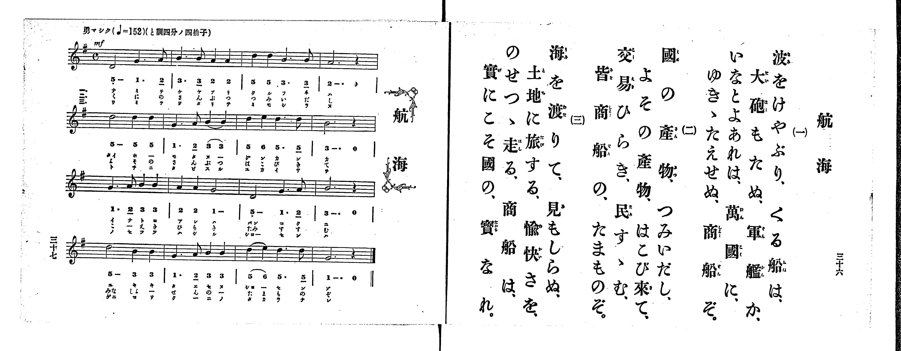

# 航海

> Re:Shoka 使用 AI 協助辨識與重建樂譜，可能會有錯誤。歡迎回報。

<audio controls src="kokai.mp3"></audio>

- 出處：共益商社樂器店《唱歌教科書 生徒用 巻一》第三十六～三十七頁（第十八曲）
- NDL Digital Collections PID 854862（https://dl.ndl.go.jp/pid/854862）掃描 P020.jpg

## 說明

原書資訊與歌詞全文（NDL PID 854862《唱歌教科書 生徒用 巻一》第三十六～三十七頁，掃描 P020.jpg）：
調性與拍號：と調四分ノ四拍子（G 大調 4/4 拍），♩=152，「勇マシク」
註記：第三學期第四曲（全卷第十八曲）。全曲十六小節，分節歌，三節同一旋律（譜下配字一、三節印片假名，二節印平假名）。開頭標 mf。第六小節後二音「3 3」、第七小節後二音「5. 5_」、第十五小節前二音「5 6」印有圓滑線。第十五～十六小節第三節譜下配字誤植為「ターカラ｜レ」（漏「ナ」字），右頁歌詞作「寶なれ。」。五線譜與簡譜一致。

## 歌詞

```text
一、
波をけやぶり、くる船は、
大砲もたぬ、軍艦か、
いなとよあれは、萬國に、
ゆきゝたえせぬ、商船ぞ。

二、
國の産物、つみいだし、
よその産物、はこび來て、
交易ひらき、民すゝむ、
皆商船の、たまものぞ。

三、
海を渡りて、見もしらぬ、
土地に旅する、愉快さを、
のせつゝ走る、商船は、
實にこそ國の、寶なれ。
```

## ABC

```abc
X:1
T:航海
M:4/4
L:1/16
Q:1/4=152
K:G
V:V1 name="Piano" snm="Pia"
[V:V1]
!mf! D8 G6 A2 | B6 B2 A4 A4 | d4 d4 B6 B2 | A12 z4 |
d8 d4 d4 | G6 A2 B4 B4 | d4 e4 d6 d2 | B12 z4 |
G6 A2 B4 B4 | A4 A4 G8 | D8 G6 A2 | B12 z4 |
d8 B4 B4 | G6 A2 B4 B4 | d4 e4 d6 d2 | G12 z4 |
```

## TMD 檔案連結

- [主旋律 TMD 檔案](kokai.tmd) [[在 TMD Studio 編輯](https://tmdlang.github.io/Tmd-TS/#tmd=s7IKdvYPcrWy4qpTUCpJTLdSSM7PyUlNLsnMz7PKrsxPzc6ML87Iz05Ugisoy88pzU21yk7MizeMtzA1sTAzQkgW55cWJadaFSdn5OfnxJekVpQk5edno8vHFySmp1oFGBgZIGQKivLLUvMS84C6C4oy80pSU8DaEQpSyzJTUkHSxclAq8tSizLTMlNTkNyVWlQMcjXUipKixLzi5KLMApBXEKrSU_OKUq2SMzJzUopS8-KL8_PSEZJp-UW5VsUlRfkFGZnJCOGSjFSgh8sTS1KL0AXBthTkFyG5Ey5RlpqjxKWlpfCiY9WzrdsVtLS4FG0VDE2NuOxtFdy5bEz0TexAmp6273oxc-r7PbOetm58Prvr6dS250v2PVvR9HTmiqe7pj9u6Ho6ZeOztT3Pps58vnzis9k7FJ5Pmf9036TnU1YoPN2--8mOhscN3c_XrHmyo_Npb-PT1rXv986DsJ_saH65oPH9ng6gLFhq9bPZm97v6QQ71c_FR8ElMz2zJDFHwRke5cUKAZ4uCpBIBWrMKCkpKLbS10_J0csD4vR8vawC_YLMFH2Yis5nfc3P-vsVQFEJlAMGJZe-loIttQCXgoLC0775QE-_2Nz-YkXXi452YEi8WDnvaeuKZ9PagS4EeQPhZCoEVg-aj4B-BEYNyCEvVu1_1rAc5ITu3hcz5wNFHzeuAAo-nT37aUfb4-Y-IAMo9XTtBKC73BWeLlkOlFQAxrICUBRsTM-jmSttgQkAyHrc0PO0u_1x87zHTdsfN61_3NALtmLF7hcrZgBNhjpx7Y5nc-aDYg9oMijqOoD-ftq7HS0-Hzc0gcJj9iaIl55u6H--vgFoB9BVQAYwNIBsoGlA9tMJQEbDs-ndT_d1A017sXbOkx3dL1uBbp4ODhpgKICV9W543tn-tLH96QSgw3ue7OqBCD7duRkmCLL05bTulwvWPlsxUyE3DcgFuQpm-9N9IF0v528G-tNYwRjoPaDhYE81Yyow1VMwjYcrAcXFrilQVZ29CFUKZkA1QFc8m9P5dM7kZ7snPt8-C2otWAswKpEDABKEQAayL1-sWvJsSe_zpl1AAx837X_cvOdx0-rHzSvf753zuHkN0HxgqDzb0w-Sbe4CWbd2OiTmnvZvBiYPSOJ7AlQMjL712x43rnrcBIzKJrDjm4BuADoJaB0wjTzfsBBsb8OL9i1AKS5Q7EKCGMR6tnnR46ZJjxsnPm5qedy47XET0K7Gx439j5u6X3TsfNwITA9gdcA09HzBpsdNTY8b5z9uBLqv8cXu3hedyx43dkNVPG4EGrAKmBAfN3U8bmwCOQes-8WENU_ndD9uXA1T19T2uLH3cdNcsElApbMh5gFLG7CN8-CO3AX0EMRykP51z6csft65Euy8JY8b94PtW_C4EVguQc0FmgU0FFnd-seNkx83bn6yD2jlMqi6J7uWPJsBFAV6phPkkIbGZxsmPm6cCXJREyxYns9qg7lnHdgkoFP3gX2_DtmFO4CJDxKMW4F5Z9KzHQtBAQi26sWybrD66WBrQB6E-GT-0zkbgIHxbHor2E5Q6D1r6Xy6f_XjxqmgmIAFJtAeYMAsAbrqxdYNEHUwF8HjZD0w-IH6gJ6ZCwkikCKkxABSRHnRBwUKWvpcXN7A-jfTKiAzMS_focagRqEaZIWCjYWWHZhRnZtWC2YAi15gsgXi-UC8SaEGGDsbgawlQDwNiFeBRdYDWauBeCoQ94JEmvtBloD01wDzoYIuGBqCSSOgkDGYZQxkg_i6IEVAEoRhMjVgcRg0AKmBO6dpPxCDHDAbiPeArVsEEW3ugYk0bQCyNgNpkLM2g0VWIzkJai7M1hq420D2gzBEjRlUHkTCXI3VRSDXgAKpA4hXgG0Duqh5DTggQO6bAHEMCK8HC3QjHINpNSxYIDJgx-AKQ2yuaV4GtGYtGINcAgqtFUC8Gxw-IJHtj5uXgwMKIggJnn2YwYNwETHBA3MtwkG1XFy6dgrglKYAZChzAQA)]

## 分析

```text
================================================================================
📊 TMD Song Profile: [ 航海 ]
================================================================================
⏱  Duration:       0:25 (25.3s), 16 measures total
🎼 Key & Tempo:    首調基準 G, != 152.0 BPM, <4/4>
   - 分析範圍：      由實際發聲的音符與和弦推測調性；播放脈絡另行呈現
🎤 人聲音域:    D4 (MIDI 62) – E5 (MIDI 76) [跨度: 14 個半音 / 1.2 個八度, 難度: moderate]
   - 最低音:  D4 in [Kokai #1 @ m.1, 0:00]
   - 最高音: E5 in [Kokai #1 @ m.7, 0:09]
   - 適合: soprano, mezzo-soprano, contralto, tenor, baritone, bass
🏛  結構:      Kokai (25.3s)
⚡ 編曲密度:        Peak 1 軌道同時演奏
🗝  調性診斷：       B 調性不明確（純淨自然大調，未偵測到可信轉調）
   - 風格氣質:    純淨自然大調（陽光明朗、易唱易記，無明顯調外色彩）
   - 轉調歷程:    全曲維持單一推測調性（未偵測到可信轉調）
   - 核心骨幹音:  D, B, G, A, E
   - 調性數值:    B 調性不明確 [相關度: 0.78, 穩定度: Ambiguous, 自然音純度: 100.0%]
   - 候選調性 (K-S): B 小調 (0.78), G 大調 (0.78), D 大調 (0.73)
   - 五度圈歷程:   +5
   - 各段落調性細節:
     • [Kokai #1]: B 調性不明確 (r: 0.78, 自然音純度: 100.0%)

  [ 五度圈游移軌跡 ]
               C  
         F            G  
      Bb               D  
      Eb               A  
         Ab           E  
            Db      [B ]*
               F# 
     (* = active key center)

  [ 十二半音累積音高分佈 ]
     C  :                            0.0%
     C# :                            0.0%
     D  : ████████████████████████  30.0%
     D# :                            0.0%
     E  : ███                        3.3%
     F  :                            0.0%
     F# :                            0.0%
     G  : █████████████████         20.8%
     G# :                            0.0%
     A  : █████████████             15.8%
     A# :                            0.0%
     B  : ████████████████████████  30.0%
--------------------------------------------------------------------------------
Assignment 軌道音域：
  - Piano         : D4 – E5 (14 個半音 / 1.2 個八度, 47 個音符)
================================================================================
```


## 原書掃描頁




