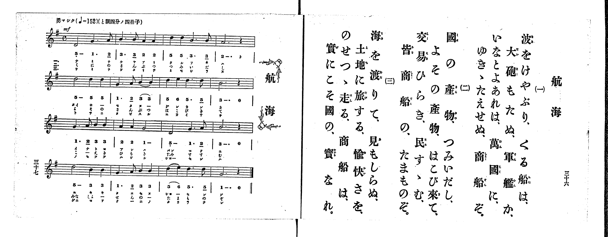

# 航海

> Re:Shōka 使用 AI 協助辨識與重建樂譜，可能會有錯誤。歡迎回報。

- **鋼琴伴奏版**：<br><audio controls src="kokai.mp3"></audio>
- **NEUTRINO 歌聲合成版**：<br><audio controls src="kokai_neutrino.mp3"></audio>

- 出處：共益商社樂器店《唱歌教科書 生徒用 巻一》第三十六～三十七頁（第十八曲）
- NDL Digital Collections PID 854862（https://dl.ndl.go.jp/pid/854862）掃描 P020.jpg

## 說明

原書資訊與歌詞全文（NDL PID 854862《唱歌教科書 生徒用 巻一》第三十六～三十七頁，掃描 P020.jpg）：
調性與拍號：と調四分ノ四拍子（G 大調 4/4 拍），♩=152，「勇マシク」
註記：第三學期第四曲（全卷第十八曲）。全曲十六小節，分節歌，三節同一旋律（譜下配字一、三節印片假名，二節印平假名）。開頭標 mf。第六小節後二音「3 3」、第七小節後二音「5. 5_」、第十五小節前二音「5 6」印有圓滑線。第十五～十六小節第三節譜下配字誤植為「ターカラ｜レ」（漏「ナ」字），右頁歌詞作「寶なれ。」。五線譜與簡譜一致。


## 歌詞

```text
一、
波をけやぶり、くる船は、
大砲もたぬ、軍艦か、
いなとよあれは、萬國に、
ゆきゝたえせぬ、商船ぞ。

二、
國の産物、つみいだし、
よその産物、はこび來て、
交易ひらき、民すゝむ、
皆商船の、たまものぞ。

三、
海を渡りて、見もしらぬ、
土地に旅する、愉快さを、
のせつゝ走る、商船は、
實にこそ國の、寶なれ。
```

## ABC

<div class="abc-score" data-abc-src="kokai.abc" aria-label="五線譜載入中"></div>

[下載 ABC 原始檔](kokai.abc)

## TMD 檔案連結

- [主旋律 TMD 檔案](kokai.tmd) [[在 TMD Studio 編輯](https://tmdlang.github.io/Tmd-TS/#tmd=s7IKdvYPcrWy4qpTUCpJTLdSSM7PyUlNLsnMz7PKrsxPzc6ML87Iz05Ugisoy88pzU21yk7MizeMtzA1sTAzQkgW55cWJadaFSdn5OfnxJekVpQk5edno8vHFySmp1oFGBgZIGQKivLLUvMS84C6C4oy80pSU8DaEQpSyzJTUkHSxclAq8tSizLTMlNTkNyVWlQMcjXUipKixLzi5KLMApBXEKrSU_OKUq2SMzJzUopS8-KL8_PSEZJp-UW5VsUlRfkFGZnJCOGSjFSgh8sTS1KL0AXBthTkFyG5Ey5RlpqDEM0vykzPzLPKTc3MysQSLkATMvLTixILMiqtMjKLS4DKkxNz4oGBDAx5LS2FFx2rnm3drqClxaVoq2BoasRlb6vgzmVjom9iBzLjafuuFzOnvt8z62nrxuezu55ObXu-ZN-zFU1PZ654umv644aup1M2Plvb82zqzOfLJz6bvUPh-ZT5T_dNej5lhcLT7buf7Gh43ND9fM2aJzs6n_Y2Pm1d-37vPAj7yY7mlwsa3-_pAMqCpVY_m73p_Z5OsMv9XHwUXIDeKknMUXCGJ5tihQBPFwVIwgBqzCgpKSi20tdPydHLA-L0fL2sAv2CzBR9mIrOZ33Nz_r7FUDJASgHjA4ufS0FW2oBLgUFhad984GefrG5_cWKrhcd7cCQeLFy3tPWFc-mtQNdCPIGwslUCKweNB8B_QiMGpBDXqza_6xhOcgJ3b0vZs4Hij5uXAEUfDp79tOOtsfNfUAGUOrp2glAd7krPF2yHCipAIxlBaAo2JieRzNX2gITAJD1uKHnaXf74-Z5j5u2P25a_7ihF2zFit0vVswAmgx14todz-bMB8Ue0GRQ1HUA_f20dztafD5uaAKFx-xNEC893dD_fH0D0A6gq4AMYGgA2UDTgOynE4CMhmfTu5_u6waa9mLtnCc7ul-2At08HRw0wFAAK-vd8Lyz_Wlj-9MJQIf3PNnVAxF8unMzTBBk6ctp3S8XrH22YqZCbhqQC3IVzPan-0C6Xs7fDPSnsYIx0HtAw8GeasZUYKqnYBoPVwKKi11ToKo6exGqFMyAaoCueDan8-mcyc92T3y-fRbUWrAWYFQiBwAkCIEMZF--WLXk2ZLe5027gAY-btr_uHnP46bVj5tXvt8753HzGqD5wFB5tqcfJNvcBbJu7XRIzD3t3wxMHpDE9wSoGBh967c9blz1uAkYlU1gxzcB3QB0EtA6YBp5vmEh2N6GF-1bgFJcoNiFBDGI9WzzosdNkx43Tnzc1PK4cdvjJqBdjY8b-x83db_o2Pm4EZgewOqAaej5gk2Pm5oeN85_3Ah0X-OL3b0vOpc9buyGqnjcCDRgFTAhPm7qeNzYBHIOWPeLCWuezul-3Lgapq6p7XFj7-OmuWCTgEpnQ8wDljZgG-fBHbkL6CGI5SD9655PWfy8cyXYeUseN-4H27fgcSOwXIKaCzQLaCiyuvWPGyc_btz8ZB_QymVQdU92LXk2AygK9EwnyCENjc82THzcOBPkoiZYsDyf1QZzzzqwSUCn7gP7fh2yC3cAEx8kGLcC886kZzsWggIQbNWLZd1g9dPB1oA8CPHJ_KdzNgAD49n0VrCdoNB71tL5dP_qx41TQTEBC0ygPcCAWQJ01YutGyDqYC6Cx8l6YPAD9QE9MxcSRCBFSIkBpIjyog8KFLT0ubi8gXV4plVAZmJevkONQU01yAYFGwstOzCjOjetFswAlrzAVAvE84F4k0INMHI2AllLgHgaEK8Ci6wHslYD8VQg7gWJNPeD7ADprwFmQwVdMDQEk0ZAIWMwyxjIBvF1QYqAJAjDZGrA4jBoAFIDNs7HEGh64yqoODDtQOimSSBbGydCeS1A9jYwqwtsOjAXgHndYD1boXrXgmXWI9kDcinUHiOYLoja1VB6HVjPVKg9k2H2NC6B2gOiIa4CJmqongVgmenY7TEGybVh908TxH5gkoX6BJgeofaAbWhqAotBTAYmTrDMGqz2gKKxaT8QgyJuNhDvAUfTIohocw9MpGkDkLUZSIOiczNYZDVSVELNhcVWDTxOQfEGwhA1ZlB5EAmLbewxCcyMkGACeWQ3lAWyFeQ1qNfhXgJpmAANeJAcKDohPJAMhIc1Ips64HbMBZProKbhjkhQsgDmRzC5GaoXnLTBUYArIlfA7VkIJkHJBuxNqCgwZBtngm0EuRbkMlDUQ9yOSDBTwTKTsNoDjkhQJILyZAcQrwArBkZk8xpwvgNF6wRIHILwerBANyIOMWMMlgshMuA4xJVlsUcizN2roCEACW-QDDiBNvWAZWEZDSQOLAZBQQvRBmGBchtICpLTsEYjVCVILcgCUIRAjNsEtqYTLgazBpi6IBkKJAEKdwgNCrAG7NaAYxGUOkAqgfkEmqFRUwUow0FiEGYRsGpoh1s0G0JDkyX28gVcrC4DKloLxiAXgXLnCiDeDc6PIJHtj5uXgzMmRBCSHfdhZkdEVBKTHWHRjCUmwakR4glQMCICGJZ-gQkO7D1IniTg83nYgxgck8A6H1GII5kBkkOYApGGZVaQI4B1N1gOVjxAymMcNoEjE9gigiUpWH4GlQGYxTu6ReA8CU5UkLQNCh9QSka1qJaLS9dOAVyZKgAZylwA)]
- [鋼琴伴奏 TMD 檔案](kokai_piano.tmd) [[在 TMD Studio 編輯](https://tmdlang.github.io/Tmd-TS/#tmd=s7IKdvYPcrWy4qpTUCpJTLdSyC8qychPL0osyKi0ysgsLskvykxOzInPTsxLVOLS0lJ40bHq2dbt7_d0vOze83zClid7tjxd2v-8s-P9nk4FLS0uRVsFQ1MjLntbBXcuGxN9EzuQwU_bd72YOfX9nllPWzc-n931dGrb8yX7nq1oejpzxdNd0x83dD2dsvHZ2p5nU2c-Xz7x2ewdCs-nzH-6b9LzKSsUnm7f_WRHw-OG7udr1jzZ0fm0t_Fp69r3e-dB2E92NL9c0Ah0DFAWLLX62exNQJcogWz1c_FRcMlMzyxJzFFwzs_JSU0uyczPK1YI8HRRsDA1sTAzAmrMKCkpKLbS10_J0csD4vR8vawC_YLMFH2Yis5nfc3P-vsVAgyMDIBy6UpcXN752YmZVgGZiXn5QR4ONQY11VwKQGBjoWUHZlTnptWCGfpaCo-bu4B4PhBvUqhReNy0EchaAsTTgHgVWGQ9kLUaiKcCcS9IpLlfQUsfrL9GwTReQRcMDcGkEVDIGMwyBrJBfF2QIiAJwjCZGrA4DBqA1ICN8zEEmt64Cir-uHE_hG6aBLK1cSKU1wJkbwOzusCmP27sB_O6wXq2QvWuBcusR7IH5FKoPUYwXRC1q6H0OrCeqVB7JsPsaVwCtQdEQ1z1uLEFqmcBWGY6dnuMQXJt2P3TBLH_cSMw7ME-edy4DGoP2IamJrAYxOTHTZ1gmTVY7QFFY9N-IAZF3Gwg3gOOpkUQ0eYemEjTBiBrM5AGRedmsMhqpKiEmguLrRp4nILiDYQhasyg8iASFtvYY3I-LJhAHtkNZYFsBXkN6nW4l0AaJkADHiQHik4IDyQD4WGNyKYOuB1zweQ6qGm4IxKULB43QuzZDNULTtrgKMAVkSvg9iwEk6BkA_YmVBQYso0zwTaCXAtyGSjqIW5HJJipYJlJWO0BRyQoEkF5sgOIV4AVAyOyeQ0434GidQIkDkF4PVigGxGHmDEGy4UQGXAc4sqy2CMR5u5V0BCAhDdIBpxAm3rAsrCMBhLfAIlCiDYIC5TbQFKQnIY1GqEqQWpBFoAiBGLcJrA1nXAxmDXA1AXJUCAJULhDaFCANWC3BhyLoNQBUgnMJ9AMjZoqQBkOEoMwi6Y_bmqHWzQbQkOTJfbyBVysLgMqWgvGIBeBcucKIN4Nzo8gke2Pm5eDMyZEEJId92FmR0RUEpMdYdGMJSbBqRHiCVAwIgIYln6BCQ7sPUieJODzediDGByT-5ELcSQzQHIIUyDSsMwKcsTjxn1gOVjxACmPcdgEjsxJiCQFy8-gMgCzeEe3CJwnwYkKkrZB4QNKyagW1aLUpT7IdakJtC4FxvWLvq6X7b1PW3e8nN0KaW4gZch4hWjDWGCeA9Km8bFAESxiqGqhFEglXAkpamFiUJUmQK4Jiko0vfCaHE0_MfZj8xeaudRxqQEkNnTtFMAREu0DFEZwjJA5xmCOMhcA)]

## 分析

```text
================================================================================
📊 TMD Song Profile: [ 航海 ]
================================================================================
⏱  Duration:       0:25 (25.3s), 16 measures total
🎼 Key & Tempo:    首調基準 G, != 152.0 BPM, <4/4>
   - 分析範圍：      由實際發聲的音符與和弦推測調性；播放脈絡另行呈現
🎤 人聲音域:    D4 (MIDI 62) – E5 (MIDI 76) [跨度: 14 個半音 / 1.2 個八度, 難度: moderate]
   - 最低音:  D4 in [Kokai #1 @ m.1, 0:00]
   - 最高音: E5 in [Kokai #1 @ m.7, 0:09]
   - 適合: soprano, mezzo-soprano, contralto, tenor, baritone, bass
🏛  結構:      Kokai (25.3s)
⚡ 編曲密度:        Peak 1 軌道同時演奏
🗝  調性診斷：       B 調性不明確（純淨自然大調，未偵測到可信轉調）
   - 風格氣質:    純淨自然大調（陽光明朗、易唱易記，無明顯調外色彩）
   - 轉調歷程:    全曲維持單一推測調性（未偵測到可信轉調）
   - 核心骨幹音:  D, B, G, A, E
   - 調性數值:    B 調性不明確 [相關度: 0.78, 穩定度: Ambiguous, 自然音純度: 100.0%]
   - 候選調性 (K-S): B 小調 (0.78), G 大調 (0.78), D 大調 (0.73)
   - 五度圈歷程:   +5
   - 各段落調性細節:
     • [Kokai #1]: B 調性不明確 (r: 0.78, 自然音純度: 100.0%)

  [ 五度圈游移軌跡 ]
               C  
         F            G  
      Bb               D  
      Eb               A  
         Ab           E  
            Db      [B ]*
               F# 
     (* = active key center)

  [ 十二半音累積音高分佈 ]
     C  :                            0.0%
     C# :                            0.0%
     D  : ████████████████████████  30.0%
     D# :                            0.0%
     E  : ███                        3.3%
     F  :                            0.0%
     F# :                            0.0%
     G  : █████████████████         20.8%
     G# :                            0.0%
     A  : █████████████             15.8%
     A# :                            0.0%
     B  : ████████████████████████  30.0%
--------------------------------------------------------------------------------
Assignment 軌道音域：
  - Piano         : D4 – E5 (14 個半音 / 1.2 個八度, 47 個音符)
================================================================================
```


## 原書掃描頁




